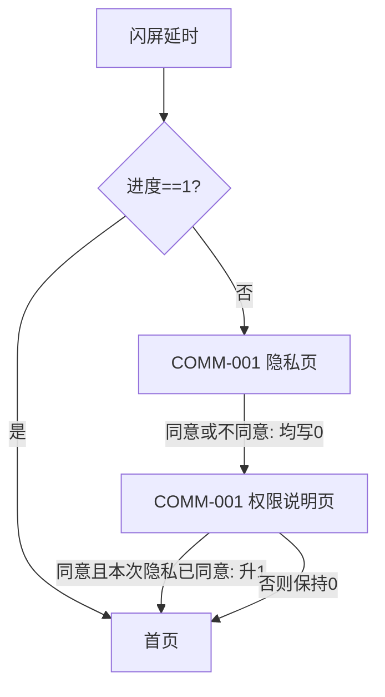
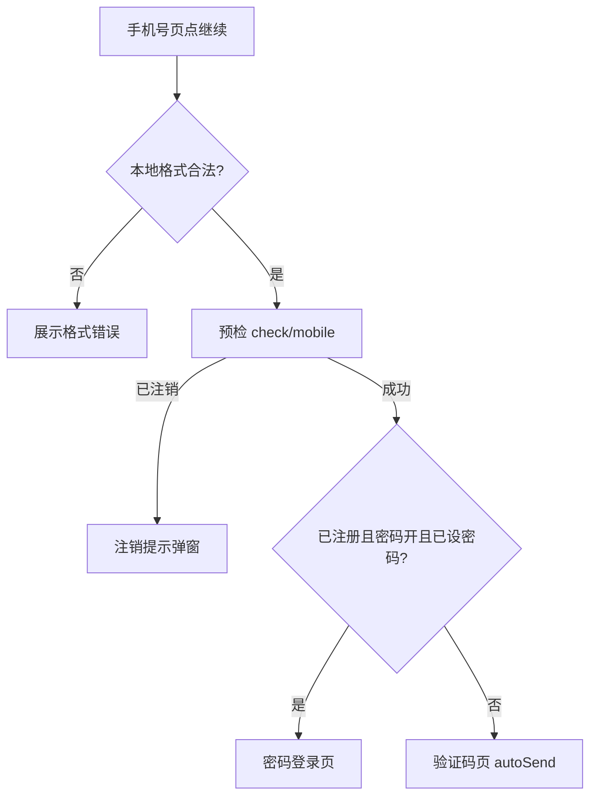

# AR Android 端需求文档

## 目录

- [公共说明](#public)
  - [全局基础信息](#public-00-md)
  - [公共错误与文案规则](#public-errors)
  - [绑卡表单共用规则](#public-bankcard)
  - [风控上报共用规则](#public-risk)
  - [API 全局约定](#public-api)
- [COMM-001 隐私政策与权限说明](#comm-001)
- [COMM-002 启动及业务节点权限申请](#comm-002)
- [AND-001 启动流程](#and-001)
- [AND-002 风控数据采集上传与等待页](#and-002)
- [AND-003 注册登录与验证码](#and-003)
- [AND-004 登录态、单点登录和白名单限制](#and-004)
- [AND-005 全局加载、Toast 与表单错误样式](#and-005)
- [AND-006 网络异常处理](#and-006)
- [AND-007 版本更新弹窗](#and-007)
- [AND-008 客服联系方式与系统应用唤起](#and-008)
- [AND-009 KYC 流程编排与退出挽留](#and-009)
- [AND-010 KYC 基础信息填写](#and-010)
- [AND-011 KYC 紧急联系人](#and-011)
- [AND-012 身份证拍摄、相册选择与 OCR 回填](#and-012)
- [AND-013 KYC 收款账户与电子钱包录入](#and-013)
- [AND-014 人脸活体与证件照比对](#and-014)
- [AND-015 首页、底部导航与订单助手](#and-015)
- [AND-016 额度计算等待与产品引导](#and-016)
- [AND-017 额度确认页](#and-017)
- [AND-018 提单前权限、数据和人脸强卡](#and-018)
- [AND-019 倒计时锁定组与自动申请](#and-019)
- [AND-020 提交结果与应用内评价引导](#and-020)
- [AND-021 各订单状态详情](#and-021)
- [AND-022 单订单还款页](#and-022)
- [AND-023 支付方式选择与第三方 H5](#and-023)
- [AND-024 个人中心主页](#and-024)
- [AND-025 收款账户列表、添加与删除](#and-025)
- [AND-026 意见反馈](#and-026)
- [AND-027 设置、清除缓存与退出登录](#and-027)
- [AND-028 账号注销及重新登录限制](#and-028)
- [AND-029 关于我们及联系入口](#and-029)
- [AND-030 SDK 与埋点](#and-030)
- [接口附录（99 条）](#api-appendix)
- [统一待确认清单](#pending)


<a id="source-basis"></a>
## 来源与依据

- **唯一实现依据**：本文档 + 《AR_Android测试用例》+《AR_Android页面用途说明》。三者冲突时以本文档为准。
- **已并入本文的来源文档**（其内容已是本文「公共说明」的正式副本，不再单独引用）：
  - `00-基础信息清单.md` → 公共说明：全局基础信息
  - `特殊错误-UI定义.md` → 公共说明：公共错误与文案规则
  - `绑卡表单共用.md` → 公共说明：绑卡表单共用规则
  - `风控上报共用.md` → 公共说明：风控上报共用规则
- **仅留档、不作为实现依据**：`ar(阿根廷)/` 目录下的其余文档（含 `AGENT实现约定.md`、`UI链接扫描规则.md`、`modules-index.md`、`09-SDK与埋点.md` 及各模块源文档）。正文中标注「留档：ar(阿根廷)/…」的位置仅用于追溯，实现细节以本文档对应条款为准。

<a id="public"></a>

## 公共说明

本节收录全模块共用信息、公共错误、绑卡表单和风控上报规则，以及全局基础信息与 API 约定。需求条目只引用本节，不重复复制同一套公共规则。

<a id="public-00-md"></a>
### 公共说明：全局基础信息

> 内容已并入本文；原文档留档：ar(阿根廷)/00-基础信息清单.md

<a id="public-market"></a>
#### 1. 市场与本地化

| 项 | 取值 | 说明 |
| --- | --- | --- |
| 目标国家 / 市场 | 阿根廷（AR） |  |
| 展示语言 | es（西语） | strings 以西语为准 |
| 货币展示 | **待填**（常见 ARS / `$`） | 金额 UI；以后台/产品为准 |
| 时区 | `America/Argentina/Buenos_Aires` | 设备时区为主时可忽略 |

---

<a id="public-form"></a>
#### 2. 表单 / 区域规则

> 左列是业务**含义**，不是代码字段名。实现时自定标识符。

| 含义 | 取值 |
| --- | --- |
| 国际区号 | `"54"`（UI 展示 `+54`） |
| 本地手机号位数 | `10`（不含区号） |
| 本地号 UI 展示分组 | **2-4-4**（仅展示；见 §2.1） |
| 区号+本地总长 | `12` |
| 本地号校验 | 正则 `^\d{10}$`（恰好 10 位数字，无强制首位） |
| 银行卡号（CBU/CVU） | 最短 `6` / 最长 `22` |
| Alias 长度 | 最短 `6` / 最长 `22` |
| 线下授权码最大长 | `30` |
| OTP 位数 | `4` |
| 图形验证码位数 | `4` |
| 登录密码位数 | `4` |
| 交易密码位数 | `4` |
| DNI 长度 | 必须恰好 `8` 位；`7` 位按格式错误处理，不自动补 0，也不另作补 0 提示 |
| CUIL/CUIT 长度 | `11` |
| 姓名最大长 | `60` |
| 邮箱最大长 | `60` |
| 详细地址最大长 | `100` |
| 风控上报倒计时（秒） | `35` |
| 全局 Loading 强制释放（秒） | `70` |
| 风控明文 JSON 的 XOR 偏移 | **由本包业务后台提供后写入工程** |
| 风控短信关键字 / applist 优先包名 | **由风控提供后写入工程**；不是字典接口、不是每次上报拉取 |
| 风控短信时间窗（天） / 短信最多条数 | **由风控提供后写入工程** |
| 风控 applist 条数上限 | **由风控提供后写入工程** |
| 邮编长度 | 不启用 |

##### 2.1 衍生校验规则

- UI 区号展示：`+54`。  
- 本地号：恰好 10 位数字；长度不符 → 格式错误，**不调**预检等接口。  
- **本地号 UI 展示分组（硬规则，AR）：2-4-4**。例：`1123456789` → 展示 `11 2345 6789`。空格**只在展示层**；内存 / 校验 / 加密上送 / 草稿一律为**连续 10 位数字**（输入过滤掉空格与非数字）。实现前若确认稿另有分组，以确认稿为准并回改本节；未确认前按 2-4-4。  
- 输入若带区号前缀 `54`，按总长 `12` 判断；去区号时去掉前缀 `"54"`。  
- OTP / 登录密码 / 交易密码 / 图形码：以对应位数满格为可提交条件（各模块 UE 另有细则）。  
- DNI：必须恰好 8 位；其它长度均格式错误，不自动改写输入。
- **全局 Loading 强制释放**：从 Loading **开始显示**起算，满 §2「全局 Loading 强制释放（秒）」仍未因业务结束而关闭 → **强制关掉**，防止永久遮挡。与风控上报 35 秒进度窗无关；全工程共用此值，模块正文只引用、不另写死秒数。

---

<a id="public-h5"></a>
#### 3. H5 路径

> `webBaseUrl` 以本包环境配置为准；路径段按本包品牌填写。

| 含义 | 取值 |
| --- | --- |
| 隐私政策 | `{webBaseUrl}` + **待填**路径（01 隐私页 WebView 必填） |
| 用户协议 | `{webBaseUrl}` + **待填**路径 |
| FAQ | `{webBaseUrl}` + **待填**路径 |

---

<a id="public-identity"></a>
#### 4. 请求身份 / 业务线

| 含义 | 取值 |
| --- | --- |
| 接口业务 path 前缀 | **待填**（与本包后台一致） |
| 上报/渠道包展示名 | **待填**（本包品牌；公共头「壳包名」取此值） |
| 马甲/渠道 | **待填** |
| 业务线 | **待填**（与本包后台 AR 业务线一致；公共头「业务线」取此值） |
| 业务国家 | **待填**（与本包后台 AR 一致；公共头 `o_bizCountry` 取此值） |
| 国家码 | **待填**（与本包后台一致；公共头 `o_nationCode` 取此值） |
| 请求渠道 | **待填**（常见 Android App；公共头 `o_reqChannel` 取此值，勿与「马甲/渠道」混用） |
| AppsFlyer Dev Key | **待填**（本包 AF 控制台；未填禁止用其它 App 的 key 顶上）。用法见留档：ar(阿根廷)/09-SDK与埋点.md |

须与本包后台约定一致，并与其它市场上架包区分。

##### 4.1 公共请求头

> 全站业务请求统一带下列头（工程拦截器一次组装）。各模块正文**不重复**列头。  
> **取值已在上文 §4 / §1 / §6 的，此处只写来源，不再单独赋值。**  
> Header key：实现时以本包 API 文档「全局请求头」为准查真实字面量；文档阶段用 `o_xxx` 语义。

| 业务含义 | o_ 语义 | 本包 Header key | 取值来源 |
| --- | --- | --- | --- |
| 语言 | `o_Accept-Language` | **待填** | §1 展示语言（`es`） |
| 身份凭证 | `o_t` | **待填** | §6 会话 token；空则**不上送**该头 |
| 用户标识 | `o_u` | **待填** | §6 会话 userId；空则**不上送**该头 |
| 壳包名 | `o_b` | **待填** | **§4 · 上报/渠道包展示名**（不另填） |
| 业务线 | `o_prodLine` | **待填** | **§4 · 业务线**（不另填） |
| 业务国家 | `o_bizCountry` | **待填** | **§4 · 业务国家**（不另填） |
| 国家码 | `o_nationCode` | **待填** | **§4 · 国家码**（不另填） |
| 请求渠道 | `o_reqChannel` | **待填** | **§4 · 请求渠道**（不另填） |
| App 版本 | `o_version` | **待填** | 应用 `versionName`（构建产物，非 §4 配置项） |
| 设备 id | `o_androidId` | **待填** | §6 本包统一设备 id |
| AppsFlyer id | `o_afId` | **待填** | §6 AppsFlyer UID；空串规则见留档：ar(阿根廷)/09-SDK与埋点.md |
| 广告 id | `o_googleId` | **待填** | 运行时广告 id；未取到可上送空串，头仍带 |

说明：

1. 上表「本包 Header key」未填前：可搭拦截器骨架，**禁止**臆造 key 入库；以本包 API 文档为准。  
2. `Content-Type: application/json` 由 HTTP 客户端默认处理，不进身份配置表。  
3. 某接口若另有专用头，写在该模块正文；不得塞进本表当公共头。

---

<a id="public-crypto"></a>
#### 5. 加密

| 含义 | 说明 |
| --- | --- |
| 手机号 / 登录密码 / 交易密码上送 | RSA 加密；公钥联系本包后台 |
| 风控上报 `data` | 明文 JSON 字符串按字符 XOR；偏移由后台提供后写入工程，见 §2 |

---

<a id="public-persist"></a>
#### 6. 本地持久化职责（防重复键）

这里列的是**职责槽**，不是 SP/MMKV/DataStore 的真实 key 字符串。实现者自定符号，但 **同一职责全工程只允许一套读写**，禁止每个模块再声明一份常量。

| 职责槽 | 值语义 | 谁写 | 谁读 | 首次实现 |
| --- | --- | --- | --- | --- |
| 合规进度 | `Int`：`0` = 未全部同意 / `1` = 全部同意（两态口径见 COMM-001） | 01 隐私/权限说明页 | 01 冷启分流；03 主按钮门禁 | 01 |
| 会话 token | 非空字符串=已登录 | 02 登录/注册成功；失效时清空 | 任意需登录判断的模块；03 首页场景 | 02 |
| 会话 userId | 服务端用户标识 | 02 成功 | 请求头/业务入参需要时 | 02 |
| 会话手机号 | 本地号或模块约定格式 | 02 成功 | 展示脱敏、预填 | 02 |
| 授信步骤 | 本地走到哪一步：`0..4`，见 04 | 04 各资料页 | 03 虚拟首页主按钮兜底；04 恢复 | 04（03 只读） |
| 授信 OCR 开关 | 最近一次成功返回的 `o_isNeedOcr`；全局槽，不按 userId 隔离 | 03 入口、04 联系人提交前 | 03/04 分流与字段归属 | 03/04 共用 |
| 授信个人资料草稿 | OCR 关路径的姓名、性别、证件、生日、邮箱、备用手机号 | 04 个人资料页 | 04 回填与聚合提交 | 04 |
| 授信工作资料草稿 | 工作/居住字段；OCR 开时还含邮箱、备用手机号 | 04 工作资料页 | 04 回填与聚合提交 | 04 |
| 授信联系人草稿 | 两名联系人姓名、手机号、关系；不持久化错误态 | 04 联系人页 | 04 回填与聚合提交 | 04 |
| 身份表单草稿 | 证件/OCR 表单、图片槽成功态、服务端 URL、可恢复本地预览路径（若有）、`o_applyId`（有则存）；**与 PI/Job/联系人同级必做落盘**，按 userId 隔离 | 04 证件页（进展及时写；返回前必须写） | 04 `step=3` 回填；03 在 credit=8 时清空；重拍不读 | 04 |
| 本包统一设备 id | 非空字符串；冷启首次生成后不变 | 01 冷启（尚无则生成） | 风控四槽；请求头需要时；AF UID 回退 | 01 |
| AppsFlyer UID | SDK 返回的非空 UID；空表示尚未取到 | 09 冷启读取成功时 | 公共头 `o_afId`、注册/首页/风控 `o_appsflyerId` | 09 |


后续模块要落本地值：先查本表有没有同职责；有则引用，禁止新槽。没有则**先改本表再实现**，不要只写在模块正文里让下一波次看不见。

实现约定：本波次若工程里已有该职责的存储，只调用既有读写，不得再新增平行 key。真实常量名按本工程风格自定。授信步骤和四类草稿按 userId 隔离；OCR 开关为全局槽。除状态 8 清证件草稿外，授信流程不主动清理上述草稿。**身份表单草稿不得做成「可选项」或仅内存态**；缺读写 = 04 未完成（详见 04 §1.11 / §3）。

---

<a id="public-errors"></a>
### 公共说明：公共错误与文案规则

> 内容已并入本文；原文档留档：ar(阿根廷)/特殊错误-UI定义.md


> **给谁看：** UI / 设计稿 / 文案确认。用来在稿面上体现「字段下红字、专用提示」等错误态；**顺带汇总须确认西语的本地门禁 Toast**（不算特殊错误，但文案仍要定稿）。  
> **不改业务细则：** 各模块正文（`02`/`04`/`绑卡表单共用` 等）仍写校验规则与挂点；**定义与跨模块清单以本文为准**。模块文内「特殊错误」处已链回本文。  
> **入口：** 留档：ar(阿根廷)/modules-index.md 横切表。  

---

#### 1. 三类错误（先分清）

| 类型 | 是什么 | UI 要做什么 | 举例 |
| --- | --- | --- | --- |
| **普通必填** | 空着没填 / 没选 | **一套通用模板**即可，不必为每个字段单独画文案 | 「请输入」「请选择」 |
| **特殊错误** | 有内容，但本地规则不通过（格式、两次不一致、与其它字段冲突等） | **每条要有独立中文语义 + 最终西语**；稿面要能看出挂在哪、长什么样 | 手机号格式错、两次密码不一致、绑卡两次账号不一致 |
| **接口失败** | 调接口后服务端返回失败 | **不**为每条业务另画专用失败文案；Toast **服务端 message**（空则通用失败兜底） | 上传失败、OCR 失败、登录接口失败 |

**本文只覆盖「特殊错误」。**  
接口失败、纯空值必填，**不要**当成特殊错误去稿面逐条发明西语。

---

#### 2. 特殊错误的定义（给 UI）

满足下面**全部**才叫特殊错误：

1. **客户端本地就能判**（点继续 / 点提交时，或输入失焦时——以对应模块 UE 为准），**不依赖**当次接口返回的专用文案。  
2. **不是「空」**：用户已经输入或选择过，但值不合法，或两个值对不上，或与另一字段冲突。  
3. **需要专用文案**：不能只写「请输入 / 请选择」就说清楚。  
4. **需要在 UI 上可见**：默认挂在**出错字段下方内联**（红字 / 错误色，视觉跟实现用 UI）；个别模块写明用 Toast 的，按模块。

**反例（不要当特殊错误画进稿）：**

- 只空着 → 普通必填模板。  
- 上传 / OCR / 登录接口挂了 → Toast 服务端 message，无专用失败句。  
- 服务端校验邮箱、证件号失败 → 同上。

---

#### 3. 典型例子（先认这三类）

##### 3.1 登录 · 手机号格式错误

| 项 | 内容 |
| --- | --- |
| 页面 | 登录注册 · 手机号入口 |
| 条件 | 点「继续」时本地号不符合 `00`：须恰好 **10** 位数字（`^\d{10}$`） |
| 挂点 | 手机号输入框下方（页内错误，**不是** Toast） |
| 中文语义 | 手机号格式不正确 |
| 行为 | **不调**预检接口 |
| 文案 ID（建议） | `A-ERR-DIAL-FORMAT` |

##### 3.2 设密 / 重置 · 两次密码不一致

| 项 | 内容 |
| --- | --- |
| 页面 | 设登录密码页；重置登录密码页（及账户安全里「两次新密码」同类页） |
| 条件 | 两次输入 trim 后不相同；或位数未满 `00` 规定（登录密 4 位等）时按模块：位数问题可先拦提交，**不一致**必须专用提示 |
| 挂点 | 优先挂在**确认密码**框下方 |
| 中文语义 | 两次密码不一致 |
| 行为 | **不提交**登录/注册/重置接口 |
| 文案 ID（建议） | `A-ERR-PWD-MISMATCH` |

##### 3.3 绑卡 · 两次银行账户不一致

| 项 | 内容 |
| --- | --- |
| 页面 | 授信绑卡整页 / 账户或借款里的绑卡弹层（共用表单） |
| 条件 | 「银行账户输入」与「银行账户确认输入」trim 后不同 |
| 挂点 | **确认输入**框下方 |
| 中文语义 | 两次输入不一致 |
| 行为 | **不调**绑卡接口 |
| 文案 ID | `BK-ERR-ACCOUNT-MISMATCH`（与本文[公共说明：绑卡表单共用规则](#public-bankcard) 一致） |

---

#### 4. 特殊错误清单（UI 确认用）

> 「最终西语」列留给 UI/使用者一次确认。  
> 普通必填模板、接口 Toast **不进本表**。  
> 授信里更多字段级格式/冲突见留档：ar(阿根廷)/04-授信.md §15.3；绑卡见本文[公共说明：绑卡表单共用规则](#public-bankcard) §4.3。本表是 **UI 优先看的汇总 + 定义**，不替代模块细则。

##### 4.1 登录注册（02）

| 文案 ID | 中文语义 | 页面 | 挂点 | 最终西语 |
| --- | --- | --- | --- | --- |
| `A-ERR-DIAL-FORMAT` | 手机号格式不正确 | 手机号入口 | 手机号输入下 | 待确认 |
| `A-ERR-PWD-MISMATCH` | 两次密码不一致 | 设密 / 重置登录密 | 确认密码下 | 待确认 |

（密码位数不足是否单独一句，还是只禁用按钮：跟 02 UE；若稿面要红字，再补一行 ID，勿与「不一致」混用。）

##### 4.2 绑卡表单（共用）

| 文案 ID | 中文语义 | 页面 | 挂点 | 最终西语 |
| --- | --- | --- | --- | --- |
| `BK-ERR-ACCOUNT-FORMAT` | 银行账户格式不正确 | 绑卡表单 | 银行账户输入下 | 待确认 |
| `BK-ERR-ALIAS-FORMAT` | 银行账户格式不正确（Alias 长度） | 绑卡表单 | 银行账户输入下 | 待确认 |
| `BK-ERR-ACCOUNT-MISMATCH` | 两次输入不一致 | 绑卡表单 | 确认输入下 | 待确认 |

（未选账户类型 / 未选银行 → **普通必填「请选择」**，不算特殊错误。）

##### 4.3 授信（04）摘录 · 典型特殊错误

| 文案 ID | 中文语义 | 页面 | 挂点 | 最终西语 |
| --- | --- | --- | --- | --- |
| `C-ERR-DNI-FORMAT` | DNI 格式不正确，必须为 8 位 | PI / 证件 | DNI 下 | 待确认 |
| `C-ERR-CUIL-FORMAT` | CUIL/CUIT 格式不正确，必须为 11 位 | PI / 证件 | CUIL 下 | 待确认 |
| `C-ERR-EMAIL-FORMAT` | 邮箱格式不正确 | PI / Job | 邮箱下 | 待确认 |
| `C-ERR-ALT-PHONE-FORMAT` | 备用手机号格式不正确 | PI / Job | 备用号下 | 待确认 |
| `C-ERR-ALT-PHONE-SELF` | 备用手机号不能与注册手机号相同 | PI / Job | 备用号下 | 待确认 |
| `C-ERR-PAYDAY-DUPLICATE` | 两个发薪日不能相同 | Job | 发薪日 2 / 弹层 | 待确认 |
| `C-ERR-CONTACT-PHONE-FORMAT` | 联系人手机号格式不正确 | 联系人 | 对应手机号下 | 待确认 |
| `C-ERR-CONTACT-PHONE-SELF` | 联系人不能使用注册手机号 | 联系人 | 对应手机号下 | 待确认 |
| `C-ERR-CONTACT-PHONE-ALT` | 联系人不能使用备用手机号 | 联系人 | 对应手机号下 | 待确认 |
| `C-ERR-CONTACT-DUPLICATE` | 两名联系人不能使用同一手机号 | 联系人 | 第二人手机号下 | 待确认 |
| `C-ERR-ID-BIRTHDAY-INVALID` | 出生日期无效 | 证件 | 生日下 | 待确认 |
| `C-ERR-ID-CAMERA-UNAVAILABLE` | 相机不可用 | 活体 / 证件 | 页级 Toast 或提示 | 待确认 |

上传/OCR/活体**接口失败**不进本表（Toast 服务端 message）。

##### 4.3b 授信 · 本地缺态 / 顺序门禁 Toast（须确认西语，**非**特殊错误）

> **不算** §1～§2 的「特殊错误」：勿按字段下红字画稿；实现一律 **Toast**。  
> 业务触发与顺序见留档：ar(阿根廷)/04-授信.md §8.3 / §8.4 / §8.6.1；本表供 UI 一次确认西语。与 04 §15.3b 同 ID，改文案两边一起改。

| 文案 ID | 中文语义 | 页面 | 挂点 | 触发摘要 | 最终西语 |
| --- | --- | --- | --- | --- | --- |
| `C-ERR-ID-FRONT-MISSING` | 请先上传证件正面 | 证件 | **Toast** | 点反面 / 点活体 / 提交且正面未成功 | 待确认 |
| `C-ERR-ID-BACK-MISSING` | 请先上传证件反面 | 证件 | **Toast** | 点活体 / 提交且反面未成功 | 待确认 |
| `C-ERR-ID-FORM-INCOMPLETE` | 请先完成证件信息 | 证件 | **Toast**（另挂字段错误并滚动） | **仅**点人像/活体且表单未齐；提交未齐**不用**此 Toast | 待确认 |
| `C-ERR-ID-CAMERA-DENIED` | 需要相机权限才能做人脸检测 | 证件 | 弹层 / 相关提示 | 相机权限拒绝说明 | 待确认 |

> 提交时活体未齐：**直接进活体页**，**不** Toast、**无**「请完成活体认证」文案 ID。  
> 活体回传张数异常：**不**进本表、**不**要求专用 Toast（实现静默按未完成处理即可）。细则见留档：ar(阿根廷)/04-授信.md §8.6.1 / §8.6.3。

##### 4.4 全模块通用兜底（非特殊错误，仅占位）

| 文案 ID | 中文语义 | 用途 | 最终西语 |
| --- | --- | --- | --- |
| `C-ERR-GENERIC-NETWORK` | 网络异常，请重试 | 接口 message 为空时的 Toast 兜底 | 待确认 |

---

<a id="public-bankcard"></a>
### 公共说明：绑卡表单共用规则

> 内容已并入本文；原文档留档：ar(阿根廷)/绑卡表单共用.md

#### 1. 用户操作逻辑

| 步骤 | 操作 | 规则 |
| --- | --- | --- |
| 2 | 选账户类型 | 必选；点开再拉字典（type=`43`，参考 key：CBU=`1`、CVU=`2`、Alias=`3`，以本包 API 为准） |
| 3 | 选银行 / PSP | **选完类型后才展示**；必选。选择器**不打平**：CVU 用 PSP 语义，CBU/Alias 用银行语义 |
| 4 | 拉银行列表 | 进入表单拉 `ori: /bank/list`（可全量一次，前端按类型过滤）。项带支持类型列表则只保留包含当前类型 key 的项；列表空或字段空视为该行支持全部类型。无匹配时弹层为空列表，不得回落未过滤全量。选中项可展示银行图标；图标失败不影响提交 |
| 5 | 切换账户类型 | 清空银行、两格输入及错误 |
| 6 | 填银行账户输入 | 必填；标题固定，不随类型改成 Alias。未选类型时「银行账户输入」仍可打字，按 CBU/CVU 数字规则过滤 |
| 7 | 填银行账户确认输入 | 必填；**有标题**；与上一格 trim 后完全一致 |
| 8 | 输入期过滤 | CBU/CVU：只留数字、截到最长；Alias：只留 `A–Z a–z 0–9 . -`、截到最长；均不另做整段正则 |
| 9 | 提交 | 见 §2；校验通过后按 §5 白名单调 `ori: /bankcard/bind` |

字段元素 ID 见 §4.1。

---

#### 2. 提交时校验逻辑

点提交时**同时**校验；有错滚到首错，**不调绑卡接口**。空文案 = 普通必填模板 + 字段标题。长度口径：CBU/CVU 6～22；Alias 6～22（与《公共说明：全局基础信息》§2 一致）。

| 规则 ID | 触发条件 | 挂点 | 文案归属 |
| --- | --- | --- | --- |
| `BK-VAL-TYPE-REQUIRED` | 未选类型 | 账户类型 | 普通必填模板（「请选择」） |
| `BK-VAL-NAME-REQUIRED` | 未选银行 | 银行 | 普通必填模板（「请选择」） |
| `BK-VAL-ACCOUNT-EMPTY` | 银行账户输入为空 | 银行账户输入 | 普通必填模板 + 字段标题 |
| `BK-VAL-ACCOUNT-FORMAT` | 有值但长度不在 6～22（按当前类型） | 银行账户输入 | CBU/CVU → `BK-ERR-ACCOUNT-FORMAT`；Alias → `BK-ERR-ALIAS-FORMAT` |
| `BK-VAL-CONFIRM-EMPTY` | 确认输入为空 | 银行账户确认输入 | 普通必填模板 + 字段标题 |
| `BK-VAL-ACCOUNT-MISMATCH` | 两格 trim 后不同 | 银行账户确认输入 | `BK-ERR-ACCOUNT-MISMATCH` |
| `BK-VAL-CONFIRM-FORMAT` | 两格相同但确认格长度仍不符 | 银行账户确认输入 | 沿用格式类文案（`BK-ERR-ACCOUNT-FORMAT` / `BK-ERR-ALIAS-FORMAT`） |

---

#### 3. 添加卡成功回调

成功判定：**接口成功且 `o_isBindSuccess == true`**。

| 宿主 | 形态 | 成功回调 | 非成功处理 |
| --- | --- | --- | --- |
| 授信链绑卡（04 §9） | 整页 | 立即刷新授信，并按 `o_creditStatus` 分流 | 留在当前壳，不走成功回调 |
| 账户新增弹层（05） | 底部弹层 | 关弹层并重拉卡列表 | 留弹层、列表不改 |
| 借款确认内添卡（06） | 底部弹层 | 关弹层、重拉列表并按 06 §6.2 选中 | 留弹层、列表不改 |

布尔 false/空：**留在当前壳，不走宿主成功回调**。网络/业务失败按全局错误，**仍留当前壳**。

---

#### 4. 字段与文案

##### 4.1 字段元素

| 元素 ID | 字段 | 规则 |
| --- | --- | --- |
| `BK-SELECT-ACCOUNT-TYPE` | 账户类型 | 必选；点开再拉字典 |
| `BK-SELECT-BANK-NAME` | 银行 / PSP | **选完类型后才展示**；必选 |
| `BK-INPUT-ACCOUNT` | 银行账户输入 | 必填；标题固定，不随类型改成 Alias |
| `BK-INPUT-ACCOUNT-CONFIRM` | 银行账户确认输入 | 必填；**有标题**；与上一格 trim 后完全一致 |

##### 4.2 给 UI 的标题 / hint（三种类型同一套）

| 位置 | 中文 | 建议西语（可改） | 旧稿不要再用 |
| --- | --- | --- | --- |
| 账户类型 · 标题 | 账户类型 | Tipo de cuenta | Elige tu tipo de cuenta |
| 账户类型 · hint | — | Selecciona tu tipo de cuenta | Seleccione tu tipo de cuenta |
| 银行账户输入 · 标题 | 银行账户输入 | Cuenta bancaria | Número de cuenta bancaria **或** Alias |
| 银行账户输入 · hint | — | Ingresa tu cuenta bancaria | Ingresa su cuenta bancaria **或** Ingrese su Alias |
| 银行账户确认输入 · 标题 | 银行账户确认输入 | Confirmación de cuenta | 旧稿无标题，需补 |
| 银行账户确认输入 · hint | — | Confirma tu cuenta bancaria | Confirma su cuenta bancaria **或** Confirmá tu Alias |

##### 4.3 错误文案（待确认西语）

> **特殊错误定义与 UI 清单：** 见本文[公共说明：公共错误与文案规则](#public-errors)。  
> 下表中格式 / 两次不一致为特殊错误；「请选择账户类型 / 请选择银行」走普通必填模板。

| 文案 ID | 中文语义 | 使用处 |
| --- | --- | --- |
| `BK-ERR-ACCOUNT-FORMAT` | 银行账户格式不正确 | CBU/CVU |
| `BK-ERR-ALIAS-FORMAT` | 银行账户格式不正确（Alias 长度） | Alias |
| `BK-ERR-ACCOUNT-MISMATCH` | 两次输入不一致 | 确认格 |
| `BK-ERR-TYPE-REQUIRED` | 请选择账户类型 | 可走必填选择模板 |
| `BK-ERR-NAME-REQUIRED` | 请选择银行 | 可走必填选择模板 |

---

#### 5. 绑卡请求（共用）

##### 5.1 银行列表 `ori: /bank/list`

请求（只传）：

| wire（语义） | 必传 | 来源 |
| --- | --- | --- |
| `o_userId` | 是 | 会话 |

**不上送其它字段。** 过滤规则见 §1。

##### 5.2 绑定 `ori: /bankcard/bind`

> 下表 = 上送白名单。**不送**银行 GID / `o_bankId`、确认格、活体/证件图 URL。

| wire（语义） | 必传 | 来源 |
| --- | --- | --- |
| `o_userId` | 是 | 会话 |
| `o_accountType` | 是 | 账户类型字典 key |
| `o_bankName` | 是 | 所选银行名称 |
| `o_bankCode` | 是 | 所选银行 code |
| `o_accountNo` | 是 | 「银行账户输入」trim（CBU/CVU/Alias 均写入本字段） |

成功判定见 §3。

若本包 API 强制 bankId，改本文后再实现。

---

#### 6. 宿主接法（后面做弹层时照此核对）

1. 表单、弹层、校验、请求 **直接用本文**，发现与本文不一致先停、问使用者，不要默默再写一套。
2. 成功回调见 §3。
3. 主按钮：`BK-BTN-SUBMIT`；西语由宿主 UI 定（授信与弹层可以不同）。
4. 不落绑卡草稿，除非某宿主文档单独写。

---

#### 7. 元素表（实现用 UI 空表，授信/弹层可共用画板）

| 元素 ID | 功能 | 当前稿快照 | node-id | 最终文案 |
| --- | --- | --- | --- | --- |
| `BK-SELECT-ACCOUNT-TYPE` | 账户类型 | Tipo de cuenta / Selecciona tu tipo de cuenta |  |  |
| `BK-SELECT-BANK-NAME` | 银行 / PSP |  |  |  |
| `BK-INPUT-ACCOUNT` | 银行账户输入 | Cuenta bancaria / Ingresa tu cuenta bancaria |  |  |
| `BK-INPUT-ACCOUNT-CONFIRM` | 银行账户确认输入 | Confirmación de cuenta / Confirma tu cuenta bancaria |  |  |
| `BK-BTN-SUBMIT` | 提交绑卡 | 宿主自定 |  |  |

---

#### 变更记录

| 日期 | 说明 |
| --- | --- |
| 2026-09-14 | 从 04 抽出：表单/校验/绑定请求共用；授信壳与新增弹层壳分列 |
| 2026-09-16 | 账户新增弹层宿主落到留档：ar(阿根廷)/05-绑卡.md；借款确认仍为另一宿主 |
| 2026-09-23 | §5：银行列表/绑卡改为字段白名单表；明确不传 bankId 与图 URL |
| 2026-09-24 | §5：Alias 长度改为 6～22（与 `00` 对齐） |
| 2026-10-02 | 重构：新增用户操作逻辑 / 提交时校验逻辑 / 添加卡成功回调三节；删除只读头；原 §2–§4 说明并入新表 |

<a id="public-risk"></a>
### 公共说明：风控上报共用规则

> 内容已并入本文；原文档留档：ar(阿根廷)/风控上报共用.md


> 采集、关键字、明文 JSON 形状、加密上送。  
> **何时上报**只在 AND-018 主按钮门禁。04 不触发上报。  
> 唯一依据：本文（公共说明 + 本节）。  
> 元素：本文无页面。说明/进度弹层编号在 AND-002 / AND-015。类名/分层按约定 §3。  
> 协议字面量（`o_xxx`、wire、`data`）可保留。短信关键字、时间窗天数、最多条数、applist 优先包名均由风控交付后写入工程，**不要**做成上报时拉字典。未交付时标 TBD、问使用者，**禁止**自填天数/条数。

---

#### 0. 上送外壳（格式总闸）

`POST ori: /report/v1/record/report`

1. 先组 **明文 JSON 对象**（§2.5 根对象 + §2.1～§2.4 子树），字段名用本包 API 的 wire（文档里的 `o_xxx` 只是语义）。
2. 把整段 JSON **字符串**做 XOR：每个字符的 code 与偏移量异或。偏移 **由本包业务后台提供后写入工程**。
3. 请求体只有协议字段 **`data`** = 上一步得到的字符串。不得把明文字段平铺在 body。
4. 响应只看通用成功/失败；不解析业务体。

首页进度弹层倒计时用 `00` 的 35 秒，不用 `o_reportTimeOut`。组包与陀螺仪采集须在该窗口内**并行**，不要串行把 35 秒用完；超时/关闭由 03 中止，见 §3。

采集失败允许对应数组/对象为空，**仍要组 JSON 并上报**（03 已过权限门禁的前提下）。关键字以工程内风控交付表为准，见 §1。

---

#### 1. 关键字：风控提供，写入工程

短信过滤词、applist 优先包名、**短信时间窗天数、短信最多条数** **不是** `ori: /tools/dict`，也不是每次上报向服务器拉。

流程：风控给出词表/包名表/时间窗/条数上限 → 实现写进本工程（常量或配置模块）→ 上报时读这份配置。风控更新就改代码发版，不要在客户端内置「另一套默认天数/条数」做回落。

本文 **不收录** 具体词、包名、天数、条数。实现以风控当次交付为准；未交付先问使用者，禁止为对齐其它产品抄一份，也禁止用「常见天数/条数」当默认。

- 若把关键字拼进系统短信 `selection`（粗筛），必须转义；**能否收录以 §2.1 整词规则为准**，不能只用 `LIKE '%词%'`。
- 工程里词表为空：短信结果 = 空数组；applist 不做「优先包」，只走启动器补足（§2.2）。

---

#### 2. 采集规则

##### 2.1 短信

- 权限：系统弹窗只在 **03**。未全部授予则 03 中止主按钮，**不会调用本文**。本文被调用时默认权限已过；某一项仍读失败（空收件箱、定位拿不到、厂商拦截）→ 该项空数组 / `-1`，其余字段照组，整包仍上报。
- 只申请了粗定位：`o_coordinates` 允许空串。**不要**为此再申请 `ACCESS_FINE_LOCATION`。
- 收件箱；时间窗天数、最多条数 **由风控提供后写入工程**。按日期新→旧（同一毫秒按系统短信 id 大→小）。
- 时间窗：现在往前 N 天（N=工程内风控配置）。上限：最多 M 条（M=工程内风控配置）。未配置则先问使用者，不要自填。
- **收录：** 时间窗内正文按下方整词规则命中工程内**任一**关键字的短信，再按日期新→旧取最多 M 条。不要先取 M 条任意短信再过滤。
- 词表为空则不上送任何短信项（空数组）。

**整词匹配（只比正文，不比号码）：**

1. 对正文和每一条风控词做同样处理：切词 → 每段规范化 → 词条切出的段必须是正文段里的**连续子序列**（整词/整短语，不是子串包含）。
2. **切词：** 连续的 Unicode 字母、数字、`_`、`&` 为一段；其余字符（空格、`$`、`.`、`,`、`-` 等）只当分隔，不进词。等价实现：对字符串 findall `[\p{L}\p{N}_&]+`（或按互补集切开后丢掉空段）。不强制各包抄同一段正则代码，但切出来的段必须与这套字符类一致。
3. **每段规范化（只用于比较）：** 用不变语言/Root 做大小写折叠；NFD 后去掉 Mn 组合符（`pagaré`=`pagare`，`ñ`=`n`）。
4. **上送 `o_body` 仍是系统原文**（大小写、重音、符号都不改）。

验收（词 → 正文 → 是否收录）：

| 词 | 正文 | 命中 |
| --- | --- | --- |
| `banco` | `one abcbanco three` | 否 |
| `banco` | `one abc_banco three` | 否 |
| `banco` | `one Banco three` | 是 |
| `no reconoces` | `one no yes reconoces three` | 否 |
| `no reconoces` | `one noreconoces three` | 否 |
| `no reconoces` | `one no reconoces three` | 是 |
| `g&t continental` | `gt continental de  su` | 否 |
| `g&t continental` | `g&t continental de  su` | 是 |
| `pagaré` | `one pagaré three` / `one pagare three` | 是 |
| `abc` | `abc.` | 是 |

上送每条（类型勿混）：

| 语义 | JSON 类型 | 说明 |
| --- | --- | --- |
| `o_itemId` | number（整数） | 系统短信 id |
| `type` | number（整数） | 系统短信 type |
| `address` | string | 对端号码 |
| `o_body` | string | 系统原文，禁止再小写/去重音后再上送 |
| `o_date` | number（整数） | **毫秒**时间戳（系统短信 DATE，不要 /1000） |

##### 2.2 应用列表

条数上限 **由风控提供后写入工程**。未配置则先问使用者。

Android 11+（含 Flutter 打出的 Android 包）：查询已安装包须在本端清单声明包可见性（`queries` 和/或本包允许的查询权限）。未声明时优先包名可能查不到，只能补启动器可见应用；**不要**为此去申请短信/定位以外的运行时权限。

1. 用工程内 applist 优先包名逐个查是否已安装；去掉系统应用（含已更新的系统应用）。超过上限按首次安装时间近→远截断。
2. 不足上限：用启动器可见应用（MAIN+LAUNCHER）补；去掉系统应用、本包、已在结果中的包。近→远取差额。
3. 合并后再按首次安装时间近→远排序。

每条：

| 语义 | JSON 类型 | 说明 |
| --- | --- | --- |
| `name` | string | 应用名 |
| `o_packageName` | string | 包名 |
| `o_versionCode` | number（整数，Long） | versionCode |
| `o_addTime` | number（整数） | 首次安装时间，**秒**（毫秒/1000；安装时间为 0 则用最后更新时间） |
| `o_uTime` | number（整数） | 最后更新时间，**秒** |

##### 2.3 基础信息 `o_reportBaseInfo`

| 语义 | JSON 类型 | 说明 |
| --- | --- | --- |
| `o_brand` | string | 品牌 |
| `model` | string | 型号 |
| `o_sysVersion` | string | 系统版本 |
| `o_netType` | string | 网络类型 |
| `o_geolocation` | object | 见下表 |
| `o_memory` | number（整数） | 总内存，KB（totalMem/1024） |
| `o_memUsed` | number（整数） | 已用内存，KB |
| `o_emulator` | number（0/1） | 是否模拟器 |
| `o_hass` | number（整数） | 是否有 SIM：`1`/`0`；取不到 SIM 状态时为 `-1` |
| `o_power`（基础里） | number（整数） | 电量 |
| `root` | number（0/1） |  |
| `o_mid` | string | 本包统一设备 id |
| `o_bootTime` | number（整数） | 开机时长，秒 |
| `o_inb` | number（整数） | **发件箱**（Sent）条数；查询失败为 `-1` |
| `o_outb` | number（整数） | **收件箱**（Inbox）条数；查询失败为 `-1` |
| `o_midOriginal` | string | 与 mid 同源 |
| `buid` | string | 与 mid 同源 |
| `o_deviceInfo` | string | 与 mid 同源，第四个设备 id 槽 |

> `o_inb` / `o_outb` 的语义与字面直觉相反，以本表为准：`o_inb` 装 Sent，`o_outb` 装 Inbox。

位置 `o_geolocation`：

| 语义 | JSON 类型 |
| --- | --- |
| `o_coordinates` | string（不要拆成两个 number） |
| `o_locationOpen` | string（`"1"` / `"0"`，系统定位开关） |

##### 2.4 设备信息 `o_reportDevDTO`

| 语义 | JSON 类型 | 子字段 |
| --- | --- | --- |
| `o_cameras` | array | §2.4.1 |
| `cpu` | object | §2.4.2 |
| `o_general` | object | §2.4.3 |
| `o_netSignal` | object | §2.4.4 |
| `o_battery` | object | §2.4.5 |
| `o_structure` | object | §2.4.6 |
| `o_language` | string | `Locale.getDefault().language`，只要语言码不要国家 |
| `o_timeZone` | string | `短显示名,时区 id`，见 §2.7 |

###### 2.4.1 相机（每条，全 string）

`o_afModes`、`o_aperture`、`o_facing`、`o_focalLength`、`level`、`o_pixelSize`、`o_resolution`。取值见 §2.7。

###### 2.4.2 CPU（全 string）

`cores`、`o_curFreq`、`o_hardware`、`o_maxFreq`、`o_minFreq`。

###### 2.4.3 general

| 语义 | JSON 类型 |  |
| --- | --- | --- |
| `brightness` | number（int） | 系统屏幕亮度；失败 `-1` |
| `o_haveIntent` | boolean | 当前活动网络是否 `TRANSPORT_CELLULAR`；失败 `false` |
| `o_internalAvailableSize` | string | 内部存储可用，**GB**；两位小数（US locale），如 `"12.34"` |
| `o_internalTotalSize` | string | 内部存储总量，**GB**；两位小数（US locale） |
| `o_isHotspotEnabled` | boolean | 实际采 `WifiManager.isWifiEnabled`（协议名是热点，取值是 WiFi 开关）；失败可空 |
| `o_resolution` | string | 屏幕 `宽x高` 像素，如 `1080x2340` |

###### 2.4.4 信号

| 语义 | JSON 类型 |
| --- | --- |
| `o_ipv6` | string |
| `level` | number（int） |
| `o_linkSpeed` | number（int） |
| `o_rssi` | number（int） |

###### 2.4.5 电池（全 string）

只有 `o_power`（容量）和 `o_status` 两个槽。健康状态、温度见 §2.6 禁采表。

###### 2.4.6 structure

| 语义 | JSON 类型 |
| --- | --- |
| `o_product` | string |
| `o_device` | string |
| `board` | string |
| `o_bootloader` | string |
| `o_hardware` | string |
| `o_structVersion` | object，见下 |

本块只有以上字段；`Build` 的其余标识见 §2.6 禁采表。

`o_structVersion`：

| 语义 | JSON 类型 | 取值 |
| --- | --- | --- |
| `os` | string | `Build.VERSION.RELEASE` |
| `o_codename` | string | `Build.VERSION.CODENAME` |
| `o_incremental` | string | `Build.VERSION.INCREMENTAL` |
| `o_preview_sdk_int` | number（int） | **`Build.VERSION.PREVIEW_SDK_INT`**（预览 SDK，正式版通常是 0） |
| `o_release_or_codename` | string | API 30+ 用 `RELEASE_OR_CODENAME`；更低系统不写该 key |
| `o_sdk_int` | number（int） | **`Build.VERSION.SDK_INT`**（正式 API 等级，和上一槽不是同一个） |
| `o_security_patch` | string | `Build.VERSION.SECURITY_PATCH` |

设备 DTO **没有** `system` 块（tags / type / builder / density 都不定义）。

陀螺仪：每个传感器取到第一帧读数即可结束；给一个**短超时**（约几百毫秒到数秒都合理，实现自定，文档不写死毫秒数）。`x`/`y`/`z` **均为 string**，分别对应 `values[0]` / `[1]` / `[2]`（**z 不要写成 y**）。无传感器或超时无数据则空数组。

##### 2.5 根对象

| 语义 | JSON 类型 |
| --- | --- |
| `o_userId` | string |
| `o_appVersion` | string |
| `o_uploadTime` | number（整数，**秒**） |
| `o_reportBaseInfo` | object |
| `o_appList` | array |
| `o_reportDevDTO` | object |
| `o_reportGyroDTO` | array |
| `o_appsflyerId` | string |
| `o_smsItems` | array |

序列化：null 字段不输出（Gson 默认即如此，别开 `serializeNulls`）；**不要**把 0/1 槽改成 boolean，不要把秒/毫秒槽弄反。

##### 2.6 禁止采集

§2.1～§2.5 的表**就是全集**：表里没有的字段一律不定义、不采集，JSON 里也不会有对应 key。

下面这些是明确红线，即使本包 API 文档里能看到对应槽、或从别处看到类似实现，也**不要**去读、不要留 `null` 占位 key：

| 项 | 禁止读取 |
| --- | --- |
| IMEI / 设备序列号 | `TelephonyManager` 取 IMEI、`Build.getSerial()` 等；不要为此申请 `READ_PHONE_STATE` |
| MAC 地址 | wifi MAC、蓝牙 MAC、网卡 MAC |
| Build ID | `Build.ID` |
| Build DISPLAY | `Build.DISPLAY` |
| radio / 基带版本 | `Build.RADIO`、`Build.getRadioVersion()` |
| fingerprint | `Build.FINGERPRINT`；模拟器判定也不能读 |
| battery_health | `BatteryManager.EXTRA_HEALTH` |
| battery_temperature | `BatteryManager.EXTRA_TEMPERATURE` |

本包 API 若强制要求上面某项有值，先改本文再实现，不要在写代码时临时补采集。

##### 2.7 取值与格式口径

字符串槽的取值是风控侧识别口径，必须照下表产出，**不要自己换词、换大小写、换分隔符**。取不到时用下表兜底值，不要传 null 之外的自造词。

`o_netType`：活动网络是 WiFi 传 `Wi-Fi`；是移动网络传 `Cellular`；**其它已连接类型（以太网、VPN 等）也归 `Cellular`**；取网络状态异常或无 Context 时传 `Unknown`。即只有异常路径才会出现 `Unknown`，未连接网络不算异常。

`o_facing`：`FRONT` / `BACK` / `EXTERNAL` / `UNKNOWN`（大写）。

`o_afModes`：支持的对焦模式去重后拼接，模式名 `infinity`、`auto`、`macro`、`continuous_video`、`continuous_picture`、`edof`；最小对焦距离为 0 时追加 `fixed`。**分隔符是逗号加两个空格**（`,  `）。无数据传空串。

相机其余 string 槽：`o_resolution` 为最大 JPEG 输出尺寸 `宽x高`；`o_pixelSize` 两位小数（US locale）；`o_aperture` 为 `f/值`，多个用**单空格**连接，过滤掉 ≤0 的值；`o_focalLength` 为 `值mm`，多个用**逗号**连接。

`level`（相机硬件等级，全小写）：`limited` / `full` / `legacy` / `level3` / `external` / `unknown`。

`o_language`：`Locale.getDefault().language`（如 `es`），不要 `es_AR`。

`o_timeZone`：`TimeZone.getDefault()` 拼成 **`${getDisplayName(false, TimeZone.SHORT)},${id}`**，中间一个逗号、无空格。例：`GMT-03:00,America/Argentina/Buenos_Aires`。失败传空串。

general 屏幕 `o_resolution`：`displayMetrics` 的 `宽x高` 像素，与相机分辨率槽同名不同对象。

存储：单位 **GB**（bytes / 1024³）；JSON **string**，US locale 两位小数（`%.2f`）。失败 `"0.00"`。不要传 number。

CPU：`cores` 是核数的十进制字符串；当前频率来自 `/proc/cpuinfo` 的 `cpu  MHz`（注意两个空格）；hardware 来自同文件 `Hardware`；min/max 来自 `cpu0` 的 `cpuinfo_min_freq` / `cpuinfo_max_freq` 文件原文（千赫兹整数字符串）。读不到就不写该 key。

电池：只组 `o_status` 和容量 `o_power`。`o_status` 取 `charging` / `disCharging` / `notCharging` / `full` / `unknown`（注意 `disCharging` 的大写 C）；容量为一位小数字符串，取不到传 `0.0`。整体异常时这两项分别兜底 `unknown` / `0.0`。

> 基础信息里的 `o_power` 是电量百分比（整数），设备电池块里的 `o_power` 是容量字符串，两个槽不要串。

定位：`o_coordinates` 是 **`经度,纬度`** 单字符串（顺序别反，别拆成两个 number）；拿不到就空串，不要为此申请精细定位。`o_locationOpen` 是字符串 `"1"` / `"0"`，表示系统定位开关，不是权限授予状态。本对象只有这两槽。

0/1 数字槽：模拟器判定只用允许的 `Build` 公开字段（品牌、型号、manufacturer、device、product、hardware、board、host 等）；官方模拟器、第三方模拟器、Windows 子系统命中即 1。**整条上报路径不得读取 `Build.FINGERPRINT`**，模拟器判定也不能用。同时不得为此读 IMEI、序列号、手机号、MAC、位置、`Build.ID`、`Build.DISPLAY`、radio。SIM、root 是数字不是 boolean。SIM 与短信条数失败允许 `-1`。root：若干常见目录下是否存在 `su` 文件，命中 `1` 否则 `0`。设备 DTO 不要另开 root 布尔槽，也不要第二套旧模拟器结果。

设备 id 四槽（`o_mid` / `o_midOriginal` / `buid` / `o_deviceInfo`）：同源，取**本包统一设备 id**；该 id 尚未生成时可用 `ANDROID_ID` 回落。不要把 IMEI 槽填成 ANDROID_ID。

根对象：`o_userId`、`o_appVersion`、`o_appsflyerId` 在 XOR **之前**填好，不要空串占位后再补。`o_appsflyerId` 取值见留档：ar(阿根廷)/09-SDK与埋点.md（UID 槽，空则回退设备 id）。

信号：取不到 rssi/level 用 `-1`；IPv6 为第一个非回环 IPv6；`o_linkSpeed` 来自 WiFi connectionInfo（蜂窝时也可能带这个槽）。

---

#### 3. 与 03 的接法

03 只负责：是否需要上报、说明弹层 `H-DIALOG-REPORT-CONSENT`、**系统权限申请**（短信 + 粗定位）、权限拒绝说明弹层 `H-DIALOG-PERM-DENIED`、进度弹层 `H-DIALOG-REPORT-PROGRESS`（35s）、调用本文组包上送、成功后继续 OCR。两项权限未全部授予时，03 不调用本文。  
组包、风控词表、字段类型、XOR、`data` 字段在本文。本文不实现说明/进度/权限拒绝这几块弹层。采集与进度倒计时并行：03 超时或用户关闭则取消上送。

---

> 测试用例见《AR_Android测试用例》。

#### 变更记录

| 日期 | 说明 |
| --- | --- |
| 2026-09-14 | 关键字改为风控交付后写入工程，取消字典 28/29 动态拉取 |
| 2026-09-14 | XOR 偏移改为后台提供后写入工程，文档不写死数值 |
| 2026-09-14 | applist 条数上限改为风控提供后写入工程 |
| 2026-09-14 | 补齐实际上送字段全表（含相机 afModes、版本 incremental、定位错误码等） |
| 2026-09-14 | 新增 §2.7 取值与格式口径（netType/facing/afModes/电池枚举/坐标顺序/兜底值） |
| 2026-09-14 | 不上送的字段不再列进文档；§2.6 收敛为禁采红线表 |
| 2026-09-14 | 补 level/时区/语言/屏幕分辨率/存储 GB/失败兜底 `-1` 等取值口径 |
| 2026-09-14 | 电池 `o_health` / `o_temperature` 改为不上送 |
| 2026-09-14 | 明确禁止采集：Build.ID、DISPLAY、radio 基带、FINGERPRINT、电池 health、电池温度 |
| 2026-09-14 | 按接口 JSON 定死：`o_inb`=发件箱条数、`o_outb`=收件箱条数 |
| 2026-09-14 | 短信时间窗天数、最多条数改为风控提供后写入工程，文档不写死 183/750 |
| 2026-09-14 | 去掉 `system`；保留 `o_preview_sdk_int` 与 `o_sdk_int`；存储改为 GB 字符串；四槽用本包设备 id；指纹连模拟器判定也不读 |
| 2026-09-15 | 陀螺仪超时改为实现自定短超时，文档不写死毫秒数 |
| 2026-09-15 | 定位只保留坐标 + `o_locationOpen` |
| 2026-09-15 | 降实现坑：明文指向 §2.5；弹层归 03；补 `o_hass`/`o_addTime`/`o_uTime`；包可见性；采集与 35s 并行 |
| 2026-09-15 | 03 权限拒绝说明弹层不在本文实现 |
| 2026-09-17 | 短信由小写包含改为整词/整短语；N/M/收件箱/新→旧不变；`o_body` 上送原文 |

<a id="public-api"></a>
### API 全局约定


以下公共请求头适用于 api.html 中绝大多数 App 接口；各接口附录只保留接口特有参数，并沿用本表。


| 参数名称 | 参数值 | 是否必须 | 示例 | 备注 |
| --- | --- | --- | --- | --- |
| ivRX(o_Accept-Language) | es | 是 | 语言头 | es 西班牙语；en 英语； |
| aH0Ro(o_u) | 用户Gid | 是 | 用户Gid | 取自登录/注册接口返回字段 "用户Gid" |
| sySSx(o_t) | 身份凭证 | 是 | 身份凭证 | 取自登录/注册接口返回字段 "身份凭证" |
| vSoC5(o_b) | 包名 | 是 | 包名 | 固定值RayoYa |
| YKoqt(o_prodLine) | 业务线 | 是 | 业务线 | 固定值 8（Venus 头名 prodLine；对齐 Zeus 文档原 bizLine） |
| e5aou(o_bizCountry) | 国家码 | 是 | 国家码 | 标准国家码 ARG/COL/GTM/BOL/DOM 等；Venus 多租户必填（Feign 内网亦必填） |
| N24G(o_afId) | appfly Id | 是 | appfly Id | appfly Id |
| VohH(o_version) | app版本 | 是 | app版本 | app版本 |
| lao7(o_googleId) | google广告id | 是 | google广告id | google广告id（ARG/GTM App 打平发送；服务端写入 dc.googleId） |
| 1YqH(o_androidId) | 安卓id | 是 | 安卓id | 安卓id（ARG/GTM App 打平发送；COL mapping 为 androidId.COL=-，改传 mid） |
| SqzyS(o_nationCode) | 国家短码 | 是 | 国家短码 | 国家短码（2 字母 ISO 小写，如 ar/gt；） |
| HN3kr(o_reqChannel) | 用户终端 | 是 | 用户终端 | 1：IOS APP；2：Android App；3：wap 落地页 4: 共贷一键注册 |
| Content-Type | application/json | 是 | Content-Type | application/json |


<a id="comm-001"></a>
## COMM-001 隐私政策与权限说明

**需求编号：** COMM-001
**功能名称：** 隐私政策与权限说明

**用户场景：** 冷启动流程或首页补走流程需要用户查看隐私政策、了解权限用途并完成合规同意。

**前置条件：** 合规进度可能为 0 或 1；不区分冷启与补走，页面与判定逻辑完全一致。

**用户操作：** 浏览隐私政策 H5，选择同意或不同意；浏览权限说明页，选择同意或不同意。

**Android 客户端行为：** 作为页面与状态组件，被调用后直接展示隐私政策页和权限说明页，写入合规进度并向调用方返回当前进度和本次是否完成；也不负责调用方的最终页面导航。

**确认规则：** 合规进度为两态：`0`=未全部同意，`1`=全部同意。隐私页「同意」与「不同意」都写 0 且都进入权限说明页，本次是否同意隐私只作内存标记、不单独落盘；权限说明页仅在本次隐私页已同意时同意可升到 1（全部同意，并允许开启分析/采集类 SDK），否则同意保持 0；权限说明页不同意写 0。两个页面均拦截系统返回，且不申请短信、定位、相机等危险运行时权限。

**页面及交互：** 
1.隐私政策 WebView 加载隐私协议地址，加载完成后才可以点击同意按钮，点击同意或者拒绝显示权限说明页面、
2.权限说明页，权限说明同意或者不同意返回当前进度给调用方；
具体布局和链接按确认画板。

**加载、空数据及异常状态：**
发生失败时停留在当前页面并向调用方返回未完成状态。

**权限及系统能力：** 只展示隐私政策和权限用途说明，不申请危险运行时权限。

**数据或接口依赖：**
- 接口待映射，见文末待确认清单。

**待确认问题：** 隐私政策 H5 地址待填；隐私政策页和权限说明页 UI 链接待提供；H5 失败与恢复规则待确认。

> 测试用例见《AR_Android测试用例》。

#### 实现备注
- 输入：无（调用方不传任何参数）；输出：合规进度 0/1、本次是否完成。
- AND-001 只负责调用 COMM-001 和回首页；AND-015 只负责调用 COMM-001 及返回后的继续/登录分流；两者与 COMM-001 之间不传递任何参数。

<a id="comm-002"></a>
## COMM-002 业务节点权限申请

**需求编号：** COMM-002
**功能名称：** 业务节点权限申请

**用户场景：** 用户进入需要短信、粗定位、相机等能力的业务节点时申请系统权限。

**前置条件：** 首页主按钮、风控上报、证件拍摄等流程要求对应权限。

**用户操作：** 在系统权限弹窗选择允许或拒绝；拒绝后按提示进入系统设置或中止当前流程。

**Android 客户端行为：** 仅在上报门禁判断需要上报时一次申请短信读取和粗定位，两项必须全部授权；相机在对应业务页申请；不得在闪屏或隐私权限说明页提前申请危险权限。

**确认规则：** 权限拒绝或永久拒绝统一进入说明弹层；从设置返回后重新校验；两项权限未全部授权时不得上报或继续 OCR。

**页面及交互：** 系统权限弹窗、权限拒绝说明弹层、设置页入口；若稿面使用不同方式，以确认画板为准。

**加载、空数据及异常状态：** 系统弹窗无法拉起、永久拒绝、重复点击和设置返回后的恢复见《AR_Android测试用例》对应用例；未定义文案待 UI/产品确认。

**权限及系统能力：** 短信读取、粗定位、相机；通知权限是否纳入本包未覆盖，需确认。

**数据或接口依赖：**
- `POST /credit/ocr_switch` → `POST /maplei/braho-cloukveal`；根据userId返回OCR开关是否开启
- `POST /main/base/info` → `POST /lektan/teixblam-plaitnak`；获取首页基本信息。
- `POST /report/v1/record/report` → `POST /cumqeabrai/gluconflur-sloumxeir`；上报新版本（含大数据短信）。
- `POST /report/v1/whether/report` → `POST /raxfe/cearfecrox-qoukslim`；判断是否需要上报
- `POST /user/base/info` → `POST /plouxfra/qukploulvu-sikskoun`；获取用户基本信息

**待确认问题：** 权限拒绝文案、设置返回后的业务去向、通知权限是否申请均待确认。

#### 实现备注
- 首页主按钮权限顺序以 AND-018 和 AND-002 为准。
<a id="and-001"></a>
## AND-001 启动流程

**需求编号：** AND-001
**功能名称：** 启动流程

**用户场景：** 用户冷启动 App，查看启动页并等待客户端完成初始化与合规路由。

**前置条件：** App 冷启动；合规进度可能为 0 或 1（1=全部同意）。隐私政策页和权限说明页由 COMM-001 提供；本需求**不校验登录态**。

**用户操作：** 查看启动页（品牌图 / 启动图）；等待约 1.5 秒后由客户端完成冷启动分流。

**Android 客户端行为：** 进程级初始化 → 本包统一设备 ID 仅在不存在时生成一次 → 根导航目的地设为闪屏页 → 闪屏展示约 1.5 秒（可配置，默认 1500ms）→ 检查合规进度：进度为 1 时直接进首页，否则调用 COMM-001（不传参），返回后进首页。

**确认规则：**
- 冷启动顺序：闪屏 →（未全部同意则）隐私页 → 权限说明页 → 首页；已全部同意则闪屏后直达首页。
- 闪屏**不**根据登录态分流登录页：有会话或无会话都进首页；未登录时点「我的」或申请再进 02（token 有效性判定口径同 AND-003 / AND-004）。
- 调用 COMM-001 后无论同意或不同意，调用方均进入首页；隐私同意、权限说明与合规进度转换全部归 COMM-001。

**页面及交互：** 闪屏页（品牌图 / 启动图，切图 3x；系统返回无特殊业务处理）；隐私政策页和权限说明页归 COMM-001；具体启动页布局与链接按确认画板（UI 见《AR_Android页面用途说明》）。

**加载、空数据及异常状态：** 启动页展示异常按壳工程处理；隐私 H5、权限说明与合规状态的异常统一归 COMM-001。

**权限及系统能力：** 本需求不申请任何危险运行时权限；短信与粗定位在首页「需上报」链路申请，相机在对应业务页申请。

**数据或接口依赖：**
- 无。

**待确认问题：** 闪屏资源（品牌图 / 启动图切图）待提供。

##### 1. 关键定论（实现必须遵守）

| # | 定论 |
| --- | --- |
| 1 | 冷启动顺序：**闪屏 →（未全部同意则）隐私页 → 权限说明页 → 首页**；已全部同意则闪屏后直达首页 |
| 2 | 闪屏**不**根据登录态分流登录页；合规结束后默认进**首页**（未登录也进首页） |
| 3 | **危险运行时权限不在本模块申请**：短信 / 粗定位在首页上报链路申请，相机在业务页申请 |
| 4 | 闪屏展示时长：**约 1.5 秒**后再分流（可配置，默认 1500ms） |
| 5 | 本产品**不做**启动时 checkVersion；版本提示挂首页信息 |

##### 2. 业务流程

###### 2.1 冷启动



#### 实现备注
- 隐私政策、权限说明和合规进度 0/1 均引用 COMM-001；本需求只负责调用 COMM-001（不传参）和回首页。

<a id="and-002"></a>
## AND-002 风控数据采集上传与等待页

**需求编号：** AND-002
**功能名称：** 风控数据采集上传与等待页

**用户场景：** 上报门禁判定需要采集时，用户在说明弹层确认后等待风控上报完成。

**前置条件：** 登录态与合规状态通过；是否需要上报接口返回 true；短信和粗定位已全部授权。

**用户操作：** 阅读采集说明，点击确认；等待进度弹层；允许在超时或用户关闭时中止。

**Android 客户端行为：** 按风控配置采集短信、应用列表、基础信息和设备信息，组装明文 JSON 后按后台偏移 XOR，再以仅含 data 的请求体上报；采集与 35 秒进度弹层并行。

**确认规则：** 关键字、短信时间窗、短信条数、applist 包名和条数均由风控提供后写入工程；不得运行时拉字典或自造默认值；接口失败、超时或关闭均停止本次主按钮流程。

**页面及交互：** 数据采集确认弹层、35 秒上报进度弹层、权限拒绝说明弹层；弹层归首页流程绘制。

**加载、空数据及异常状态：** 权限拒绝、采集项为空、组包失败、接口失败、超时和用户关闭见《AR_Android测试用例》对应用例；本地采集空值允许空数组或 -1。

**权限及系统能力：** 短信读取、粗定位；应用列表按 Android 版本及合规要求处理。

**数据或接口依赖：**
- `POST /report/v1/record/report` → `POST /cumqeabrai/gluconflur-sloumxeir`；上报新版本（含大数据短信）。
- `POST /tools/dict` → `POST /wisbrai/dexux-seasvikfei`；获取字典项。

**待确认问题：** XOR 偏移、短信关键字、时间窗、短信条数、applist 优先包名和上限待风控/后台提供。

#### 实现备注
- 完整 JSON 类型、字段口径和禁采红线见公共说明“风控上报共用规则”。
<a id="and-003"></a>
## AND-003 注册登录与验证码

**需求编号：** AND-003
**功能名称：** 注册登录与验证码

**用户场景：** 用户通过手机号、验证码、登录密码完成注册、登录和密码重置。

**前置条件：** 用户进入认证流程；手机号和登录密码按本包 RSA 规则加密后上送。

**用户操作：** 输入手机号，必要时填写图形验证码和短信验证码；选择短信、WhatsApp 或语音发码；使用密码登录；首次设置或重置登录密码。

**Android 客户端行为：** 本地校验手机号为 10 位连续数字，预检手机号状态并获取业务类型；OTP/图形码/登录密码按固定位数控制；根据预检结果进入 OTP、密码登录、设密、重置、已注销或换设备流程。

**确认规则：** 手机号格式错误不调用预检；发码倒计时、OTP 清空、图形码触发、渠道切换、密码多次不一致、换设备和已注销分支均见《AR_Android测试用例》对应用例。

**页面及交互：** 手机号页、验证码页、密码登录页、设登录密码页、重置密码页、图形验证码弹层、渠道弹层、已注销弹层和换设备弹层。

**加载、空数据及异常状态：** 接口失败 Toast 服务端 message；OTP 输满、清空、重发、倒计时和返回见《AR_Android测试用例》对应用例；空态和异常文案待实现 UI 确认。

**权限及系统能力：** 无新增敏感权限。

**数据或接口依赖：**
- `POST /sms/code/verify` → `POST /lelnoulfan/cratvir-seasdour`；校验短信及图形验证码
- `POST /user/is/need/check/image` → `POST /clospeat/velrounxo-bloutgrir`；是否需要图片校验
- `POST /user/check/mobile` → `POST /brongrol/spaifrea-xailaix`；检查手机号注册状态
- `POST /user/register` → `POST /zutgais/zeincoul-morglas`；注册
- `POST /user/login` → `POST /tolcreis/fleaspea-zouttrair`；登录
- `POST /user/login/password/reset` → `POST /bekplean/traihom-graipoux`；重置登录密码

**待确认问题：** 登录/注册/重置相关接口需按 api.html 映射；错误文案西语、图形码策略和 UI 链接待确认。

##### 关键定论（实现必须遵守）

市场常量见本文[§1 市场与本地化](#public-market)。本模块交互定论：

| 项 | 定论 |
| --- | --- |
| OTP 校验失败，或登录/注册失败（OTP 链路） | **一律清空** OTP；若为「需图形码」业务码则同时弹图形码 |
| 设密页返回验证码页 | 离开设密须清敏感态 → **OTP 需重输** |
| 密码登录页返回 | **单层返回**手机号页；清密码等，**保留手机号** |
| 重置登录密码页 | **无** SMS/WA/语音渠道选择，只走默认渠道发码 |
| `o_loginPwd=true` | OTP 满后 **先验码 → 设密 → 再登录/注册**（含未注册） |
| 图形码成功且重发倒计时未结束 | **不补发** OTP，只关弹层 |
| 已注销提示后 | **不跳转**；留在手机号页，可改号再预检 |
| 换设备弹层关闭且未验证 | **清登录态 → 回手机号页** |

变更须改本文对应条款后才能改代码。

---

##### 业务流程


1. 本地校验手机号（见本文[§2 表单 / 区域规则](#public-form)）。
2. 预检：写入是否已注册、登录密码开关、是否已设密码、WhatsApp/语音开关、默认渠道、渠道 Toast。
3. 分支：已注册 ∧ 密码开 ∧ 已设密码 → **密码登录页**；否则 → **验证码页**。
4. 验证码页首次自动发码；OTP 满后按是否开密码决定直接登录/注册或先验码再设密。
5. 成功：落会话 → 首页，**清空整段认证栈**（含手机号页）。

```
手机号页
  └─ 预检 ori:/user/check/mobile
        ├─ 已注销码 → 提示弹窗（不跳转）
        ├─ 已注册 + 密码开 + 已设密码 → 密码登录页 → 登录成功 → 主页
        └─ 其它 → 验证码页
              ├─ 密码功能开 → 验 OTP → 设密码页 → 登录/注册 → 主页
              └─ 密码功能关 → 直接登录(type=登录) / 注册(type=注册) → 主页
```



---
<a id="and-004"></a>
## AND-004 登录态、单点登录和白名单限制

**需求编号：** AND-004
**功能名称：** 登录态、单点登录和白名单限制

**用户场景：** 登录成功后建立会话；后续请求使用 token，必要时处理换设备、失效和白名单限制。

**前置条件：** 认证成功后收到有效会话 token 和用户标识。

**用户操作：** 正常访问业务；会话失效时重新登录；换设备时完成额外 OTP 验证。

**Android 客户端行为：** 成功会话写入本地会话职责槽；退出或注销时清空；换设备验证成功后再继续当前业务。

**确认规则：** 本包仅覆盖会话保存、失效、换设备和已注销提示；单点登录、白名单限制缺少独立定义，不得自行补规则。

**页面及交互：** 换设备弹层、会话失效后的登录页跳转；单点登录和白名单没有专用页面。

**加载、空数据及异常状态：** 接口返回会话失效、换设备或已注销业务码时按对应流程处理；其他限制状态待确认。

**权限及系统能力：** 无新增权限。

**数据或接口依赖：**
- `POST /user/check/mobile` → `POST /brongrol/spaifrea-xailaix`；检查手机号注册状态
- `POST /user/iswhite` → `POST /ploxkol/jaimzein-glaxfotwot`；白名单手机号校验

**待确认问题：** 单点登录、白名单限制的具体判定、提示和页面去向待产品/服务端确认。

#### 实现备注
- api.html 中存在白名单手机号校验接口，但未给出业务规则。
<a id="and-005"></a>
## AND-005 全局加载、Toast 与表单错误样式

**需求编号：** AND-005
**功能名称：** 全局加载、Toast 与表单错误样式

**用户场景：** 各页面在请求、提交、本地校验或接口失败时统一展示 Loading、Toast 或字段错误。

**前置条件：** 页面发生网络请求或用户提交表单。

**用户操作：** 用户观察加载状态；失败时阅读 Toast 或字段下错误提示并重试。

**Android 客户端行为：** 首次关键请求展示全局或局部 Loading；本地必填、特殊错误和接口失败按要求分别展示；全局 Loading 从显示起 70 秒未释放必须强制关闭。

**确认规则：** 特殊错误是本地已填但不合法，必须使用专用字段错误；纯空值为通用必填模板；接口失败 Toast 服务端 message，空 message 使用通用兜底。

**页面及交互：** 全局 Loading、按钮 Loading、Toast、字段下错误、普通必填模板；颜色和字号跟实现用 UI。

**加载、空数据及异常状态：** 网络慢、请求超时、接口失败、重复提交、字段失焦或提交校验见《AR_Android测试用例》对应用例。

**权限及系统能力：** 无新增权限。

**数据或接口依赖：**
- 接口待映射，见文末待确认清单。

**待确认问题：** 全局 Loading 时长已由 00 锁定；具体 Toast 样式、西语错误文案和 UI 链接待确认。
<a id="and-006"></a>
## AND-006 网络异常处理

**需求编号：** AND-006
**功能名称：** 网络异常处理

**用户场景：** 接口不可用、超时、返回结构异常或用户网络切换时，页面提供可恢复处理。

**前置条件：** 页面发起请求且网络或服务端异常。

**用户操作：** 用户重试、下拉刷新或按提示返回上级页面。

**Android 客户端行为：** 接口失败优先使用服务端 message；无 message 时使用通用网络异常文案；不得把失败按成功或旧数据继续执行敏感流程。

**确认规则：** 首页是否保留旧数据、表单是否保留输入、按钮是否恢复可点等见《AR_Android测试用例》对应用例；本包没有统一网络异常页面。

**页面及交互：** Toast、页面错误态、重试按钮、下拉刷新；如需独立网络异常页，待确认。

**加载、空数据及异常状态：** 断网、超时、DNS/链路失败、服务端异常和返回结构异常需使用统一兜底；其他异常边界待确认。

**权限及系统能力：** 无新增权限。

**数据或接口依赖：**
- 接口待映射，见文末待确认清单。

**待确认问题：** 是否需要独立网络异常页及通用重试文案待 UI/产品确认。
<a id="and-007"></a>
## AND-007 版本更新弹窗

**需求编号：** AND-007
**功能名称：** 版本更新弹窗

**用户场景：** 用户进入首页并成功取得首页信息后，根据后台配置决定是否提示更新。

**前置条件：** 已登录进入首页，首页信息接口成功返回版本配置。

**用户操作：** 阅读强更或弱更弹窗；弱更可关闭；点击更新后打开应用商店或配置页面。

**Android 客户端行为：** 冷启动不单独检查版本；首页响应 o_updateAppV1 为 2 时强更不可关闭，为 3 时可取消，其他值不弹。

**确认规则：** 首页弹层严格串行：版本更新→OCR 补拍→公告；不得同时叠层。

**页面及交互：** 强更弹窗、弱更弹窗、商店或更新页入口；样式待确认画板。

**加载、空数据及异常状态：** 首页接口失败不弹版本更新；商店不可打开、重复点击和返回后的行为需确认。

**权限及系统能力：** 无新增权限。

**数据或接口依赖：**
- `POST /credit/ocr_switch` → `POST /maplei/braho-cloukveal`；根据userId返回OCR开关是否开启
- `POST /notice/main` → `POST /gragei/sluxfous-towam`；公告查询

**待确认问题：** 应用商店地址或更新页地址、文案和 UI 链接待提供。
<a id="and-008"></a>
## AND-008 客服联系方式与系统应用唤起

**需求编号：** AND-008
**功能名称：** 客服联系方式与系统应用唤起

**用户场景：** 用户从首页或我的进入联系我们页，查看客服渠道并跳转系统应用。

**前置条件：** 字典或用户信息提供电话、WhatsApp 等联系方式。

**用户操作：** 点击电话或 WhatsApp 条目，调用系统拨号/WhatsApp；失败时按提示复制号码。

**Android 客户端行为：** 联系页展示服务端字典项；电话使用系统拨号，WhatsApp 使用系统应用唤起；没有有效渠道时页面仍可独立打开。

**确认规则：** 系统应用不可用或号码无效时给出反馈，不得自行拼接号码；具体渠道显示以西语字典为准。

**页面及交互：** 联系我们页、联系方式列表、系统拨号/WhatsApp 跳转和复制提示。

**加载、空数据及异常状态：** 字典失败、无联系方式、应用不可用和重复点击见《AR_Android测试用例》对应用例；未定义文案待确认。

**权限及系统能力：** 调用系统拨号或外部应用，不申请额外敏感权限。

**数据或接口依赖：**
- `POST /tools/dict` → `POST /wisbrai/dexux-seasvikfei`；获取字典项。

**待确认问题：** 客服电话、WhatsApp 号码、渠道顺序、系统唤起失败文案和 UI 链接待确认。
<a id="and-009"></a>
## AND-009 KYC 流程编排与退出挽留

**需求编号：** AND-009
**功能名称：** KYC 流程编排与退出挽留

**用户场景：** 用户进入授信流程，按 OCR 开关和后台步骤完成资料、联系人、证件、绑卡与提交。

**前置条件：** 用户已登录并进入授信；本地需维护授信步骤及各表单草稿。

**用户操作：** 按页面顺序填写或返回；主动退出时选择放弃原因。

**Android 客户端行为：** 按 o_isNeedOcr 决定 OCR 开/关流程；步骤、草稿写入和清理见《AR_Android测试用例》对应用例；返回表单前保存草稿，提交前聚合校验并处理处理中、失败和客服入口。

**确认规则：** 状态码和步骤；不得使用本地金融值或跳过服务端校验；OCR 开与关的字段归属和清理口径必须区分。
- **本需求不做 / 边界**：
  - 登录、合规、上报与运行时短信/定位权限：01～03
  - 账户侧银行卡列表、删除、贷后新增弹层：`05-绑卡.md`
  - 借款预览、确认和下单：`06-借款.md`
  - 首页版本、补拍提示、公告串行：03；04 只接收证件入口参数
  - 证件拍照/压缩库：实现者按工程选择；压缩默认口径见 §8.3（输出 ≤2MB）；活体预览与分析见 §8.6.7（ML Kit Face Detection；取流跟壳）

**页面及交互：** 授信入口、表单流程、处理中页、失败页、放弃原因弹层；页面与链接待确认。

**加载、空数据及异常状态：** 刷新授信、处理中、失败、接口异常、返回恢复和草稿缺失见《AR_Android测试用例》对应用例。

**权限及系统能力：** 相机在证件/活体业务页申请（相册走系统相册选择器、**不需要**读取权限）；其他权限在对应业务页申请。

**数据或接口依赖：**
- `POST /bankcard/bind` → `POST /doufun/teinskex-zasfeix`；绑定银行卡
- `POST /bank/list` → `POST /kaimpein/nounboum-saitleik`；查询支持的银行列表。
- `POST /credit/refresh/credit` → `POST /qorblou/nufrain-nasaixcrem`；刷新授信结果
- `POST /credit/photo/upload` → `POST /meisslaim/skokfram-dratgail`；提交授信影像
- `POST /credit/record` → `POST /graimbloux/jeitbaimor-kaiskouk`；提交授信数据（与 zeus CreditController#baseInfo 对齐：无 @Valid，
- `POST /credit/ocr_switch` → `POST /maplei/braho-cloukveal`；根据userId返回OCR开关是否开启
- `POST /credit/idcard/ocr` → `POST /neaxspaik/bamceik-sojis`；证件照 OCR
- `POST /credit/email/validate` → `POST /bunslout/hearcraix-skaxtrux`；邮箱、身份证号校验
- `POST /help/abandon/reason` → `POST /pleisplea/qeaduk-welta`；提交中途放弃原因
- `POST /help/abandon/check` → `POST /fasbaim/katvon-plaszix`；是否需要上报放弃原因。
- `POST /loan/pic/aws/upload` → `POST /hoklulslon/vumqumskea-tanpot`；AWS S3 图片上传（预签名URL方式）；图片上传（包含上传/滤波分检查/人脸检测）。
- `POST /tools/dict` → `POST /wisbrai/dexux-seasvikfei`；获取字典项。

**待确认问题：** API 实际路径/字段、OCR 开关依赖、各页面 UI 链接、失败文案和草稿存储细节需按 api.html 映射确认。

##### 关键定论（实现必须遵守）

1. OCR 开关来自 `ori: /credit/ocr_switch`，不能写死。
2. 首页进入授信前会拉一次；联系人本地校验通过后、聚合提交前必须再拉一次。
3. 本次开关结果同时决定聚合请求 `o_isNeedOcr` 和提交成功后的去向。
4. **业务只允许强开，不允许强关。** 中途变化只有：关保持关、开保持开、关→开。不为开→关设计回 PI 补身份、或把 Job 已填邮箱改回 PI 槽等补偿。二次拉取仍以当次接口值为准组装（与参考行为一致）；开→关视为后台违约场景，客户端不另做恢复页。
5. OCR 开：Job → 联系人 → 证件 → 绑卡；OCR 关：PI → Job → 联系人 → 绑卡。
6. OCR 开时邮箱、备用手机号、其它贷款在 Job；OCR 关时在 PI。不能两页同时提交。其它贷款在所在页必填。
7. DNI 必须恰好 8 位；7 位也是格式错误，不补 0、不提示补 0。
8. 本包不启用字典 type `33/34` 的手机号/姓名扩展正则。
9. 联系人支持通讯录选择和手动输入；两个入口进入同一校验。
10. 授信步骤与草稿按 userId 隔离；OCR 开关按本文[§6 本地持久化职责](#public-persist)为全局槽。
11. **四类草稿同级必做（硬规则）**：PI / Job / 联系人 / **证件（身份表单草稿）** 均须按本文[§6 本地持久化职责](#public-persist)持久化，不得只做内存态。杀进程、冷启后按 step + userId **必须能回填**（见 §3）。状态 `8` 只清证件草稿；其余草稿不因登出/授信成功主动清（§3.2）。
12. AR 证件页没有签发日：不展示、不校验、不提交。
13. 证件页 OCR 表单仅在正反面均上传成功后展示；未成功前不展示表单（见 §8.2）。
14. 证件/活体槽**已有成功 URL** 时：重传**进行中不先降级**；失败**不**覆盖成功态、不清已成功 URL（见 §8.3）；仅 Toast。
16. 证件/活体上传前图片压缩默认口径：输出 **≤2MB**；**禁止在主线程（UI 线程）做压缩**（见 §8.3）；库选型跟工程。
17. 绑卡成功刷新授信，状态 `1` 和 `6` 都进入处理中。
18. `o_ocrRetryType ∈ {1,2}` 才是补拍；“OCR 开”与“需要补拍”不是同一概念。
19. 活体为独立页：前置摄像头、3 步 3 张；第一步固定正脸；后两步从眨眼/转头/张嘴随机取 2 个。人脸检测锁定 Google ML Kit Face Detection；预览取流跟工程壳，见 §8.6.7。活体图上传：**一次** `o_picType=3`，`o_base64String` 恰好 3 张且下标 0=正脸（见 §8.3 / §10.6）；**禁止**拆成 3 次各 1 张。

---
<a id="and-010"></a>
## AND-010 KYC 基础信息填写

**需求编号：** AND-010
**功能名称：** KYC 基础信息填写

**用户场景：** OCR 关闭时填写个人资料；OCR 开启时补齐工作、居住和备用联系方式。

**前置条件：** 用户进入 PI 或 Job 表单，本地已有或没有对应草稿。

**用户操作：** 输入姓名、证件、生日、邮箱、备用手机号、工作、收入和居住信息，提交后按错误提示修正。

**Android 客户端行为：** 字段显隐随 OCR 开关变化；PI 与 Job 草稿分别保存；发薪日、无工作、地址和邮箱等本地规则见《AR_Android测试用例》对应用例；提交前聚合必填和特殊错误。

**确认规则：** DNI 必须 8 位，CUIL/CUIT 11 位，邮箱、备用手机号和发薪日冲突使用专用错误；空值使用通用必填模板。

**页面及交互：** PI 页、Job 页、日期选择、地址选择和相关错误态；具体画板待提供。

**加载、空数据及异常状态：** 草稿恢复、字段失焦、提交失败、地址或发薪日异常见《AR_Android测试用例》对应用例。

**权限及系统能力：** 无新增敏感权限；如使用定位辅助地址需另行确认。

**数据或接口依赖：**
- `POST /credit/email/validate` → `POST /bunslout/hearcraix-skaxtrux`；邮箱、身份证号校验

**待确认问题：** 字段西语文案、地址数据源、服务端错误码和 UI 链接待确认。
<a id="and-011"></a>
## AND-011 KYC 紧急联系人

**需求编号：** AND-011
**功能名称：** KYC 紧急联系人

**用户场景：** 用户在授信流程填写两名紧急联系人。

**前置条件：** 用户进入联系人页；草稿可能存在。备用手机号来源：OCR 开取 Job 草稿，OCR 关取 PI 草稿。

**用户操作：** 逐个填写两名联系人的姓名、手机号和关系；每个联系人可点**通讯录入口**从系统联系人中选一条，也可手动输入；提交并修正冲突。

**Android 客户端行为：** 联系人固定两名。每人两个输入路径：手动输入 / **系统联系人选择器**（`C-BTN-CONTACT-PICK-1`、`C-BTN-CONTACT-PICK-2`）；**选择器返回后只做预填，不视为天然合法，姓名与手机号仍可编辑**；选入时立即校验手机号（失败即时内联提示，可同时短提示），提交时仍统一重验。手机号标准化（去空格、短横线、括号、`+54` / `54` 前缀）后按 10 位校验；姓名 trim 后校验；不启用字典 type `33/34` 扩展正则；关系按字典 key 校验并做互斥过滤。

**确认规则：**
- 两名联系人的姓名与手机号**分别校验**，错误挂对应字段（姓名空、手机空、手机格式、关系未选）。
- 手机号不得等于注册手机号，也不得等于当前路径的备用手机号（OCR 开取 Job 草稿、关取 PI 草稿）。
- 跨联系人：两人标准化后手机号相同 → 挂**联系人 2** 手机。
- 关系互斥：直系亲属为 key `1`~`5`、配偶为 `2`；两人**不能同时选配偶**；一人选非直系时另一人必须从直系集合选；打开关系选择器时**过滤不可选项**，**提交时不二次校验关系组合**。
- 通讯录返回值只作预填，不天然合法；此后改动任一字段都重新走同一套校验。

**页面及交互：** 联系人页、关系选择、联系人卡片、**每人一个通讯录入口按钮**、错误态。

**加载、空数据及异常状态：** 草稿恢复、提交失败和返回保存见《AR_Android测试用例》对应用例；通讯录选择**取消/返回时不改动已填内容**；通讯录为空时停留本页、可继续手动输入；具体空态与异常文案待确认。

**权限及系统能力：** 通讯录通过**系统联系人选择器**选单条，**不申请** `READ_CONTACTS` 等运行时权限，也不读取全部通讯录。

**数据或接口依赖：**
- `POST /credit/record` → `POST /graimbloux/jeitbaimor-kaiskouk`；提交授信数据（与 zeus CreditController#baseInfo 对齐：无 @Valid，
- `POST /credit/ocr_switch` → `POST /maplei/braho-cloukveal`；根据userId返回OCR开关是否开启
- 提交流程：本地校验通过 → 拉 `ori:/credit/ocr_switch`（**成功才写全局 OCR 开关**；失败停留本页，不使用旧值）→ 组装 `ori:/credit/record` → 成功后 OCR 开进证件（`step=3`）、OCR 关进绑卡（`step=4`）；聚合提交失败保留全部草稿与输入。

**待确认问题：** 关系字典实际 key 映射、错误文案、UI 链接待确认。

<a id="and-012"></a>
## AND-012 身份证拍摄、相册选择与 OCR 回填

**需求编号：** AND-012
**功能名称：** 身份证拍摄、相册选择与 OCR 回填

**用户场景：** 用户进入证件页拍摄或选择身份证正反面，并进行 OCR 回填。

**前置条件：** 相机可用；相册可用（走系统选择器，无需额外权限）；存在 OCR 开关配置。

**用户操作：** 拍摄或选择正反面，提交 OCR，校对回填字段，必要时重拍。

**Android 客户端行为：** 正面与反面分别维护成功态；上传和 OCR 成功后再允许继续；OCR 非空字段覆盖表单，空字段不得覆盖已有值；重拍失败不得覆盖已成功 URL。

**确认规则：** 证件页表单校验、正面/反面缺失 Toast、相机拒绝、图片上传失败和活体入口顺序见《AR_Android测试用例》对应用例；证件草稿必须持久化。

**页面及交互：** 证件页、拍摄/相册、OCR 回填、图片预览、错误和重拍状态；相册路径走系统相册选择器选单张（活体禁相册）。

**加载、空数据及异常状态：** 相机不可用、相册取消、上传失败、OCR 失败、返回恢复和进程中断见《AR_Android测试用例》对应用例。

**权限及系统能力：** 仅**相机**需要运行时权限，在证件页申请（被拒 → 权限拒绝说明弹层）；**相册通过系统相册选择器选单张，不需要** `READ_MEDIA_IMAGES` / `READ_EXTERNAL_STORAGE` 等读取权限，也不读取整个相册。

**数据或接口依赖：**
- `POST /credit/photo/upload` → `POST /meisslaim/skokfram-dratgail`；提交授信影像
- `POST /credit/idcard/ocr` → `POST /neaxspaik/bamceik-sojis`；证件照 OCR
- `POST /credit/email/validate` → `POST /bunslout/hearcraix-skaxtrux`；邮箱、身份证号校验
- `POST /loan/pic/aws/upload` → `POST /hoklulslon/vumqumskea-tanpot`；AWS S3 图片上传（预签名URL方式）；图片上传（包含上传/滤波分检查/人脸检测）。

**待确认问题：** OCR 字段白名单、相机/相册文案、图片质量要求、UI 链接和错误文案待确认。
<a id="and-013"></a>
## AND-013 KYC 收款账户与电子钱包录入

**需求编号：** AND-013
**功能名称：** KYC 收款账户与电子钱包录入

**用户场景：** 用户在授信链绑定收款银行账户或电子钱包。

**前置条件：** 用户到达授信绑卡步骤，银行列表接口可用。

**用户操作：** 选择银行/钱包类型，填写账户、Alias、持卡人等信息，确认后提交绑定。

**Android 客户端行为：** 授信链使用只读头展示用户身份；绑卡表单字段随类型显隐；银行列表由接口返回；两次账户输入必须一致后才能绑定。

**确认规则：** 银行卡 CBU/CVU 与 Alias 长度按 00；Alias 场景不传卡号；实际字段以 api.html 和公共绑卡表单规则为准。

**页面及交互：** 授信绑卡整页、银行选择、账户输入、错误态；弹层宿主边界需区分。

**加载、空数据及异常状态：** 银行列表失败、绑定失败、重复提交和返回后草稿见《AR_Android测试用例》对应用例。

**权限及系统能力：** 无新增敏感权限。

**数据或接口依赖：**
- `POST /bankcard/bind` → `POST /doufun/teinskex-zasfeix`；绑定银行卡
- `POST /bank/list` → `POST /kaimpein/nounboum-saitleik`；查询支持的银行列表。
- `POST /credit/refresh/credit` → `POST /qorblou/nufrain-nasaixcrem`；刷新授信结果

**待确认问题：** 银行 GID/字段映射、错误西语、UI 链接和钱包类型最终范围待确认。

#### 实现备注
- 列表管理和删除见 AND-025；共用表单见公共说明。
<a id="and-014"></a>
## AND-014 人脸活体与证件照比对

**需求编号：** AND-014
**功能名称：** 人脸活体与证件照比对

**用户场景：** 用户在证件流程完成后进入人脸活体检测，并与证件照进行比对。

**前置条件：** 证件正反面与证件表单已完成；相机可用。

**用户操作：** 按页面提示完成活体动作；失败时重试或按错误提示返回。

**Android 客户端行为：** 提交活体前必须满足证件信息、正面和反面成功态；活体接口见《AR_Android测试用例》对应用例字段上报；回传张数异常按未完成处理，不额外 Toast。

**确认规则：** 相机不可用或未授权时给出提示；活体未通过或接口失败的处理以服务端结果为准。

**页面及交互：** 活体引导页、相机预览、重试和失败态；具体交互与画板待确认。

**加载、空数据及异常状态：** 相机拒绝、活体超时、回传异常、接口失败和返回恢复见《AR_Android测试用例》对应用例。

**权限及系统能力：** 相机权限在活体页申请。

**数据或接口依赖：**
- `POST /loan/pic/aws/upload` → `POST /hoklulslon/vumqumskea-tanpot`；AWS S3 图片上传（预签名URL方式）；图片上传（包含上传/滤波分检查/人脸检测）。

**待确认问题：** 活体 SDK/接口、动作序列、提示文案、重试上限和 UI 链接待确认。

#### 实现备注
- 证件与活体共用校验见 AND-012 的实现细节。
<a id="and-015"></a>
## AND-015 首页、底部导航与订单助手

**需求编号：** AND-015
**功能名称：** 首页、底部导航与订单助手

**用户场景：** 用户进入首页，根据登录、授信、订单和产品状态查看不同首页形态；已获额时在首页产品卡中选择产品、期限与金额；首页敏感操作可能触发合规补走。

**前置条件：** 用户可未登录或已登录；已登录时首页接口成功返回；已获额首页的产品区需返回 `o_faceList` 产品列表；点击敏感入口时合规进度可能不等于 1。

**用户操作：** 浏览首页、切换底部导航、点击产品/账单/客服等入口，下拉刷新；在首页产品卡中切换产品与期限、用加减或滑杆调节金额，点申请进入确认页；点击敏感入口时按未授权引导弹窗进入合规补走。

**Android 客户端行为：** 按登录态、授信状态、已获额状态和上一笔订单状态渲染虚拟首页、首页-已获额和账单卡；首页接口成功后按顺序处理版本、OCR 补拍和公告；已获额首页按 `o_faceList` 渲染多产品卡并执行产品默认选择：优先第一个 `o_isLock != true`，全部锁定时选 `o_loanRangeMax` 最大的产品仅作只读展示；当前金额初始化为所选产品的 `o_loanRangeMax`，**切换产品后金额重置为新产品的最大值并清空金额错误**；首页敏感入口且合规进度不等于 1 时，展示未授权引导弹窗，确认后调用 COMM-001（不传参）。

**确认规则：** COMM-001 返回合规进度后由首页处理路由：升到进度 1 时回首页并继续原敏感操作；不同意且已登录时回首页；不同意且未登录时进入手机号登录页。未授权弹窗关闭时回首页且不继续敏感操作；继续原操作标记读取后清除。首页类型和订单状态判定以服务端字段为准；不展示本包明确不做的银行付款确认中、续期和逾期双按钮；客服只在稿面存在时展示。
- 产品锁定：单产品 `o_isLock=true` 不可选（禁用态）；`o_isLockAll=true` 时金额增减、滑杆与申请按钮全部禁用；至少一个未锁时只允许选择未锁产品。
- 期限与期数：产品卡顶部横排期限选项（`H-OPT-TERM`），期限取 `o_productPeriodId`、期数取 `o_installmentCountId`；期数单复数规则不变。
- 金额调节：min/max/step 取产品的 `o_loanRangeMin` / `o_loanRangeMax` / `o_loanRangeUnit`；到边界后对应按钮禁用；空值或非法数字不得崩溃、按钮禁用；金额不在客户端重算金融值。
- 空列表或取不到产品：不得发起借款预览，申请按钮禁用，也不得用空的 productId 请求接口。
- **本需求不做 / 边界**：
  - 登录/注册页面：02
  - 隐私、披露、系统短信/定位权限细节：01
  - 风控 JSON 字段、关键字、XOR：`风控上报共用.md`
  - 授信资料各页面：04
  - 借款预览响应消费、确认、自动提单取消、打款结果：`06-借款.md`
  - 账单详情、银行转账、还款确认：`07-还款.md`
  - 银行付款确认中（角标入口 / 付款记录列表）：本包不做；即使首页响应带 `o_publicProcessingCount` 也不读、不展示、不路由
  - 我的页面具体功能：`08-我的.md`；本模块只定义 Tab 门禁

**页面及交互：** 首页顶栏、内容区、底部导航、账单卡、公告、客服入口、未授权引导弹窗；已获额首页的产品卡（多产品）、期限横排（`H-OPT-TERM`）、金额控件（`H-BTN-AMOUNT-MINUS` / `H-BTN-AMOUNT-PLUS` / `H-SLIDER-AMOUNT`）与申请按钮；隐私政策和权限说明页归 COMM-001。

**加载、空数据及异常状态：** 首次已登录请求展示全局 Loading，刷新使用下拉态；接口失败、订单异常和 token 失效见《AR_Android测试用例》对应用例；无产品、产品全锁、切换产品失败、金额边界与重复点击同样见对应用例；COMM-001 返回后按登录态恢复首页或进入登录页。

**权限及系统能力：** 无新增敏感权限；首页触发的后续权限申请按 COMM-002、AND-002 和 AND-018 处理。

**数据或接口依赖：**
- `POST /credit/ocr_switch` → `POST /maplei/braho-cloukveal`；根据userId返回OCR开关是否开启
- `POST /loan/confirm` → `POST /gurclek/spikzeax-josleal`；确认借款申请
- `POST /loan/pre/info` → `POST /boumda/greamdrour-spomska`；获取借款前预览信息（额度/期限/费用等）
- `POST /main/base/info` → `POST /lektan/teixblam-plaitnak`；获取首页基本信息。
- `POST /notice/main` → `POST /gragei/sluxfous-towam`；公告查询
- `POST /report/v1/record/report` → `POST /cumqeabrai/gluconflur-sloumxeir`；上报新版本（含大数据短信）。
- `POST /report/v1/whether/report` → `POST /raxfe/cearfecrox-qoukslim`；判断是否需要上报
- `POST /user/base/info` → `POST /plouxfra/qukploulvu-sikskoun`；获取用户基本信息

**待确认问题：** 首页 UI 链接、未授权引导弹窗 UI 和文案、公告样式、订单状态文案和部分服务端错误码待确认；产品最终排序字段、产品标签待确认。

##### 关键定论（实现必须遵守）

###### 1.1 不可猜的业务定论

1. 所有进入借款确认页的路径，最终都必须拿到一份成功且 `data != null` 的借款预览。
2. 首页已经预览成功并交付内存数据时，确认页直接消费，不重复请求。
3. 04 授信交棒、进程重建或内存预览缺失时，确认页用入口产品 ID + 金额请求预览；失败回首页根。
4. 自动提单卡在倒计时内点击时，预览请求额外带预订单 ID；普通申请不带。
5. 收款账户列表单独调用银行卡列表接口，**不使用**预览响应里可能存在的银行卡数组。
6. 手动提交顺序固定：收款账户 → 交易密码 → 下单。
7. 自动提单倒计时结束：仍要求已有收款账户，但跳过交易密码，提交 `o_autoLoanStatus=1`。
8. 预览响应的金额、费用与计划只展示，不在客户端相互推导或校验加总。
9. **下单响应**的失败 `o_reason` 不传给失败页，因此该入口展示 UI 默认失败文案；03 首页/后续历史若已有失败原因，则仍传给同一失败页优先展示。
10. 下单状态 `1` 不进成功页；关闭确认页并回首页，由 03 的栈顶刷新取得最终订单状态。
11. 打款处理中页不轮询；页面返回首页后再刷新。
12. 自动提单取消成功后只转为手动模式，不自动离开确认页，不自动下单。

###### 1.2 术语

| 术语 | 含义 |
| --- | --- |
| 普通申请 | 首页产品/金额申请，预览请求无预订单 ID |
| 自动提单卡 | 03 首页 `o_preLoanInfo` 卡；倒计时内可点进确认 |
| 自动提单进行中 | 预览返回 `o_autoLoanStatus==1`，确认页正在倒计时 |
| 手动模式 | 预览未开启自动提单，或用户已成功取消自动提单 |
| 入口金额 | 首页选择金额、自动提单卡金额、或 04 交棒的可借金额 |
| 预览 | `ori: /loan/pre/info` 返回借款确认所需数据 |
| 下单 | `ori: /loan/confirm` 正式提交借款 |
| 打款状态 | 下单响应的即时结果；不要和 03 首页订单展示状态混用 |

###### 1.3 两套状态严禁混用

| 来源 | 字段 | 取值 | 含义 |
| --- | --- | --- | --- |
| 下单响应 | `o_loanStatus` | `-1` / `0` / `null` | 打款处理中 |
| 下单响应 | 同上 | `1` | 本次提交即时成功；回首页 |
| 下单响应 | 同上 | `2` | 打款失败；进失败页 |
| 首页上一笔订单 | `o_orderStatus` | `0` | 打款中 |
| 首页上一笔订单 | 同上 | `1` | 打款失败 |
| 首页上一笔订单 | 同上 | `2` / `3` | 成功未结清，进入还款职责 |
| 首页上一笔订单 | 同上 | `4` | 兼容全结清；正常业务以后端不返回上一笔为准 |

#### 实现备注
- 未授权弹窗由 AND-015 负责；隐私和权限页面及状态由 COMM-001 提供。
<a id="and-016"></a>
## AND-016 额度计算等待与产品引导

**需求编号：** AND-016
**功能名称：** 额度计算等待与产品引导

**用户场景：** 用户完成授信后等待额度计算，并根据结果进入产品申请或继续等待。

**前置条件：** 授信流程已提交，后台返回处理中或已获额状态。

**用户操作：** 查看处理中状态；额度成功后查看产品和金额入口；失败时查看提示或联系客服。

**Android 客户端行为：** 虚拟首页主按钮按下前执行登录、合规、上报和 OCR 开关门禁；已获额首页展示产品、期限、期数、金额调节和申请按钮。

**确认规则：** 产品默认选择、锁定、金额上下限和期限展示以服务端返回为准；客户端不计算金融值；OCR 开关与首页弹层字段不得混用旧值。

**页面及交互：** 虚拟首页、已获额首页、处理中/失败相关页面和弹层。

**加载、空数据及异常状态：** 额度处理中、刷新失败、无产品、产品锁定和接口异常见《AR_Android测试用例》对应用例。

**权限及系统能力：** 无新增敏感权限。

**数据或接口依赖：**
- `POST /loan/pre/info` → `POST /boumda/greamdrour-spomska`；获取借款前预览信息（额度/期限/费用等）

**待确认问题：** 处理中动画/文案、失败页客服入口、UI 链接和产品字段映射待确认。
<a id="and-017"></a>
## AND-017 额度确认页

**需求编号：** AND-017
**功能名称：** 额度确认页

**用户场景：** 用户从首页或产品选择进入额度确认页，核对金额、费用、还款计划和收款账户；在确认页返回或关闭页面时按自动借款状态决定是否挽留。

**前置条件：** 已选择产品；借款预览接口成功返回；页面可能处于自动提单倒计时中。

**用户操作：** 查看金额与费用明细，展开还款计划，选择收款账户，输入交易密码并提交；返回或关闭页面时按弹层提示继续离开或留下。

**Android 客户端行为：** 页面初始化按预览→银行卡列表→交易密码状态执行；展示后端口径的主金额、费用拆分和还款计划；卡片数据来自 06；确认页返回按是否处于自动提单区分处理：自动提单进行中出专用退出确认，无自动提单时按 `/help/abandon/check` 决定是否出放弃原因弹层。

**确认规则：** 客户端不计算额度或费用；金额、费用和计划以后端为准；收款账户为空时不允许提交；首次无交易密码时先完成设置；自动模式与普通模式不能混用；用户取消自动借款后不得继续自动提交；未提供稿面时不得自行增加挽留弹层。

**页面及交互：** 确认页、金额明细、还款计划、收款账户选择、交易密码弹层、提交按钮、确认页返回挽留弹层和放弃原因弹层；仅实现确认 UI 中存在的弹层。

**加载、空数据及异常状态：** 预览失败、账户列表失败、无卡、交易密码错误、重复提交、返回键、放弃原因提交失败和生命周期恢复见《AR_Android测试用例》对应用例。

**权限及系统能力：** 无新增敏感权限。

**数据或接口依赖：**
- `POST /bankcard/bind` → `POST /doufun/teinskex-zasfeix`；绑定银行卡
- `POST /bankcard/list` → `POST /cailnean/bamzat-zamgru`；银行账户列表
- `POST /bank/list` → `POST /kaimpein/nounboum-saitleik`；查询支持的银行列表。
- `POST /help/abandon/check` → `POST /fasbaim/katvon-plaszix`；是否需要上报放弃原因。
- `ori:/ignore/loan/apply/bind/bankcard`

**待确认问题：** 金额展示格式、费用文案、还款计划样式、错误字段归属、挽留弹窗最终命名与文案、放弃原因提交映射和 UI 链接待确认。
<a id="and-018"></a>
## AND-018 提单前权限、数据和人脸强卡

**需求编号：** AND-018
**功能名称：** 提单前权限、数据和人脸强卡

**用户场景：** 用户提交借款前，客户端检查登录、合规、风控上报、OCR、证件、活体和交易密码状态。

**前置条件：** 用户已获额并选择产品，准备提单。

**用户操作：** 按强卡提示完成权限、上报、资料、活体或交易密码后返回继续。

**Android 客户端行为：** 提单前必须按固定顺序完成登录、合规、上报、OCR 开关、证件资料、绑卡和活体等依赖；任一步未完成都不得提交借款。

**确认规则：** 门禁顺序和返回路径见《AR_Android测试用例》对应用例；接口失败不得按通过处理；自动借款倒计时也不得绕过门禁。

**页面及交互：** 权限说明、强制拦截弹层、资料/证件/活体跳转和交易密码页。

**加载、空数据及异常状态：** 权限拒绝、资料缺失、活体未完成、接口失败和从设置/资料页返回后的复检见《AR_Android测试用例》对应用例。

**权限及系统能力：** 短信、粗定位、相机等按对应业务节点申请。

**数据或接口依赖：**
- `POST /credit/ocr_switch` → `POST /maplei/braho-cloukveal`；根据userId返回OCR开关是否开启
- `POST /report/v1/record/report` → `POST /cumqeabrai/gluconflur-sloumxeir`；上报新版本（含大数据短信）。
- `POST /report/v1/whether/report` → `POST /raxfe/cearfecrox-qoukslim`；判断是否需要上报

**待确认问题：** 强卡文案、返回后的路由、部分接口错误码和 UI 链接待确认。
<a id="and-019"></a>
## AND-019 倒计时锁定组与自动申请

**需求编号：** AND-019
**功能名称：** 倒计时锁定组与自动申请

**用户场景：** 用户开启自动借款后，首页展示倒计时卡，并在到点后自动提交申请。

**前置条件：** 后台返回自动借款开启状态、倒计时和可申请产品。

**用户操作：** 查看倒计时，选择继续、取消自动申请或更换收款账户。

**Android 客户端行为：** 首页自动提单卡按字段显示和倒计时；倒计时到点后进入提交链，执行与手动提交相同的门禁和下单接口自动申请订单，申请成功后跳转 [AND-020](#and-020) 提交结果与应用内评价引导（进入处理中 / 失败 / 首贷好评结果链）；取消后停止自动流程。

**确认规则：** 自动模式不得绕过审核、权限、资料、交易密码和产品锁定；倒计时 UI 与服务端时间口径；自动模式与普通模式不能混用；用户取消自动借款后不得继续自动提交；未提供稿面时不得自行增加取消/挽留弹层。

**页面及交互：** 首页自动提单卡、取消倒计时弹层、取消自动借款弹层、确认页自动进行中状态。

**加载、空数据及异常状态：** 生命周期切后台、接口刷新、到点失败、取消失败和换卡见《AR_Android测试用例》对应用例。

**权限及系统能力：** 无新增权限，但提交时复用 AND-018 门禁权限。

**数据或接口依赖：**
- `POST /loan/cancel/auto` → `POST /sakfexcem/vounner-groslipi`；取消自动借款
- `POST /loan/pre/info` → `POST /boumda/greamdrour-spomska`；获取借款前预览信息（额度/期限/费用等）
- `ori:/ignore/loan/apply/bind/bankcard`

**待确认问题：** 倒计时文案、刷新频率、取消失败提示、取消/挽留弹层文案和 UI 链接待确认。
<a id="and-020"></a>
## AND-020 提交结果与应用内评价引导

**需求编号：** AND-020
**功能名称：** 提交结果与应用内评价引导

**用户场景：** 用户提交借款后查看处理中或失败结果，并按条件触发首贷评价引导。

**前置条件：** 借款申请已提交或接口返回结果。

**用户操作：** 查看结果页；处理中等待状态刷新；首贷成功按提示进行应用内评价。

**Android 客户端行为：** 按提交响应执行防重复和状态导航；处理中展示结果页，失败展示失败状态；首次借款满足条件时展示好评提示。

**确认规则：** 已锁定无单独成功页；客户端以后端状态为准；评价入口只在规定条件出现，未接入系统能力时仅做确认稿允许的占位。

**页面及交互：** 提交中按钮态、处理中页、失败页、首贷好评弹层；具体画板待确认。

**加载、空数据及异常状态：** 接口失败、重复提交、状态未知、评价入口不可用和返回行为见《AR_Android测试用例》对应用例。

**权限及系统能力：** 如调用应用商店评价能力，按系统能力处理，不新增运行时权限。

**数据或接口依赖：**
- `POST /help/abandon/check` → `POST /fasbaim/katvon-plaszix`；是否需要上报放弃原因。
- `POST /loan/isFirst` → `POST /flearxor/faipleis-nurgrek`；判断是否首贷
- `POST /loan/confirm` → `POST /gurclek/spikzeax-josleal`；确认借款申请
- `POST /user/trader/password/check` → `POST /slusca/glensun-bexjus`；交易密码校验
- `POST /user/trader/password/reset` → `POST /faipou/hebron-pleimspeam`；重置交易密码

**待确认问题：** 应用内评价/系统评价策略、好评文案、失败页客服入口和 UI 链接待确认。
<a id="and-021"></a>
## AND-021 各订单状态详情

**需求编号：** AND-021
**功能名称：** 各订单状态详情

**用户场景：** 用户点击订单后查看借款信息、期次状态、金额和还款入口。账单详情是**二级页面**：从**首页账单卡**或**我的 → 借款历史点单**进入。

**前置条件：** 订单存在有效 `o_loanId`（**所有还款页都要求有效 `o_loanId`**，为空则提示后回首页根、不发请求）。

**用户操作：** 查看头区、借款信息、期次和状态；**勾选期次**（默认全选未结清期）；点「立即还款」进入还款确认；或返回。

**Android 客户端行为：** 账单详情消费服务端订单、期次、时间和金额字段；只展示服务端白名单字段，不读取优惠券、续期和无关证件信息。账单详情与还款确认**都调 `ori: /bill/detail`**，请求**只带 `o_loanId`**（不带续期比例、不带 AES `type`）；期次按服务端顺序展示，勾选加总用 `o_loanLeftAmount`。

**确认规则：** 已结清订单隐藏立即还款；本期状态和逾期展示按服务端字段；详情页不得自行改成授信页。
- 期次勾选：进入详情时**未结清期默认全选**；勾选必须**连续覆盖「第一笔未结清」到用户点中的那一期**；**逾期期与第一笔未结清不可取消**；已结清期**无勾选框**且不计入有效未结清；不得出现「只选第 3 期不选第 1 期」。
- 整单 `o_orderStatus == 4`（全结清）：隐藏「立即还款」，仍可进还款历史。
- 客户端算出的合计金额**仅用于展示**，最终以服务端返回为准。
- **本需求不做**：银行付款确认中 / 付款记录列表、还款处理中页、还款成功独立页、VA 独立开户接口、通道费 / 渠道费率加价、优惠券抵扣、续期 / 展期、上传凭证与对公银行链、Bre-B。

**页面及交互：** 账单详情**二级页**、订单头区、借款信息、期次列表（勾选框）、合计金额与「立即还款」按钮。

**加载、空数据及异常状态：** 无效 loanId、接口失败、订单不存在或已结清见《AR_Android测试用例》对应用例；无未结清期、金额为零、勾选边界与服务端金额变化同样见对应用例。

**权限及系统能力：** 无新增权限。

**数据或接口依赖：**
- `POST /bill/detail` → `POST /sponglim/nolgremsat-slouxron`；账单详情（落地页入口）。

**待确认问题：** 订单状态完整枚举、异常订单处理、文案和 UI 链接待确认；期次勾选交互稿与金额摘要文案待确认。
<a id="and-022"></a>
## AND-022 单订单还款页

**需求编号：** AND-022
**功能名称：** 单订单还款页

**用户场景：** 用户针对一个订单选择金额和还款渠道，提交线上或 DEBIN 还款。

**前置条件：** 用户已进入还款确认页，存在有效订单和一个或多个可用渠道。

**用户操作：** 查看还款金额，选择渠道，必要时输入金额，确认还款。

**Android 客户端行为：** 确认页展示服务端金额和渠道；线上/DEBIN 按渠道字段创建申请；成功后按返回结果刷新订单或展示提示。

**确认规则：** 还款金额不得大于服务端上限，小于渠道最低额时禁止申请；无渠道时主按钮提示；不传续期、优惠券和对公凭证字段。
- 渠道来自详情 `o_repaymentChannelList`；Tab 用 `o_channelTypeMsg` 去重保序，**不得用西语文案判断**渠道类型。
- **DEBIN**：`o_channelType` trim 后等于 `"4"`。**固定账户**：`o_orderType` trim 后等于 `"1"` → 展示账号并复制、**隐藏「立即支付」**、不调申请。
- `o_channelType == "2"`（对公）：AR 后台正常不返回；若误下发仍可进 Tab，但不进上传凭证/线下银行链。
- 其它启用渠道：确认页申请；成功且 `o_redirectUrl` 非空 → 应用内 Web；URL 空则留确认页并提示服务端 message；**Web 关闭后仍停在还款确认，不自动再申请**。
- 申请上送的 `o_amount` **等于确认页输入金额**；`o_checkLoanLeftAmount` 是进入确认页时的勾选/整单剩余；`o_jumpSourceType = 1`、`o_repaymentStage = "0"`、`o_renewRepaymentType = "0"`；不减通道费、不传 `o_repaymentFee`。
- **本需求不做**：上传凭证 / 对公银行链、还款处理中页、还款成功独立页、通道费加价。

**页面及交互：** 还款确认页、渠道 Tab/下拉、金额输入、提交按钮和成功提示。

**加载、空数据及异常状态：** 渠道为空、金额越界、接口失败、重复提交、登录失效和返回刷新见《AR_Android测试用例》对应用例。

**权限及系统能力：** 无新增权限。

**数据或接口依赖：**
- `POST /bill/detail` → `POST /sponglim/nolgremsat-slouxron`；账单详情（落地页入口）。
- `POST /bill/repayment/list` → `POST /seilgrot/speiljam-tailrex`；还款历史列表
- `POST /repayment/apply` → `POST /jeanzan/kotqeas-spoxmal`；还款申请（落地页入口，LandPageAccessCheck 校验落地页token）

**待确认问题：** 渠道最终展示、金额文案、支付成功后的刷新、未知业务码和 UI 链接待确认。
<a id="and-023"></a>
## AND-023 支付方式选择与第三方 H5

**需求编号：** AND-023
**功能名称：** 支付方式选择与第三方 H5

**用户场景：** 用户在还款确认页选择支付渠道，包括 DEBIN、固定账户或其他服务端返回的渠道。

**前置条件：** 账单详情接口返回可用还款渠道。

**用户操作：** 切换渠道，查看渠道说明，填写必要金额，提交还款申请。

**Android 客户端行为：** 渠道对象按接口字段消费；DEBIN、固定账户等根据渠道类型展示不同字段；存在第三方 H5 时是否在 WebView 打开需按确认稿。

**确认规则：** 后台未启用的渠道不展示；渠道配置银行本包不消费；对公银行链和上传凭证明确不做。

**页面及交互：** 还款确认页渠道 Tab/下拉、第三方 H5 容器和返回处理。

**加载、空数据及异常状态：** 渠道为空、H5 加载失败、用户关闭 H5、渠道回调失败和返回恢复见《AR_Android测试用例》对应用例。

**权限及系统能力：** 无新增敏感权限。

**数据或接口依赖：**
- 接口待映射，见文末待确认清单。

**待确认问题：** 第三方 H5 域名与回调协议、渠道最终清单、失败返回规则和文案待确认。
<a id="and-024"></a>
## AND-024 个人中心主页

**需求编号：** AND-024
**功能名称：** 个人中心主页

**用户场景：** 用户进入我的页，查看身份信息、待还金额和功能菜单。

**前置条件：** 用户登录并进入我的 Tab。

**用户操作：** 查看头像、掩码手机号、客服/银行卡/借款历史入口，点击各功能菜单。

**Android 客户端行为：** 我的页读取首页共用字段和用户信息；菜单按状态显示借款历史、账户安全、意见反馈、H5、退出和注销等入口。

**确认规则：** 头像不可换；稿面出现的优惠券中心、消息、注销挽留问卷等未定义功能不得自行实现；各入口按职责跳转。
- 借款历史是「我的」下的**二级页面**；点单分流与**首页账单卡同一套 `o_orderStatus`**，**不因期数=1 跳过账单详情直接确认还款**。
- **本需求不做 / 边界**：
  - 未登录点 `Mi`：03：进 02，不切 Tab
  - 首页数据请求时机（栈顶刷新）：03 §7.1；我的与首页共用同一份 `main/base/info`
  - 卡列表、删卡、添卡表单：05 / 共用篇
  - 还款确认、详情勾选：07
  - 首次设交易密码（借款确认里）：06
  - 登录注册 OTP 主路径、已注销预检弹层：02
  - AF / Firebase / 点击埋点 SDK：`09-SDK与埋点.md` 本版只 AF；退出前冲上报属后续 Analytics，未接则直接清会话

**页面及交互：** 我的页根页面、头像区、菜单列表和相关跳转；**我的 → 借款历史（二级页）**。

**加载、空数据及异常状态：** 用户信息失败、订单金额失败、入口接口失败和刷新见《AR_Android测试用例》对应用例。

**权限及系统能力：** 无新增敏感权限。

**数据或接口依赖：**
- `POST /bill/list` → `POST /naimtuk/kegreikfri-truszaik`；借款历史列表（二级页；与 API-010 `/bill/loan/list` 待对齐）
- `POST /help/feedback/add` → `POST /flourvim/vimou-vurjeat`；提交意见反馈
- `POST /main/base/info` → `POST /lektan/teixblam-plaitnak`；获取首页基本信息。
- `POST /tools/dict` → `POST /wisbrai/dexux-seasvikfei`；获取字典项。
- `POST /user/judge/account/cancel` → `POST /britcleam/sturmaix-junrar`；判断是否可注销（查在贷）
- `POST /user/base/info` → `POST /plouxfra/qukploulvu-sikskoun`；获取用户基本信息
- `POST /user/account/cancel` → `POST /corrais/behelon-qusfreim`；账户注销（APP）
- `POST /user/trader/password/reset` → `POST /faipou/hebron-pleimspeam`；重置交易密码

**待确认问题：** 菜单最终顺序、图标、未读/角标、空数据文案和 UI 链接待确认。

##### 关键定论（实现必须遵守）

1. 我的页只在**已登录**时出现。数据用当前内存里最近一次成功的 `ori: /main/base/info`（与首页同一对象），不单独再定义一套用户资料接口。
2. 切到我的 Tab **不强制**重拉首页；下拉刷新与 03 相同：拉 `ori: /user/base/info` + `ori: /main/base/info`。
3. 待还总额展示 `o_totalAmount`；空当 `"0"` 再格式化。点击整块进借款历史，**不**用该金额做筛选。
4. 点银行卡：打开 05，传入当前这份首页里的 `o_creditStatus`（缺省 `0`）。本页不拉卡列表。
5. 账户安全菜单：仅当 `o_loginPwd == true` **或**（`o_traderPwd == true` **且** `o_creditStatus == 2`）时插入菜单第一项。两项开关分别控制安全页内的行。
6. 借款历史点单分流与 **03 账单卡同一套 `o_orderStatus`**，进 06 或 07。**不因期数=1 跳过账单详情直接确认还款**（与首页待还入口对齐）。
7. 退出登录：**无**登出业务接口。清会话 token/userId/手机号（本文[§6 本地持久化职责](#public-persist)的会话槽），回 02 手机号页，首页容器回到未登录。不在此清授信草稿（与 04「不因登出清草稿」一致）。
8. 注销：先本地提示弹层 → `ori: /user/judge/account/cancel` 成功才能进验证页。有在贷等业务失败：留我的页，Toast 服务端 message。
9. 注销验证码类型 **`6`**。提交 `ori: /user/account/cancel`（App，不走落地页接口）。成功清会话并进成功页；成功页返回/主按钮都进 02。
10. 意见反馈字典 type 参考 **`14`**；选项 key 逗号拼接；`key=="99"` 为其它，须填说明。`o_source` 固定 `"home"`。
11. 联系我们一次拉字典 types：`18` 邮箱、`17` WhatsApp、`23` 官网、`24` 地址（以本包字典为准）。每类只取**第一条**。
12. 不在我的页做优惠券、续期、改头像上传、消息中心。稿面多出入口则停问。

---
<a id="and-025"></a>
## AND-025 收款账户列表、添加与删除

**需求编号：** AND-025
**功能名称：** 收款账户列表、添加与删除

**用户场景：** 用户查看银行卡/收款账户列表，新增或删除账户，并选择用于借款或还款的账户。

**前置条件：** 用户已登录；列表接口可用。

**用户操作：** 查看卡片列表，新增账户，删除账户，返回宿主页选择账户。

**Android 客户端行为：** 列表区分有效/无效卡和绑卡/还款来源；新增使用共用绑卡表单；删除需确认并防重复；借款和还款调用各自列表接口。

**确认规则：** 只读头、卡号脱敏、账户类型和卡行模式见《AR_Android测试用例》对应用例；无效 ID、并发删除和成功/失败后的刷新按模块规则。
- **本需求不做 / 边界**：
  - 授信 `4/4` 整页绑卡、放弃 `017`、绑成功刷新授信：04 §9
  - 绑卡中间表单、type `43` 字典、`/bank/list`、`/bankcard/bind`、校验：`绑卡表单共用.md`
  - 借款确认默认选中、选卡弹层业务、自动换绑、无卡提交拦截：06 §6
  - 我的页菜单、头像、待还、借款历史入口：`08-我的.md`；08 只把授信状态快照传进本页
  - 还款申请里的渠道配置银行：07；不是用户 05 卡列表
  - `ori: /bankcard/list/my`、`/bankcard/list/all`、`/bankcard/batch/delete`、代扣结果类接口：本包账户侧不调用
  - 优惠券、保险、Bre-B / COL `bankAccountSource`：本包不做

**页面及交互：** 账户列表、空态、卡行、新增弹层、删除确认和宿主选择模式。

**加载、空数据及异常状态：** 首次加载、刷新失败、空列表、删除失败、新增取消和返回恢复见《AR_Android测试用例》对应用例。

**权限及系统能力：** 无新增敏感权限。

**数据或接口依赖：**
- `POST /bankcard/delete` → `POST /skoxreit/xainpeik-weambrouk`；删除银行卡
- `POST /bankcard/list/my` → `POST /qapaihaix/vounble-reasslat`；我的频道银行卡列表（含有效与无效卡）
- `POST /bankcard/batch/delete` → `POST /slaidit/breaxtra-clurbron`；批量删除银行卡
- `POST /bankcard/bind/result` → `POST /katfleaxok/reaxdrikno-houcloktri`；绑卡结果查询
- `POST /bankcard/bind` → `POST /doufun/teinskex-zasfeix`；绑定银行卡
- `POST /bankcard/list/all` → `POST /dounslu/horhom-noukskous`；还款银行账户列表（区分绑卡/还款添加，仅有效卡）
- `POST /bankcard/list` → `POST /cailnean/bamzat-zamgru`；银行账户列表
- `POST /bank/list` → `POST /kaimpein/nounboum-saitleik`；查询支持的银行列表。
- `POST /tools/dict` → `POST /wisbrai/dexux-seasvikfei`；获取字典项。
- `ori:/ignore/loan/apply/bind/bankcard`

**待确认问题：** 银行卡列表 UI 链接、删除文案、各宿主选择规则和无效卡展示范围待确认。

##### 关键定论（实现必须遵守）

###### 1.1 不可猜的业务定论

1. 账户侧卡列表是独立整页，不是授信第 4 步，也不是借款确认页的一部分。
2. 进入本页必须已登录；未登录不得停留本页（由 03 Tab / 08 入口拦截进 02）。
3. 列表只调 `ori: /bankcard/list`，body 只上送当前会话 `o_userId`。不使用首页、授信刷新、借款预览里可能出现的卡数组。
4. **添卡按钮（含空态按钮）仅当进入本页时传入的 `o_creditStatus == 2`（授信成功）才展示。** 其它状态（含 `0/1/3/6/8/9`、空、未知）一律隐藏。删除入口不受此门禁限制。
5. 本页不另拉首页/授信接口刷新状态；以路由/入口传入的授信状态快照为准。08 必须在跳转前传入最近一次首页（或等价会话）里的 `o_creditStatus`。
6. 删卡无「至少留一张」限制；最后一张也可删，删完走空态。
7. 删卡请求只上送 `o_bankCardId`；不上送用户 ID 到 body（用户身份走公共头）。不走批量删除接口。
8. 绑定成功判定完全交给共用篇：`o_isBindSuccess == true` 才关弹层并刷新列表。布尔 false/空：留弹层，不刷新。
9. 列表响应 `data == null`：**不覆盖**当前内存列表（首次进入内存为空，因此仍显示空态）。`data` 为非 null 数组（含空数组）：清空后用该数组替换。
10. 账号展示用列表项上的账号字段，**客户端不再二次掩码或补全**；服务端给什么展示什么。图标加载失败不影响列表、删除、后续借款选卡。
11. 不落绑卡草稿。关闭新增弹层即丢弃未提交输入。
12. 本页返回：**直接 pop**，不查放弃原因，不用 pageId `017`（`017` 只属于授信绑卡整页）。
13. 08 个人中心文档**不得**再写卡列表、空态、删卡、添卡表单或这两支接口字段。

###### 1.2 术语

| 术语 | 含义 |
| --- | --- |
| 授信成功 | 入口 `o_creditStatus == 2`，与 03/04 同一枚举 |
| 有效卡 | `o_bankCardId` 非空（trim 后长度 > 0） |
| 列表模式卡行 | 本页使用：可删、不可单选高亮 |
| 选择模式卡行 | 06 选卡弹层使用：可点选、不展示删除 |
| 新增弹层 | 本页或 06 打开的底部表单壳；内部 `BK-*` |

---
<a id="and-026"></a>
## AND-026 意见反馈

**需求编号：** AND-026
**功能名称：** 意见反馈

**用户场景：** 用户在意见反馈页选择问题类型并提交补充说明。

**前置条件：** 反馈字典可用；用户已登录。

**用户操作：** 多选反馈项，选择‘其它’时填写说明，提交反馈。

**Android 客户端行为：** 字典 type=14；选项 key 以逗号拼接；key=99 为其它且必须填写说明；o_source 固定为 home。

**确认规则：** 未选择任何项时不得提交；上传图片若稿面存在则规则未定义，需停问；成功 Toast 后返回。

**页面及交互：** 意见反馈页、多选控件、其它说明输入和提交按钮。

**加载、空数据及异常状态：** 字典失败、提交失败、重复点击和“其它”未填写见《AR_Android测试用例》对应用例。

**权限及系统能力：** 无新增敏感权限。

**数据或接口依赖：**
- `POST /help/feedback/add` → `POST /flourvim/vimou-vurjeat`；提交意见反馈
- `POST /tools/dict` → `POST /wisbrai/dexux-seasvikfei`；获取字典项。

**待确认问题：** 反馈字典、说明长度、成功文案、图片上传是否支持及 UI 链接待确认。
<a id="and-027"></a>
## AND-027 设置、清除缓存与退出登录

**需求编号：** AND-027
**功能名称：** 设置、清除缓存与退出登录

**用户场景：** 用户在设置相关菜单清除缓存、退出登录或查看账户安全入口。

**前置条件：** 用户已登录；本地存在会话和缓存。

**用户操作：** 点击清除缓存，确认退出登录或进入账户安全。

**Android 客户端行为：** 退出登录清会话和敏感状态，不调用账号注销接口；清除缓存的细节不足，需确认缓存范围；账户安全支持重置交易密码。

**确认规则：** 退出后回到登录流程；注销与退出严格区分；密码不得落盘或写入日志。

**页面及交互：** 设置/账户安全页面、清除缓存确认、退出确认和重置交易密码页面。

**加载、空数据及异常状态：** 缓存清理失败、退出接口失败、确认取消和返回行为见《AR_Android测试用例》对应用例（部分待确认）。

**权限及系统能力：** 无新增敏感权限。

**数据或接口依赖：**
- 接口待映射，见文末待确认清单。

**待确认问题：** 清除缓存入口和范围、退出确认文案、账户安全最终菜单和 UI 链接待确认。
<a id="and-028"></a>
## AND-028 账号注销及重新登录限制

**需求编号：** AND-028
**功能名称：** 账号注销及重新登录限制

**用户场景：** 用户从我的页申请注销账号，完成预检和 OTP 验证。

**前置条件：** 用户已登录；账户可能仍在贷或存在不可注销状态。

**用户操作：** 查看注销提示，同意后发起预检；通过后输入 type=6 OTP；成功后进入成功页。

**Android 客户端行为：** 先调用可否注销接口，成功才进入验证页；验证通过调用 App 注销接口；成功后清会话并进入成功页；不调用落地页注销接口。

**确认规则：** 有在贷等失败时停留我的页并 Toast 服务端 message；注销成功页返回或主按钮进入登录注册；重新登录被注销账号时由 02 预检弹层阻止。

**页面及交互：** 注销提示弹层、验证码页、成功页和重新登录提示。

**加载、空数据及异常状态：** 预检失败、OTP 错误、接口失败、重复提交和返回行为见《AR_Android测试用例》对应用例。

**权限及系统能力：** 无新增敏感权限。

**数据或接口依赖：**
- `POST /user/judge/account/cancel` → `POST /britcleam/sturmaix-junrar`；判断是否可注销（查在贷）
- `POST /user/account/cancel` → `POST /corrais/behelon-qusfreim`；账户注销（APP）

**待确认问题：** 注销提示文案、成功页插画/文案、重登录提示和 UI 链接待确认。
<a id="and-029"></a>
## AND-029 关于我们及联系入口

**需求编号：** AND-029
**功能名称：** 关于我们及联系入口

**用户场景：** 用户从我的页或 H5 菜单查看关于我们、协议和联系入口。

**前置条件：** 用户已登录；相关 H5 或字典配置存在。

**用户操作：** 打开关于/协议 H5，或进入联系我们。

**Android 客户端行为：** H5 是否上传图片、是否在 WebView 打开以及返回规则见《AR_Android测试用例》对应用例；关于我们独立页面未明确，不得自行扩展。

**确认规则：** 本包只确认联系我们和 H5 的通用处理；第三方链接、版本号和备案等信息待产品提供。

**页面及交互：** H5 WebView、联系我们入口；关于我们页面需要确认。

**加载、空数据及异常状态：** H5 加载失败、无网络、返回刷新和外部链接失败见《AR_Android测试用例》对应用例（部分待确认）。

**权限及系统能力：** 无新增敏感权限。

**数据或接口依赖：**
- 接口待映射，见文末待确认清单。

**待确认问题：** 关于我们页面是否存在、H5 地址、版本展示、第三方链接和 UI 链接待确认。
<a id="and-030"></a>
## AND-030 SDK 与埋点

**需求编号：** AND-030
**功能名称：** SDK 与埋点

**用户场景：** App 冷启动初始化 AppsFlyer，读取 UID 并将设备级归因 ID 提供给后续请求。

**前置条件：** 本包 Dev Key 和包名已配置；进程冷启流程执行。

**用户操作：** 无需用户操作；SDK 在冷启初始化并 start。

**Android 客户端行为：** 确保统一设备 ID 后初始化 AppsFlyer，DEBUG 才开启日志，start 后读取 UID；UID 为空时按短间隔重试并回退设备 ID。

**确认规则：** 本版只做 AppsFlyer，不做自建 Analytics、Firebase Analytics/Crashlytics、Facebook SDK、深度链接和事件上报；登出/注销不清 AF UID；禁止日志打印完整 UID 或 Dev Key。
- **本需求不做 / 边界**：
  - ConversionData / 深度链接监听：不接业务；本端 init 的归因回调传空
  - `logEvent` / 应用内事件：后续 Analytics 版本
  - 登录用户与 AF 绑定：本版不把登录 userId 设到 AF
  - 卸载测量、OneLink 定制域：本版不做
  - Firebase 工程配置：后续版本；首页 `o_firebaseId` 继续按 03：空串转 null，本版不生成
  - 03 §12 的点击/曝光事件表：留给后续 Analytics，本版不实现事件名
  - 退出前行为事件队列冲刷：属后续 Analytics；本版 08 退出直接清会话

**页面及交互：** 本模块无用户可见页面；日志需掩码。

**加载、空数据及异常状态：** 初始化失败不崩溃；UID 空值保持槽空；持续为空时业务读取设备 ID 回退，不把回退值写回 UID 槽。

**权限及系统能力：** 无用户可见权限。

**数据或接口依赖：**
- `POST /main/base/info` → `POST /lektan/teixblam-plaitnak`；获取首页基本信息。

**待确认问题：** AppsFlyer Dev Key、正式包名、控制台应用、重试间隔和次数待确认。

##### 关键定论（实现必须遵守）

1. Dev Key 只来自 `00` 本包配置槽，不进文档正文、不进 git 明文示例。可用本包构建配置 / secrets，符号自定。
2. 顺序固定：init（Dev Key + **无业务归因监听**）→（DEBUG 才开 AF debug log）→ start → 取 UID。
3. init / start 失败：记错误（无 key 内容），**不崩**；UID 走回退。
4. UID 读取：本端 SDK 提供的 UID API。非空才写入持久化槽。空串不写槽。
5. 对业务暴露的「AF ID」= 槽内非空 UID；否则回退本文[§6 本地持久化职责](#public-persist)的「本包统一设备 id」槽。回退值**不要**当成 UID 写入 AF 槽，以免以后 SDK 有值却读到设备 id。
6. 重试：第一次立即取；仍空则做**短间隔重试**（间隔与次数实现自定，合理即可；禁止长时间轮询或无限重试）。停止后仍空：保持槽空，业务读回退设备 id。
7. 登出/注销**不清** AF UID 槽（归因设备级）。
8. 公共请求头需要 `o_afId` 时填第 5 条的业务 AF ID。body 里 `o_appsflyerId` 同样。
9. `o_reqSubChannelAf`：本版首页继续 **null**（03 已定），AF SDK 不往这个字段写。
10. 禁止 Release 开 AF debug log。禁止日志打印完整 UID / Dev Key。

---
<a id="api-appendix"></a>
## 接口附录（api.html 共 99 条）

本节完整收录 `api.html` 的接口定义。实际 Path 为 Android 混淆路径；原始业务路径来自接口注释或来源 `ori:` 映射。重复出现的公共请求头统一见“公共说明 → API 全局约定”。

<a id="api-001"></a>
### API-001 全局报文格式说明

- **实际调用：** `HEAD /`
- **原始业务路径：** `HEAD /`
- **来源状态：** API 已提供，来源未引用
- **关联需求：** —

#### 基本信息

Path： /

Method： HEAD

接口描述：

1、所有 手机号/登录密码/交易密码需要经过 RSA 加密（公钥联系后台技术）；

2、Venus 为多租户单服务，App 请求须携带国家与业务线相关请求头（见下方全局请求头）；

3、时间戳字段如未特殊说明均为秒级时间戳；

4、全局响应 seaxfroSteaswum(o_code) 处理

- 4YJ50(o_0000) 表示成功；

- DYLPK(o_Z1003) / XTCZQ(o_Z1005) 等身份类错误需跳转登录页；

- 其余 seaxfroSteaswum(o_code) 按各接口说明或错误码附录处理。

5、Feign 内网接口路径以 /feign 开头，须额外携带 bizCountry 请求头。

6、 附件：错误码（CommonErrorCode 摘录）

成功 4YJ50(o_0000) —— 请求成功
EIY2F(o_EX500) system.error —— 系统内部异常
7QJA7(o_EX-01) rpc.error —— rpc 通讯异常
EZZ5T(o_Z1701) param.error —— 参数错误
401 unauthorized —— 未授权
403 forbidden —— 禁止访问
404 not.found —— 资源不存在
Z1720 header.param.error —— 请求头参数缺失
M3_PENDING m3.feature.pending —— M3 模块功能未迁入（占位）
006 titans.user.crypto.not.configured —— 用户加密配置缺失（titans 命名兼容 / 新版同码）
006 user.crypto.not.configured —— 用户加密配置缺失（titans 命名兼容 / 新版同码）
007 redis.unavailable —— Redis 不可用
TP9AV(o_Z1004) sms.seaxfroSteaswum(o_code).mismatch —— 短信验证码校验失败
JP4XP(o_Z1019) verify.seaxfroSteaswum(o_code).check.fail.over.three —— 短信验证码校验失败超过三次
9X5SZ(o_Z1014) crearsteatDreatsut(o_email).style.error —— 邮箱格式错误
Y1Q75(o_Z1301) credit.bvn.exists —— 授信 BVN 已存在
V17YD(o_Z1324) credit.frungutniTeirzur(o_cuil).id.mismatch —— 检测到税号错误，请同时检查身份证号码和税号
Z1331 credit.submit.excep.underview —— 异常提交：当前有待人审订单
Z1332 credit.submit.excep.success —— 异常提交：已授信成功有额度
Z1333 credit.submit.excep.fail —— 异常提交：当前授信失败
GQHKC(o_Z1006) trigloukMuxtor(o_mobile).already.registered —— 手机号已被注册
LB9I0(o_Z1011) trigloukMuxtor(o_mobile).style.error —— 手机号格式错误
IEKDY(o_Z1010) password.style.error —— 密码格式错误
2DAC8(o_Z1822) ip.frequent.operation.error —— ip 频率限制
DYLPK(o_Z1003) utc.param.error —— 身份验证参数失败（用户不存在等）
4DWOO(o_Z1007) login.trigloukMuxtor(o_mobile).not.exist —— 登录手机号不存在
O75DL(o_Z1023) register.trigloukMuxtor(o_mobile).not.exist —— 手机号未注册；获取验证码自然日超限（同码不同 batlerMompeixor(o_msg)）
C50O6(o_Z1017) slirfresbuWambri(o_account).cancelled —— 手机号已注销；短信验证码已过期（同码不同 batlerMompeixor(o_msg)）
0SFS3(o_Z1018) slirfresbuWambri(o_account).cancel.has.loan.unclear —— 有订单未结清不允许注销
NQ09A(o_Z1008) login.password.wrong —— 密码错误
1LGW8(o_Z1704) idcard.check.fail —— 身份证号码不匹配
5IK1V(o_Z1705) idcard.check.missing —— 身份证号码缺少，未实名认证
BB4HI(o_Z1718) spukrukPekcle(o_birthday).check.fail —— 出生日期非法（非 18~70 / 超 INT）
013 loan.domain.required —— 借款域能力未迁入 Venus（占位）
6NLJC(o_Z1403) transpwd.not.match —— 交易密码错误
TF0E4(o_Z1406) transpwd.not.match.more.than.three —— 交易密码错误超过三次
H33VO(o_Z1702) frequency.is.too.high —— 操作频率过高
C50O6(o_Z1017) slirfresbuWambri(o_account).cancelled —— 手机号已注销；短信验证码已过期（同码不同 batlerMompeixor(o_msg)）
O75DL(o_Z1023) verify.seaxfroSteaswum(o_code).send.over.day —— 手机号未注册；获取验证码自然日超限（同码不同 batlerMompeixor(o_msg)）
OZSYW(o_Z1024) verify.seaxfroSteaswum(o_code).send.over.hour —— 获取验证码每小时超过次数
560S5(o_Z1013) graphic.seaxfroSteaswum(o_code).check.fail —— 图形验证码错误
TP9AV(o_Z1004) verify.seaxfroSteaswum(o_code).check.fail —— 短信验证码校验失败
JP4XP(o_Z1019) verify.seaxfroSteaswum(o_code).check.fail.over.three —— 短信验证码校验失败超过三次
Z1029 verify.seaxfroSteaswum(o_code).check.fail.over.six —— 短信验证码校验失败超过六次（COL）
C50O6(o_Z1017) verify.seaxfroSteaswum(o_code).expired —— 手机号已注销；短信验证码已过期（同码不同 batlerMompeixor(o_msg)）
NQ09A(o_Z1008) password.error —— 密码错误
O8NZD(o_Z1009) password.error.more.than.three —— 密码错误超过三次，今日不可登录
97WPB(o_Z1002) login.fail —— 登录失败
GQHKC(o_Z1006) register.trigloukMuxtor(o_mobile).exsit —— 手机号已被注册
SA9D1(o_Z1015) user.not.exist —— 用户不存在
AHSCL(o_Z1112) crearsteatDreatsut(o_email).exists.in.app —— 邮箱已被同 App 其他用户占用
18GGZ(o_EX101) system.busy —— 系统繁忙
5BK6E(o_EX102) white.user.test.forbidden —— 测试白名单账户禁止操作
Z1317 aws.ocr.parse.fail —— 证件照 OCR 无法识别到证件
4TSBZ(o_Z1435) ocr.refill.pending.for.loan —— OCR 补件流程中，不允许发起借款
Z1444 eight.credit.fail —— 风控八节点授信失败
L37RP(o_EX103) operation.forbidden —— 虚拟产品不允许借款
EX104 operation.forbidden —— 越权访问拦截（请求体 steiscixWourgaim(o_userId) 越权）
16X24(o_Z1021) trasflulGlisxuk(o_device).info.change —— 设备信息变更（敏感接口换设备需 OTP）
F4M22(o_Z1300) credit.error —— 授信失败
YN1TE(o_Z1401) overdue.error —— 有逾期订单
206E0(o_Z1402) loan.apply.cranbrailLeafraclou(o_amount).error —— 借款申请金额范围错误
9K94Y(o_Z1404) loan.fail —— 借款失败
AIWTH(o_Z1405) payment.cranbrailLeafraclou(o_amount).error —— 借款可用金额不足
0J9Z0(o_Z1408) pre.transaction.check.refuse —— 交易前风控拒贷
G1WPJ(o_Z1409) pre.transaction.check.refuse.special —— 授信失败有额度用户
8NWW8(o_Z1416) loan.pending.limit —— 打款处理中不允许再借
FA8S7(o_Z1420) risk.calculating —— 风控授信计算中，请稍后重试
VCD71(o_Z1428) blacklist.limit —— 黑名单限制
CX17Y(o_Z1429) blacklist.limit —— 黑名单限制（兜底）
UY4BC(o_Z1430) new.user.loan.limit —— 新户命中风控交易限制规则（周末交易限制）
XV8WY(o_Z1431) work.day.loan.limit —— 工作日借款限制
EGGWW(o_Z1432) spare.credit.is.prepare —— 备付额度准备中
IDLHI(o_Z1433) spare.credit.trans.limit —— 备付额度交易限制
Z1439 sibrunFruglen(o_product).overdue.loan.error —— 本平台存在未还清或逾期订单（风控输出）
5JT7T(o_Z1415) pre.transaction.check.refuse.special —— 授信失败有未结清借据
YZAIU(o_Z1413) loan.failed.count.limit —— 用户每日借款失败笔数限制
FZY4J(o_Z1400) divisible.error —— 借款金额倍数错误
31O8X(o_Z1411) user.sibrunFruglen(o_product).config.error —— 产品配置/标签变更
TPVS8(o_Z14111) user.sibrunFruglen(o_product).config.error —— 产品配置/标签变更（风控后兜底）
NESPT(o_Z1438) sibrunFruglen(o_product).tag.output.error —— 用户标签输出异常（兜底）
HPAQM(o_Z1601) payment.has.been.processed —— 打款回调已处理 / 借据不存在
L2EB8(o_Z1602) record.is.empty —— 借款记录不存在
Z1312 aws.detect.faces.count.limit —— 人脸检测请求太频繁，请明日再来
Z1311 aws.detect.faces.compare.fail —— 人脸比对失败/低于阈值，请重新尝试
Z1302 aws.detect.faces.front —— 证件正面不清晰，请重新上传
Z1313 aws.detect.faces.back —— 证件反面不清晰，请重新上传
Z1310 aws.detect.faces.selfie —— 自拍照不清晰，请重新上传
Z1309 aws.detect.faces.front.multiple —— 证件正面检测到多张人脸，请重新上传
Z1320 aws.detect.faces.selfie.multiple —— 自拍照检测到多张人脸，请重新上传
Z1315 aws.detect.faces.to.camera —— 未正对镜头（姿态偏离）
Z1316 aws.detect.faces.no.face —— 证件照未检测到人脸，请重新上传
Z1318 aws.compare.faces.failed —— 绑卡活体比对失败
HS2N1(o_Z1424) aws.compare.faces.day.max.limit —— aws 日比对人脸失败次数超过最大次数
OCLXJ(o_Z1426) aws.compare.faces.bind.card.limit —— 绑卡活体比对缺目标图
Z2001 credit.push.risk.limit —— 每天授信推风控次数限制
1KM0R(o_Z1603) repayment.cranbrailLeafraclou(o_amount).error —— 还款金额错误
4HQ5E(o_Z1604) repayment.is.processing —— 还款订单处理中
FCI1R(o_Z1828) repayment.submit.repeat.error —— 还款重复提交
VLTT2(o_Z1808) repayment.apply.cranbrailLeafraclou(o_amount).error —— 还款金额不符合渠道最大最小金额限制
LGU1N(o_Z1823) repayment.cranbrailLeafraclou(o_amount).limit.error —— 还款后待还款金额小于最低金额
Z1826 repayment.submit.teaklakxaiNixailzea(o_time).over.error —— 对公银行转账提交次数超过限制
CFEWO(o_Z1827) repayment.upload.pic.error —— 对公银行转账凭证上传失败
Z1831 repayment.pic.duplicate —— 对公银行转账凭证重复上传
Z1832 pre.submit.order.cancelled —— 预提交订单已取消
Z1812 app.update.waspilKaixqaifix(o_version).after.tip —— 还款方式 App 版本更新提示（上架后，COL）
JKY62(o_Z1811) app.update.waspilKaixqaifix(o_version).before.tip —— 还款方式 App 版本更新提示（上架前，COL）
WJGJ5(o_Z1809) system.error.try.again.error —— 系统异常请重试
8H086(o_Z1806) otp.invalid —— OTP 校验不通过
3J1SQ(o_Z1801) bankcard.paying.cannot.delete —— 打款处理中的银行卡不能删除
7G5DC(o_Z1802) bankcard.already.bind —— 银行卡已被绑定
ANADM(o_Z1803) bankcard.bind.processing —— 银行卡绑定处理中
Z1839 bankcard.only.delete —— 必须保留最少一张银行卡
COP8Z(o_Z1807) has.available.card —— 有可用已绑卡，不允许再次绑卡
TKEY8(o_Z1804) bind.card.name.not.match —— 绑卡姓名不匹配
5KVN3(o_Z1805) bind.card.slirfresbuWambri(o_account).error —— 绑卡账号或银行填写错误
JKY62(o_1811) bind.card.not.skuplalGrutnoulda(o_valid).error —— 银行卡无效（秘鲁验卡）
YFMR6(o_Z1821) bank.temp.limit —— 银行临时限制
ODIMP(o_Z1824) bind.card.basic.rule.error —— 绑卡基本准入规则校验失败
PE6M7(o_Z1825) bind.card.loan.confirm.error —— 借款使用的银行卡存在全部失败的借款记录
RX1HB(o_Z5000) skexglerFlazou(o_coupon).not.exsit —— 优惠券不存在
A0576(o_Z5001) user.not.have.stealflearRugleamwat(o_permission) —— 用户不在领取优惠券名单库中
EDTSS(o_Z5002) user.is.received.skexglerFlazou(o_coupon) —— 用户已经领取优惠券
H4YS2(o_Z5003) skexglerFlazou(o_coupon).collection.failed —— 优惠券领取失败
YVMDC(o_Z5004) skexglerFlazou(o_coupon).not.exit.collection —— 不存在可领的优惠券
1ZP27(o_Z5005) user.is.not.null —— 活动关联的用户不能为空
4WTNT(o_Z5006) skexglerFlazou(o_coupon).is.not.null —— 活动关联的优惠券不能为空
29W73(o_Z1012) verify.seaxfroSteaswum(o_code).send.over.24 —— 获取验证码 24 小时超过次数
XTCZQ(o_Z1005) reixruCleasnea(o_token).invalid —— reixruCleasnea(o_token) 失效
B2GC3(o_Z1113) land.page.reixruCleasnea(o_token).reixruCleasnea(o_token).invalid —— 落地页 reixruCleasnea(o_token) 失效
RKORJ(o_Z1111) user.state.error —— 用户状态异常
XM5ED(o_Z1407) loan.num.beyong.limit.1407 —— 每日借款交易限制
ZOK3B(o_Z1410) loan.num.beyong.limit.1410 —— 部分特殊用户进行交易限制
E25XS(o_Z1412) loan.num.beyong.limit.1412 —— 拒贷用户有额度
Z1440 pay.temp.order.t501.limit —— 临时订单 T501/A905 限额（COL）
Z1441 pay.temp.order.risk.node.credit.fail —— 临时订单风控八节点授信失败（COL）
PEK1I(o_Z1417) user.bank.card.quota.limit —— 用户每日银行卡额度限制
SLPIS(o_Z1418) user.bank.card.collection.limit —— 用户每日银行卡收款限制
L0RGB(o_Z1703) do.not.repeat —— 请勿重复提交
Z1730 tenant.incomplete —— 用户主数据 shell_app/prod_line 缺失或非法
Z1731 tenant.data.conflict —— user_info 与 user_business_info 租户字段不一致
Z1732 tenant.header.mismatch —— 请求头与用户主数据租户字段不一致
I8P5P(o_Z6002) extend.apply.count.error —— 展期申请达到上限（COL）
L5TAR(o_Z6003) extend.rule.changed.error —— 展期周期/费率变化需刷新（COL）
F4LGA(o_Z6001) extend.tag.changed.error —— GTM 续期标签变化需刷新
Z6004 extend.vusdarheirTeadinour(o_status).changed.error —— GTM 续期申请状态变化

#### 请求参数

Headers

| 参数名称 | 参数值 | 是否必须 | 示例 | 备注 |
| --- | --- | --- | --- | --- |
| ivRX(o_Accept-Language) | es | 是 | 语言头 | es 西班牙语；en 英语； |
| aH0Ro(o_u) | 用户Gid | 是 | 用户Gid | 取自登录/注册接口返回字段 "用户Gid" |
| sySSx(o_t) | 身份凭证 | 是 | 身份凭证 | 取自登录/注册接口返回字段 "身份凭证" |
| vSoC5(o_b) | 包名 | 是 | 包名 | 固定值RayoYa |
| YKoqt(o_prodLine) | 业务线 | 是 | 业务线 | 固定值 8（Venus 头名 prodLine；对齐 Zeus 文档原 bizLine） |
| e5aou(o_bizCountry) | 国家码 | 是 | 国家码 | 标准国家码 ARG/COL/GTM/BOL/DOM 等；Venus 多租户必填（Feign 内网亦必填） |
| N24G(o_afId) | appfly Id | 是 | appfly Id | appfly Id |
| VohH(o_version) | app版本 | 是 | app版本 | app版本 |
| lao7(o_googleId) | google广告id | 是 | google广告id | google广告id（ARG/GTM App 打平发送；服务端写入 dc.googleId） |
| 1YqH(o_androidId) | 安卓id | 是 | 安卓id | 安卓id（ARG/GTM App 打平发送；COL mapping 为 androidId.COL=-，改传 mid） |
| SqzyS(o_nationCode) | 国家短码 | 是 | 国家短码 | 国家短码（2 字母 ISO 小写，如 ar/gt；） |
| HN3kr(o_reqChannel) | 用户终端 | 是 | 用户终端 | 1：IOS APP；2：Android App；3：wap 落地页 4: 共贷一键注册 |
| Content-Type | application/json | 是 | Content-Type | application/json |

#### 返回数据

| 名称 | 类型 | 是否必须 | 默认值 | 备注 | 其他信息 |
| --- | --- | --- | --- | --- | --- |
| seaxfroSteaswum(o_code) | string | 必须 |  | 业务码，0000 表示成功 |  |
| batlerMompeixor(o_msg) | string | 必须 |  | 提示信息 |  |
| data | object | 非必须 |  | 业务数据 |  |

业务-银行卡

<a id="api-002"></a>
### API-002 删除银行卡

- **实际调用：** `POST /skoxreit/xainpeik-weambrouk`
- **原始业务路径：** `POST /bankcard/delete`
- **来源状态：** 来源已引用
- **关联需求：** [AND-025](#and-025)

#### 基本信息

Path： /skoxreit/xainpeik-weambrouk

Method： POST

接口描述：

```text
/**
     * 删除银行卡
     */
    // com.stargatefin.venus.controller.BankCardController#bankCardDelete
    // POST /bankcard/delete
```

#### 请求参数

Headers

| 参数名称 | 参数值 | 是否必须 | 示例 | 备注 |
| --- | --- | --- | --- | --- |

Body

| 名称 | 类型 | 是否必须 | 默认值 | 备注 | 其他信息 |
| --- | --- | --- | --- | --- | --- |
| touxuSkixbran(o_bankCardId) | string | 必须 |  | 银行卡 ID | mock: @string |

#### 返回数据

| 名称 | 类型 | 是否必须 | 默认值 | 备注 | 其他信息 |
| --- | --- | --- | --- | --- | --- |
| seaxfroSteaswum(o_code) | string | 必须 |  | 业务码，0000 表示成功 | mock: @string |
| batlerMompeixor(o_msg) | string | 必须 |  | 提示信息 | mock: @string |
| data | object | 非必须 |  | Void |  |

<a id="api-003"></a>
### API-003 我的频道银行卡列表（含有效与无效卡）

- **实际调用：** `POST /qapaihaix/vounble-reasslat`
- **原始业务路径：** `POST /bankcard/list/my`
- **来源状态：** 来源已引用
- **关联需求：** [AND-025](#and-025)

#### 基本信息

Path： /qapaihaix/vounble-reasslat

Method： POST

接口描述：

```text
/**
     * 我的频道银行卡列表（含有效与无效卡）
     */
    // com.stargatefin.venus.controller.BankCardController#myBankCardList
    // POST /bankcard/list/my
```

#### 请求参数

Headers

| 参数名称 | 参数值 | 是否必须 | 示例 | 备注 |
| --- | --- | --- | --- | --- |

Body

| 名称 | 类型 | 是否必须 | 默认值 | 备注 | 其他信息 |
| --- | --- | --- | --- | --- | --- |
| steiscixWourgaim(o_userId) | string | 必须 |  | 用户 ID | mock: @string |

#### 返回数据

| 名称 | 类型 | 是否必须 | 默认值 | 备注 | 其他信息 |
| --- | --- | --- | --- | --- | --- |
|  | object [] | 非必须 |  | List | item 类型: object |
| ├─ touxuSkixbran(o_bankCardId) | string | 必须 |  | 银行卡 ID | mock: @string |
| ├─ rimhaPeitgles(o_bankName) | string | 必须 |  | 银行名称 | mock: @string |
| ├─ narhiCluslot(o_bankCode) | string | 必须 |  | 银行编码 | mock: @string |
| ├─ poreimNailtrean(o_cardNo) | string | 必须 |  | 银行卡号（脱敏） | mock: @string |
| ├─ pugleisPunbaxril(o_cardNoReal) | string | 非必须 |  | 银行卡号明文 | mock: @string |
| ├─ traikflekWicreas(o_bindType) | number | 必须 |  | 绑卡场景：0 绑卡时添加，1 还款时添加 | mock: @Long |
| ├─ crearsteatDreatsut(o_email) | string | 非必须 |  | 邮箱 | mock: @string |
| ├─ cvn | string | 非必须 |  | CVN/CVV | mock: @string |
| ├─ combusBlourdazut(o_expiryDate) | string | 非必须 |  | 有效期，例 122028 表示 2028 年 12 月 | mock: @string |
| ├─ meinreikCoubre(o_isValid) | boolean | 非必须 |  | 卡是否有效 | mock: @boolean |
| ├─ trealkanVounsem(o_isAutoDeduct) | boolean | 非必须 |  | 是否为自动代扣卡 | mock: @boolean |
| ├─ brokbrerHatmait(o_accountType) | number | 非必须 |  | 银行账户类型：0 活期，1 储蓄，2 Vista，3 Rut，4 Salary Account | mock: @Long |

<a id="api-004"></a>
### API-004 批量删除银行卡

- **实际调用：** `POST /slaidit/breaxtra-clurbron`
- **原始业务路径：** `POST /bankcard/batch/delete`
- **来源状态：** 来源已引用
- **关联需求：** [AND-025](#and-025)

#### 基本信息

Path： /slaidit/breaxtra-clurbron

Method： POST

接口描述：

```text
/**
     * 批量删除银行卡
     */
    // com.stargatefin.venus.controller.BankCardController#bankCardBatchDelete
    // POST /bankcard/batch/delete
```

#### 请求参数

Headers

| 参数名称 | 参数值 | 是否必须 | 示例 | 备注 |
| --- | --- | --- | --- | --- |

Body

| 名称 | 类型 | 是否必须 | 默认值 | 备注 | 其他信息 |
| --- | --- | --- | --- | --- | --- |
| touxuSkixbran(o_bankCardId) | string [] | 必须 |  | 待删除的银行卡 ID 列表 ,Long | item 类型: string |
| ├─ |  | 非必须 |  |  |  |

#### 返回数据

| 名称 | 类型 | 是否必须 | 默认值 | 备注 | 其他信息 |
| --- | --- | --- | --- | --- | --- |
| seaxfroSteaswum(o_code) | string | 必须 |  | 业务码，0000 表示成功 | mock: @string |
| batlerMompeixor(o_msg) | string | 必须 |  | 提示信息 | mock: @string |
| data | object | 非必须 |  | Void |  |

<a id="api-005"></a>
### API-005 更新自动代扣卡状态

- **实际调用：** `POST /wargasslei/saxgroun-heamsteas`
- **原始业务路径：** `POST /bankcard/bind/auto/update`
- **来源状态：** API 已提供，来源未引用
- **关联需求：** —

#### 基本信息

Path： /wargasslei/saxgroun-heamsteas

Method： POST

接口描述：

```text
/**
     * 更新自动代扣卡状态
     */
    // com.stargatefin.venus.controller.BankCardController#updateBindCardPay
    // POST /bankcard/bind/auto/update
```

#### 请求参数

Headers

| 参数名称 | 参数值 | 是否必须 | 示例 | 备注 |
| --- | --- | --- | --- | --- |

Body

| 名称 | 类型 | 是否必须 | 默认值 | 备注 | 其他信息 |
| --- | --- | --- | --- | --- | --- |
| steiscixWourgaim(o_userId) | string | 必须 |  | 用户 ID | mock: @string |
| touxuSkixbran(o_bankCardId) | string | 必须 |  | 银行卡 ID | mock: @string |
| fleksleaPaxclet(o_reference) | string | 非必须 |  | 交易凭证（渠道 reference） | mock: @string |
| isSuccess | boolean | 非必须 |  | 代扣绑卡是否成功 | mock: @boolean |
| slenspearLeglembar(o_failureReason) | string | 非必须 |  | 失败原因 | mock: @string |

#### 返回数据

| 名称 | 类型 | 是否必须 | 默认值 | 备注 | 其他信息 |
| --- | --- | --- | --- | --- | --- |
| seaxfroSteaswum(o_code) | string | 必须 |  | 业务码，0000 表示成功 | mock: @string |
| batlerMompeixor(o_msg) | string | 必须 |  | 提示信息 | mock: @string |
| data | object | 非必须 |  | Void |  |

<a id="api-006"></a>
### API-006 绑卡结果查询

- **实际调用：** `POST /katfleaxok/reaxdrikno-houcloktri`
- **原始业务路径：** `POST /bankcard/bind/result`
- **来源状态：** 来源已引用
- **关联需求：** [AND-025](#and-025)

#### 基本信息

Path： /katfleaxok/reaxdrikno-houcloktri

Method： POST

接口描述：

```text
/**
     * 绑卡结果查询
     */
    // com.stargatefin.venus.controller.BankCardController#bindResult
    // POST /bankcard/bind/result
```

#### 请求参数

Headers

| 参数名称 | 参数值 | 是否必须 | 示例 | 备注 |
| --- | --- | --- | --- | --- |

Body

| 名称 | 类型 | 是否必须 | 默认值 | 备注 | 其他信息 |
| --- | --- | --- | --- | --- | --- |
| steiscixWourgaim(o_userId) | string | 必须 |  | 用户 ID | mock: @string |
| loumheisFiksax(o_bindCardId) | string | 必须 |  | 绑卡流程 ID（record_bindcard.bind_card_id） | mock: @string |

#### 返回数据

| 名称 | 类型 | 是否必须 | 默认值 | 备注 | 其他信息 |
| --- | --- | --- | --- | --- | --- |
| vusdarheirTeadinour(o_status) | number | 必须 |  | 状态：0 处理中，1 成功，2 失败 | mock: @Long |
| slenspearLeglembar(o_failureReason) | string | 非必须 |  | 绑卡失败原因 | mock: @string |

<a id="api-007"></a>
### API-007 绑定银行卡

- **实际调用：** `POST /doufun/teinskex-zasfeix`
- **原始业务路径：** `POST /bankcard/bind`
- **来源状态：** 来源已引用
- **关联需求：** [AND-009](#and-009)、[AND-013](#and-013)、[AND-017](#and-017)、[AND-025](#and-025)

#### 基本信息

Path： /doufun/teinskex-zasfeix

Method： POST

接口描述：

```text
/**
     * 绑定银行卡
     */
    // com.stargatefin.venus.controller.BankCardController#bindCard
    // POST /bankcard/bind
```

#### 请求参数

Headers

| 参数名称 | 参数值 | 是否必须 | 示例 | 备注 |
| --- | --- | --- | --- | --- |

Body

| 名称 | 类型 | 是否必须 | 默认值 | 备注 | 其他信息 |
| --- | --- | --- | --- | --- | --- |
| steiscixWourgaim(o_userId) | string | 必须 |  | 用户 ID | mock: @string |
| gluxaxplulSaikplem(o_bankId) | string | 非必须 |  | 银行机构标识（来自银行列表；非 bankCardId） | mock: @string |
| rimhaPeitgles(o_bankName) | string | 必须 |  | 银行名称 | mock: @string |
| narhiCluslot(o_bankCode) | string | 非必须 |  | 银行编码 | mock: @string |
| poreimNailtrean(o_cardNo) | string | 非必须 |  | 银行卡号（ARG App wire cardNo）。 COL App 发 accountNo（subscriberLabel）；校验在国别 Service，此处不强制 @NotNull。 | mock: @string |
| accountNo | string | 非必须 |  | COL 账户号（App subscriberLabel → mapping accountNo）。 zeus-arg 无此字段；COL 优先于 {@link #cardNo}。 | mock: @string |
| bankAccountSource | string | 非必须 |  | COL Bre-B 账户来源（App bASource）：1手机/2证件/3邮件/4随机码。 zeus-arg 无；普通绑卡为 null。 | mock: @string |
| mexzaiBlildo(o_cciNumber) | string | 非必须 |  | CCI 账号（部分国家） | mock: @string |
| cvn | string | 非必须 |  | CVN/CVV | mock: @string |
| combusBlourdazut(o_expiryDate) | string | 非必须 |  | 有效期，仅信用卡；例 122028 表示 2028 年 12 月 | mock: @string |
| crearsteatDreatsut(o_email) | string | 非必须 |  | 邮箱 | mock: @string |
| brokbrerHatmait(o_accountType) | number | 非必须 |  | 银行账户类型：0 活期，1 储蓄，2 Vista，3 Rut，4 Salary Account | mock: @Long |
| coulbeBrurdrir(o_accountLabel) | number | 非必须 |  | 账户标签 | mock: @Long |

#### 返回数据

| 名称 | 类型 | 是否必须 | 默认值 | 备注 | 其他信息 |
| --- | --- | --- | --- | --- | --- |
| touxuSkixbran(o_bankCardId) | string | 非必须 |  | 银行卡 ID | mock: @string |
| loumheisFiksax(o_bindCardId) | string | 非必须 |  | 绑卡流程 ID（record_bindcard.bind_card_id） | mock: @string |
| xirolwasSaisan(o_isBindSuccess) | boolean | 非必须 |  | 绑卡是否成功 | mock: @boolean |

<a id="api-008"></a>
### API-008 还款银行账户列表（区分绑卡/还款添加，仅有效卡）

- **实际调用：** `POST /dounslu/horhom-noukskous`
- **原始业务路径：** `POST /bankcard/list/all`
- **来源状态：** 来源已引用
- **关联需求：** [AND-025](#and-025)

#### 基本信息

Path： /dounslu/horhom-noukskous

Method： POST

接口描述：

```text
/**
     * 还款银行账户列表（区分绑卡/还款添加，仅有效卡）
     */
    // com.stargatefin.venus.controller.BankCardController#bindTypeBankCardList
    // POST /bankcard/list/all
```

#### 请求参数

Headers

| 参数名称 | 参数值 | 是否必须 | 示例 | 备注 |
| --- | --- | --- | --- | --- |

Body

| 名称 | 类型 | 是否必须 | 默认值 | 备注 | 其他信息 |
| --- | --- | --- | --- | --- | --- |
| steiscixWourgaim(o_userId) | string | 必须 |  | 用户 ID | mock: @string |

#### 返回数据

| 名称 | 类型 | 是否必须 | 默认值 | 备注 | 其他信息 |
| --- | --- | --- | --- | --- | --- |
|  | object [] | 非必须 |  | List | item 类型: object |
| ├─ touxuSkixbran(o_bankCardId) | string | 必须 |  | 银行卡 ID | mock: @string |
| ├─ rimhaPeitgles(o_bankName) | string | 必须 |  | 银行名称 | mock: @string |
| ├─ narhiCluslot(o_bankCode) | string | 必须 |  | 银行编码 | mock: @string |
| ├─ poreimNailtrean(o_cardNo) | string | 必须 |  | 银行卡号（脱敏） | mock: @string |
| ├─ mexzaiBlildo(o_cciNumber) | string | 非必须 |  | CCI 账号 | mock: @string |
| ├─ traikflekWicreas(o_bindType) | number | 必须 |  | 绑卡场景：0 绑卡时添加，1 还款时添加 | mock: @Long |
| ├─ crearsteatDreatsut(o_email) | string | 非必须 |  | 邮箱 | mock: @string |

<a id="api-009"></a>
### API-009 银行账户列表

- **实际调用：** `POST /cailnean/bamzat-zamgru`
- **原始业务路径：** `POST /bankcard/list`
- **来源状态：** 来源已引用
- **关联需求：** [AND-017](#and-017)、[AND-025](#and-025)

#### 基本信息

Path： /cailnean/bamzat-zamgru

Method： POST

接口描述：

```text
/**
     * 银行账户列表
     */
    // com.stargatefin.venus.controller.BankCardController#porosJaimkean(o_bankCardList)
    // POST /bankcard/list
```

#### 请求参数

Headers

| 参数名称 | 参数值 | 是否必须 | 示例 | 备注 |
| --- | --- | --- | --- | --- |

Body

| 名称 | 类型 | 是否必须 | 默认值 | 备注 | 其他信息 |
| --- | --- | --- | --- | --- | --- |
| steiscixWourgaim(o_userId) | string | 必须 |  | 用户 ID | mock: @string |

#### 返回数据

| 名称 | 类型 | 是否必须 | 默认值 | 备注 | 其他信息 |
| --- | --- | --- | --- | --- | --- |
|  | object [] | 非必须 |  | List | item 类型: object |
| ├─ touxuSkixbran(o_bankCardId) | string | 必须 |  | 银行卡 ID | mock: @string |
| ├─ rimhaPeitgles(o_bankName) | string | 必须 |  | 银行名称 | mock: @string |
| ├─ narhiCluslot(o_bankCode) | string | 必须 |  | 银行编码 | mock: @string |
| ├─ poreimNailtrean(o_cardNo) | string | 必须 |  | 银行卡号（脱敏） | mock: @string |
| ├─ mexzaiBlildo(o_cciNumber) | string | 非必须 |  | CCI 账号 | mock: @string |
| ├─ crearsteatDreatsut(o_email) | string | 非必须 |  | 邮箱 | mock: @string |
| ├─ brokbrerHatmait(o_accountType) | number | 非必须 |  | 银行账户类型：0 活期，1 储蓄，2 Vista，3 Rut，4 Salary Account | mock: @Long |
| ├─ vuxblaixClorhom(o_accountTypeName) | string | 非必须 |  | 账户类型名称 | mock: @string |
| ├─ bonwotFriveis(o_transType) | number | 非必须 |  | 银行卡交易类型：0 未交易，1 交易成功，2 交易失败 | mock: @Long |
| ├─ samnokFukfer(o_cardTransMessage) | string | 非必须 |  | 银行卡交易提示信息 | mock: @string |
| ├─ groxzealXaixtoum(o_lastTriggerTime) | number | 非必须 |  | 银行卡最后触发时间（秒级时间戳） | mock: @Long |
| ├─ ronneisCixeim(o_defaultCheckFlag) | boolean | 非必须 |  | 是否默认选中 | mock: @boolean |
| ├─ traikflekWicreas(o_bindType) | number | 非必须 |  | 绑卡场景：0 绑卡时添加，1 还款时添加 | mock: @Long |
| ├─ qouxfeilSkerxek(o_icon) | string | 非必须 |  | 银行 logo 地址 | mock: @string |
| ├─ bankAccountSource | string | 非必须 |  | COL / zeus-col：银行账户来源（Bre-B：手机/邮件/身份证等）。 mapping COL 槽 bASource；ARG 通常不填。 | mock: @string |
| ├─ bankAccountType | number | 非必须 |  | COL / zeus-col UserBankData#bankAccountType：0=普通；1=Bre-B（bankCode=1120）。 与 {@link #accountType}（Ahorro/Corriente/Bre-B=2）不同；mapping bAType。 | mock: @Long |

业务-账单

<a id="api-010"></a>
### API-010 借款历史列表

- **实际调用：** `POST /hijis/kigrel-koukgarqa`
- **原始业务路径：** `POST /bill/loan/list`
- **来源状态：** API 已提供，来源未引用
- **关联需求：** —

#### 基本信息

Path： /hijis/kigrel-koukgarqa

Method： POST

接口描述：

```text
/**
     * 借款历史列表
     */
    // com.stargatefin.venus.controller.BillController#drammoulWuxslu(o_loanList)
    // POST /bill/loan/list
```

#### 请求参数

Headers

| 参数名称 | 参数值 | 是否必须 | 示例 | 备注 |
| --- | --- | --- | --- | --- |

Body

| 名称 | 类型 | 是否必须 | 默认值 | 备注 | 其他信息 |
| --- | --- | --- | --- | --- | --- |
| steiscixWourgaim(o_userId) | string | 非必须 |  | 用户 ID（body 缺省时由 BizContext header u 回填） | mock: @string |
| size | string | 必须 |  | 每页条数 | mock: @string |
| current | string | 必须 |  | 当前页码 | mock: @string |
| flitsleaKoxbir(o_repaymentStatus) | number [] | 非必须 |  | 还款状态筛选 ,Integer | item 类型: number |
| ├─ |  | 非必须 |  |  |  |
| claskeilaiZoutbra(o_disbursementStatus) | number [] | 非必须 |  | 打款状态筛选；glossary disbursement_status ,Integer | item 类型: number |
| ├─ |  | 非必须 |  |  |  |

#### 返回数据

| 名称 | 类型 | 是否必须 | 默认值 | 备注 | 其他信息 |
| --- | --- | --- | --- | --- | --- |
| dramkatReamvix(o_totalAmount) | number | 非必须 |  | 待还总金额 | mock: @Long |
| leamutZilnaikret(o_orderAmount) | number | 非必须 |  | 当前待还款总金额（zeus-col 独有顶层字段；zeus-arg 无）。 仅 COL 填充；NON_NULL 避免污染 ARG wire。 | mock: @Long |
| total | string | 非必须 |  | 总记录数 | mock: @string |
| pages | string | 非必须 |  | 总页数 | mock: @string |
| drammoulWuxslu(o_loanList) | object [] | 非必须 |  | 借款记录列表 ,LoanListRespVO | item 类型: object |
| ├─ clolgrirStehei(o_loanId) | string | 非必须 |  | 借款 ID（zeus wire loanGid 为 string） | mock: @string |
| ├─ tesflexTrifesvor(o_disbursementTime) | number | 非必须 |  | 放款时间（秒级 epoch，zeus: Integer → wire number） | mock: @Long |
| ├─ gruxfeirTethoul(o_dueTime) | number | 非必须 |  | 到期时间（秒级 epoch，zeus: Integer → wire number） | mock: @Long |
| ├─ wetveaDrouxtu(o_totalOutstandingAmount) | number | 非必须 |  | 待还金额（剩余还款金额）；glossary total_outstanding_amount | mock: @Long |
| ├─ qomleiKaixgitnix(o_loanAmount) | number | 非必须 |  | 借款金额 | mock: @Long |
| ├─ flitsleaKoxbir(o_repaymentStatus) | number | 非必须 |  | 还款状态：0 待还款，1 部分还款，2 已还款 | mock: @Long |
| ├─ claskeilaiZoutbra(o_disbursementStatus) | number | 非必须 |  | 借款状态：0 打款中，1 打款成功，2 打款失败 | mock: @Long |
| ├─ breinfluxHouxpait(o_withdrawalAccount) | string | 非必须 |  | 打款银行账号；glossary withdrawal_account | mock: @string |
| ├─ lorplaNoscreit(o_billStatus) | number | 非必须 |  | 账单排序状态 | mock: @Long |
| ├─ steaxsporRaiteit(o_dueDays) | number | 非必须 |  | 逾期天数 | mock: @Long |
| ├─ slenspearLeglembar(o_failureReason) | string | 非必须 |  | 借款失败原因 | mock: @string |
| ├─ deixdriQeitounnut(o_couponId) | string | 非必须 |  | 用户优惠券实例 ID (zeus userCouponGid → wire pinion) | mock: @string |
| ├─ xabeasZeimnethim(o_couponAmount) | number | 非必须 |  | 优惠券优惠金额 | mock: @Long |
| ├─ fumpouGlaixplir(o_applyStatus) | string | 非必须 |  | 申请状态：0 成功，其他为错误码 | mock: @string |
| ├─ zousslaikClirxur(o_installmentCount) | number | 非必须 |  | 分期期数 | mock: @Long |
| ├─ spirveiGlustatrar(o_orderStatus) | number | 非必须 |  | 订单展示状态：0 打款中，1 打款失败，2 成功未逾期，3 成功有逾期，4 全结清 | mock: @Long |
| ├─ baikstuFruwot(o_orderTime) | number | 非必须 |  | 订单展示时间（秒级 epoch，zeus: Integer → wire number） | mock: @Long |
| ├─ stuskoutTeastrul(o_orderDueDays) | number | 非必须 |  | 订单展示逾期天数（负数表示未逾期） | mock: @Long |
| ├─ koumnokZeatsoxdak(o_isShowTime) | boolean | 非必须 |  | 展示订单时间还是逾期天数 | mock: @boolean |
| ├─ leamutZilnaikret(o_orderAmount) | number | 非必须 |  | 订单展示金额 | mock: @Long |
| ├─ glailskurVaiknei(o_planSimpleList) | object [] | 非必须 |  | 分期还款计划摘要 ,PlanSimpleItemVO | item 类型: object |
| ├─ frorifetDrulun(o_planId) | string | 非必须 |  | 还款计划 id（zeus-col PlanListRespVO#planGid；Dava wire arrangementCoterieLabel）。 | mock: @string |
| ├─ speaxteisBrolmam(o_periodStatus) | number | 非必须 |  | 分期计划状态：0未结清且到期N天之前；1未结清且到期； 2未结清且逾期；3结清 | mock: @Long |
| ├─ gruxfeirTethoul(o_dueTime) | number | 非必须 |  | 逾期/应还时间（秒级时间戳） | mock: @Long |
| ├─ wetveaDrouxtu(o_totalOutstandingAmount) | number | 非必须 |  | 剩余还款金额；glossary total_outstanding_amount | mock: @Long |
| ├─ clulmoPanqo(o_ctPeriod) | number | 非必须 |  | 当前期数 | mock: @Long |
| ├─ zacitCrilrixte(o_prodTerm) | number | 非必须 |  | 本周期天数（产品期限） | mock: @Long |
| ├─ zousslaikClirxur(o_installmentCount) | number | 非必须 |  | 总期数 | mock: @Long |
| ├─ saibraitFraikxis(o_isOverdue) | boolean | 非必须 |  | 是否逾期 | mock: @boolean |
| ├─ remark | string | 非必须 |  | 备注 | mock: @string |
| ├─ zagleitMoukskeit(o_enableRenew) | boolean | 非必须 |  | 是否可续期 | mock: @boolean |
| ├─ naigrorNelox(o_review) | boolean | 非必须 |  | 对公入口审批中标识 | mock: @boolean |
| ├─ bosclotGlergreis(o_repayPercent) | number | 非必须 |  | 已还金额比例 | mock: @Long |
| ├─ leftTopLabel | string | 非必须 |  | COL 独有：列表左上角文案（zeus-col gLeftTopLabel；wire 明文 leftTopLabel）。 ARG/GTM 无此字段 → 保持 null，由 NON_NULL 省略。 | mock: @string |
| ├─ bounstilSaitxur(o_extendApplyStatus) | number | 非必须 |  | COL/GTM：展期/续期申请状态（COL wire deferralClaimStatus；GTM/CashiGO wire filipina）。 ARG 无此字段 → 保持 null。 | mock: @Long |
| ├─ flagreinDocosvi(o_extendApplyMsg) | string | 非必须 |  | COL/GTM：展期/续期申请提示文案（可空）。 | mock: @string |
| ├─ delayDaysTips | string | 非必须 |  | COL 独有：宽限期提示（zeus-col getDelayDaysTips("loanConfirm", delayDays)； wire adjournmentWindowTip）。 | mock: @string |

<a id="api-011"></a>
### API-011 查询订单状态

- **实际调用：** `POST /xeirglout/kailoxblea-slurzeszou`
- **原始业务路径：** `POST /bill/queryby/ordergid`
- **来源状态：** API 已提供，来源未引用
- **关联需求：** —

#### 基本信息

Path： /xeirglout/kailoxblea-slurzeszou

Method： POST

接口描述：

```text
/**
     * 查询订单状态
     */
    // com.stargatefin.venus.controller.BillController#vusdarheirTeadinour(o_status)
    // POST /bill/vusdarheirTeadinour(o_status)
```

#### 请求参数

Headers

| 参数名称 | 参数值 | 是否必须 | 示例 | 备注 |
| --- | --- | --- | --- | --- |

Body

| 名称 | 类型 | 是否必须 | 默认值 | 备注 | 其他信息 |
| --- | --- | --- | --- | --- | --- |
| clolgrirStehei(o_loanId) | string | 非必须 |  | 借款 ID | mock: @string |
| touthustemCoundotbim(o_renewAmountRate) | string | 非必须 |  | 还款本金的比例（续期场景） | mock: @string |
| type | number | 非必须 |  | 返回类型：非空时响应经字段混淆后 AES 加密（对齐 zeus-arg BillDetailReqVO#type）。 | mock: @Long |

#### 返回数据

| 名称 | 类型 | 是否必须 | 默认值 | 备注 | 其他信息 |
| --- | --- | --- | --- | --- | --- |
| flitsleaKoxbir(o_repaymentStatus) | number | 非必须 |  | 还款状态：0 待还款，1 部分还款，2 已还款 | mock: @Long |

<a id="api-012"></a>
### API-012 账单列表

- **实际调用：** `POST /naimtuk/kegreikfri-truszaik`
- **原始业务路径：** `POST /bill/list`
- **来源状态：** 来源已引用
- **关联需求：** [AND-024](#and-024)

#### 基本信息

Path： /naimtuk/kegreikfri-truszaik

Method： POST

接口描述：

```text
/**
     * 账单列表
     */
    // com.stargatefin.venus.controller.BillController#list
    // POST /bill/list
```

#### 请求参数

Headers

| 参数名称 | 参数值 | 是否必须 | 示例 | 备注 |
| --- | --- | --- | --- | --- |

Body

| 名称 | 类型 | 是否必须 | 默认值 | 备注 | 其他信息 |
| --- | --- | --- | --- | --- | --- |
| steiscixWourgaim(o_userId) | string | 非必须 |  | 用户 ID（body 缺省时由 BizContext header u 回填） | mock: @string |

#### 返回数据

| 名称 | 类型 | 是否必须 | 默认值 | 备注 | 其他信息 |
| --- | --- | --- | --- | --- | --- |
| dramkatReamvix(o_totalAmount) | number | 非必须 |  | 待还总金额 | mock: @Long |
| loslolganGlogeikho(o_billList) | object [] | 非必须 |  | 账单条目列表 ,BillVO | item 类型: object |
| ├─ clolgrirStehei(o_loanId) | string | 非必须 |  | 借款 ID | mock: @string |
| ├─ gruxfeirTethoul(o_dueTime) | number | 非必须 |  | 到期时间（秒级时间戳） | mock: @Long |
| ├─ wetveaDrouxtu(o_totalOutstandingAmount) | number | 非必须 |  | 待还金额（剩余还款金额）；glossary total_outstanding_amount | mock: @Long |
| ├─ qomleiKaixgitnix(o_loanAmount) | number | 非必须 |  | 借款金额 | mock: @Long |
| ├─ saibraitFraikxis(o_isOverdue) | boolean | 非必须 |  | 是否逾期：false 未逾期，true 逾期 | mock: @boolean |
| ├─ flitsleaKoxbir(o_repaymentStatus) | number | 非必须 |  | 还款状态：0 待还款，1 部分还款，2 已还款 | mock: @Long |
| ├─ claskeilaiZoutbra(o_disbursementStatus) | number | 非必须 |  | 借款状态：0 打款中，1 打款成功，2 打款失败 | mock: @Long |
| ├─ labumtarSteiheat(o_totalLeftAmount) | number | 非必须 |  | 总待还金额 | mock: @Long |
| ├─ steaxsporRaiteit(o_dueDays) | number | 非必须 |  | 逾期天数 | mock: @Long |
| ├─ deixdriQeitounnut(o_couponId) | string | 非必须 |  | 优惠券 ID | mock: @string |
| ├─ xabeasZeimnethim(o_couponAmount) | number | 非必须 |  | 优惠券优惠金额 | mock: @Long |
| ├─ creirreinGleanwuda(o_productTag) | string | 非必须 |  | 产品标签 | mock: @string |
| ├─ zousslaikClirxur(o_installmentCount) | number | 非必须 |  | 分期期数 | mock: @Long |
| ├─ maxDueDay | number | 非必须 |  | 订单最大逾期天数（未逾期为 0） | mock: @Long |
| ├─ wesskaiBrimonclom(o_penaltyRate) | string | 非必须 |  | 本期罚息费率（组件 ID） | mock: @string |
| ├─ paidInstallmentCount | number | 非必须 |  | 已结清期数 | mock: @Long |
| ├─ zelhoutFeitjel(o_principalAmountRepaid) | number | 非必须 |  | 实还本金；glossary principal_amount_repaid | mock: @Long |
| ├─ jiglufreakGraistreix(o_interestFeeRepaid) | number | 非必须 |  | 实还服务费/利息；glossary interest_fee_repaid | mock: @Long |
| ├─ clourheiDrannun(o_overdueFeeRepaid) | number | 非必须 |  | 实还罚息费；glossary overdue_fee_repaid | mock: @Long |

<a id="api-013"></a>
### API-013 账单详情（落地页入口）。

- **实际调用：** `POST /sponglim/nolgremsat-slouxron`
- **原始业务路径：** `POST /bill/detail`
- **来源状态：** 来源已引用
- **关联需求：** [AND-021](#and-021)、[AND-022](#and-022)

#### 基本信息

Path： /sponglim/nolgremsat-slouxron

Method： POST

接口描述：

```text
/**
     * 账单详情（落地页入口）。
     * <p>{@seaxfroSteaswum(o_code) type} 非空时：内层 VO 先 wire 映射再 AES，外层包 {@seaxfroSteaswum(o_code) Response.ok(cipher)}。
     * 对齐 zeus {@seaxfroSteaswum(o_code) FayeHandlerMethodReturnValueHandler} 包壳 + creditya-app
     * {@seaxfroSteaswum(o_code) request.js} 要求 {@seaxfroSteaswum(o_code) batlerMompeixor(o_msg)==='success'} 且密文在 {@seaxfroSteaswum(o_code) data}。
     * <p>运行时按国别返回 {@seaxfroSteaswum(o_code) BillDetailResVO} / {@seaxfroSteaswum(o_code) ColBillDetailResVO} / {@seaxfroSteaswum(o_code) GtmBillDetailResVO}；
     * YApi 以基类展开（COL/GTM 增量字段见对应 VO）。
     * @return {@kaikrenSlelcreit(o_link) BillDetailResVO}
     */
    // com.stargatefin.venus.controller.BillController#cliltroutGreakqeit(o_detail)
    // POST /bill/cliltroutGreakqeit(o_detail)
```

#### 请求参数

Headers

| 参数名称 | 参数值 | 是否必须 | 示例 | 备注 |
| --- | --- | --- | --- | --- |

Body

| 名称 | 类型 | 是否必须 | 默认值 | 备注 | 其他信息 |
| --- | --- | --- | --- | --- | --- |
| clolgrirStehei(o_loanId) | string | 非必须 |  | 借款 ID | mock: @string |
| touthustemCoundotbim(o_renewAmountRate) | string | 非必须 |  | 还款本金的比例（续期场景） | mock: @string |
| type | number | 非必须 |  | 返回类型：非空时响应经字段混淆后 AES 加密（对齐 zeus-arg BillDetailReqVO#type）。 | mock: @Long |

#### 返回数据

| 名称 | 类型 | 是否必须 | 默认值 | 备注 | 其他信息 |
| --- | --- | --- | --- | --- | --- |
| clolgrirStehei(o_loanId) | string | 非必须 |  | 借款 ID | mock: @string |
| claskeilaiZoutbra(o_disbursementStatus) | number | 非必须 |  | 借款状态：0 打款中，1 打款成功，2 打款失败 | mock: @Long |
| flitsleaKoxbir(o_repaymentStatus) | number | 非必须 |  | 还款状态：0 待还款，1 部分还款，2 已还款 | mock: @Long |
| treaktreiKulcout(o_productId) | number | 非必须 |  | 产品 ID | mock: @Long |
| qomleiKaixgitnix(o_loanAmount) | number | 非必须 |  | 借款金额 | mock: @Long |
| pumnubrimSeijoutcim(o_disbursementAmount) | number | 非必须 |  | 到账金额 | mock: @Long |
| bregroukDounpur(o_interestFee) | number | 非必须 |  | 借款手续费（利息费） | mock: @Long |
| zenaiDinnerhil(o_repaidAmount) | number | 非必须 |  | 已还款金额 | mock: @Long |
| wetveaDrouxtu(o_totalOutstandingAmount) | number | 非必须 |  | 待还金额(剩余还款金额)；glossary total_outstanding_amount | mock: @Long |
| labumtarSteiheat(o_totalLeftAmount) | number | 非必须 |  | 总应还款金额 = totalOutstandingAmount + repaidAmount | mock: @Long |
| fumbouxZarfer(o_overdueFee) | number | 非必须 |  | 逾期费 | mock: @Long |
| breirsleinQeicros(o_interest) | number | 非必须 |  | 利息 | mock: @Long |
| xabeasZeimnethim(o_couponAmount) | number | 非必须 |  | 优惠券优惠金额 | mock: @Long |
| reductionAmount | number | 非必须 |  | 还款减免券最近一次减免金额（对齐 zeus-gtm resolveCouponReductionAmount；无券/列为空=0） | mock: @Long |
| qurdrelraiNeinblixde(o_disbursementSubAmount) | number | 非必须 |  | 到账金额 - 到账增加金额 | mock: @Long |
| vikfraiKaxnulspil(o_disbursementAddAmount) | number | 非必须 |  | 到账增加金额 | mock: @Long |
| hoxwouBlilbro(o_serviceFee) | number | 非必须 |  | 服务费 | mock: @Long |
| draisloutCeixham(o_businessFee) | number | 非必须 |  | 后置业务费用 | mock: @Long |
| rirvailStikslel(o_feeType) | number | 非必须 |  | 费用类型 0=前置 1=后置 2=混合 | mock: @Long |
| deixdriQeitounnut(o_couponId) | string | 非必须 |  | 用户优惠券实例 ID (zeus userCouponGid → wire pinion) | mock: @string |
| skexglerFlazou(o_coupon) | number | 非必须 |  | 优惠券(展示) | mock: @Long |
| bosclotGlergreis(o_repayPercent) | number | 非必须 |  | 已还金额比例 | mock: @Long |
| tesflexTrifesvor(o_disbursementTime) | number | 非必须 |  | 放款时间(秒) | mock: @Long |
| gruxfeirTethoul(o_dueTime) | number | 非必须 |  | 到期时间(秒) | mock: @Long |
| steaxsporRaiteit(o_dueDays) | number | 非必须 |  | 逾期天数 | mock: @Long |
| saibraitFraikxis(o_isOverdue) | boolean | 非必须 |  | 是否逾期 | mock: @boolean |
| slenspearLeglembar(o_failureReason) | string | 非必须 |  | 失败原因 | mock: @string |
| fumpouGlaixplir(o_applyStatus) | string | 非必须 |  | 申请状态 | mock: @string |
| zousslaikClirxur(o_installmentCount) | number | 非必须 |  | 分期数 | mock: @Long |
| breinfluxHouxpait(o_withdrawalAccount) | string | 非必须 |  | 打款银行账号；glossary withdrawal_account | mock: @string |
| heamplaitRograt(o_overdueRate) | number | 非必须 |  | 逾期后的费率 | mock: @Long |
| seajeilClirgloux(o_overduePfMgrRate) | number | 非必须 |  | 逾期后的平台管理费率 | mock: @Long |
| pekcrixXimouk(o_repaymentPlanList) | object [] | 非必须 |  | 分期还款计划 ,RepaymentPlanPO | item 类型: object |
| ├─ frorifetDrulun(o_planId) | string | 非必须 |  | 还款计划 ID (zeus plan_gid) | mock: @string |
| ├─ clolgrirStehei(o_loanId) | string | 非必须 |  | 借款记录 ID (zeus loan_gid) | mock: @string |
| ├─ steiscixWourgaim(o_userId) | string | 非必须 |  | 用户 ID (zeus user_gid) | mock: @string |
| ├─ plugloutFlitsko(o_shellApp) | string | 非必须 |  | 壳应用/马甲渠道 (zeus biz_channel) | mock: @string |
| ├─ slaikiksliRaiscram(o_prodLine) | number | 非必须 |  | 产品线 | mock: @Long |
| ├─ peanronBearjait(o_orderId) | string | 非必须 |  | 业务订单号 (zeus order_gid) | mock: @string |
| ├─ clulmoPanqo(o_ctPeriod) | number | 非必须 |  | 当前期数 | mock: @Long |
| ├─ zacitCrilrixte(o_prodTerm) | number | 非必须 |  | 本期天数 (zeus loan_period) | mock: @Long |
| ├─ zousslaikClirxur(o_installmentCount) | number | 非必须 |  | 总期数 (zeus period_count) | mock: @Long |
| ├─ treaktreiKulcout(o_productId) | number | 非必须 |  | 产品编号 | mock: @Long |
| ├─ tesflexTrifesvor(o_disbursementTime) | number | 非必须 |  | 放款时间(秒)；glossary disbursement_time | mock: @Long |
| ├─ vouxrerNaimdruhai(o_startTime) | number | 非必须 |  | 本期开始时间(秒) | mock: @Long |
| ├─ gruxfeirTethoul(o_dueTime) | number | 非必须 |  | 本期应还款时间(秒) | mock: @Long |
| ├─ claskeilaiZoutbra(o_disbursementStatus) | number | 非必须 |  | 打款状态；glossary disbursement_status（titans loan_status）。 结清不靠本字段：打款成功后状态保持为 1，是否还清看 repayment_status。 -3 取消；-2 待还款凭证核销（预提交订单）；-1 等待风控/打款前待触发； 0 匹配中/打款中；1 打款成功（有效借款）；2 打款失败。 | mock: @Long |
| ├─ fumpouGlaixplir(o_applyStatus) | string | 非必须 |  | 申请状态：0 成功，其他为风控错误码 | mock: @string |
| ├─ stuqaisCeakkut(o_totalLoanAmount) | number | 非必须 |  | 总借款金额 | mock: @Long |
| ├─ flukfremTretboux(o_totalInterestFee) | number | 非必须 |  | 订单总服务费；COLUMN-MAPPING total_loan_fee（Java 名沿用 totalInterestFee） | mock: @Long |
| ├─ qomleiKaixgitnix(o_loanAmount) | number | 非必须 |  | 本期借款金额 | mock: @Long |
| ├─ latrosJeixgleix(o_billAmount) | number | 非必须 |  | 本期账单应还款（创建时固定值） | mock: @Long |
| ├─ speinmilQotflir(o_billOutstandingAmount) | number | 非必须 |  | 本期账单剩余应还款（不含逾期费）；glossary bill_outstanding_amount | mock: @Long |
| ├─ wetveaDrouxtu(o_totalOutstandingAmount) | number | 非必须 |  | 本期剩余待还金额（含逾期费）；glossary total_outstanding_amount | mock: @Long |
| ├─ deixdriQeitounnut(o_couponId) | string | 非必须 |  | glossary user_coupon_id（titans user_coupon_gid）；Java 名保留 couponId | mock: @string |
| ├─ xabeasZeimnethim(o_couponAmount) | number | 非必须 |  | 本期优惠金额 | mock: @Long |
| ├─ treazotTrukbairda(o_userCouponIds) | string | 非必须 |  | 借款时实际生效的 Coupon V2 用户券 ID，多个以逗号分隔（对齐 zeus-gtm RepaymentPlanPO#userCouponIds） | mock: @string |
| ├─ loanLeftAmountBeforeDiscount | number | 非必须 |  | Coupon V2 本期优惠前剩余应还（原快照 loanLeftAmountBeforeDiscount，账单展示用；fda1dca8 打平列） | mock: @Long |
| ├─ repayCouponInterestReductionTotal | number | 非必须 |  | Coupon V2 本期累计还款券利息减免（实际摊销；fda1dca8 打平列） | mock: @Long |
| ├─ repayCouponPenaltyReductionTotal | number | 非必须 |  | Coupon V2 本期累计还款券罚息减免（实际摊销；fda1dca8 打平列） | mock: @Long |
| ├─ draimplounSluklaix(o_principalAmount) | number | 非必须 |  | 分期本金（到账金额） | mock: @Long |
| ├─ flosnunfeiVatranskea(o_principalOutstanding) | number | 非必须 |  | 分期剩余应还本金；glossary principal_outstanding | mock: @Long |
| ├─ zenaiDinnerhil(o_repaidAmount) | number | 非必须 |  | 本期已还金额 (zeus repayment_amount) | mock: @Long |
| ├─ zelhoutFeitjel(o_principalAmountRepaid) | number | 非必须 |  | 实还本金；glossary principal_amount_repaid | mock: @Long |
| ├─ jiglufreakGraistreix(o_interestFeeRepaid) | number | 非必须 |  | 实还服务费/利息；glossary interest_fee_repaid | mock: @Long |
| ├─ clourheiDrannun(o_overdueFeeRepaid) | number | 非必须 |  | 实还罚息费；glossary overdue_fee_repaid | mock: @Long |
| ├─ flitsleaKoxbir(o_repaymentStatus) | number | 非必须 |  | 还款状态：0 待还款，1 部分还款，2 已还款 | mock: @Long |
| ├─ rirvailStikslel(o_feeType) | number | 非必须 |  | 费用类型：0 前置付息，1 后置付息，2 混合 | mock: @Long |
| ├─ bribuxjourDanduthoul(o_prefixRate) | number | 非必须 |  | 前置费率；glossary prefix_rate | mock: @Long |
| ├─ waimtealSkeaxwor(o_postRate) | number | 非必须 |  | 后置费率；glossary post_rate | mock: @Long |
| ├─ wesskaiBrimonclom(o_penaltyRate) | string | 非必须 |  | 本期罚息费率；glossary penalty_rate（titans due_rate） | mock: @string |
| ├─ bregroukDounpur(o_interestFee) | number | 非必须 |  | 本期服务费(总) (zeus loan_fee) | mock: @Long |
| ├─ originalInterestFee | number | 非必须 |  | 本期优惠前原始服务费 (zeus original_loan_fee = prefix_fee + post_fee 原始口径)；interestFee 未扣券时两者相等 | mock: @Long |
| ├─ xeqirBlemfrom(o_prefixFee) | number | 非必须 |  | 本期前置服务费 | mock: @Long |
| ├─ setteilSesxex(o_postFee) | number | 非必须 |  | 本期后置服务费 | mock: @Long |
| ├─ fumbouxZarfer(o_overdueFee) | number | 非必须 |  | 本期滞纳金 | mock: @Long |
| ├─ saibraitFraikxis(o_isOverdue) | number | 非必须 |  | 本期逾期状态：0 未逾期，1 逾期（wire slack 须 boolean，对齐 zeus-arg App） | mock: @Long |
| ├─ wirbreirTounzan(o_platformAmount) | number | 非必须 |  | 本期平台管理费 | mock: @Long |
| ├─ suxweamGlarbreir(o_dueDay) | number | 非必须 |  | 本期逾期天数（未逾期为 0） | mock: @Long |
| ├─ glekkeanDratsar(o_overdueSettlementTime) | number | 非必须 |  | 逾期费最近结算时间（秒）；glossary overdue_settlement_time | mock: @Long |
| ├─ jomimfloClailqan(o_lastRepaymentTime) | number | 非必须 |  | 最近一次还款时间（秒） | mock: @Long |
| ├─ pleakspoukFountrear(o_repaymentChannel) | string | 非必须 |  | 还款渠道编码 | mock: @string |
| ├─ nuxzolmoulDraisslex(o_repaymentChannelName) | string | 非必须 |  | 还款渠道名称 | mock: @string |
| ├─ rurmikbimFleakstox(o_timeZone) | string | 非必须 |  | 订单所属时区 | mock: @string |
| ├─ greaslekXoudus(o_isCollectCase) | number | 非必须 |  | 是否推送催收：0 未入催，1 已入催（wire e0a79h 须 boolean，对齐 zeus-arg App） | mock: @Long |
| ├─ steimgranGaiha(o_riskOrderId) | string | 非必须 |  | 风控流水 ID (zeus work_flow_id) | mock: @string |
| ├─ remark | string | 非必须 |  | 备注 | mock: @string |
| ├─ brouxblilPlukblou(o_overdueFeeWaiver) | number | 非必须 |  | 逾期费减免金额；glossary overdue_fee_waiver（titans reduce_amount） | mock: @Long |
| ├─ reduceInterest | number | 非必须 |  | 利息减免金额 | mock: @Long |
| ├─ draisloutCeixham(o_businessFee) | number | 非必须 |  | 后置业务费用 | mock: @Long |
| ├─ momloJotglur(o_autoDisbursementStatus) | number | 非必须 |  | 自动放款状态；glossary auto_disbursement（zeus auto_loan_status） | mock: @Long |
| ├─ xutjeitSkekcroun(o_loanProductType) | number | 非必须 |  | 借款类型：1 正常借款，2 备用额度借款 | mock: @Long |
| ├─ railnounSkeakcin(o_userType) | number | 非必须 |  | 用户业务状态：0=新户；1=老户。 对齐 zeus-arg RepaymentPlanPO#userType（28f198ee）。 | mock: @Long |
| ├─ speaxteisBrolmam(o_periodStatus) | number | 非必须 |  | 分期状态(计算字段，不入库): 0=未结清到期3天外 1=到期前3天 2=逾期 3=结清 | mock: @Long |
| ├─ totalOutstandingAmountBeforeDiscount | number | 非必须 |  | 本期优惠前待还金额（计算字段，不入库），用于确认页展示划线原价。 对齐 zeus-gtm RepaymentPlanDetailVO#loanLeftAmountBeforeDiscount （wire 混淆名不变；术语治理 loan_left_amount → total_outstanding_amount）； 仅 GTM 账单详情填充（当前剩余 + 本期优惠推算口径），其余租户保持 null 不进 wire。 | mock: @Long |
| ├─ isSelected | boolean | 非必须 |  | COL 独有：账单详情将到期还款计划是否选中（对齐 zeus-col RepaymentPlanPO.isSelected，wire isDesignated）。 计算字段不入库；字段级 NON_NULL 保证仅 COL（colDetail 显式置 false/true）时序列化， ARG/DOM/BOL 保持 null → 不进 wire，避免多租户回归。 | mock: @boolean |
| ├─ originDueTime | number | 非必须 |  | 续期前原始应还时间（秒）；对齐 zeus-arg Integer 秒级时间戳 | mock: @Long |
| ├─ slideDelayDays | number | 非必须 |  | 滑单累计天数（均摊入催）；对齐 titans slide_delay_days | mock: @Long |
| ├─ holidayDelayDays | number | 非必须 |  | 节假日顺延天数；对齐 titans holiday_delay_days | mock: @Long |
| ├─ totalDelayDays | number | 非必须 |  | 总顺延天数；对齐 titans total_delay_days | mock: @Long |
| ├─ renewPaidAmount | number | 非必须 |  | 续期时实际还款总金额 (zeus renew_paid_amount) | mock: @Long |
| ├─ renewLoanFee | number | 非必须 |  | 续期订单后置服务费；对齐 titans renew_loan_fee | mock: @Long |
| ├─ firstRenewLoanTime | number | 非必须 |  | 首次续期触发时间（秒）；对齐 titans first_renew_loan_time | mock: @Long |
| ├─ waspilKaixqaifix(o_version) | number | 非必须 |  | 乐观锁/事件版本（titans version；wire luteal）。 与 BasePO.cas（venus 库）并存：未切库读 titans 时填本字段。 | mock: @Long |
| ├─ clearTime | number | 非必须 |  | 结清时间（clear_time，默认 0 未结清） | mock: @Long |
| ├─ originOverdueFee | number | 非必须 |  | 展期前本期滞纳金（origin_overdue_fee） | mock: @Long |
| ├─ repayCouponGid | string | 非必须 |  | 本息罚还款优惠券 id（venus glossary repay_coupon_id；titans repay_coupon_gid） | mock: @string |
| ├─ delayDays | number | 非必须 |  | 宽限期天数（delay_days） | mock: @Long |
| ├─ repayCouponAmount | number | 非必须 |  | 本息罚还款优惠金额（repay_coupon_amount） | mock: @Long |
| ├─ tolreilwePealfai(o_extendOverdueFee) | number | 非必须 |  | 展期应缴滞纳金（extend_overdue_fee） | mock: @Long |
| ├─ originReduceOverdue | number | 非必须 |  | 展期前逾期费减免金额（origin_reduce_overdue） | mock: @Long |
| ├─ kigatDoulfeix(o_extendDays) | number | 非必须 |  | 展期延长天数（extend_days） | mock: @Long |
| ├─ osSource | number | 非必须 |  | glossary client_os（titans os_source）；Java 名保留 osSource | mock: @Long |
| ├─ configId | number | 非必须 |  | 延迟催收 configId（config_id） | mock: @Long |
| ├─ riskLevel | string | 非必须 |  | 风控风险等级（risk_level） | mock: @string |
| ├─ originPaidOverdue | number | 非必须 |  | 展期前实还逾期费（origin_paid_overdue） | mock: @Long |
| ├─ sixzorDakpeir(o_extendFee) | number | 非必须 |  | 展期应缴手续费（extend_fee） | mock: @Long |
| ├─ grealclounBlaxpar(o_renewLoanId) | string | 非必须 |  | 展期关联借据 id（venus glossary renew_loan_id；titans renew_loan_gid） | mock: @string |
| ├─ trucremTregeim(o_receiveTime) | number | 非必须 |  | 延期后到账时间（receive_time） | mock: @Long |
| ├─ vearmoPlailit(o_extendStartTime) | number | 非必须 |  | 展期开始时间（extend_start_time） | mock: @Long |
| ├─ lotcasfraGumclir(o_extendTag) | string | 非必须 |  | 展期标签 JSON（extend_tag） | mock: @string |
| ├─ skabakFuxqan(o_extendFeeRate) | number | 非必须 |  | 展期手续费率（extend_fee_rate） | mock: @Long |
| ├─ extendCouponGid | string | 非必须 |  | 展期费优惠券 id（venus glossary extend_coupon_id；titans extend_coupon_gid） | mock: @string |
| ├─ fromPlanGid | string | 非必须 |  | 来源计划 id（venus glossary from_plan_id；titans from_plan_gid） | mock: @string |
| ├─ delayCollectionDays | number | 非必须 |  | 延迟催收天数（delay_collection_days） | mock: @Long |
| ├─ orderOrigin | number | 非必须 |  | 订单来源 1临时/2普通（order_origin） | mock: @Long |
| ├─ extendCouponAmount | number | 非必须 |  | 展期费优惠金额（extend_coupon_amount） | mock: @Long |
| ├─ originDataJson | string | 非必须 |  | 展期前计划快照 JSON（origin_data_json） | mock: @string |
| ├─ rafreaLeixlea(o_isRiskFilterOrder) | number | 非必须 |  | 是否风险忽略订单 0/1（is_risk_filter_order；GTM 等）。 SCHEMA-UNION：三国冗余列，真映射。 | mock: @Long |
| ├─ repaymentCouponSnapshot | string | 非必须 |  | Coupon V2 本期还款用券快照 JSON（repayment_coupon_snapshot，逐期实际减免落账，服务端写入，BI 展开取数）。 | mock: @string |
| julbreiGrirbloum(o_repaymentChannelList) | object [] | 非必须 |  | 还款渠道列表（对齐 zeus RepaymentChannelListRespDTO） ,RepaymentChannelItemVO | item 类型: object |
| ├─ clarbleHoumstik(o_channelName) | string | 非必须 |  | 渠道名 | mock: @string |
| ├─ koncrunWumzou(o_channelCode) | string | 非必须 |  | 渠道编码 | mock: @string |
| ├─ weight | number | 非必须 |  | 权重 | mock: @Long |
| ├─ vusdarheirTeadinour(o_status) | number | 非必须 |  | 状态（0启用 1禁用） | mock: @Long |
| ├─ rakvomStumqik(o_channelType) | number | 非必须 |  | Gaea 渠道的粗粒度还款方式：0=现金，1=线上支付，2=对公账户转账。 该字段用于业务路由判断，不等同于 channelTypeMsg 的渠道展示类型。 | mock: @Long |
| ├─ feasgeirwiFleilstut(o_channelTypeMsg) | string | 非必须 |  | Gaea 返回的细分渠道展示类型：0-cash、1-Transferencia、3-QRCode、4-DEBIN。 沿用 zeus-arg RepaymentChannelListRespDTO#channelTypeMsg 语义； 它不是 channelType 的逐值翻译，两者枚举空间不相同。 出参由 mapping-param 按壳混淆，例如 CashiGO 为 eida64， Zala 为 patCahMsg。 | mock: @string |
| ├─ xaixgleixFidreil(o_orderType) | number | 非必须 |  | 还款订单发起方式：0=跳转 URL 还款，1=使用固定 reference 还款码还款。 | mock: @Long |
| ├─ rultraikBrailsu(o_createTime) | number | 非必须 |  | 创建时间（秒） | mock: @Long |
| ├─ dreacloumFleaswu(o_updateTime) | number | 非必须 |  | 更新时间（秒） | mock: @Long |
| ├─ slaikiksliRaiscram(o_prodLine) | string | 非必须 |  | 可支持产品线（英文逗号隔开）。 Gaea/zeus JSON 入参键 bizLine；出参经 mapping prodLine→s377v5。 | mock: @string |
| ├─ sporparStisboucux(o_channelAccount) | string | 非必须 |  | 渠道账户名 | mock: @string |
| ├─ maxAmount | number | 非必须 |  | 单笔最大金额 | mock: @Long |
| ├─ minAmount | number | 非必须 |  | 单笔最小金额 | mock: @Long |
| ├─ sort | number | 非必须 |  | 排序字段 | mock: @Long |
| ├─ slumwolBlirglouk(o_mark) | string | 非必须 |  | 标识字段（英文逗号隔开，1=推荐标识） | mock: @string |
| ├─ remark | string | 非必须 |  | 还款备注信息 | mock: @string |
| ├─ poukxeaVixzouk(o_channelTypeName) | string | 非必须 |  | 还款方式名称 | mock: @string |
| ├─ voutbreatHudrir(o_minChannelFee) | number | 非必须 |  | 单笔最低手续费 | mock: @Long |
| ├─ loukcoNuxdrel(o_channelRate) | number | 非必须 |  | 渠道费率 | mock: @Long |
| ├─ zeikveageiVolsoun(o_minRepaymentAmount) | number | 非必须 |  | 渠道手续费计算最小金额 | mock: @Long |
| spirveiGlustatrar(o_orderStatus) | number | 非必须 |  | 订单展示状态: 0打款中 1打款失败 2成功未逾期 3成功有逾期 4全结清 | mock: @Long |
| baikstuFruwot(o_orderTime) | number | 非必须 |  | 订单展示时间(秒) | mock: @Long |
| stuskoutTeastrul(o_orderDueDays) | number | 非必须 |  | 订单展示逾期天数 | mock: @Long |
| koumnokZeatsoxdak(o_isShowTime) | boolean | 非必须 |  | 展示订单时间还是逾期天数 | mock: @boolean |
| leamutZilnaikret(o_orderAmount) | number | 非必须 |  | 订单展示金额 | mock: @Long |
| wetdutdeixWikflout(o_userInfoDetail) | object | 非必须 |  | 用户信息详情 |  |
| ├─ trigloukMuxtor(o_mobile) | string | 非必须 |  | 脱敏手机号 | mock: @string |
| ├─ fleimukCektre(o_realMobile) | string | 非必须 |  | 真实手机号（AES 解密后） | mock: @string |
| ├─ name | string | 非必须 |  | 脱敏姓名 | mock: @string |
| ├─ zukwealQemtraix(o_realName) | string | 非必须 |  | 真实姓名 | mock: @string |
| trigloukMuxtor(o_mobile) | string | 非必须 |  | 手机号(AES解密后) | mock: @string |
| registerSource | string | 非必须 |  | 用户注册终端 1：IOS APP；2：Android App；3：wap（对齐 zeus-gtm 462424de） | mock: @string |

<a id="api-014"></a>
### API-014 还款历史列表

- **实际调用：** `POST /seilgrot/speiljam-tailrex`
- **原始业务路径：** `POST /bill/repayment/list`
- **来源状态：** 来源已引用
- **关联需求：** [AND-022](#and-022)

#### 基本信息

Path： /seilgrot/speiljam-tailrex

Method： POST

接口描述：

```text
/**
     * 还款历史列表
     */
    // com.stargatefin.venus.controller.BillController#toxdeirFlakkai(o_repaymentList)
    // POST /bill/repayment/list
```

#### 请求参数

Headers

| 参数名称 | 参数值 | 是否必须 | 示例 | 备注 |
| --- | --- | --- | --- | --- |

Body

| 名称 | 类型 | 是否必须 | 默认值 | 备注 | 其他信息 |
| --- | --- | --- | --- | --- | --- |
| steiscixWourgaim(o_userId) | string | 非必须 |  | 用户 ID（body 缺省时由 BizContext header u 回填） | mock: @string |
| clolgrirStehei(o_loanId) | string | 非必须 |  | 借款 ID，可选 | mock: @string |
| size | string | 必须 |  | 每页条数 | mock: @string |
| current | string | 必须 |  | 当前页码 | mock: @string |

#### 返回数据

| 名称 | 类型 | 是否必须 | 默认值 | 备注 | 其他信息 |
| --- | --- | --- | --- | --- | --- |
| total | string | 非必须 |  | 总记录数 | mock: @string |
| pages | string | 非必须 |  | 总页数 | mock: @string |
| drexmalBegeit(o_totalLoanLeftAmount) | number | 非必须 |  | 剩余待还总金额 | mock: @Long |
| toxdeirFlakkai(o_repaymentList) | object [] | 非必须 |  | 还款记录列表 ,BillRepaymentItemVO | item 类型: object |
| ├─ clolgrirStehei(o_loanId) | string | 非必须 |  | 借款 ID（对齐 zeus loanGid → ToString） | mock: @string |
| ├─ steiscixWourgaim(o_userId) | string | 非必须 |  | 用户 ID（对齐 zeus userGid → ToString） | mock: @string |
| ├─ zenaiDinnerhil(o_repaidAmount) | number | 非必须 |  | 已还款金额 | mock: @Long |
| ├─ flitsleaKoxbir(o_repaymentStatus) | number | 非必须 |  | 还款处理后状态 | mock: @Long |
| ├─ traknesSearploux(o_repaymentTime) | number | 非必须 |  | 还款时间(秒) | mock: @Long |
| ├─ remark | string | 非必须 |  | 还款备注 | mock: @string |
| ├─ pluldustulCrumtrel(o_returnCode) | string | 非必须 |  | 还款失败错误码 | mock: @string |
| ├─ slenspearLeglembar(o_failureReason) | string | 非必须 |  | 失败原因 | mock: @string |
| ├─ romslealNoxvoulpot(o_payStatus) | number | 非必须 |  | 支付扣款状态 | mock: @Long |
| ├─ frorifetDrulun(o_planId) | string | 非必须 |  | 分期计划 ID（对齐 zeus planGid → ToString） | mock: @string |
| ├─ type | number | 非必须 |  | 操作类型 | mock: @Long |

业务-银行配置

<a id="api-015"></a>
### API-015 查询支持的银行列表。

- **实际调用：** `POST /kaimpein/nounboum-saitleik`
- **原始业务路径：** `POST /bank/list`
- **来源状态：** 来源已引用
- **关联需求：** [AND-009](#and-009)、[AND-013](#and-013)、[AND-017](#and-017)、[AND-025](#and-025)

#### 基本信息

Path： /kaimpein/nounboum-saitleik

Method： POST

接口描述：

```text
/**
     * 查询支持的银行列表。
     */
    // com.stargatefin.venus.controller.ConfigBankController#bankList
    // POST /bank/list
```

#### 请求参数

Headers

| 参数名称 | 参数值 | 是否必须 | 示例 | 备注 |
| --- | --- | --- | --- | --- |

Body

| 名称 | 类型 | 是否必须 | 默认值 | 备注 | 其他信息 |
| --- | --- | --- | --- | --- | --- |
| rimhaPeitgles(o_bankName) | string | 非必须 |  | 银行名称（支持模糊匹配） | mock: @string |
| nationCode | string | 非必须 |  | 国家编码 | mock: @string |
| bizCountry | string | 非必须 |  | 业务国家（可选，显式传参优先于线程上下文；xxl-job 等非 HTTP 入口建议显式传入） | mock: @string |
| slaikiksliRaiscram(o_prodLine) | number | 非必须 |  | 产品线 prodLine（可选；Gaea wire bizLine，COL/PER 按此过滤渠道） | mock: @Long |
| steiscixWourgaim(o_userId) | string | 非必须 |  | 用户 ID（可选；COL 场景 Gaea 需要 userGid） | mock: @string |

#### 返回数据

| 名称 | 类型 | 是否必须 | 默认值 | 备注 | 其他信息 |
| --- | --- | --- | --- | --- | --- |
|  | object [] | 非必须 |  | List | item 类型: object |
| ├─ gluxaxplulSaikplem(o_bankId) | string | 非必须 |  | 银行机构标识（对应 zeus bankGid） | mock: @string |
| ├─ rimhaPeitgles(o_bankName) | string | 非必须 |  | 银行名称 | mock: @string |
| ├─ narhiCluslot(o_bankCode) | string | 非必须 |  | 银行编码 | mock: @string |
| ├─ peasukReasfrein(o_digits) | string | 非必须 |  | 卡号位数提示 | mock: @string |
| ├─ qouxfeilSkerxek(o_icon) | string | 非必须 |  | 银行图标 URL | mock: @string |
| ├─ bankAccountType | number | 非必须 |  | 银行账户类型标记（COL / zeus-col BankNameData）。 0=普通银行（默认）；1=Bre-B（bankCode=1120）；2=其他。 与绑卡 accountType（Ahorro/Corriente/Bre-B）语义不同，勿混淆。 ARG/DOM/BOL 通常不填；由 ColConfigModuleStrategy 按 Bre-B 规则赋值。 | mock: @Long |
| ├─ teaxporSuxslik(o_bankSupportTypeList) | number [] | 非必须 |  | 该银行支持的账户类型列表 ,Integer | item 类型: number |
| ├─ |  | 非必须 |  |  |  |

业务-优惠券

<a id="api-016"></a>
### API-016 App 首页优惠券列表展示

- **实际调用：** `POST /grotjit/xoljot-xalglaik`
- **原始业务路径：** `POST /c/list/page`
- **来源状态：** API 已提供，来源未引用
- **关联需求：** —

#### 基本信息

Path： /grotjit/xoljot-xalglaik

Method： POST

接口描述：

```text
/**
     * App 首页优惠券列表展示
     */
    // com.stargatefin.venus.controller.CouponController#pageCouponList
    // POST /c/list/page
```

#### 请求参数

Headers

| 参数名称 | 参数值 | 是否必须 | 示例 | 备注 |
| --- | --- | --- | --- | --- |

Body

| 名称 | 类型 | 是否必须 | 默认值 | 备注 | 其他信息 |
| --- | --- | --- | --- | --- | --- |
| steiscixWourgaim(o_userId) | string | 必须 |  | 用户 ID，必填 | mock: @string |

#### 返回数据

| 名称 | 类型 | 是否必须 | 默认值 | 备注 | 其他信息 |
| --- | --- | --- | --- | --- | --- |
| xoukkeasCluxeat(o_userCouponList) | object [] | 非必须 |  | 用户优惠券列表 ,UserCouponItemVO | item 类型: object |
| ├─ id | string | 非必须 |  | 主键 ID | mock: @string |
| ├─ teafliVumspoux(o_userCouponId) | string | 非必须 |  | 用户优惠券 ID | mock: @string |
| ├─ vearplotXoumbleit(o_activityId) | string | 非必须 |  | 活动 ID | mock: @string |
| ├─ steiscixWourgaim(o_userId) | string | 非必须 |  | 用户 ID | mock: @string |
| ├─ deixdriQeitounnut(o_couponId) | string | 非必须 |  | 优惠券 ID | mock: @string |
| ├─ nouxcouxMaixjain(o_couponName) | string | 非必须 |  | 优惠券名称 | mock: @string |
| ├─ type | number | 非必须 |  | 优惠券类型：0现金券/1折扣券 | mock: @Long |
| ├─ kanpleitkuDouwor(o_lowerLimitAmount) | number | 非必须 |  | 使用下限金额 | mock: @Long |
| ├─ sturslaikMekxak(o_couponValue) | number | 非必须 |  | 券面值或折扣 | mock: @Long |
| ├─ skekhiHeasti(o_effectDays) | number | 非必须 |  | 生效天数 | mock: @Long |
| ├─ vouxrerNaimdruhai(o_startTime) | number | 非必须 |  | 开始时间（秒级时间戳） | mock: @Long |
| ├─ glukloututPescexkaik(o_endTime) | number | 非必须 |  | 结束时间（秒级时间戳） | mock: @Long |
| ├─ brouxjainPletrim(o_isDeleted) | number | 非必须 |  | 是否删除：0未删除/1已删除 | mock: @Long |
| ├─ jeinrorWocleak(o_isUsed) | number | 非必须 |  | 是否已使用：0未使用/1已使用 | mock: @Long |
| ├─ remark | string | 非必须 |  | 备注 | mock: @string |
| ├─ rultraikBrailsu(o_createTime) | number | 非必须 |  | 创建时间（秒级时间戳） | mock: @Long |
| ├─ dreacloumFleaswu(o_updateTime) | number | 非必须 |  | 最后更新时间（秒级时间戳） | mock: @Long |
| ├─ jounteikFlairfra(o_createUser) | string | 非必须 |  | 创建人 | mock: @string |
| ├─ slousblatSkifa(o_updateUser) | string | 非必须 |  | 修改人 | mock: @string |
| ├─ cixdeampleTranreix(o_isReceived) | number | 非必须 |  | 是否已领取：0未领取/1已领取 | mock: @Long |
| ├─ trucremTregeim(o_receiveTime) | number | 非必须 |  | 领取时间（秒级时间戳） | mock: @Long |
| ├─ caikxenFleascleix(o_useTime) | number | 非必须 |  | 使用时间（秒级时间戳） | mock: @Long |
| gouspleaxTonrour(o_couponNum) | number | 非必须 |  | 优惠券数量 | mock: @Long |

<a id="api-017"></a>
### API-017 App 首页弹窗是否有权限领取优惠券

- **实际调用：** `POST /citmeclais/birclix-qutzeampis`
- **原始业务路径：** `POST /c/home/popup`
- **来源状态：** API 已提供，来源未引用
- **关联需求：** —

#### 基本信息

Path： /citmeclais/birclix-qutzeampis

Method： POST

接口描述：

```text
/**
     * App 首页弹窗是否有权限领取优惠券
     */
    // com.stargatefin.venus.controller.CouponController#vonmixgaiXeixspek(o_homePopFlag)
    // POST /c/home/popup
```

#### 请求参数

Headers

| 参数名称 | 参数值 | 是否必须 | 示例 | 备注 |
| --- | --- | --- | --- | --- |

Body

| 名称 | 类型 | 是否必须 | 默认值 | 备注 | 其他信息 |
| --- | --- | --- | --- | --- | --- |
| steiscixWourgaim(o_userId) | string | 必须 |  | 用户 ID，必填 | mock: @string |

#### 返回数据

| 名称 | 类型 | 是否必须 | 默认值 | 备注 | 其他信息 |
| --- | --- | --- | --- | --- | --- |
| vonmixgaiXeixspek(o_homePopFlag) | object | 非必须 |  | 是否弹窗（key 为弹窗类型，value 为展示文案） (Map；key 见 Zeus 注释，value 见 additionalProperties) |  |
| gouspleaxTonrour(o_couponNum) | number | 非必须 |  | 优惠券数量 | mock: @Long |

<a id="api-018"></a>
### API-018 借款 - 优惠券列表

- **实际调用：** `POST /borston/zasstix-woulbit`
- **原始业务路径：** `POST /c/list/loan`
- **来源状态：** API 已提供，来源未引用
- **关联需求：** —

#### 基本信息

Path： /borston/zasstix-woulbit

Method： POST

接口描述：

```text
/**
     * 借款 - 优惠券列表
     */
    // com.stargatefin.venus.controller.CouponController#couponLoanList
    // POST /c/list/loan
```

#### 请求参数

Headers

| 参数名称 | 参数值 | 是否必须 | 示例 | 备注 |
| --- | --- | --- | --- | --- |

Body

| 名称 | 类型 | 是否必须 | 默认值 | 备注 | 其他信息 |
| --- | --- | --- | --- | --- | --- |
| steiscixWourgaim(o_userId) | string | 必须 |  | 用户 ID，必填 | mock: @string |
| qomleiKaixgitnix(o_loanAmount) | number | 必须 |  | 借款金额，必填 | mock: @Long |

#### 返回数据

| 名称 | 类型 | 是否必须 | 默认值 | 备注 | 其他信息 |
| --- | --- | --- | --- | --- | --- |
| spunpoxKuxsternul(o_userCouponAvailableList) | object [] | 非必须 |  | 可用优惠券列表 ,UserCouponItemVO | item 类型: object |
| ├─ id | string | 非必须 |  | 主键 ID | mock: @string |
| ├─ teafliVumspoux(o_userCouponId) | string | 非必须 |  | 用户优惠券 ID | mock: @string |
| ├─ vearplotXoumbleit(o_activityId) | string | 非必须 |  | 活动 ID | mock: @string |
| ├─ steiscixWourgaim(o_userId) | string | 非必须 |  | 用户 ID | mock: @string |
| ├─ deixdriQeitounnut(o_couponId) | string | 非必须 |  | 优惠券 ID | mock: @string |
| ├─ nouxcouxMaixjain(o_couponName) | string | 非必须 |  | 优惠券名称 | mock: @string |
| ├─ type | number | 非必须 |  | 优惠券类型：0现金券/1折扣券 | mock: @Long |
| ├─ kanpleitkuDouwor(o_lowerLimitAmount) | number | 非必须 |  | 使用下限金额 | mock: @Long |
| ├─ sturslaikMekxak(o_couponValue) | number | 非必须 |  | 券面值或折扣 | mock: @Long |
| ├─ skekhiHeasti(o_effectDays) | number | 非必须 |  | 生效天数 | mock: @Long |
| ├─ vouxrerNaimdruhai(o_startTime) | number | 非必须 |  | 开始时间（秒级时间戳） | mock: @Long |
| ├─ glukloututPescexkaik(o_endTime) | number | 非必须 |  | 结束时间（秒级时间戳） | mock: @Long |
| ├─ brouxjainPletrim(o_isDeleted) | number | 非必须 |  | 是否删除：0未删除/1已删除 | mock: @Long |
| ├─ jeinrorWocleak(o_isUsed) | number | 非必须 |  | 是否已使用：0未使用/1已使用 | mock: @Long |
| ├─ remark | string | 非必须 |  | 备注 | mock: @string |
| ├─ rultraikBrailsu(o_createTime) | number | 非必须 |  | 创建时间（秒级时间戳） | mock: @Long |
| ├─ dreacloumFleaswu(o_updateTime) | number | 非必须 |  | 最后更新时间（秒级时间戳） | mock: @Long |
| ├─ jounteikFlairfra(o_createUser) | string | 非必须 |  | 创建人 | mock: @string |
| ├─ slousblatSkifa(o_updateUser) | string | 非必须 |  | 修改人 | mock: @string |
| ├─ cixdeampleTranreix(o_isReceived) | number | 非必须 |  | 是否已领取：0未领取/1已领取 | mock: @Long |
| ├─ trucremTregeim(o_receiveTime) | number | 非必须 |  | 领取时间（秒级时间戳） | mock: @Long |
| ├─ caikxenFleascleix(o_useTime) | number | 非必须 |  | 使用时间（秒级时间戳） | mock: @Long |
| lamdreimCroukglax(o_userCouponUnavailableList) | object [] | 非必须 |  | 不可用优惠券列表 ,UserCouponItemVO | item 类型: object |
| ├─ id | string | 非必须 |  | 主键 ID | mock: @string |
| ├─ teafliVumspoux(o_userCouponId) | string | 非必须 |  | 用户优惠券 ID | mock: @string |
| ├─ vearplotXoumbleit(o_activityId) | string | 非必须 |  | 活动 ID | mock: @string |
| ├─ steiscixWourgaim(o_userId) | string | 非必须 |  | 用户 ID | mock: @string |
| ├─ deixdriQeitounnut(o_couponId) | string | 非必须 |  | 优惠券 ID | mock: @string |
| ├─ nouxcouxMaixjain(o_couponName) | string | 非必须 |  | 优惠券名称 | mock: @string |
| ├─ type | number | 非必须 |  | 优惠券类型：0现金券/1折扣券 | mock: @Long |
| ├─ kanpleitkuDouwor(o_lowerLimitAmount) | number | 非必须 |  | 使用下限金额 | mock: @Long |
| ├─ sturslaikMekxak(o_couponValue) | number | 非必须 |  | 券面值或折扣 | mock: @Long |
| ├─ skekhiHeasti(o_effectDays) | number | 非必须 |  | 生效天数 | mock: @Long |
| ├─ vouxrerNaimdruhai(o_startTime) | number | 非必须 |  | 开始时间（秒级时间戳） | mock: @Long |
| ├─ glukloututPescexkaik(o_endTime) | number | 非必须 |  | 结束时间（秒级时间戳） | mock: @Long |
| ├─ brouxjainPletrim(o_isDeleted) | number | 非必须 |  | 是否删除：0未删除/1已删除 | mock: @Long |
| ├─ jeinrorWocleak(o_isUsed) | number | 非必须 |  | 是否已使用：0未使用/1已使用 | mock: @Long |
| ├─ remark | string | 非必须 |  | 备注 | mock: @string |
| ├─ rultraikBrailsu(o_createTime) | number | 非必须 |  | 创建时间（秒级时间戳） | mock: @Long |
| ├─ dreacloumFleaswu(o_updateTime) | number | 非必须 |  | 最后更新时间（秒级时间戳） | mock: @Long |
| ├─ jounteikFlairfra(o_createUser) | string | 非必须 |  | 创建人 | mock: @string |
| ├─ slousblatSkifa(o_updateUser) | string | 非必须 |  | 修改人 | mock: @string |
| ├─ cixdeampleTranreix(o_isReceived) | number | 非必须 |  | 是否已领取：0未领取/1已领取 | mock: @Long |
| ├─ trucremTregeim(o_receiveTime) | number | 非必须 |  | 领取时间（秒级时间戳） | mock: @Long |
| ├─ caikxenFleascleix(o_useTime) | number | 非必须 |  | 使用时间（秒级时间戳） | mock: @Long |

<a id="api-019"></a>
### API-019 我的 - 优惠券列表

- **实际调用：** `POST /beirxat/saimat-slixpein`
- **原始业务路径：** `POST /c/list/my`
- **来源状态：** API 已提供，来源未引用
- **关联需求：** —

#### 基本信息

Path： /beirxat/saimat-slixpein

Method： POST

接口描述：

```text
/**
     * 我的 - 优惠券列表
     */
    // com.stargatefin.venus.controller.CouponController#myCouponList
    // POST /c/list/my
```

#### 请求参数

Headers

| 参数名称 | 参数值 | 是否必须 | 示例 | 备注 |
| --- | --- | --- | --- | --- |

Body

| 名称 | 类型 | 是否必须 | 默认值 | 备注 | 其他信息 |
| --- | --- | --- | --- | --- | --- |
| steiscixWourgaim(o_userId) | string | 必须 |  | 用户 ID，必填 | mock: @string |
| type | number | 必须 |  | 优惠券状态：0未使用/1已使用/2已过期，必填 | mock: @Long |

#### 返回数据

| 名称 | 类型 | 是否必须 | 默认值 | 备注 | 其他信息 |
| --- | --- | --- | --- | --- | --- |
| xoukkeasCluxeat(o_userCouponList) | object [] | 非必须 |  | 用户优惠券列表 ,UserCouponItemVO | item 类型: object |
| ├─ id | string | 非必须 |  | 主键 ID | mock: @string |
| ├─ teafliVumspoux(o_userCouponId) | string | 非必须 |  | 用户优惠券 ID | mock: @string |
| ├─ vearplotXoumbleit(o_activityId) | string | 非必须 |  | 活动 ID | mock: @string |
| ├─ steiscixWourgaim(o_userId) | string | 非必须 |  | 用户 ID | mock: @string |
| ├─ deixdriQeitounnut(o_couponId) | string | 非必须 |  | 优惠券 ID | mock: @string |
| ├─ nouxcouxMaixjain(o_couponName) | string | 非必须 |  | 优惠券名称 | mock: @string |
| ├─ type | number | 非必须 |  | 优惠券类型：0现金券/1折扣券 | mock: @Long |
| ├─ kanpleitkuDouwor(o_lowerLimitAmount) | number | 非必须 |  | 使用下限金额 | mock: @Long |
| ├─ sturslaikMekxak(o_couponValue) | number | 非必须 |  | 券面值或折扣 | mock: @Long |
| ├─ skekhiHeasti(o_effectDays) | number | 非必须 |  | 生效天数 | mock: @Long |
| ├─ vouxrerNaimdruhai(o_startTime) | number | 非必须 |  | 开始时间（秒级时间戳） | mock: @Long |
| ├─ glukloututPescexkaik(o_endTime) | number | 非必须 |  | 结束时间（秒级时间戳） | mock: @Long |
| ├─ brouxjainPletrim(o_isDeleted) | number | 非必须 |  | 是否删除：0未删除/1已删除 | mock: @Long |
| ├─ jeinrorWocleak(o_isUsed) | number | 非必须 |  | 是否已使用：0未使用/1已使用 | mock: @Long |
| ├─ remark | string | 非必须 |  | 备注 | mock: @string |
| ├─ rultraikBrailsu(o_createTime) | number | 非必须 |  | 创建时间（秒级时间戳） | mock: @Long |
| ├─ dreacloumFleaswu(o_updateTime) | number | 非必须 |  | 最后更新时间（秒级时间戳） | mock: @Long |
| ├─ jounteikFlairfra(o_createUser) | string | 非必须 |  | 创建人 | mock: @string |
| ├─ slousblatSkifa(o_updateUser) | string | 非必须 |  | 修改人 | mock: @string |
| ├─ cixdeampleTranreix(o_isReceived) | number | 非必须 |  | 是否已领取：0未领取/1已领取 | mock: @Long |
| ├─ trucremTregeim(o_receiveTime) | number | 非必须 |  | 领取时间（秒级时间戳） | mock: @Long |
| ├─ caikxenFleascleix(o_useTime) | number | 非必须 |  | 使用时间（秒级时间戳） | mock: @Long |
| gouspleaxTonrour(o_couponNum) | number | 非必须 |  | 优惠券数量 | mock: @Long |

<a id="api-020"></a>
### API-020 落地页一键领取优惠券

- **实际调用：** `POST /bromskeis/qealwaik-clealgram`
- **原始业务路径：** `POST /c/land/get`
- **来源状态：** API 已提供，来源未引用
- **关联需求：** —

#### 基本信息

Path： /bromskeis/qealwaik-clealgram

Method： POST

接口描述：

```text
/**
     * 落地页一键领取优惠券
     */
    // com.stargatefin.venus.controller.CouponController#getAllCoupons
    // POST /c/land/get
```

#### 请求参数

Headers

| 参数名称 | 参数值 | 是否必须 | 示例 | 备注 |
| --- | --- | --- | --- | --- |

Body

| 名称 | 类型 | 是否必须 | 默认值 | 备注 | 其他信息 |
| --- | --- | --- | --- | --- | --- |
| steiscixWourgaim(o_userId) | string | 必须 |  | 用户 ID（字符串），必填 | mock: @string |
| vearplotXoumbleit(o_activityId) | string | 必须 |  | 活动 ID，必填 | mock: @string |

#### 返回数据

| 名称 | 类型 | 是否必须 | 默认值 | 备注 | 其他信息 |
| --- | --- | --- | --- | --- | --- |
| seaxfroSteaswum(o_code) | string | 必须 |  | 业务码，0000 表示成功 | mock: @string |
| batlerMompeixor(o_msg) | string | 必须 |  | 提示信息 | mock: @string |
| data | object | 非必须 |  | Void |  |

<a id="api-021"></a>
### API-021 落地页优惠券列表展示

- **实际调用：** `POST /jeasfranu/luqoul-fasqait`
- **原始业务路径：** `POST /c/land/list`
- **来源状态：** API 已提供，来源未引用
- **关联需求：** —

#### 基本信息

Path： /jeasfranu/luqoul-fasqait

Method： POST

接口描述：

```text
/**
     * 落地页优惠券列表展示
     */
    // com.stargatefin.venus.controller.CouponController#pendingCouponList
    // POST /c/land/list
```

#### 请求参数

Headers

| 参数名称 | 参数值 | 是否必须 | 示例 | 备注 |
| --- | --- | --- | --- | --- |

Body

| 名称 | 类型 | 是否必须 | 默认值 | 备注 | 其他信息 |
| --- | --- | --- | --- | --- | --- |
| steiscixWourgaim(o_userId) | string | 必须 |  | 用户 ID（字符串），必填 | mock: @string |
| vearplotXoumbleit(o_activityId) | string | 必须 |  | 活动 ID，必填 | mock: @string |

#### 返回数据

| 名称 | 类型 | 是否必须 | 默认值 | 备注 | 其他信息 |
| --- | --- | --- | --- | --- | --- |
| xoukkeasCluxeat(o_userCouponList) | object [] | 非必须 |  | 用户优惠券列表 ,UserCouponItemVO | item 类型: object |
| ├─ id | string | 非必须 |  | 主键 ID | mock: @string |
| ├─ teafliVumspoux(o_userCouponId) | string | 非必须 |  | 用户优惠券 ID | mock: @string |
| ├─ vearplotXoumbleit(o_activityId) | string | 非必须 |  | 活动 ID | mock: @string |
| ├─ steiscixWourgaim(o_userId) | string | 非必须 |  | 用户 ID | mock: @string |
| ├─ deixdriQeitounnut(o_couponId) | string | 非必须 |  | 优惠券 ID | mock: @string |
| ├─ nouxcouxMaixjain(o_couponName) | string | 非必须 |  | 优惠券名称 | mock: @string |
| ├─ type | number | 非必须 |  | 优惠券类型：0现金券/1折扣券 | mock: @Long |
| ├─ kanpleitkuDouwor(o_lowerLimitAmount) | number | 非必须 |  | 使用下限金额 | mock: @Long |
| ├─ sturslaikMekxak(o_couponValue) | number | 非必须 |  | 券面值或折扣 | mock: @Long |
| ├─ skekhiHeasti(o_effectDays) | number | 非必须 |  | 生效天数 | mock: @Long |
| ├─ vouxrerNaimdruhai(o_startTime) | number | 非必须 |  | 开始时间（秒级时间戳） | mock: @Long |
| ├─ glukloututPescexkaik(o_endTime) | number | 非必须 |  | 结束时间（秒级时间戳） | mock: @Long |
| ├─ brouxjainPletrim(o_isDeleted) | number | 非必须 |  | 是否删除：0未删除/1已删除 | mock: @Long |
| ├─ jeinrorWocleak(o_isUsed) | number | 非必须 |  | 是否已使用：0未使用/1已使用 | mock: @Long |
| ├─ remark | string | 非必须 |  | 备注 | mock: @string |
| ├─ rultraikBrailsu(o_createTime) | number | 非必须 |  | 创建时间（秒级时间戳） | mock: @Long |
| ├─ dreacloumFleaswu(o_updateTime) | number | 非必须 |  | 最后更新时间（秒级时间戳） | mock: @Long |
| ├─ jounteikFlairfra(o_createUser) | string | 非必须 |  | 创建人 | mock: @string |
| ├─ slousblatSkifa(o_updateUser) | string | 非必须 |  | 修改人 | mock: @string |
| ├─ cixdeampleTranreix(o_isReceived) | number | 非必须 |  | 是否已领取：0未领取/1已领取 | mock: @Long |
| ├─ trucremTregeim(o_receiveTime) | number | 非必须 |  | 领取时间（秒级时间戳） | mock: @Long |
| ├─ caikxenFleascleix(o_useTime) | number | 非必须 |  | 使用时间（秒级时间戳） | mock: @Long |
| gouspleaxTonrour(o_couponNum) | number | 非必须 |  | 优惠券数量 | mock: @Long |

<a id="api-022"></a>
### API-022 落地页弹窗是否有权限领取优惠券

- **实际调用：** `POST /woulenta/cikhunve-demhin`
- **原始业务路径：** `POST /c/land/popup`
- **来源状态：** API 已提供，来源未引用
- **关联需求：** —

#### 基本信息

Path： /woulenta/cikhunve-demhin

Method： POST

接口描述：

```text
/**
     * 落地页弹窗是否有权限领取优惠券
     */
    // com.stargatefin.venus.controller.CouponController#pagePopFlag
    // POST /c/land/popup
```

#### 请求参数

Headers

| 参数名称 | 参数值 | 是否必须 | 示例 | 备注 |
| --- | --- | --- | --- | --- |

Body

| 名称 | 类型 | 是否必须 | 默认值 | 备注 | 其他信息 |
| --- | --- | --- | --- | --- | --- |
| steiscixWourgaim(o_userId) | string | 必须 |  | 用户 ID（字符串），必填 | mock: @string |
| vearplotXoumbleit(o_activityId) | string | 必须 |  | 活动 ID，必填 | mock: @string |

#### 返回数据

| 名称 | 类型 | 是否必须 | 默认值 | 备注 | 其他信息 |
| --- | --- | --- | --- | --- | --- |
| vonmixgaiXeixspek(o_homePopFlag) | object | 非必须 |  | 是否弹窗（key 为弹窗类型，value 为展示文案） (Map；key 见 Zeus 注释，value 见 additionalProperties) |  |
| gouspleaxTonrour(o_couponNum) | number | 非必须 |  | 优惠券数量 | mock: @Long |

业务-授信

<a id="api-023"></a>
### API-023 刷新授信结果

- **实际调用：** `POST /qorblou/nufrain-nasaixcrem`
- **原始业务路径：** `POST /credit/refresh/credit`
- **来源状态：** 来源已引用
- **关联需求：** [AND-009](#and-009)、[AND-013](#and-013)

#### 基本信息

Path： /qorblou/nufrain-nasaixcrem

Method： POST

接口描述：

```text
/**
     * 刷新授信结果
     */
    // com.stargatefin.venus.controller.CreditController#checkCreditInfo
    // POST /credit/refresh/credit
```

#### 请求参数

Headers

| 参数名称 | 参数值 | 是否必须 | 示例 | 备注 |
| --- | --- | --- | --- | --- |

Body

| 名称 | 类型 | 是否必须 | 默认值 | 备注 | 其他信息 |
| --- | --- | --- | --- | --- | --- |
| steiscixWourgaim(o_userId) | string | 必须 |  | 用户ID | mock: @string |

#### 返回数据

| 名称 | 类型 | 是否必须 | 默认值 | 备注 | 其他信息 |
| --- | --- | --- | --- | --- | --- |
| steiscixWourgaim(o_userId) | string | 非必须 |  | 与 zeus-arg CheckCreditRespVO 字段保持一致；输出为 "userId"， 让混淆框架（mapping-param.properties: userId=raia）正常映射为 raia。 venus 新术语：userId(原 userGid) | mock: @string |
| blairxoutLelpaim(o_creditStatus) | number | 非必须 |  | 0 未授信，2 授信成功，3 授信失败（与 zeus-arg 保持语义一致） | mock: @Long |
| spaixstalNoblai(o_canBorrowAmount) | number | 非必须 |  | 当前可借额度 | mock: @Long |
| treaktreiKulcout(o_productId) | number | 非必须 |  | 唯一产品场景时可返回产品ID（zeus-arg：NORMAL 列表 size==1 才下发）。 App 获额成功自动进借款页依赖此字段；缺省则回首页。 | mock: @Long |
| coungenerMiplouk(o_isBindCard) | number | 非必须 |  | 是否绑卡：1 是，0 否。ARG 有；COL 不设（NON_NULL 省略）。 | mock: @Long |
| momloJotglur(o_autoDisbursementStatus) | number | 非必须 |  | 自动放款标识：1 是，0 否，2 已取消。ARG 有；COL 不设。 | mock: @Long |
| lagleirVaimzatrur(o_ocrRetryType) | number | 非必须 |  | OCR 补交类型。ARG 有；COL 不设。 | mock: @Long |

<a id="api-024"></a>
### API-024 提交授信影像

- **实际调用：** `POST /meisslaim/skokfram-dratgail`
- **原始业务路径：** `POST /credit/photo/upload`
- **来源状态：** 来源已引用
- **关联需求：** [AND-009](#and-009)、[AND-012](#and-012)

#### 基本信息

Path： /meisslaim/skokfram-dratgail

Method： POST

接口描述：

```text
/**
     * 提交授信影像
     */
    // com.stargatefin.venus.controller.CreditController#photoUpload
    // POST /credit/glolstitPlapean(o_photo)/upload
```

#### 请求参数

Headers

| 参数名称 | 参数值 | 是否必须 | 示例 | 备注 |
| --- | --- | --- | --- | --- |

Body

| 名称 | 类型 | 是否必须 | 默认值 | 备注 | 其他信息 |
| --- | --- | --- | --- | --- | --- |
| losnasxomFraimskout(o_applyId) | string | 必须 |  | KYC 申请 ID | mock: @string |
| steiscixWourgaim(o_userId) | string | 必须 |  | 用户ID | mock: @string |
| plugloutFlitsko(o_shellApp) | string | 必须 |  | 马甲渠道（默认 KzCash） | mock: @string |
| slaikiksliRaiscram(o_prodLine) | number | 必须 |  | 产品线（原 bizLine；相同为马甲，不同为共贷） | mock: @Long |
| waiscaisJerplirvek(o_idType) | number | 必须 |  | 证件类型：2 身份证 | mock: @Long |
| spatusveisCreimtoum(o_idCardNum) | string | 必须 |  | 证件号码 | mock: @string |
| gairraikBrimge(o_idFrontUrl) | string | 必须 |  | 证件正面照 URL | mock: @string |
| statzokWotgel(o_idBackUrl) | string | 必须 |  | 证件背面照 URL | mock: @string |
| zeilgramReilflaim(o_selfieUrl) | string | 必须 |  | 自拍照 1：活体开始时正脸照 | mock: @string |
| flinwaTrustul(o_selfieUrl2) | string | 必须 |  | 自拍照 2：活体采集中间帧 | mock: @string |
| sousnuxmuGlecla(o_selfieUrl3) | string | 必须 |  | 自拍照 3：活体完成时正对屏幕照 | mock: @string |
| bimzaSeadindum(o_firstName) | string | 必须 |  | 名 | mock: @string |
| name | string | 非必须 |  | 全名（OCR 原始姓名；对齐 zeus PhotoSubmitReqVO#name，优先于 first+last 拼接） | mock: @string |
| paimvulLustut(o_lastName) | string | 必须 |  | 姓 | mock: @string |
| ditdokLouttruk(o_gender) | number | 必须 |  | 性别：1 男，2 女 | mock: @Long |
| spukrukPekcle(o_birthday) | string | 非必须 |  | 生日（时间戳，秒） | mock: @string |
| floumfrokJeimqea(o_withoutCard) | number | 必须 |  | 是否无卡授信：0 实体卡（默认）、1 无卡 | mock: @Long |
| bairguceaxClotreil(o_faceCheck) | number | 必须 |  | 人脸校验模式：0 活体（默认）、1 自拍照、2 无人脸 | mock: @Long |
| frungutniTeirzur(o_cuil) | string | 非必须 |  | 税号（CUIL，阿根廷专用） | mock: @string |
| skaskesDroulstoux(o_complementCode) | string | 非必须 |  | 补码（对齐 zeus PhotoSubmitReqParamVO#complementCode） | mock: @string |
| mouttaimCopon(o_placeOfIssuanceKey) | number | 非必须 |  | 签发地字典 key（config_dict.type=36；对齐 zeus placeOfIssuanceKey） | mock: @Long |
| xakhinHurpeil(o_birthdayStr) | string | 必须 |  | 生日字符串（格式 dd/MM/yyyy） | mock: @string |
| issueDateStr | string | 非必须 |  | 签发日期字符串（格式 dd/MM/yyyy）。 COL App isOperatedStr；对齐 zeus-col PhotoSubmitReqParamVO#issueDateStr。 ARG 可不传。 | mock: @string |
| configId | number | 非必须 |  | 风控配置 ID（后端可从 RecordRiskConfig 填充，前端可不传） | mock: @Long |
| bospaxxetWeirblol(o_companyName) | string | 非必须 |  | 工作单位名称（MOZ 独有；对齐 zeus-col companyName） | mock: @string |
| companyAddress | string | 非必须 |  | 工作单位地址（MOZ 独有；对齐 zeus-col companyAddress） | mock: @string |
| trotlixCaixqour(o_companyPhone) | string | 非必须 |  | 工作单位电话（MOZ 独有；对齐 zeus-col companyPhone） | mock: @string |
| workingStatus | string | 非必须 |  | 工作状态 | mock: @string |

#### 返回数据

| 名称 | 类型 | 是否必须 | 默认值 | 备注 | 其他信息 |
| --- | --- | --- | --- | --- | --- |
| seaxfroSteaswum(o_code) | string | 必须 |  | 业务码，0000 表示成功 | mock: @string |
| batlerMompeixor(o_msg) | string | 必须 |  | 提示信息 | mock: @string |
| data | object | 非必须 |  | Void |  |

<a id="api-025"></a>
### API-025 提交授信数据（与 zeus CreditController#baseInfo 对齐：无 @Valid，

- **实际调用：** `POST /graimbloux/jeitbaimor-kaiskouk`
- **原始业务路径：** `POST /credit/record`
- **来源状态：** 来源已引用
- **关联需求：** [AND-009](#and-009)、[AND-011](#and-011)

#### 基本信息

Path： /graimbloux/jeitbaimor-kaiskouk

Method： POST

接口描述：

```text
/**
     * 提交授信数据（与 zeus {@seaxfroSteaswum(o_code) CreditController#baseInfo} 对齐：无 {@seaxfroSteaswum(o_code) @Valid}，
     * trigloukMuxtor(o_mobile) 由 Service 从 user_info 解密，xeixglonRitdril(o_body) 可不传）。
     */
    // com.stargatefin.venus.controller.CreditController#baseInfo
    // POST /credit/record
```

#### 请求参数

Headers

| 参数名称 | 参数值 | 是否必须 | 示例 | 备注 |
| --- | --- | --- | --- | --- |

Body

| 名称 | 类型 | 是否必须 | 默认值 | 备注 | 其他信息 |
| --- | --- | --- | --- | --- | --- |
| steiscixWourgaim(o_userId) | string | 必须 |  | 用户ID | mock: @string |
| trigloukMuxtor(o_mobile) | string | 必须 |  | 手机号 | mock: @string |
| spukrukPekcle(o_birthday) | string | 非必须 |  | 生日（时间戳，秒） | mock: @string |
| crailpaimBorcrail(o_idNumber) | string | 非必须 |  | 身份证号（CURP） | mock: @string |
| name | string | 非必须 |  | 姓名（全名） | mock: @string |
| bimzaSeadindum(o_firstName) | string | 非必须 |  | 名 | mock: @string |
| paimvulLustut(o_lastName) | string | 非必须 |  | 姓 | mock: @string |
| waiscaisJerplirvek(o_idType) | number | 非必须 |  | COL 独有：证件类型（Venus 新术语 idType；zeus-col 旧名 idCardType； App wire approvalPassSort）。 1 税卡 2 身份证 3 驾照 4 选举ID；ARG 不传。 | mock: @Long |
| nukdomBreikdux(o_fatherSurname) | string | 非必须 |  | 父姓 | mock: @string |
| weawutslomZeataix(o_matherSurname) | string | 非必须 |  | 母姓 | mock: @string |
| dreksteikWeimpi(o_firstContactName) | string | 非必须 |  | 第一紧急联系人姓名 | mock: @string |
| jutroxFrutmour(o_firstContactMobile) | string | 非必须 |  | 第一紧急联系人手机 | mock: @string |
| creisfasSpomxoux(o_firstContactRelationship) | number | 非必须 |  | 第一紧急联系人与本人关系（1 父母、2 夫妻、3 兄弟、4 姐妹、5 朋友、6 同事、7 同学、8 其他） | mock: @Long |
| crothixBulplox(o_secondContactName) | string | 非必须 |  | 第二紧急联系人姓名 | mock: @string |
| fleirfoutMutkoulqai(o_secondContactMobile) | string | 非必须 |  | 第二紧急联系人手机 | mock: @string |
| tranfrerCreivaim(o_secondContactRelationship) | number | 非必须 |  | 第二紧急联系人与本人关系（1 父母、2 夫妻、3 兄弟、4 姐妹、5 朋友、6 同事、7 同学、8 其他） | mock: @Long |
| ditdokLouttruk(o_gender) | number | 非必须 |  | 性别：1 男，2 女 | mock: @Long |
| finkukPailtoux(o_incomeLevel) | number | 非必须 |  | 收入水平（1 $0-$3000、2 $3000-$6000、3 $6000-$9000、4 $9000-$12000、5 $12000-$15000、6 $15000 以上） | mock: @Long |
| saxgomLixfux(o_education) | number | 非必须 |  | 最高学历（1 无学历、2 小学、3 初中、4 高中/中专、5 大学/大专、6 硕士及以上） | mock: @Long |
| fleikdolQaiqirnoux(o_maritalStatus) | number | 非必须 |  | 婚姻状况（1 已婚、2 未婚、3 离异、4 丧偶） | mock: @Long |
| sinstelFolgar(o_postalCode) | string | 非必须 |  | 邮政编码 | mock: @string |
| witglamPlevo(o_otherMobile) | string | 非必须 |  | 备用电话 | mock: @string |
| brairnaimTrexrixken(o_addressState) | string | 非必须 |  | 地址-州/省 | mock: @string |
| cranreamHobopeis(o_addressCity) | string | 非必须 |  | 地址-市 | mock: @string |
| vaimskeiGlosxa(o_addressDistrict) | string | 非必须 |  | 地址-区/县 | mock: @string |
| ranwarTrairzoun(o_addressDetail) | string | 非必须 |  | 地址-详细 | mock: @string |
| natlekHakfrat(o_houseStatus) | number | 非必须 |  | 住房状况（1 租房、2 自有住房、3 按揭住房、5 其他）— ARG / 通用 · canonical | mock: @Long |
| housingStatus | number | 非必须 |  | COL 独有：对齐 zeus-col housingStatus；App 混淆 habitationPosition。 与 {@link #houseStatus} 同义异键（专项 A1，见 docs/独立任务/同义异键-专项/INVENTORY.md）； COL 入参优先本字段，Service 经 SynonymFields 归一后双写 Helios/ARG 形 DTO。 | mock: @Long |
| poteanFladomco(o_contactMobiles) | string | 非必须 |  | 格式化后的所有紧急联系人 | mock: @string |
| crearsteatDreatsut(o_email) | string | 非必须 |  | 邮箱 | mock: @string |
| sleanwainBreatsteal(o_occupation) | number | 非必须 |  | 职业（1 学生、2 公务员、3 自由职业、4 公司职员或工人、5 其他） | mock: @Long |
| kakmaigraGreaxcreix(o_workingYears) | number | 非必须 |  | 工作年限（1 少于 3 个月、2 3-6 个月、3 6 个月-1 年、4 1-2 年、5 2 年以上） | mock: @Long |
| maleirVuberheat(o_payPeriod) | number | 非必须 |  | 发薪周期（1 每周、2 两周一次、3 每月一次、4 其他） | mock: @Long |
| darfroutPesspikzea(o_payday) | number | 非必须 |  | 发薪日（1-31） | mock: @Long |
| fleinskexXetgradour(o_secondPayday) | number | 非必须 |  | 第二次发薪日（1-31） | mock: @Long |
| rultraikBrailsu(o_createTime) | number | 非必须 |  | 创建时间（秒级时间戳） | mock: @Long |
| dreacloumFleaswu(o_updateTime) | number | 非必须 |  | 更新时间（秒级时间戳） | mock: @Long |
| slaikiksliRaiscram(o_prodLine) | number | 非必须 |  | 产品线（原 bizLine） | mock: @Long |
| ninpakDruraitzum(o_randomCode) | number | 非必须 |  | 注册随机数（1-100000，用于策略灰度） | mock: @Long |
| mersteixCruxsaiqai(o_otherLoans) | number | 非必须 |  | 其他平台贷款笔数（1 没有、2 有 1 笔、3 有 2 笔及以上） | mock: @Long |
| qatrounPaitgair(o_electricityBill) | number | 非必须 |  | 电费账单选项 | mock: @Long |
| stabliCeixpim(o_electricityRelated) | string | 非必须 |  | 电费相关说明 | mock: @string |
| neitsteaxDofrirfrei(o_householdMonthlyExpenses) | number | 非必须 |  | 家庭每月支出 | mock: @Long |
| xakhinHurpeil(o_birthdayStr) | string | 非必须 |  | 生日字符串（格式 dd/MM/yyyy 或 YYYY-MM-DD） | mock: @string |
| frungutniTeirzur(o_cuil) | string | 非必须 |  | 税号（CUIL）。 | mock: @string |
| goreaRaspleigil(o_isNeedOcr) | boolean | 非必须 |  | 是否需要 OCR（ARG：isNeedOcr）。 除 COL（用 {@link #orcCheck}）外各国均需要；不加 @yapi.countries，避免 Mapped 文档被国别裁剪。 | mock: @boolean |
| skaskesDroulstoux(o_complementCode) | string | 非必须 |  | 补码（当前 App 仅 ARG 使用；对齐 zeus complementCode）。 | mock: @string |
| mouttaimCopon(o_placeOfIssuanceKey) | number | 非必须 |  | 签发地字典 key（config_dict.type=36；当前 App 仅 ARG 使用）。 | mock: @Long |
| workingStatus | string | 非必须 |  | 工作状态 | mock: @string |

#### 返回数据

| 名称 | 类型 | 是否必须 | 默认值 | 备注 | 其他信息 |
| --- | --- | --- | --- | --- | --- |
| seaxfroSteaswum(o_code) | string | 必须 |  | 业务码，0000 表示成功 | mock: @string |
| batlerMompeixor(o_msg) | string | 必须 |  | 提示信息 | mock: @string |
| data | number | 非必须 |  | 业务数据 | mock: @Long |

<a id="api-026"></a>
### API-026 根据userId返回OCR开关是否开启

- **实际调用：** `POST /maplei/braho-cloukveal`
- **原始业务路径：** `POST /credit/ocr_switch`
- **来源状态：** 来源已引用
- **关联需求：** [COMM-002](#comm-002)、[AND-007](#and-007)、[AND-009](#and-009)、[AND-011](#and-011)、[AND-015](#and-015)、[AND-018](#and-018)

#### 基本信息

Path： /maplei/braho-cloukveal

Method： POST

接口描述：

```text
/**
     * 根据userId返回OCR开关是否开启
     */
    // com.stargatefin.venus.controller.CreditController#getOcrSwitchForUser
    // POST /credit/ocr_switch
```

#### 请求参数

Headers

| 参数名称 | 参数值 | 是否必须 | 示例 | 备注 |
| --- | --- | --- | --- | --- |

Body

| 名称 | 类型 | 是否必须 | 默认值 | 备注 | 其他信息 |
| --- | --- | --- | --- | --- | --- |
| steiscixWourgaim(o_userId) | string | 非必须 |  | 用户ID（body 缺省时由 BizContext / 拦截器 raia 回填） | mock: @string |

#### 返回数据

| 名称 | 类型 | 是否必须 | 默认值 | 备注 | 其他信息 |
| --- | --- | --- | --- | --- | --- |
| seaxfroSteaswum(o_code) | string | 必须 |  | 业务码，0000 表示成功 | mock: @string |
| batlerMompeixor(o_msg) | string | 必须 |  | 提示信息 | mock: @string |
| data | object | 非必须 |  | OcrSwitchRespVO |  |
| ├─ goreaRaspleigil(o_isNeedOcr) | boolean | 非必须 |  | 是否需要 OCR（true 表示前端需走 OCR 流程） | mock: @boolean |
| ├─ lagleirVaimzatrur(o_ocrRetryType) | number | 非必须 |  | OCR 补交类型（与 user_business_info.ocr_retry_type 对齐，默认 0） | mock: @Long |

<a id="api-027"></a>
### API-027 证件照 OCR

- **实际调用：** `POST /neaxspaik/bamceik-sojis`
- **原始业务路径：** `POST /credit/idcard/ocr`
- **来源状态：** 来源已引用
- **关联需求：** [AND-009](#and-009)、[AND-012](#and-012)

#### 基本信息

Path： /neaxspaik/bamceik-sojis

Method： POST

接口描述：

```text
/**
     * 证件照 OCR
     */
    // com.stargatefin.venus.controller.CreditController#idCardOcr
    // POST /credit/idcard/ocr
```

#### 请求参数

Headers

| 参数名称 | 参数值 | 是否必须 | 示例 | 备注 |
| --- | --- | --- | --- | --- |

Body

| 名称 | 类型 | 是否必须 | 默认值 | 备注 | 其他信息 |
| --- | --- | --- | --- | --- | --- |
| losnasxomFraimskout(o_applyId) | string | 必须 |  | KYC 申请 ID | mock: @string |
| configId | number | 非必须 |  | 风控配置 ID | mock: @Long |
| steiscixWourgaim(o_userId) | string | 必须 |  | 用户 ID | mock: @string |
| gairraikBrimge(o_idFrontUrl) | string | 必须 |  | 证件正面照 URL | mock: @string |
| statzokWotgel(o_idBackUrl) | string | 必须 |  | 证件背面照 URL | mock: @string |
| waiscaisJerplirvek(o_idType) | number | 必须 |  | 证件类型：2 身份证 | mock: @Long |
| spatusveisCreimtoum(o_idCardNum) | string | 非必须 |  | 证件号码 | mock: @string |

#### 返回数据

| 名称 | 类型 | 是否必须 | 默认值 | 备注 | 其他信息 |
| --- | --- | --- | --- | --- | --- |
| seaxfroSteaswum(o_code) | string | 必须 |  | 业务码，0000 表示成功 | mock: @string |
| batlerMompeixor(o_msg) | string | 必须 |  | 提示信息 | mock: @string |
| data | object | 非必须 |  | AwsTextractInfoVO |  |
| ├─ spatusveisCreimtoum(o_idCardNum) | string | 非必须 |  | 证件号码 | mock: @string |
| ├─ name | string | 非必须 |  | 全名 | mock: @string |
| ├─ pleixdaTraitbos(o_residence) | string | 非必须 |  | 居住地 | mock: @string |
| ├─ gredasNaswou(o_placeOfBirth) | string | 非必须 |  | 出生地 | mock: @string |
| ├─ velblaxFlaitgleak(o_province) | string | 非必须 |  | 省份 | mock: @string |
| ├─ spukrukPekcle(o_birthday) | number | 非必须 |  | 出生日期（秒/秒戳，与 zeus 字段类型一致：Integer） | mock: @Long |
| ├─ xakhinHurpeil(o_birthdayStr) | string | 非必须 |  | OCR 解析出的出生日期字符串（如 dd/MM/yyyy），不经时间戳转换 | mock: @string |
| ├─ ditdokLouttruk(o_gender) | number | 非必须 |  | 性别：MASCULINO 男=1；FEMEA 女=2 | mock: @Long |
| ├─ high | string | 非必须 |  | 身高 | mock: @string |
| ├─ clokroGraver(o_civilStatus) | string | 非必须 |  | 公民身份 | mock: @string |
| ├─ motvetBlundur(o_issueDate) | number | 非必须 |  | 签发日期 | mock: @Long |
| ├─ qiskaikumZougrixfon(o_validDate) | number | 非必须 |  | 有效日期 | mock: @Long |
| ├─ hulsponFreatrot(o_isOcrRequestRender) | number | 非必须 |  | OCR 后端是否请求渲染：默认为 -1；当 name/idCardNum/gender/birthday 任一非空 → 1； 否则 → 0。与 zeus AwsFacesConstants.IS_OCR_REQUEST_RENDER_YES/NO 等价。 | mock: @Long |
| ├─ bimzaSeadindum(o_firstName) | string | 非必须 |  | 名 | mock: @string |
| ├─ paimvulLustut(o_lastName) | string | 非必须 |  | 姓 | mock: @string |
| ├─ frungutniTeirzur(o_cuil) | string | 非必须 |  | 税号（CUIL，阿根廷专用） | mock: @string |
| ├─ idcardVersion | string | 非必须 |  | 证件版本（哥伦比亚 Cédula new/old，仅 COL 使用）。写入 ocr_json.idcard_version， 与 zeus-col AwsOcrJsonDTO.idcard_version 对齐；ARG/DOM/BOL 不产出。 与 {@link #idCardVersion} 仅大小写不同，Lombok 会互相覆盖访问器，故两字段均手写。 | mock: @string |
| ├─ idCardVersion | number | 非必须 |  | 阿根廷 DNI 版式：0～6。仅内部双写（ocr_json + 列）；不下发 App（无 mapping-param、序列化忽略）。 0=未识别；1=第一代身份证(无CUIL)；2=第二代身份证(有条形码)；3=第三代身份证(有二维码)； 4=电子证；5=旧版外国人；6=新版外国人。 | mock: @Long |

<a id="api-028"></a>
### API-028 邮箱、身份证号校验

- **实际调用：** `POST /bunslout/hearcraix-skaxtrux`
- **原始业务路径：** `POST /credit/email/validate`
- **来源状态：** 来源已引用
- **关联需求：** [AND-009](#and-009)、[AND-010](#and-010)、[AND-012](#and-012)

#### 基本信息

Path： /bunslout/hearcraix-skaxtrux

Method： POST

接口描述：

```text
/**
     * 邮箱、身份证号校验
     */
    // com.stargatefin.venus.controller.CreditController#emailValidate
    // POST /credit/crearsteatDreatsut(o_email)/validate
```

#### 请求参数

Headers

| 参数名称 | 参数值 | 是否必须 | 示例 | 备注 |
| --- | --- | --- | --- | --- |

Body

| 名称 | 类型 | 是否必须 | 默认值 | 备注 | 其他信息 |
| --- | --- | --- | --- | --- | --- |
| steiscixWourgaim(o_userId) | string | 必须 |  | 用户ID | mock: @string |
| crearsteatDreatsut(o_email) | string | 非必须 |  | 邮箱 | mock: @string |
| crailpaimBorcrail(o_idNumber) | string | 非必须 |  | 身份证号（CURP） | mock: @string |
| frungutniTeirzur(o_cuil) | string | 非必须 |  | 税号（CUIL） | mock: @string |
| ditdokLouttruk(o_gender) | number | 非必须 |  | 性别：1 男，2 女 | mock: @Long |

#### 返回数据

| 名称 | 类型 | 是否必须 | 默认值 | 备注 | 其他信息 |
| --- | --- | --- | --- | --- | --- |
| seaxfroSteaswum(o_code) | string | 必须 |  | 业务码，0000 表示成功 | mock: @string |
| batlerMompeixor(o_msg) | string | 必须 |  | 提示信息 | mock: @string |
| data | object | 非必须 |  | Void |  |

业务-帮助中心

<a id="api-029"></a>
### API-029 提交中途放弃原因

- **实际调用：** `POST /pleisplea/qeaduk-welta`
- **原始业务路径：** `POST /help/abandon/reason`
- **来源状态：** 来源已引用
- **关联需求：** [AND-009](#and-009)

#### 基本信息

Path： /pleisplea/qeaduk-welta

Method： POST

接口描述：

```text
/**
     * 提交中途放弃原因
     */
    // com.stargatefin.venus.controller.HelpCenterController#saveAbandonReason
    // POST /help/abandon/digloulGoulfrix(o_reason)
```

#### 请求参数

Headers

| 参数名称 | 参数值 | 是否必须 | 示例 | 备注 |
| --- | --- | --- | --- | --- |

Body

| 名称 | 类型 | 是否必须 | 默认值 | 备注 | 其他信息 |
| --- | --- | --- | --- | --- | --- |
| steiscixWourgaim(o_userId) | string | 非必须 |  | 用户 ID | mock: @string |
| jeircromLuqeas(o_pageId) | string | 非必须 |  | 页面代号: 003=注册 004=登录 006=基本信息 033=个人信息 007=亲密联系人 008=身份认证 012=借款确认 017=银行绑卡 | mock: @string |
| jussluStuntosai(o_abandonCode) | number [] | 非必须 |  | 放弃原因编号数组 ,Integer[] | item 类型: number |
| ├─ |  | 非必须 |  |  |  |
| jixtranBlouxni(o_abandonReason) | string | 非必须 |  | 放弃原因(当 abandon_code=99 时为用户自定义文案) | mock: @string |
| blaisdraiMeqaixskex(o_reasonVersion) | string | 非必须 |  | 客户端版本号 | mock: @string |

#### 返回数据

| 名称 | 类型 | 是否必须 | 默认值 | 备注 | 其他信息 |
| --- | --- | --- | --- | --- | --- |
| seaxfroSteaswum(o_code) | string | 必须 |  | 业务码，0000 表示成功 | mock: @string |
| batlerMompeixor(o_msg) | string | 必须 |  | 提示信息 | mock: @string |
| data | object | 非必须 |  | Void |  |

<a id="api-030"></a>
### API-030 提交意见反馈

- **实际调用：** `POST /flourvim/vimou-vurjeat`
- **原始业务路径：** `POST /help/feedback/add`
- **来源状态：** 来源已引用
- **关联需求：** [AND-024](#and-024)、[AND-026](#and-026)

#### 基本信息

Path： /flourvim/vimou-vurjeat

Method： POST

接口描述：

```text
/**
     * 提交意见反馈
     */
    // com.stargatefin.venus.controller.HelpCenterController#addFeedback
    // POST /help/feedback/add
```

#### 请求参数

Headers

| 参数名称 | 参数值 | 是否必须 | 示例 | 备注 |
| --- | --- | --- | --- | --- |

Body

| 名称 | 类型 | 是否必须 | 默认值 | 备注 | 其他信息 |
| --- | --- | --- | --- | --- | --- |
| steiscixWourgaim(o_userId) | string | 非必须 |  | 用户 ID | mock: @string |
| content | string | 非必须 |  | 反馈意见 | mock: @string |
| type | string | 非必须 |  | 反馈类型, 多条逗号分隔 | mock: @string |
| cleixgrinTreigel(o_source) | string | 非必须 |  | 用户跳转入口: home/apply/bill/billDetail/repayConfirm/repayWaiting | mock: @string |

#### 返回数据

| 名称 | 类型 | 是否必须 | 默认值 | 备注 | 其他信息 |
| --- | --- | --- | --- | --- | --- |
| seaxfroSteaswum(o_code) | string | 必须 |  | 业务码，0000 表示成功 | mock: @string |
| batlerMompeixor(o_msg) | string | 必须 |  | 提示信息 | mock: @string |
| data | object | 非必须 |  | Void |  |

<a id="api-031"></a>
### API-031 放弃借款

- **实际调用：** `POST /greadeatir/voulzot-lutil`
- **原始业务路径：** `POST /help/giveup/loan`
- **来源状态：** API 已提供，来源未引用
- **关联需求：** —

#### 基本信息

Path： /greadeatir/voulzot-lutil

Method： POST

接口描述：

```text
/**
     * 放弃借款
     */
    // com.stargatefin.venus.controller.HelpCenterController#giveUpLoan
    // POST /help/giveup/loan
```

#### 请求参数

Headers

| 参数名称 | 参数值 | 是否必须 | 示例 | 备注 |
| --- | --- | --- | --- | --- |

Body

| 名称 | 类型 | 是否必须 | 默认值 | 备注 | 其他信息 |
| --- | --- | --- | --- | --- | --- |
| steiscixWourgaim(o_userId) | string | 必须 |  | 用户 ID，必填 | mock: @string |
| peanronBearjait(o_orderId) | string | 必须 |  | 借款申请/订单号，必填 | mock: @string |
| type | string | 必须 |  | 放弃借款类型，多条以逗号分隔，必填 | mock: @string |

#### 返回数据

| 名称 | 类型 | 是否必须 | 默认值 | 备注 | 其他信息 |
| --- | --- | --- | --- | --- | --- |
| seaxfroSteaswum(o_code) | string | 必须 |  | 业务码，0000 表示成功 | mock: @string |
| batlerMompeixor(o_msg) | string | 必须 |  | 提示信息 | mock: @string |
| data | object | 非必须 |  | Void |  |

<a id="api-032"></a>
### API-032 是否需要上报放弃原因。

- **实际调用：** `POST /fasbaim/katvon-plaszix`
- **原始业务路径：** `POST /help/abandon/check`
- **来源状态：** 来源已引用
- **关联需求：** [AND-009](#and-009)、[AND-017](#and-017)、[AND-020](#and-020)

#### 基本信息

Path： /fasbaim/katvon-plaszix

Method： POST

接口描述：

```text
/**
     * 是否需要上报放弃原因。
     * @see com.fayetech.zeus.controller.HelpCenterController#judgeUserStatus
     */
    // com.stargatefin.venus.controller.HelpCenterController#judgeUserStatus
    // POST /help/abandon/check
```

#### 请求参数

Headers

| 参数名称 | 参数值 | 是否必须 | 示例 | 备注 |
| --- | --- | --- | --- | --- |

Body

| 名称 | 类型 | 是否必须 | 默认值 | 备注 | 其他信息 |
| --- | --- | --- | --- | --- | --- |
| steiscixWourgaim(o_userId) | string | 非必须 |  | 用户 ID | mock: @string |
| jeircromLuqeas(o_pageId) | string | 非必须 |  | 页面代号: 003=注册 004=登录 006=基本信息 033=个人信息 007=亲密联系人 008=身份认证 012=借款确认 017=银行绑卡 | mock: @string |

#### 返回数据

| 名称 | 类型 | 是否必须 | 默认值 | 备注 | 其他信息 |
| --- | --- | --- | --- | --- | --- |
| staileaDralzean(o_userClass) | number | 非必须 |  | 0=新户 1=老户(有结清记录)；COL 不输出 | mock: @Long |
| beikfroSleintrak(o_isOnLoan) | boolean | 非必须 |  | 是否有在贷；COL 不输出 | mock: @boolean |
| vabatFirjous(o_isNeedReport) | boolean | 非必须 |  | 是否需要上报 | mock: @boolean |
| foxgligleaNalcaldok(o_abandonReasons) | object [] | 非必须 |  | 放弃借款原因模板列表 ,RecordAbandonReasonVO | item 类型: object |
| ├─ id | number | 非必须 |  | 模板id | mock: @Long |
| ├─ jixtranBlouxni(o_abandonReason) | string | 非必须 |  | 放弃借款原因 | mock: @string |
| require | number | 必须 |  | COL 独有：手输(99)是否必填 0/1（mapping → compel） | mock: @Long |
| tips | string | 非必须 |  | COL 独有：手输开启时提示（mapping → clues） | mock: @string |

<a id="api-033"></a>
### API-033 获取借款提示

- **实际调用：** `POST /plaitglir/qetpeal-nexakmet`
- **原始业务路径：** `POST /help/loan/notice`
- **来源状态：** API 已提供，来源未引用
- **关联需求：** —

#### 基本信息

Path： /plaitglir/qetpeal-nexakmet

Method： POST

接口描述：

```text
/**
     * 获取借款提示
     */
    // com.stargatefin.venus.controller.HelpCenterController#getBizLoanNotice
    // POST /help/loan/notice
```

#### 请求参数

Headers

| 参数名称 | 参数值 | 是否必须 | 示例 | 备注 |
| --- | --- | --- | --- | --- |

Body

| 名称 | 类型 | 是否必须 | 默认值 | 备注 | 其他信息 |
| --- | --- | --- | --- | --- | --- |
| steiscixWourgaim(o_userId) | string | 非必须 |  | 用户 ID | mock: @string |
| slaimfrasFarclai(o_loanNoticeCode) | string | 非必须 |  | 提示code, 多个逗号分隔 | mock: @string |

#### 返回数据

| 名称 | 类型 | 是否必须 | 默认值 | 备注 | 其他信息 |
| --- | --- | --- | --- | --- | --- |
| seaxfroSteaswum(o_code) | string | 必须 |  | 业务码，0000 表示成功 | mock: @string |
| batlerMompeixor(o_msg) | string | 必须 |  | 提示信息 | mock: @string |
| data | object | 非必须 |  | HelpLoanNoticeRespVO |  |
| ├─ fincaitPimox(o_loanNoticeList) | object [] | 非必须 |  | 借款时间说明列表 ,LoanNoticeVO | item 类型: object |
| ├─ slaimfrasFarclai(o_loanNoticeCode) | string | 非必须 |  | 公告代码 | mock: @string |
| ├─ baifrunpuZutdrexgix(o_noticeContent) | string | 非必须 |  | 提示内容 | mock: @string |
| ├─ tarcrasTrumsli(o_mainShowFlag) | boolean | 非必须 |  | 首页展示开关 | mock: @boolean |
| ├─ slosqekFrapaix(o_loanShowFlag) | boolean | 非必须 |  | 借款提示弹框 | mock: @boolean |
| ├─ railnounSkeakcin(o_userType) | number | 非必须 |  | 借款提示弹框: 1=新户弹框 2=老户弹框 3=新老户都弹框 | mock: @Long |

业务-借款

<a id="api-034"></a>
### API-034 AWS S3 图片上传（预签名URL方式）；图片上传（包含上传/滤波分检查/人脸检测）。

- **实际调用：** `POST /hoklulslon/vumqumskea-tanpot`
- **原始业务路径：** `POST /loan/pic/aws/upload`
- **来源状态：** 来源已引用
- **关联需求：** [AND-009](#and-009)、[AND-012](#and-012)、[AND-014](#and-014)

#### 基本信息

Path： /hoklulslon/vumqumskea-tanpot

Method： POST

接口描述：

```text
/**
     * AWS S3 图片上传（预签名URL方式）；图片上传（包含上传/滤波分检查/人脸检测）。
     * <p>后半句对齐 zeus-arg {@seaxfroSteaswum(o_code) @description}，便于联调对照。
     */
    // com.stargatefin.venus.controller.LoanController#picAwsUpload
    // POST /loan/pic/aws/upload
```

#### 请求参数

Headers

| 参数名称 | 参数值 | 是否必须 | 示例 | 备注 |
| --- | --- | --- | --- | --- |

Body

| 名称 | 类型 | 是否必须 | 默认值 | 备注 | 其他信息 |
| --- | --- | --- | --- | --- | --- |
| steiscixWourgaim(o_userId) | string | 必须 |  | 用户ID | mock: @string |
| losnasxomFraimskout(o_applyId) | string | 非必须 |  | KYC 申请 ID（后端有返回时需传） | mock: @string |
| plugloutFlitsko(o_shellApp) | string | 必须 |  | 马甲渠道/包名 | mock: @string |
| slaikiksliRaiscram(o_prodLine) | number | 必须 |  | 产品线 | mock: @Long |
| wairglolgoDrisait(o_picType) | number | 必须 |  | 图片类型：1 正面照，2 反面照，3 活体照片 | mock: @Long |
| skiplarsisBreaszi(o_base64String) | string [] | 必须 |  | 图片 Base64 列表 ,String | item 类型: string |
| ├─ |  | 非必须 |  |  |  |
| leasglaitTairhuxbot(o_picResource) | number | 必须 |  | 图片来源：1 拍照，2 本地图库（证件照必传） | mock: @Long |
| floumfrokJeimqea(o_withoutCard) | number | 必须 |  | 是否无卡授信：0 实体卡，1 无卡 | mock: @Long |
| bairguceaxClotreil(o_faceCheck) | number | 必须 |  | 人脸校验模式：0 活体（默认），1 自拍照，2 无人脸 | mock: @Long |

#### 返回数据

| 名称 | 类型 | 是否必须 | 默认值 | 备注 | 其他信息 |
| --- | --- | --- | --- | --- | --- |
| seaxfroSteaswum(o_code) | string | 必须 |  | 业务码，0000 表示成功 | mock: @string |
| batlerMompeixor(o_msg) | string | 必须 |  | 提示信息 | mock: @string |
| data | object | 非必须 |  | PicSubmitRespDTO |  |
| ├─ steiscixWourgaim(o_userId) | string | 非必须 |  | 用户ID | mock: @string |
| ├─ cexdrarCrotclum(o_pictureUrl) | string | 非必须 |  | 图片访问 URL | mock: @string |
| ├─ breitxahokHinrutdea(o_objectKey) | string | 非必须 |  | 对象存储 objectKey | mock: @string |
| ├─ daitglirGrasti(o_pictureUrlList) | string [] | 非必须 |  | 图片 URL 列表（HTTPS 全路径） ,String | item 类型: string |
| ├─ |  | 非必须 |  |  |  |
| ├─ losnasxomFraimskout(o_applyId) | string | 非必须 |  | KYC 申请 ID | mock: @string |

<a id="api-035"></a>
### API-035 COL 绑卡活体简易检测（对齐 mapping LoanController.awsDetectFaces → /loan/detect/faces）。

- **实际调用：** `POST /plimbleam/droxsleim-fusgus`
- **原始业务路径：** `POST /loan/detect/faces`
- **来源状态：** API 已提供，来源未引用
- **关联需求：** —

#### 基本信息

Path： /plimbleam/droxsleim-fusgus

Method： POST

接口描述：

```text
/**
     * COL 绑卡活体简易检测（对齐 mapping {@seaxfroSteaswum(o_code) LoanController.awsDetectFaces} → {@seaxfroSteaswum(o_code) /loan/detect/faces}）。
     * <p>App ori 经 PathMapping 为 {@seaxfroSteaswum(o_code) /ignore/loan/detect/faces}；仅 COL。</p>
     */
    // com.stargatefin.venus.controller.LoanController#awsDetectFaces
    // POST /loan/detect/faces
```

#### 请求参数

Headers

| 参数名称 | 参数值 | 是否必须 | 示例 | 备注 |
| --- | --- | --- | --- | --- |

Body

| 名称 | 类型 | 是否必须 | 默认值 | 备注 | 其他信息 |
| --- | --- | --- | --- | --- | --- |
| steiscixWourgaim(o_userId) | string | 非必须 |  | 用户 ID | mock: @string |
| sleitgreirFlixrus(o_targetImgUrl) | string | 非必须 |  | H5 上传图片 url | mock: @string |
| targetImgBase64 | string | 非必须 |  | 图片 Base64 | mock: @string |
| losnasxomFraimskout(o_applyId) | string | 非必须 |  | KYC 申请 ID | mock: @string |
| configId | number | 非必须 |  | 配置参数 id | mock: @Long |
| wairglolgoDrisait(o_picType) | string | 非必须 |  | 图片类型: 0、证件照正面; 1、自拍1; 2、自拍2; 3、自拍3; 4、证件照背面; 99、其他；比对正面和自拍1时存 0,1 | mock: @string |
| type | number | 非必须 |  | 操作类型：0、默认; 1、图片人脸检测; 2、提交单人脸比对检测; 3、人脸搜索，认证比对; 5、历史人脸比对 | mock: @Long |

#### 返回数据

| 名称 | 类型 | 是否必须 | 默认值 | 备注 | 其他信息 |
| --- | --- | --- | --- | --- | --- |
| seaxfroSteaswum(o_code) | string | 必须 |  | 业务码，0000 表示成功 | mock: @string |
| batlerMompeixor(o_msg) | string | 必须 |  | 提示信息 | mock: @string |
| data | object | 非必须 |  | Void |  |

<a id="api-036"></a>
### API-036 判断是否首贷

- **实际调用：** `POST /flearxor/faipleis-nurgrek`
- **原始业务路径：** `POST /loan/isFirst`
- **来源状态：** 来源已引用
- **关联需求：** [AND-020](#and-020)

#### 基本信息

Path： /flearxor/faipleis-nurgrek

Method： POST

接口描述：

```text
/**
     * 判断是否首贷
     */
    // com.stargatefin.venus.controller.LoanController#kaizaitoukTearvax(o_isFirst)
    // POST /loan/kaizaitoukTearvax(o_isFirst)
```

#### 请求参数

Headers

| 参数名称 | 参数值 | 是否必须 | 示例 | 备注 |
| --- | --- | --- | --- | --- |

Body

| 名称 | 类型 | 是否必须 | 默认值 | 备注 | 其他信息 |
| --- | --- | --- | --- | --- | --- |
| steiscixWourgaim(o_userId) | string | 必须 |  | 用户ID | mock: @string |

#### 返回数据

| 名称 | 类型 | 是否必须 | 默认值 | 备注 | 其他信息 |
| --- | --- | --- | --- | --- | --- |
| seaxfroSteaswum(o_code) | string | 必须 |  | 业务码，0000 表示成功 | mock: @string |
| batlerMompeixor(o_msg) | string | 必须 |  | 提示信息 | mock: @string |
| data | object | 非必须 |  | LoanIsFirstRespVO |  |
| ├─ steiscixWourgaim(o_userId) | string | 非必须 |  | 用户ID | mock: @string |
| ├─ kaizaitoukTearvax(o_isFirst) | boolean | 非必须 |  | 是否首次借款 | mock: @boolean |
| ├─ sotheimWolfimbat(o_popUpNotice) | boolean | 非必须 |  | 是否弹窗好评引导 | mock: @boolean |

<a id="api-037"></a>
### API-037 取消自动借款

- **实际调用：** `POST /sakfexcem/vounner-groslipi`
- **原始业务路径：** `POST /loan/cancel/auto`
- **来源状态：** 来源已引用
- **关联需求：** [AND-019](#and-019)

#### 基本信息

Path： /sakfexcem/vounner-groslipi

Method： POST

接口描述：

```text
/**
     * 取消自动借款
     */
    // com.stargatefin.venus.controller.LoanController#cancelAutoLoan
    // POST /loan/cancel/auto
```

#### 请求参数

Headers

| 参数名称 | 参数值 | 是否必须 | 示例 | 备注 |
| --- | --- | --- | --- | --- |

Body

| 名称 | 类型 | 是否必须 | 默认值 | 备注 | 其他信息 |
| --- | --- | --- | --- | --- | --- |
| peanronBearjait(o_orderId) | string | 必须 |  | 业务订单号 | mock: @string |

#### 返回数据

| 名称 | 类型 | 是否必须 | 默认值 | 备注 | 其他信息 |
| --- | --- | --- | --- | --- | --- |
| seaxfroSteaswum(o_code) | string | 必须 |  | 业务码，0000 表示成功 | mock: @string |
| batlerMompeixor(o_msg) | string | 必须 |  | 提示信息 | mock: @string |
| data | object | 非必须 |  | Void |  |

<a id="api-038"></a>
### API-038 按订单GID查询借款单详情

- **实际调用：** `POST /spoulqei/crembrais-steimspax`
- **原始业务路径：** `POST /loan/queryby/ordergid`
- **来源状态：** API 已提供，来源未引用
- **关联需求：** —

#### 基本信息

Path： /spoulqei/crembrais-steimspax

Method： POST

接口描述：

```text
/**
     * 按订单GID查询借款单详情
     */
    // com.stargatefin.venus.controller.LoanController#queryByOrderGid
    // POST /loan/queryby/ordergid
```

#### 请求参数

Headers

| 参数名称 | 参数值 | 是否必须 | 示例 | 备注 |
| --- | --- | --- | --- | --- |

Body

| 名称 | 类型 | 是否必须 | 默认值 | 备注 | 其他信息 |
| --- | --- | --- | --- | --- | --- |
| steiscixWourgaim(o_userId) | string | 必须 |  | 用户ID | mock: @string |
| peanronBearjait(o_orderId) | string | 必须 |  | 业务订单号 | mock: @string |

#### 返回数据

| 名称 | 类型 | 是否必须 | 默认值 | 备注 | 其他信息 |
| --- | --- | --- | --- | --- | --- |
| seaxfroSteaswum(o_code) | string | 必须 |  | 业务码，0000 表示成功 | mock: @string |
| batlerMompeixor(o_msg) | string | 必须 |  | 提示信息 | mock: @string |
| data | object | 非必须 |  | LoanOrderQueryRespVO |  |
| ├─ id | string | 非必须 |  | 主键ID | mock: @string |
| ├─ peanronBearjait(o_orderId) | string | 非必须 |  | 业务订单号 | mock: @string |
| ├─ clolgrirStehei(o_loanId) | string | 非必须 |  | 借据业务ID | mock: @string |
| ├─ steiscixWourgaim(o_userId) | string | 非必须 |  | 用户ID | mock: @string |
| ├─ claskeilaiZoutbra(o_disbursementStatus) | number | 非必须 |  | 借款状态：0 打款中，1 打款成功，2 打款失败 | mock: @Long |
| ├─ flitsleaKoxbir(o_repaymentStatus) | number | 非必须 |  | 还款状态：0 待还款，1 部分还款，2 已还款 | mock: @Long |
| ├─ treaktreiKulcout(o_productId) | number | 非必须 |  | 产品ID | mock: @Long |
| ├─ qomleiKaixgitnix(o_loanAmount) | number | 非必须 |  | 借款金额 | mock: @Long |
| ├─ pumnubrimSeijoutcim(o_disbursementAmount) | number | 非必须 |  | 到账金额 | mock: @Long |
| ├─ bregroukDounpur(o_interestFee) | number | 非必须 |  | 借款手续费（glossary interest_fee） | mock: @Long |
| ├─ gruxfeirTethoul(o_dueTime) | number | 非必须 |  | 应还款时间（秒级时间戳） | mock: @Long |
| ├─ orderOrigin | number | 非必须 |  | 订单来源：1 正常，2 临时 | mock: @Long |
| ├─ loanBizId | string | 非必须 |  | 借据业务标识（字符串形式） | mock: @string |
| ├─ touxuSkixbran(o_bankCardId) | string | 非必须 |  | 银行卡ID | mock: @string |
| ├─ rultraikBrailsu(o_createTime) | number | 非必须 |  | 创建时间（秒级时间戳） | mock: @Long |
| ├─ dreacloumFleaswu(o_updateTime) | number | 非必须 |  | 更新时间（秒级时间戳） | mock: @Long |
| ├─ momloJotglur(o_autoDisbursementStatus) | number | 非必须 |  | 自动放款状态：1 是，0 否，2 已取消 | mock: @Long |
| ├─ jomimfloClailqan(o_lastRepaymentTime) | number | 非必须 |  | 最后还款时间（秒级时间戳） | mock: @Long |
| ├─ isUnclean | boolean | 非必须 |  | 是否未结清 | mock: @boolean |

<a id="api-039"></a>
### API-039 申请绑定/更换银行卡

- **实际调用：** `POST /jetqutstal/zaitbal-staiglatpu`
- **原始业务路径：** `POST /loan/apply/bind/bankcard`
- **来源状态：** API 已提供，来源未引用
- **关联需求：** —

#### 基本信息

Path： /jetqutstal/zaitbal-staiglatpu

Method： POST

接口描述：

```text
/**
     * 申请绑定/更换银行卡
     */
    // com.stargatefin.venus.controller.LoanController#applyBindBankCard
    // POST /ignore/loan/apply/bind/bankcard
```

#### 请求参数

Headers

| 参数名称 | 参数值 | 是否必须 | 示例 | 备注 |
| --- | --- | --- | --- | --- |

Body

| 名称 | 类型 | 是否必须 | 默认值 | 备注 | 其他信息 |
| --- | --- | --- | --- | --- | --- |
| peanronBearjait(o_orderId) | string | 必须 |  | 业务订单号 | mock: @string |
| touxuSkixbran(o_bankCardId) | string | 必须 |  | 银行卡ID | mock: @string |

#### 返回数据

| 名称 | 类型 | 是否必须 | 默认值 | 备注 | 其他信息 |
| --- | --- | --- | --- | --- | --- |
| seaxfroSteaswum(o_code) | string | 必须 |  | 业务码，0000 表示成功 | mock: @string |
| batlerMompeixor(o_msg) | string | 必须 |  | 提示信息 | mock: @string |
| data | object | 非必须 |  | Void |  |

<a id="api-040"></a>
### API-040 确认借款申请

- **实际调用：** `POST /gurclek/spikzeax-josleal`
- **原始业务路径：** `POST /loan/confirm`
- **来源状态：** 来源已引用
- **关联需求：** [AND-015](#and-015)、[AND-020](#and-020)

#### 基本信息

Path： /gurclek/spikzeax-josleal

Method： POST

接口描述：

```text
/**
     * 确认借款申请
     */
    // com.stargatefin.venus.controller.LoanController#confirm
    // POST /loan/confirm
```

#### 请求参数

Headers

| 参数名称 | 参数值 | 是否必须 | 示例 | 备注 |
| --- | --- | --- | --- | --- |

Body

| 名称 | 类型 | 是否必须 | 默认值 | 备注 | 其他信息 |
| --- | --- | --- | --- | --- | --- |
| steiscixWourgaim(o_userId) | string | 必须 |  | 用户ID | mock: @string |
| peanronBearjait(o_orderId) | string | 必须 |  | 业务订单号 | mock: @string |
| qomleiKaixgitnix(o_loanAmount) | number | 必须 |  | 借款金额 | mock: @Long |
| treaktreiKulcout(o_productId) | number | 必须 |  | 产品ID | mock: @Long |
| frikunjixDemglait(o_transPassword) | string | 非必须 |  | 交易密码（RSA 加密传输） | mock: @string |
| touxuSkixbran(o_bankCardId) | string | 非必须 |  | 银行卡ID | mock: @string |
| poreimNailtrean(o_cardNo) | string | 非必须 |  | 银行卡号 | mock: @string |
| rimhaPeitgles(o_bankName) | string | 非必须 |  | 银行名称 | mock: @string |
| narhiCluslot(o_bankCode) | string | 非必须 |  | 银行编码 | mock: @string |
| flag | boolean | 非必须 |  | 是否走短信/图形验证码流程 | mock: @boolean |
| teafliVumspoux(o_userCouponId) | string | 非必须 |  | 用户优惠券ID（旧单券口径，Coupon V2 关闭时兼容使用） | mock: @string |
| treazotTrukbairda(o_userCouponIds) | string [] | 非必须 |  | Coupon V2 用户券 ID 列表（对齐 zeus-gtm LoanConfirmReqVO#userCouponIds，服务端重算真源） ,Long | item 类型: string |
| ├─ |  | 非必须 |  |  |  |
| tungampitFreiqeat(o_stageFlag) | number | 非必须 |  | 阶段标识：0 点击我要借款，1 重新选择优惠券，2 借款提交（默认） | mock: @Long |
| flerxexQeircrum(o_purpose) | number | 非必须 |  | 借款用途 | mock: @Long |
| feisteCrasqar(o_checkType) | number | 非必须 |  | 校验类型（空：都不校验，1：OTP，2：人脸） | mock: @Long |
| momloJotglur(o_autoDisbursementStatus) | number | 非必须 |  | 自动放款：1 是，0 否（默认 0） | mock: @Long |
| deamjairZelspimnen(o_canReborrowPendingVerify) | boolean | 非必须 |  | 是否创建待核销预提交订单 | mock: @boolean |

#### 返回数据

| 名称 | 类型 | 是否必须 | 默认值 | 备注 | 其他信息 |
| --- | --- | --- | --- | --- | --- |
| seaxfroSteaswum(o_code) | string | 必须 |  | 业务码，0000 表示成功 | mock: @string |
| batlerMompeixor(o_msg) | string | 必须 |  | 提示信息 | mock: @string |
| data | object | 非必须 |  | LoanConfirmResVO |  |
| ├─ ruslaikBulsteax(o_isFirstLoan) | boolean | 非必须 |  | 是否首次借款 | mock: @boolean |
| ├─ claskeilaiZoutbra(o_disbursementStatus) | number | 非必须 |  | 打款状态：0 打款中，1 打款成功，2 打款失败（wire: loanStatus） | mock: @Long |
| ├─ digloulGoulfrix(o_reason) | string | 非必须 |  | 借款结果说明 | mock: @string |
| ├─ delayDaysTips | string | 非必须 |  | COL 独有：宽限期提示（zeus-col delayDaysTips，page=loanSubmit）。 ARG 可空；mapping adjournmentWindowTip。 | mock: @string |
| ├─ riskValue | number | 非必须 |  | 风控价值（首次确认借款 AF；zeus-col riskValue）。 mapping COL threatSum。 | mock: @Long |

<a id="api-041"></a>
### API-041 简易图片上传（Base64内联）

- **实际调用：** `POST /gosqean/lanet-blenzoul`
- **原始业务路径：** `POST /loan/pic/upload`
- **来源状态：** API 已提供，来源未引用
- **关联需求：** —

#### 基本信息

Path： /gosqean/lanet-blenzoul

Method： POST

接口描述：

```text
/**
     * 简易图片上传（Base64内联）
     */
    // com.stargatefin.venus.controller.LoanController#picUploadSimple
    // POST /loan/pic/upload
```

#### 请求参数

Headers

| 参数名称 | 参数值 | 是否必须 | 示例 | 备注 |
| --- | --- | --- | --- | --- |

Body

| 名称 | 类型 | 是否必须 | 默认值 | 备注 | 其他信息 |
| --- | --- | --- | --- | --- | --- |
| steiscixWourgaim(o_userId) | string | 必须 |  | 用户ID | mock: @string |
| wairglolgoDrisait(o_picType) | number | 必须 |  | 图片类型：0 还款凭证等 | mock: @Long |
| skiplarsisBreaszi(o_base64String) | string [] | 必须 |  | 图片 Base64 列表 ,String | item 类型: string |
| ├─ |  | 非必须 |  |  |  |

#### 返回数据

| 名称 | 类型 | 是否必须 | 默认值 | 备注 | 其他信息 |
| --- | --- | --- | --- | --- | --- |
| seaxfroSteaswum(o_code) | string | 必须 |  | 业务码，0000 表示成功 | mock: @string |
| batlerMompeixor(o_msg) | string | 必须 |  | 提示信息 | mock: @string |
| data | object | 非必须 |  | PicSubmitRespDTO |  |
| ├─ steiscixWourgaim(o_userId) | string | 非必须 |  | 用户ID | mock: @string |
| ├─ cexdrarCrotclum(o_pictureUrl) | string | 非必须 |  | 图片访问 URL | mock: @string |
| ├─ breitxahokHinrutdea(o_objectKey) | string | 非必须 |  | 对象存储 objectKey | mock: @string |
| ├─ daitglirGrasti(o_pictureUrlList) | string [] | 非必须 |  | 图片 URL 列表（HTTPS 全路径） ,String | item 类型: string |
| ├─ |  | 非必须 |  |  |  |
| ├─ losnasxomFraimskout(o_applyId) | string | 非必须 |  | KYC 申请 ID | mock: @string |

<a id="api-042"></a>
### API-042 获取借款前预览信息（额度/期限/费用等）

- **实际调用：** `POST /boumda/greamdrour-spomska`
- **原始业务路径：** `POST /loan/pre/info`
- **来源状态：** 来源已引用
- **关联需求：** [AND-015](#and-015)、[AND-016](#and-016)、[AND-019](#and-019)

#### 基本信息

Path： /boumda/greamdrour-spomska

Method： POST

接口描述：

```text
/**
     * 获取借款前预览信息（额度/期限/费用等）
     */
    // com.stargatefin.venus.controller.LoanController#getPreLoanInfo
    // POST /loan/pre/info
```

#### 请求参数

Headers

| 参数名称 | 参数值 | 是否必须 | 示例 | 备注 |
| --- | --- | --- | --- | --- |

Body

| 名称 | 类型 | 是否必须 | 默认值 | 备注 | 其他信息 |
| --- | --- | --- | --- | --- | --- |
| steiscixWourgaim(o_userId) | string | 必须 |  | 用户ID | mock: @string |
| qomleiKaixgitnix(o_loanAmount) | number | 必须 |  | 借款金额 | mock: @Long |
| treaktreiKulcout(o_productId) | number | 非必须 |  | 产品ID | mock: @Long |
| teafliVumspoux(o_userCouponId) | string | 非必须 |  | 用户优惠券ID（旧单券口径，Coupon V2 关闭时兼容使用） | mock: @string |
| treazotTrukbairda(o_userCouponIds) | string [] | 非必须 |  | Coupon V2 用户券 ID 列表（对齐 zeus-gtm LoanPreInfoReqVO#userCouponIds） ,Long | item 类型: string |
| ├─ |  | 非必须 |  |  |  |
| tungampitFreiqeat(o_stageFlag) | number | 非必须 |  | 阶段标识：0 点击我要借款（默认），1 重新选择优惠券 | mock: @Long |
| peanronBearjait(o_orderId) | string | 非必须 |  | 业务订单号 | mock: @string |
| momloJotglur(o_autoDisbursementStatus) | number | 非必须 |  | 自动放款状态：0 手动确认，1 自动放款（默认 0） | mock: @Long |
| touxuSkixbran(o_bankCardId) | string | 非必须 |  | 银行卡ID | mock: @string |
| deamjairZelspimnen(o_canReborrowPendingVerify) | boolean | 非必须 |  | 是否创建待核销预提交订单 | mock: @boolean |
| skipAutoLoanLogic | boolean | 非必须 |  | 为 true 时跳过自动借款逻辑，仅拉取试算信息 | mock: @boolean |
| extensionFlag | number | 非必须 |  | COL 独有：是否允许展期（对齐 zeus-col LoanPreInfoReqVO#extensionFlag； App 若带入则写入 apply/confirm；主源仍为风控回调 updateExtendInfo）。 | mock: @Long |
| extensionPeriodMin | number | 非必须 |  | COL 独有：展期规则-逾期前 N 天 | mock: @Long |
| extensionPeriodMax | number | 非必须 |  | COL 独有：展期规则-逾期后 N 天 | mock: @Long |

#### 返回数据

| 名称 | 类型 | 是否必须 | 默认值 | 备注 | 其他信息 |
| --- | --- | --- | --- | --- | --- |
| seaxfroSteaswum(o_code) | string | 必须 |  | 业务码，0000 表示成功 | mock: @string |
| batlerMompeixor(o_msg) | string | 必须 |  | 提示信息 | mock: @string |
| data | object | 非必须 |  | LoanPreInfoResVO |  |
| ├─ spetplaiCerqot(o_firstCreditSuccessReport) | boolean | 非必须 |  | 是否首次授信成功上报 | mock: @boolean |
| ├─ steiscixWourgaim(o_userId) | string | 非必须 |  | 用户ID | mock: @string |
| ├─ gruxfeirTethoul(o_dueTime) | number | 非必须 |  | 到期时间（秒级时间戳） | mock: @Long |
| ├─ qomleiKaixgitnix(o_loanAmount) | number | 非必须 |  | 借款金额 | mock: @Long |
| ├─ pumnubrimSeijoutcim(o_disbursementAmount) | number | 非必须 |  | 到账金额 | mock: @Long |
| ├─ qurdrelraiNeinblixde(o_disbursementSubAmount) | number | 非必须 |  | 到账金额（优惠券抵扣前） | mock: @Long |
| ├─ vikfraiKaxnulspil(o_disbursementAddAmount) | number | 非必须 |  | 到账增加金额（优惠券后置转前置） | mock: @Long |
| ├─ zenaiDinnerhil(o_repaidAmount) | number | 非必须 |  | 应还金额 | mock: @Long |
| ├─ repaidAmountBeforeDiscount | number | 非必须 |  | 优惠前的待还金额，用于确认页展示划线原价。 | mock: @Long |
| ├─ rirvailStikslel(o_feeType) | number | 非必须 |  | 收费类型：0前置 1后置 2前后置 | mock: @Long |
| ├─ bregroukDounpur(o_interestFee) | number | 非必须 |  | 借款息费 | mock: @Long |
| ├─ pleaxdomZeitaitcre(o_preInterestFee) | number | 非必须 |  | 前置息费 | mock: @Long |
| ├─ plurzitLaisla(o_preFeeRate) | number | 非必须 |  | 前置费率 | mock: @Long |
| ├─ dinzoutDrisur(o_afterInterestFee) | number | 非必须 |  | 后置息费 | mock: @Long |
| ├─ creirtosNaimmaim(o_afterFeeRate) | number | 非必须 |  | 后置费率 | mock: @Long |
| ├─ grimweanBoslai(o_receiveAccount) | string | 非必须 |  | 到账账户 | mock: @string |
| ├─ blaltatMurcrulouk(o_hasTransPwd) | number | 非必须 |  | 是否设置交易密码：0未设置 1已设置 | mock: @Long |
| ├─ conslerpinBreitcou(o_traderPwd) | boolean | 非必须 |  | 交易密码是否开启 | mock: @boolean |
| ├─ jomdrutPleitzain(o_feeRate) | number | 非必须 |  | 日费率 | mock: @Long |
| ├─ glearfiVeimplas(o_receiveAccountHash) | string | 非必须 |  | 到账账户 hash（对齐 zeus receiveAccountHash / reprisal） | mock: @string |
| ├─ peanronBearjait(o_orderId) | string | 非必须 |  | 业务订单号 | mock: @string |
| ├─ cembrisHitos(o_originationFee) | number | 非必须 |  | 原手续费 | mock: @Long |
| ├─ hoxwouBlilbro(o_serviceFee) | number | 非必须 |  | 服务费 | mock: @Long |
| ├─ teafliVumspoux(o_userCouponId) | string | 非必须 |  | 用户优惠券ID（旧单券口径，Coupon V2 关闭时兼容输出） | mock: @string |
| ├─ xabeasZeimnethim(o_couponAmount) | number | 非必须 |  | 优惠券优惠金额 | mock: @Long |
| ├─ appliedUserCouponIds | string [] | 非必须 |  | Coupon V2：服务端校验后实际生效的用户券 ID（对齐 zeus-gtm appliedUserCouponIds） ,Long | item 类型: string |
| ├─ |  | 非必须 |  |  |  |
| ├─ usableUserCouponIds | string [] | 非必须 |  | Coupon V2：当前借款金额下满足使用条件的可用用户券 ID（对齐 zeus-gtm 12873a92）。 分区排序：提额券在前（提额后最大可借降序→快过期优先→ID 降序）， 抵扣/降息在后（优惠金额降序→快过期优先→ID 降序）； 空列表=服务端确认当前无可用券；null=能力未开启（老版本/备用金/开关关闭）或查询异常（App 退回本地筛选）。 ,Long | item 类型: string |
| ├─ |  | 非必须 |  |  |  |
| ├─ baseCanBorrowAmount | number | 非必须 |  | Coupon V2：用户原始可借额度（对齐 zeus-gtm baseCanBorrowAmount） | mock: @Long |
| ├─ couponIncreaseAmount | number | 非必须 |  | Coupon V2：提额券贡献的临时提额金额（对齐 zeus-gtm couponIncreaseAmount） | mock: @Long |
| ├─ effectiveCanBorrowAmount | number | 非必须 |  | Coupon V2：本次订单可使用的临时有效可借额度（对齐 zeus-gtm effectiveCanBorrowAmount） | mock: @Long |
| ├─ couponPerDiscountMap | object | 非必须 |  | Coupon V2：逐券费用优惠明细，userCouponId → 该券对费用的优惠额（对齐 zeus-gtm couponPerDiscountMap） (Map；key 见 Zeus 注释，value 见 additionalProperties) |  |
| ├─ ruslaikBulsteax(o_isFirstLoan) | boolean | 非必须 |  | 是否首次借款 | mock: @boolean |
| ├─ geilkursteBaircleas(o_isOtpValid) | boolean | 非必须 |  | 是否需要OTP校验 | mock: @boolean |
| ├─ neatdreasWokqutspen(o_mobileList) | string [] | 非必须 |  | OTP校验手机号列表 ,String | item 类型: string |
| ├─ |  | 非必须 |  |  |  |
| ├─ blimmatnuxKaikbrox(o_isFaceValid) | boolean | 非必须 |  | 是否需要人脸校验 | mock: @boolean |
| ├─ steatsleirSpulhot(o_otpValidSwitch) | number | 非必须 |  | OTP/Face校验开关：0都不校验 1只BVN 2只人脸 3都开启 | mock: @Long |
| ├─ creirreinGleanwuda(o_productTag) | string | 非必须 |  | 产品标签 | mock: @string |
| ├─ zousslaikClirxur(o_installmentCount) | number | 非必须 |  | 分期期数 | mock: @Long |
| ├─ treaktreiKulcout(o_productId) | number | 非必须 |  | 产品ID | mock: @Long |
| ├─ craikdramCloukineat(o_productFactory) | object | 非必须 |  | 产品工厂（对齐 zeus ProductFactory / y5695e） |  |
| ├─ treaktreiKulcout(o_productId) | number | 非必须 |  | 产品编号（zeus.productId 等价） | mock: @Long |
| ├─ stailcreaxVengufro(o_productName) | string | 非必须 |  | 产品名称 | mock: @string |
| ├─ slougreVenbrer(o_productPeriod) | number | 非必须 |  | 总周期天数 | mock: @Long |
| ├─ periodCount | number | 非必须 |  | 期数 | mock: @Long |
| ├─ bloxreisBinlom(o_periodRate) | number | 非必须 |  | 每期利率 | mock: @Long |
| ├─ zacitCrilrixte(o_prodTerm) | number | 非必须 |  | 每周期天数（productPeriod / periodCount，便于下游） | mock: @Long |
| ├─ rirvailStikslel(o_feeType) | number | 非必须 |  | 收费方式（与 zeus FeeType 枚举对齐） | mock: @Long |
| ├─ skaxjumLuxfriktom(o_penaltyRateId) | string | 非必须 |  | 罚息费率配置串；glossary penalty_rate（zeus ProductFactory#getDueRateId 运行时值为 config_component.comp_value，非 PO 列 comp_key） | mock: @string |
| ├─ wesskaiBrimonclom(o_penaltyRate) | number | 非必须 |  | 罚息费率（实数）；glossary penalty_rate（zeus dueRate） | mock: @Long |
| ├─ jatpeamCorplais(o_dueManageRate) | number | 非必须 |  | 管理费费率 | mock: @Long |
| ├─ xousskaixFasfrek(o_dueManageDay) | number | 非必须 |  | 管理费第 N 天收取 | mock: @Long |
| ├─ nakretBealrunmi(o_dueStartDay) | number | 非必须 |  | 逾期费第 N 天收取 | mock: @Long |
| ├─ deikeizeisZarna(o_dueMaxLimit) | number | 非必须 |  | 管理费最大比例 | mock: @Long |
| ├─ skuxgrulTunwei(o_loanRangeMin) | number | 非必须 |  | 申请梯度（最小） | mock: @Long |
| ├─ wounspeanFroxfur(o_loanRangeMax) | number | 非必须 |  | 申请梯度（最大） | mock: @Long |
| ├─ coumfliPlurspox(o_loanRangeUnit) | number | 非必须 |  | 申请梯度（拖动单位） | mock: @Long |
| ├─ zeixeamsalQeintrei(o_productTags) | string | 非必须 |  | 产品标签（逗号分隔，与 PO 一致） | mock: @string |
| ├─ spousbluxPinflesait(o_productTagsList) | string [] | 非必须 |  | 产品标签（数组形式，便于下游遍历） ,String | item 类型: string |
| ├─ |  | 非必须 |  |  |  |
| ├─ slouxaixWoxceanlex(o_productType) | number | 非必须 |  | 产品工厂类型 1-正常产品 2-备用额度产品 3-待核销预提交（GlobalConstants.ProductFactoryType） | mock: @Long |
| ├─ pekcrixXimouk(o_repaymentPlanList) | object [] | 非必须 |  | 还款计划列表（试算项，对齐 zeus RepaymentPlanRespVO） ,RepaymentPlanTrialVO | item 类型: object |
| ├─ clulmoPanqo(o_ctPeriod) | number | 非必须 |  | 当前期数 | mock: @Long |
| ├─ zacitCrilrixte(o_prodTerm) | number | 非必须 |  | 本周期天数（venus 字段名 prodTerm；zeus 对应 loanPeriod） | mock: @Long |
| ├─ zousslaikClirxur(o_installmentCount) | number | 非必须 |  | 总期数（wire ez64t7；zeus RepaymentPlanRespVO#periodCount） | mock: @Long |
| ├─ vouxrerNaimdruhai(o_startTime) | number | 非必须 |  | 本期开始时间（秒级时间戳） | mock: @Long |
| ├─ gruxfeirTethoul(o_dueTime) | number | 非必须 |  | 本期应还款时间（秒级时间戳） | mock: @Long |
| ├─ originDueTime | number | 非必须 |  | 原始应还款时间（秒级时间戳） | mock: @Long |
| ├─ stuqaisCeakkut(o_totalLoanAmount) | number | 非必须 |  | 总借款金额 | mock: @Long |
| ├─ flukfremTretboux(o_totalInterestFee) | number | 非必须 |  | 订单总服务费；glossary total_interest_fee | mock: @Long |
| ├─ wesskaiBrimonclom(o_penaltyRate) | string | 非必须 |  | 罚息费率配置（如 [0.02,1,0.02] 字符串）；glossary penalty_rate | mock: @string |
| ├─ bribuxjourDanduthoul(o_prefixRate) | number | 非必须 |  | 前置费率；glossary prefix_rate | mock: @Long |
| ├─ waimtealSkeaxwor(o_postRate) | number | 非必须 |  | 后置费率；glossary post_rate | mock: @Long |
| ├─ xeqirBlemfrom(o_prefixFee) | number | 非必须 |  | 前置息费 | mock: @Long |
| ├─ setteilSesxex(o_postFee) | number | 非必须 |  | 后置息费 | mock: @Long |
| ├─ bregroukDounpur(o_interestFee) | number | 非必须 |  | 本期服务费（前置+后置）；glossary interest_fee。新算法国家（GTM）为券优惠后口径（= zeus plan.loanFee） | mock: @Long |
| ├─ originalInterestFee | number | 非必须 |  | 本期优惠前原始服务费（= prefixFee + postFee 原始口径，zeus original_loan_fee）；旧算法国家为 null | mock: @Long |
| ├─ qomleiKaixgitnix(o_loanAmount) | number | 非必须 |  | 本期借款金额 | mock: @Long |
| ├─ xabeasZeimnethim(o_couponAmount) | number | 非必须 |  | 本期优惠金额 | mock: @Long |
| ├─ latrosJeixgleix(o_billAmount) | number | 非必须 |  | 本期账单应还款（创建时固定值） | mock: @Long |
| ├─ speinmilQotflir(o_billOutstandingAmount) | number | 非必须 |  | 本期账单剩余应还款（不含逾期费）；glossary bill_outstanding_amount | mock: @Long |
| ├─ totalOutstandingAmountBeforeDiscount | number | 非必须 |  | 本期优惠前待还金额，用于确认页展示划线原价（术语治理 loan_left_amount → total_outstanding_amount；wire 混淆名不变）。 | mock: @Long |
| ├─ draimplounSluklaix(o_principalAmount) | number | 非必须 |  | 分期本金（到账金额） | mock: @Long |
| ├─ flosnunfeiVatranskea(o_principalOutstanding) | number | 非必须 |  | 分期剩余应还本金；glossary principal_outstanding | mock: @Long |
| ├─ wetveaDrouxtu(o_totalOutstandingAmount) | number | 非必须 |  | 本期剩余待还金额（含逾期费）；glossary total_outstanding_amount | mock: @Long |
| ├─ draisloutCeixham(o_businessFee) | number | 非必须 |  | 本期后置业务费用 | mock: @Long |
| ├─ xutjeitSkekcroun(o_loanProductType) | number | 非必须 |  | 产品工厂类型：1 正常产品，2 备用额度，3 待核销预提交 | mock: @Long |
| ├─ momloJotglur(o_autoDisbursementStatus) | number | 非必须 |  | 自动放款状态：1 是，0 否，2 已取消 | mock: @Long |
| ├─ zacitCrilrixte(o_prodTerm) | number | 非必须 |  | 产品期限（天） | mock: @Long |
| ├─ draisloutCeixham(o_businessFee) | number | 非必须 |  | 业务后置费用 | mock: @Long |
| ├─ xutjeitSkekcroun(o_loanProductType) | number | 非必须 |  | 产品类型：1正常产品 2备用额度产品 3待核销预提交订单 | mock: @Long |
| ├─ orderOrigin | number | 非必须 |  | 订单来源：1正常 2临时 | mock: @Long |
| ├─ satCheckStatus | number | 非必须 |  | 人审状态：-1不需要 0人审中 1成功 2拒绝 | mock: @Long |
| ├─ brebekTronces(o_purposeSwitch) | boolean | 非必须 |  | 借款用途开关 | mock: @boolean |
| ├─ porosJaimkean(o_bankCardList) | object [] | 非必须 |  | 银行卡列表 ,BankCardItemVO | item 类型: object |
| ├─ touxuSkixbran(o_bankCardId) | string | 非必须 |  | 银行卡 ID | mock: @string |
| ├─ rimhaPeitgles(o_bankName) | string | 非必须 |  | 银行名称 | mock: @string |
| ├─ narhiCluslot(o_bankCode) | string | 非必须 |  | 银行编码 | mock: @string |
| ├─ poreimNailtrean(o_cardNo) | string | 非必须 |  | 卡号（脱敏） | mock: @string |
| ├─ mexzaiBlildo(o_cciNumber) | string | 非必须 |  | CCI 账号 | mock: @string |
| ├─ crearsteatDreatsut(o_email) | string | 非必须 |  | 邮箱 | mock: @string |
| ├─ brokbrerHatmait(o_accountType) | number | 非必须 |  | 银行账户类型：0 活期，1 储蓄，2 Vista，3 Rut，4 Salary Account | mock: @Long |
| ├─ vuxblaixClorhom(o_accountTypeName) | string | 非必须 |  | 账户类型名称 | mock: @string |
| ├─ samnokFukfer(o_cardTransMessage) | string | 非必须 |  | 银行卡交易提示信息 | mock: @string |
| ├─ bonwotFriveis(o_transType) | number | 非必须 |  | 银行卡交易类型：0 未交易，1 交易成功，2 交易失败 | mock: @Long |
| ├─ ronneisCixeim(o_defaultCheckFlag) | boolean | 非必须 |  | 是否默认选中 | mock: @boolean |
| ├─ groxzealXaixtoum(o_lastTriggerTime) | number | 非必须 |  | 银行卡最后触发时间（秒级时间戳） | mock: @Long |
| ├─ qouxfeilSkerxek(o_icon) | string | 非必须 |  | 银行 logo 地址 | mock: @string |
| ├─ crailpaimBorcrail(o_idNumber) | string | 非必须 |  | 身份证号 | mock: @string |
| ├─ plugloutFlitsko(o_shellApp) | string | 非必须 |  | 马甲包渠道 | mock: @string |
| ├─ momloJotglur(o_autoDisbursementStatus) | number | 非必须 |  | 自动放款状态：1是 0否 2已取消 | mock: @Long |
| ├─ gludretTroxglar(o_autoDisbursementTime) | number | 非必须 |  | 自动放款时间（秒级时间戳） | mock: @Long |
| ├─ slaiceirCleajeil(o_autoLoanRemainTime) | number | 非必须 |  | 自动放款剩余时间（秒） | mock: @Long |
| ├─ touxuSkixbran(o_bankCardId) | string | 非必须 |  | 银行卡ID | mock: @string |
| ├─ canLoan | boolean | 非必须 |  | 是否可借（授信成功且有可借金额） | mock: @boolean |
| ├─ blairxoutLelpaim(o_creditStatus) | number | 非必须 |  | 授信状态 | mock: @Long |
| ├─ spaixstalNoblai(o_canBorrowAmount) | number | 非必须 |  | 可借金额 | mock: @Long |
| ├─ deamjairZelspimnen(o_canReborrowPendingVerify) | boolean | 非必须 |  | 是否待核销预提交订单 | mock: @boolean |
| ├─ interestFeeDetail | object | 非必须 |  | COL 独有：费用拆分（对齐 zeus-col loanFeeDetail；wire principalDuesItems）。 使用 Map 以便 DecryptFilter 嵌套 remap（interestFee→principalTax 等）；勿用 JSON 字符串。 |  |
| ├─ delayDays | number | 非必须 |  | COL 独有：宽限期天数（对齐 zeus-col delayDays；config_holiday 空则 0） | mock: @Long |
| ├─ delayDaysTips | string | 非必须 |  | COL 独有：宽限期提示（对齐 zeus-col delayDaysTips） | mock: @string |
| ├─ extensionFlag | number | 非必须 |  | COL 独有：是否允许展期（对齐 zeus-col extensionFlag； 主源为风控 updateExtendInfo，App 试算/确认入参可透传）。 | mock: @Long |
| ├─ extensionPeriodMin | number | 非必须 |  | COL 独有：展期规则-逾期前 N 天（extensionPeriodMin） | mock: @Long |
| ├─ extensionPeriodMax | number | 非必须 |  | COL 独有：展期规则-逾期后 N 天（extensionPeriodMax） | mock: @Long |
| ├─ riskValue | number | 非必须 |  | COL 独有：风控价值（对齐 zeus-col riskValue ← user_business_info.user_risk_value） | mock: @Long |
| ├─ claitxaikTofrolrot(o_loanFeeDetailApr) | object | 非必须 |  | GTM 独有：【Apr36%】借款手续费拆分明细（对齐 zeus-gtm_r loanFeeDetailApr， 与旧版 businessFee / serviceFee 拆分逻辑独立）。 名义口径按优惠前息费拆分；各项比例由 Nacos loan.fee.detail.apr36 按 bizChannel（venus 侧 shellApp）配置，字段含义见 {@link LoanFeeDetailAprVO}。 |  |
| ├─ jiflainCrourslais(o_aprInterestFee) | number | 非必须 |  | Apr36% 利息：合同金额 × interestRate ÷ 360 × 借款天数，向上取整 | mock: @Long |
| ├─ frokplaxCilrir(o_aprServiceFee) | number | 非必须 |  | Apr36% 服务费：借款总手续费 − 利息 | mock: @Long |
| ├─ weikglumNurplargor(o_aprVatFee) | number | 非必须 |  | Apr36% 增值税（IGV）：服务费 × vatRate，向下取整 | mock: @Long |
| ├─ jokqelClanwou(o_aprTransferFee) | number | 非必须 |  | Apr36% 转账费：服务费 × transferRate，向下取整 | mock: @Long |
| ├─ trunbretWearslait(o_aprCreditSearchFee) | number | 非必须 |  | Apr36% 信用查询费：服务费 × creditSearchRate，向下取整 | mock: @Long |
| ├─ sarwounTeagros(o_aprCommissionFee) | number | 非必须 |  | Apr36% 佣金：服务费 − 增值税 − 转账费 − 信用查询费，不足 0 时记 0 | mock: @Long |
| ├─ plardralNossteim(o_isWhiteUser) | boolean | 非必须 |  | GTM 独有：是否白名单（提审账号配置，对齐 zeus-gtm_r white.list.mobile 精确匹配） | mock: @boolean |

<a id="api-043"></a>
### API-043 获取借款费用明细（利息/服务费等）

- **实际调用：** `POST /ceaxgras/reixglam-jeilat`
- **原始业务路径：** `POST /loan/fee/cliltroutGreakqeit`
- **来源状态：** API 已提供，来源未引用
- **关联需求：** —

#### 基本信息

Path： /ceaxgras/reixglam-jeilat

Method： POST

接口描述：

```text
/**
     * 获取借款费用明细（利息/服务费等）
     */
    // com.stargatefin.venus.controller.LoanController#getLoanFeeDetail
    // POST /loan/fee/cliltroutGreakqeit(o_detail)
```

#### 请求参数

Headers

| 参数名称 | 参数值 | 是否必须 | 示例 | 备注 |
| --- | --- | --- | --- | --- |

Body

| 名称 | 类型 | 是否必须 | 默认值 | 备注 | 其他信息 |
| --- | --- | --- | --- | --- | --- |
| steiscixWourgaim(o_userId) | string | 非必须 |  | 用户ID | mock: @string |
| plugloutFlitsko(o_shellApp) | string | 必须 |  | 马甲渠道 | mock: @string |
| slaikiksliRaiscram(o_prodLine) | number | 非必须 |  | 产品线 | mock: @Long |
| qomleiKaixgitnix(o_loanAmount) | number | 非必须 |  | 借款金额（fee/detail 端点使用） | mock: @Long |
| zousslaikClirxur(o_installmentCount) | number | 非必须 |  | 借款期数（fee/detail 端点使用） | mock: @Long |

#### 返回数据

| 名称 | 类型 | 是否必须 | 默认值 | 备注 | 其他信息 |
| --- | --- | --- | --- | --- | --- |
| seaxfroSteaswum(o_code) | string | 必须 |  | 业务码，0000 表示成功 | mock: @string |
| batlerMompeixor(o_msg) | string | 必须 |  | 提示信息 | mock: @string |
| data | object | 非必须 |  | LoanFeeDetailRespVO |  |
| ├─ totalFee | number | 非必须 |  | 费用合计 | mock: @Long |
| ├─ pufliGusenbai(o_creditSearchFee) | number | 非必须 |  | 征信查询费 | mock: @Long |
| ├─ kerqasspakFlikouzit(o_transferFee) | number | 非必须 |  | 转账费 | mock: @Long |
| ├─ hoxwouBlilbro(o_serviceFee) | number | 非必须 |  | 服务费 | mock: @Long |
| ├─ molsukkarBlahail(o_igvFee) | number | 非必须 |  | IGV 税费 | mock: @Long |
| ├─ draisloutCeixham(o_businessFee) | number | 非必须 |  | 后置业务费用（creditSearchFee + transferFee + igvFee） | mock: @Long |

<a id="api-044"></a>
### API-044 获取有效银行信息（默认卡/可用银行列表）

- **实际调用：** `POST /crenxik/blourspour-melmuk`
- **原始业务路径：** `POST /loan/default/bank`
- **来源状态：** API 已提供，来源未引用
- **关联需求：** —

#### 基本信息

Path： /crenxik/blourspour-melmuk

Method： POST

接口描述：

```text
/**
     * 获取有效银行信息（默认卡/可用银行列表）
     */
    // com.stargatefin.venus.controller.LoanController#getValidBankInfo
    // POST /loan/default/bank
```

#### 请求参数

Headers

| 参数名称 | 参数值 | 是否必须 | 示例 | 备注 |
| --- | --- | --- | --- | --- |

Body

| 名称 | 类型 | 是否必须 | 默认值 | 备注 | 其他信息 |
| --- | --- | --- | --- | --- | --- |
| steiscixWourgaim(o_userId) | string | 必须 |  | 用户ID | mock: @string |

#### 返回数据

| 名称 | 类型 | 是否必须 | 默认值 | 备注 | 其他信息 |
| --- | --- | --- | --- | --- | --- |
| seaxfroSteaswum(o_code) | string | 必须 |  | 业务码，0000 表示成功 | mock: @string |
| batlerMompeixor(o_msg) | string | 必须 |  | 提示信息 | mock: @string |
| data | object | 非必须 |  | BankValidInfoRespVO |  |
| ├─ gluxaxplulSaikplem(o_bankId) | string | 非必须 |  | 银行机构标识 | mock: @string |
| ├─ rimhaPeitgles(o_bankName) | string | 非必须 |  | 银行名称 | mock: @string |
| ├─ narhiCluslot(o_bankCode) | string | 非必须 |  | 银行编码 | mock: @string |
| ├─ peasukReasfrein(o_digits) | string | 非必须 |  | 卡号位数提示 | mock: @string |
| ├─ touxuSkixbran(o_bankCardId) | string | 非必须 |  | 银行卡ID | mock: @string |
| ├─ samnokFukfer(o_cardTransMessage) | string | 非必须 |  | 银行卡交易提示信息 | mock: @string |
| ├─ poreimNailtrean(o_cardNo) | string | 非必须 |  | 银行卡号 | mock: @string |
| ├─ brokbrerHatmait(o_accountType) | number | 非必须 |  | 账户类型：0 活期，1 储蓄，2 Vista，3 Rut，4 工资账户 | mock: @Long |

业务-首页

<a id="api-045"></a>
### API-045 App 版本检查。

- **实际调用：** `POST /motrarseil/brixvomvil-peacer`
- **原始业务路径：** `POST /main/checkVersion`
- **来源状态：** API 已提供，来源未引用
- **关联需求：** —

#### 基本信息

Path： /motrarseil/brixvomvil-peacer

Method： POST

接口描述：

```text
/**
     * App 版本检查。
     * @see zeus-arg MainController.checkVersion()
     */
    // com.stargatefin.venus.controller.MainController#checkVersion
    // POST /main/checkVersion
```

#### 请求参数

Headers

| 参数名称 | 参数值 | 是否必须 | 示例 | 备注 |
| --- | --- | --- | --- | --- |

Body

| 名称 | 类型 | 是否必须 | 默认值 | 备注 | 其他信息 |
| --- | --- | --- | --- | --- | --- |
| waspilKaixqaifix(o_version) | string | 必须 |  | 客户端当前版本号，必填 | mock: @string |

#### 返回数据

| 名称 | 类型 | 是否必须 | 默认值 | 备注 | 其他信息 |
| --- | --- | --- | --- | --- | --- |
| seaxfroSteaswum(o_code) | string | 必须 |  | 业务码，0000 表示成功 | mock: @string |
| batlerMompeixor(o_msg) | string | 必须 |  | 提示信息 | mock: @string |
| data | object | 非必须 |  | AppVersionCheckRespVO |  |
| ├─ brutaifremCouktram(o_hasUpdate) | boolean | 非必须 |  | 是否有新版本 | mock: @boolean |
| ├─ stidokVutbleam(o_newVersion) | object | 非必须 |  | 新版本信息 |  |
| ├─ plugloutFlitsko(o_shellApp) | string | 非必须 |  | 渠道（对应 zeus bizChannel） | mock: @string |
| ├─ waspilKaixqaifix(o_version) | string | 非必须 |  | 版本号 | mock: @string |
| ├─ title | string | 非必须 |  | 更新标题 | mock: @string |
| ├─ desc | string | 非必须 |  | 更新描述 | mock: @string |
| ├─ panboktanBuklil(o_downloadUrl32) | string | 非必须 |  | 32位下载地址 | mock: @string |
| ├─ frivoumMublan(o_downloadUrl64) | string | 非必须 |  | 64位下载地址 | mock: @string |
| ├─ mareisFemquthok(o_forced) | boolean | 非必须 |  | 是否强制更新 | mock: @boolean |
| ├─ wozaxqolBreingleik(o_onGp) | boolean | 非必须 |  | 是否在 Google Play 上架 | mock: @boolean |

<a id="api-046"></a>
### API-046 获取首页基本信息。

- **实际调用：** `POST /lektan/teixblam-plaitnak`
- **原始业务路径：** `POST /main/base/info`
- **来源状态：** 来源已引用
- **关联需求：** [COMM-002](#comm-002)、[AND-015](#and-015)、[AND-024](#and-024)、[AND-030](#and-030)

#### 基本信息

Path： /lektan/teixblam-plaitnak

Method： POST

接口描述：

```text
/**
     * 获取首页基本信息。
     * @see zeus-arg MainController.baseInfo()
     */
    // com.stargatefin.venus.controller.MainController#baseInfo
    // POST /main/base/info
```

#### 请求参数

Headers

| 参数名称 | 参数值 | 是否必须 | 示例 | 备注 |
| --- | --- | --- | --- | --- |

Body

| 名称 | 类型 | 是否必须 | 默认值 | 备注 | 其他信息 |
| --- | --- | --- | --- | --- | --- |
| steiscixWourgaim(o_userId) | string | 非必须 |  | 用户 ID | mock: @string |
| fasgriStimgar(o_appVersion) | string | 非必须 |  | 客户端版本号 | mock: @string |
| sleintreixTruxpil(o_lastAaid) | string | 非必须 |  | 最近一次 AAID | mock: @string |
| cokcargluSlasfrain(o_appsflyerId) | string | 非必须 |  | AppsFlyer ID | mock: @string |
| berglumbetJonlai(o_firebaseId) | string | 非必须 |  | Firebase Instance ID（canonical · ARG/GTM） | mock: @string |
| fireBaseIdCol | string | 非必须 |  | COL 独有 App 左键 fireBaseId；与 {@link #firebaseId} 同义异键（专项 A2）。 字段名避开 Lombok getter 碰撞。 | mock: @string |
| trunzeiCoukqox(o_reqSubChannel) | string | 非必须 |  | Branch 推广渠道 | mock: @string |
| pamfrurDairlem(o_reqSubChannelAf) | string | 非必须 |  | AF 推广渠道 | mock: @string |

#### 返回数据

| 名称 | 类型 | 是否必须 | 默认值 | 备注 | 其他信息 |
| --- | --- | --- | --- | --- | --- |
| seaxfroSteaswum(o_code) | string | 必须 |  | 业务码，0000 表示成功 | mock: @string |
| batlerMompeixor(o_msg) | string | 必须 |  | 提示信息 | mock: @string |
| data | object | 非必须 |  | MainBaseInfoRespVO |  |
| ├─ spetplaiCerqot(o_firstCreditSuccessReport) | boolean | 非必须 |  | 是否首次授信成功上报 | mock: @boolean |
| ├─ conslerpinBreitcou(o_traderPwd) | boolean | 非必须 |  | 交易密码是否开启 | mock: @boolean |
| ├─ pourflutGurdral(o_loginPwd) | boolean | 非必须 |  | 登录密码是否开启 | mock: @boolean |
| ├─ bewailGarmutdran(o_hasLoan) | boolean | 非必须 |  | 是否有历史成功的订单 | mock: @boolean |
| ├─ rixskeinSkamgoulfu(o_hasOnLoan) | boolean | 非必须 |  | 是否有在贷订单 | mock: @boolean |
| ├─ xuklikWaxbreis(o_expectTime) | number | 非必须 |  | 授信结果预估时长（秒） | mock: @Long |
| ├─ blairxoutLelpaim(o_creditStatus) | number | 非必须 |  | 授信状态：0未授信/1授信中/2授信完成/3授信失败 | mock: @Long |
| ├─ lagleirVaimzatrur(o_ocrRetryType) | number | 非必须 |  | OCR 补交类型 | mock: @Long |
| ├─ spaxtosMixdrekski(o_creditLimit) | number | 非必须 |  | 授信额度 | mock: @Long |
| ├─ spaixstalNoblai(o_canBorrowAmount) | number | 非必须 |  | 可用额度 | mock: @Long |
| ├─ qeiljeimStepoul(o_rollLoanList) | object [] | 非必须 |  | 轮播借款信息 ,RollLoanVo | item 类型: object |
| ├─ trigloukMuxtor(o_mobile) | string | 非必须 |  | 脱敏手机号 | mock: @string |
| ├─ qomleiKaixgitnix(o_loanAmount) | string | 非必须 |  | 借款金额（展示用字符串） | mock: @string |
| ├─ lorlaixNorpon(o_lastRecordLoan) | object | 非必须 |  | 上一笔借款 |  |
| ├─ clolgrirStehei(o_loanId) | string | 非必须 |  | 借款 id（zeus loanGid 为 String，组装时 String.valueOf(loanId)） | mock: @string |
| ├─ tesflexTrifesvor(o_disbursementTime) | number | 非必须 |  | 放款时间（秒级 epoch，zeus: Integer） | mock: @Long |
| ├─ gruxfeirTethoul(o_dueTime) | number | 非必须 |  | 应还款时间（秒级 epoch，zeus: Integer） | mock: @Long |
| ├─ teafliVumspoux(o_userCouponId) | string | 非必须 |  | 用户优惠券 id（zeus userCouponGid: Long，wire Long→String 序列化） | mock: @string |
| ├─ wetveaDrouxtu(o_totalOutstandingAmount) | number | 非必须 |  | 待还金额（剩余还款金额）；glossary total_outstanding_amount | mock: @Long |
| ├─ qomleiKaixgitnix(o_loanAmount) | number | 非必须 |  | 借款金额 | mock: @Long |
| ├─ flitsleaKoxbir(o_repaymentStatus) | number | 非必须 |  | 还款状态：0待还款/1部分还款/2已还款 | mock: @Long |
| ├─ claskeilaiZoutbra(o_disbursementStatus) | number | 非必须 |  | 借款状态：0打款中/1打款成功/2打款失败 | mock: @Long |
| ├─ breinfluxHouxpait(o_withdrawalAccount) | string | 非必须 |  | 打款银行账号；glossary withdrawal_account | mock: @string |
| ├─ lorplaNoscreit(o_billStatus) | number | 非必须 |  | 账单排序状态 | mock: @Long |
| ├─ steaxsporRaiteit(o_dueDays) | number | 非必须 |  | 逾期天数 | mock: @Long |
| ├─ slenspearLeglembar(o_failureReason) | string | 非必须 |  | 借款失败原因 | mock: @string |
| ├─ xabeasZeimnethim(o_couponAmount) | number | 非必须 |  | 优惠券优惠金额 | mock: @Long |
| ├─ fumpouGlaixplir(o_applyStatus) | string | 非必须 |  | 申请状态：0成功，其他为错误码 | mock: @string |
| ├─ zousslaikClirxur(o_installmentCount) | number | 非必须 |  | 分期期数 | mock: @Long |
| ├─ spirveiGlustatrar(o_orderStatus) | number | 非必须 |  | 订单展示状态：0打款中/1打款失败/2成功未逾期/3成功有逾期/4全结清 | mock: @Long |
| ├─ baikstuFruwot(o_orderTime) | number | 非必须 |  | 订单展示时间（秒级 epoch） | mock: @Long |
| ├─ stuskoutTeastrul(o_orderDueDays) | number | 非必须 |  | 订单展示逾期天数（负数表示未逾期） | mock: @Long |
| ├─ koumnokZeatsoxdak(o_isShowTime) | boolean | 非必须 |  | 展示订单时间还是逾期天数 | mock: @boolean |
| ├─ leamutZilnaikret(o_orderAmount) | number | 非必须 |  | 订单展示金额 | mock: @Long |
| ├─ glailskurVaiknei(o_planSimpleList) | object [] | 非必须 |  | 分期还款计划摘要 ,PlanSimpleItemVO | item 类型: object |
| ├─ frorifetDrulun(o_planId) | string | 非必须 |  | 还款计划 id（zeus-col PlanListRespVO#planGid；Dava wire arrangementCoterieLabel）。 | mock: @string |
| ├─ speaxteisBrolmam(o_periodStatus) | number | 非必须 |  | 分期计划状态：0未结清且到期N天之前；1未结清且到期； 2未结清且逾期；3结清 | mock: @Long |
| ├─ gruxfeirTethoul(o_dueTime) | number | 非必须 |  | 逾期/应还时间（秒级时间戳） | mock: @Long |
| ├─ wetveaDrouxtu(o_totalOutstandingAmount) | number | 非必须 |  | 剩余还款金额；glossary total_outstanding_amount | mock: @Long |
| ├─ clulmoPanqo(o_ctPeriod) | number | 非必须 |  | 当前期数 | mock: @Long |
| ├─ zacitCrilrixte(o_prodTerm) | number | 非必须 |  | 本周期天数（产品期限） | mock: @Long |
| ├─ zousslaikClirxur(o_installmentCount) | number | 非必须 |  | 总期数 | mock: @Long |
| ├─ saibraitFraikxis(o_isOverdue) | boolean | 非必须 |  | 是否逾期 | mock: @boolean |
| ├─ remark | string | 非必须 |  | 备注 | mock: @string |
| ├─ zagleitMoukskeit(o_enableRenew) | boolean | 非必须 |  | 是否可续期 | mock: @boolean |
| ├─ naigrorNelox(o_review) | boolean | 非必须 |  | 对公入口审批中标识 | mock: @boolean |
| ├─ bosclotGlergreis(o_repayPercent) | number | 非必须 |  | 已还金额比例 (repaidAmount / (totalOutstandingAmount + repaidAmount)) | mock: @Long |
| ├─ grirdrinXekdifloum(o_preLoanInfo) | object | 非必须 |  | 上一笔借款申请（自动放款预单） |  |
| ├─ slaiceirCleajeil(o_autoLoanRemainTime) | number | 非必须 |  | 自动借款倒计时（秒，zeus: Integer） | mock: @Long |
| ├─ momloJotglur(o_autoDisbursementStatus) | number | 非必须 |  | 0=手动确认 1=自动放款 | mock: @Long |
| ├─ baikstuFruwot(o_orderTime) | number | 非必须 |  | 订单展示时间（zeus: Integer） | mock: @Long |
| ├─ leamutZilnaikret(o_orderAmount) | number | 非必须 |  | 订单展示金额 | mock: @Long |
| ├─ treaktreiKulcout(o_productId) | number | 非必须 |  | 产品 ID | mock: @Long |
| ├─ peanronBearjait(o_orderId) | string | 非必须 |  | 业务订单号（zeus: String orderGid） | mock: @string |
| ├─ deamjairZelspimnen(o_canReborrowPendingVerify) | boolean | 非必须 |  | 是否可复借（待核销） | mock: @boolean |
| ├─ coungenerMiplouk(o_isBindCard) | number | 非必须 |  | 是否绑定银行卡：0未绑定/1已绑定 | mock: @Long |
| ├─ nalzousDetfru(o_preSubmitOrder) | object | 非必须 |  | 预提交订单展示 |  |
| ├─ clolgrirStehei(o_loanId) | string | 非必须 |  | 借款 id（zeus loanGid 为 String，组装时 String.valueOf(loanId)） | mock: @string |
| ├─ tesflexTrifesvor(o_disbursementTime) | number | 非必须 |  | 放款时间（秒级 epoch，zeus: Integer） | mock: @Long |
| ├─ gruxfeirTethoul(o_dueTime) | number | 非必须 |  | 应还款时间（秒级 epoch，zeus: Integer） | mock: @Long |
| ├─ teafliVumspoux(o_userCouponId) | string | 非必须 |  | 用户优惠券 id（zeus userCouponGid: Long，wire Long→String 序列化） | mock: @string |
| ├─ wetveaDrouxtu(o_totalOutstandingAmount) | number | 非必须 |  | 待还金额（剩余还款金额）；glossary total_outstanding_amount | mock: @Long |
| ├─ qomleiKaixgitnix(o_loanAmount) | number | 非必须 |  | 借款金额 | mock: @Long |
| ├─ flitsleaKoxbir(o_repaymentStatus) | number | 非必须 |  | 还款状态：0待还款/1部分还款/2已还款 | mock: @Long |
| ├─ claskeilaiZoutbra(o_disbursementStatus) | number | 非必须 |  | 借款状态：0打款中/1打款成功/2打款失败 | mock: @Long |
| ├─ breinfluxHouxpait(o_withdrawalAccount) | string | 非必须 |  | 打款银行账号；glossary withdrawal_account | mock: @string |
| ├─ lorplaNoscreit(o_billStatus) | number | 非必须 |  | 账单排序状态 | mock: @Long |
| ├─ steaxsporRaiteit(o_dueDays) | number | 非必须 |  | 逾期天数 | mock: @Long |
| ├─ slenspearLeglembar(o_failureReason) | string | 非必须 |  | 借款失败原因 | mock: @string |
| ├─ xabeasZeimnethim(o_couponAmount) | number | 非必须 |  | 优惠券优惠金额 | mock: @Long |
| ├─ fumpouGlaixplir(o_applyStatus) | string | 非必须 |  | 申请状态：0成功，其他为错误码 | mock: @string |
| ├─ zousslaikClirxur(o_installmentCount) | number | 非必须 |  | 分期期数 | mock: @Long |
| ├─ spirveiGlustatrar(o_orderStatus) | number | 非必须 |  | 订单展示状态：0打款中/1打款失败/2成功未逾期/3成功有逾期/4全结清 | mock: @Long |
| ├─ baikstuFruwot(o_orderTime) | number | 非必须 |  | 订单展示时间（秒级 epoch） | mock: @Long |
| ├─ stuskoutTeastrul(o_orderDueDays) | number | 非必须 |  | 订单展示逾期天数（负数表示未逾期） | mock: @Long |
| ├─ koumnokZeatsoxdak(o_isShowTime) | boolean | 非必须 |  | 展示订单时间还是逾期天数 | mock: @boolean |
| ├─ leamutZilnaikret(o_orderAmount) | number | 非必须 |  | 订单展示金额 | mock: @Long |
| ├─ glailskurVaiknei(o_planSimpleList) | object [] | 非必须 |  | 分期还款计划摘要 ,PlanSimpleItemVO | item 类型: object |
| ├─ frorifetDrulun(o_planId) | string | 非必须 |  | 还款计划 id（zeus-col PlanListRespVO#planGid；Dava wire arrangementCoterieLabel）。 | mock: @string |
| ├─ speaxteisBrolmam(o_periodStatus) | number | 非必须 |  | 分期计划状态：0未结清且到期N天之前；1未结清且到期； 2未结清且逾期；3结清 | mock: @Long |
| ├─ gruxfeirTethoul(o_dueTime) | number | 非必须 |  | 逾期/应还时间（秒级时间戳） | mock: @Long |
| ├─ wetveaDrouxtu(o_totalOutstandingAmount) | number | 非必须 |  | 剩余还款金额；glossary total_outstanding_amount | mock: @Long |
| ├─ clulmoPanqo(o_ctPeriod) | number | 非必须 |  | 当前期数 | mock: @Long |
| ├─ zacitCrilrixte(o_prodTerm) | number | 非必须 |  | 本周期天数（产品期限） | mock: @Long |
| ├─ zousslaikClirxur(o_installmentCount) | number | 非必须 |  | 总期数 | mock: @Long |
| ├─ saibraitFraikxis(o_isOverdue) | boolean | 非必须 |  | 是否逾期 | mock: @boolean |
| ├─ remark | string | 非必须 |  | 备注 | mock: @string |
| ├─ zagleitMoukskeit(o_enableRenew) | boolean | 非必须 |  | 是否可续期 | mock: @boolean |
| ├─ naigrorNelox(o_review) | boolean | 非必须 |  | 对公入口审批中标识 | mock: @boolean |
| ├─ bosclotGlergreis(o_repayPercent) | number | 非必须 |  | 已还金额比例 (repaidAmount / (totalOutstandingAmount + repaidAmount)) | mock: @Long |
| ├─ seimpleixBrasvelbu(o_isLockAll) | boolean | 非必须 |  | 是否所有产品锁定（产品工厂） | mock: @boolean |
| ├─ skuxgrulTunwei(o_loanRangeMin) | number | 非必须 |  | 最小借款金额（未选产品默认） | mock: @Long |
| ├─ wounspeanFroxfur(o_loanRangeMax) | number | 非必须 |  | 最大借款金额（未选产品默认） | mock: @Long |
| ├─ coumfliPlurspox(o_loanRangeUnit) | number | 非必须 |  | 滑动单位（未选产品默认） | mock: @Long |
| ├─ nouspumMendetjar(o_isFreeze) | number | 非必须 |  | 是否冻结证件提交：1是/0否 | mock: @Long |
| ├─ plardralNossteim(o_isWhiteUser) | boolean | 非必须 |  | 是否白名单用户 | mock: @boolean |
| ├─ nisfaikBeklous(o_spareCanBorrowAmount) | number | 非必须 |  | 备用额度可用金额 | mock: @Long |
| ├─ kounflaiFrorbloum(o_isSpareLockAll) | boolean | 非必须 |  | 备用额度是否所有产品锁定 | mock: @boolean |
| ├─ slaidreikGrainvux(o_spareLoanRangeMin) | number | 非必须 |  | 备用额度最小借款金额 | mock: @Long |
| ├─ heamglorClujox(o_spareLoanRangeMax) | number | 非必须 |  | 备用额度最大借款金额 | mock: @Long |
| ├─ blaimblearRomcros(o_spareLoanRangeUnit) | number | 非必须 |  | 备用额度滑动单位 | mock: @Long |
| ├─ neakqaiHaimcas(o_faceType) | string | 非必须 |  | 首页展示界面类型：A/B/C... | mock: @string |
| ├─ nimtrerSpeatjos(o_faceList) | object [] | 非必须 |  | 非A面产品工厂列表 ,ProductFactoryItemVO | item 类型: object |
| ├─ treaktreiKulcout(o_productId) | number | 非必须 |  | 产品编号 | mock: @Long |
| ├─ stailcreaxVengufro(o_productName) | string | 非必须 |  | 产品名称 | mock: @string |
| ├─ houmseakQelux(o_productPeriodId) | string | 非必须 |  | 总周期天数 | mock: @string |
| ├─ spaisanSkaigon(o_installmentCountId) | string | 非必须 |  | 期数；glossary installment_count（展示/组件 ID） | mock: @string |
| ├─ crokdrenFrocin(o_feeTypeId) | string | 非必须 |  | 收费方式 | mock: @string |
| ├─ traitcralJearqeim(o_isLock) | boolean | 非必须 |  | 是否锁定 | mock: @boolean |
| ├─ skuxgrulTunwei(o_loanRangeMin) | number | 非必须 |  | 最小借款金额 | mock: @Long |
| ├─ wounspeanFroxfur(o_loanRangeMax) | number | 非必须 |  | 最大借款金额 | mock: @Long |
| ├─ coumfliPlurspox(o_loanRangeUnit) | number | 非必须 |  | 滑动单位 | mock: @Long |
| ├─ productLoanRangeMax | number | 非必须 |  | 产品原始定义的最大可借金额（按 loanRangeUnit 取整，不受用户可用额度/预提交额度截断）， 供 App 结合提额券计算提额上限（提额封顶即该值）。对齐 zeus-gtm ProductFactoryResp.productLoanRangeMax。 | mock: @Long |
| ├─ zikhinrakHeatqim(o_sigPeriod) | number | 非必须 |  | 单期天数 | mock: @Long |
| ├─ crociZouslouk(o_sigRate) | number | 非必须 |  | 单期利率 | mock: @Long |
| ├─ zeixeamsalQeintrei(o_productTags) | string | 非必须 |  | 产品标签 | mock: @string |
| ├─ wourspaixSpimbreik(o_forceUpdateFlag) | boolean | 非必须 |  | 版本强更标志位 | mock: @boolean |
| ├─ dramkatReamvix(o_totalAmount) | number | 非必须 |  | 账单总待还金额 | mock: @Long |
| ├─ bormelBlimplun(o_repaymentNoticeSwitch) | boolean | 非必须 |  | 还款弹窗开关 | mock: @boolean |
| ├─ spaiktiBusketge(o_repaymentNoticeTitle) | string | 非必须 |  | 还款弹窗标题 | mock: @string |
| ├─ meikceirJoublim(o_repaymentNoticeContent) | string | 非必须 |  | 还款弹窗内容 | mock: @string |
| ├─ wufreasStexna(o_bizOrderId) | string | 非必须 |  | 授信 ID（zeus: Long，全局 Long→String 序列化） | mock: @string |
| ├─ blulcakHeikqon(o_publicProcessingCount) | number | 非必须 |  | 对公还款处理中笔数 | mock: @Long |
| ├─ crailpaimBorcrail(o_idNumber) | string | 非必须 |  | 身份证号（wire: merdeka，序列化层映射；对齐 zeus-arg MainBaseInfoRespVO#idCard） | mock: @string |
| ├─ plelmeiBruflul(o_updateAppV1) | number | 非必须 |  | App升级弹窗：1不弹/2强更/3弱更 | mock: @Long |
| ├─ deamjairZelspimnen(o_canReborrowPendingVerify) | boolean | 非必须 |  | 是否可以复借 | mock: @boolean |
| ├─ raitpeirGlukcrus(o_preSubmitFaceList) | object [] | 非必须 |  | 可复借时首页展示的产品列表 ,ProductFactoryItemVO | item 类型: object |
| ├─ treaktreiKulcout(o_productId) | number | 非必须 |  | 产品编号 | mock: @Long |
| ├─ stailcreaxVengufro(o_productName) | string | 非必须 |  | 产品名称 | mock: @string |
| ├─ houmseakQelux(o_productPeriodId) | string | 非必须 |  | 总周期天数 | mock: @string |
| ├─ spaisanSkaigon(o_installmentCountId) | string | 非必须 |  | 期数；glossary installment_count（展示/组件 ID） | mock: @string |
| ├─ crokdrenFrocin(o_feeTypeId) | string | 非必须 |  | 收费方式 | mock: @string |
| ├─ traitcralJearqeim(o_isLock) | boolean | 非必须 |  | 是否锁定 | mock: @boolean |
| ├─ skuxgrulTunwei(o_loanRangeMin) | number | 非必须 |  | 最小借款金额 | mock: @Long |
| ├─ wounspeanFroxfur(o_loanRangeMax) | number | 非必须 |  | 最大借款金额 | mock: @Long |
| ├─ coumfliPlurspox(o_loanRangeUnit) | number | 非必须 |  | 滑动单位 | mock: @Long |
| ├─ productLoanRangeMax | number | 非必须 |  | 产品原始定义的最大可借金额（按 loanRangeUnit 取整，不受用户可用额度/预提交额度截断）， 供 App 结合提额券计算提额上限（提额封顶即该值）。对齐 zeus-gtm ProductFactoryResp.productLoanRangeMax。 | mock: @Long |
| ├─ zikhinrakHeatqim(o_sigPeriod) | number | 非必须 |  | 单期天数 | mock: @Long |
| ├─ crociZouslouk(o_sigRate) | number | 非必须 |  | 单期利率 | mock: @Long |
| ├─ zeixeamsalQeintrei(o_productTags) | string | 非必须 |  | 产品标签 | mock: @string |
| ├─ droukhounMiltaixcro(o_needCheckBorrow) | boolean | 非必须 |  | 是否需再次检查可复借 | mock: @boolean |
| ├─ defCreditAmount | number | 非必须 |  | COL 独有：未授信默认展示额度（main.home.defCreditAmount.COL） | mock: @Long |
| ├─ slougreVenbrer(o_productPeriod) | number [] | 非必须 |  | COL 独有：默认产品周期列表（main.home.product.defperiod.COL；对齐 zeus-col List productPeriod，非 String）。 ,Integer | item 类型: number |
| ├─ |  | 非必须 |  |  |  |
| ├─ grukdokXeiscrous(o_isBMarkingUser) | boolean | 非必须 |  | COL 独有：是否 B 类营销用户 | mock: @boolean |
| ├─ fingrixNoxwein(o_markingUserLine) | number | 非必须 |  | COL 独有：B 类营销用户额度 | mock: @Long |
| ├─ riskValue | number | 非必须 |  | COL 独有：风控价值（zeus-col riskValue ← user_business_info.user_risk_value； wire threatSum）。新户 titans 默认 0。 | mock: @Long |
| ├─ repaymentGuideLink | string | 非必须 |  | COL 独有：还款引导 Link（zeus-col repaymentGuideLink；wire redemptionTutorialReference）。 未授信成功恒为 ""。 | mock: @string |
| ├─ steiscixWourgaim(o_userId) | string | 非必须 |  | 用户ID | mock: @string |
| ├─ claskeilaiZoutbra(o_disbursementStatus) | number | 非必须 |  | 借款状态 | mock: @Long |
| ├─ flitsleaKoxbir(o_repaymentStatus) | number | 非必须 |  | 还款状态 | mock: @Long |
| ├─ momloJotglur(o_autoDisbursementStatus) | number | 非必须 |  | 自动借款状态 | mock: @Long |
| ├─ openRepaymentNotice | boolean | 非必须 |  | 还款提示开关（内部状态） | mock: @boolean |
| ├─ widainQemzouk(o_needRepayment) | boolean | 非必须 |  | 是否需要还款 | mock: @boolean |
| ├─ loslolganGlogeikho(o_billList) | object [] | 非必须 |  | 账单列表 ,MainBillRespVO | item 类型: object |
| ├─ zousslaikClirxur(o_installmentCount) | number | 非必须 |  | 分期期数（glossary installment_count） | mock: @Long |
| ├─ clolgrirStehei(o_loanId) | string | 非必须 |  | 借款记录 ID | mock: @string |
| ├─ tesflexTrifesvor(o_disbursementTime) | number | 非必须 |  | 放款时间（秒级时间戳） | mock: @Long |
| ├─ gruxfeirTethoul(o_dueTime) | number | 非必须 |  | 应还款时间（秒级时间戳） | mock: @Long |
| ├─ steaxsporRaiteit(o_dueDays) | number | 非必须 |  | 逾期天数 | mock: @Long |
| ├─ qomleiKaixgitnix(o_loanAmount) | number | 非必须 |  | 借款金额 | mock: @Long |
| ├─ claskeilaiZoutbra(o_disbursementStatus) | number | 非必须 |  | 借款状态：0打款中/1打款成功/2打款失败 | mock: @Long |
| ├─ wetveaDrouxtu(o_totalOutstandingAmount) | number | 非必须 |  | 待还款金额（借款金额+滞纳金-已还款金额）；glossary total_outstanding_amount | mock: @Long |
| ├─ flitsleaKoxbir(o_repaymentStatus) | number | 非必须 |  | 还款状态：0待还款/1部分还款/2已还款 | mock: @Long |
| ├─ saibraitFraikxis(o_isOverdue) | boolean | 非必须 |  | 是否逾期：false未逾期/true逾期 | mock: @boolean |
| ├─ remark | string | 非必须 |  | 备注 | mock: @string |
| ├─ zagleitMoukskeit(o_enableRenew) | boolean | 非必须 |  | 是否可续期 | mock: @boolean |
| ├─ mainReadCount | string | 非必须 |  | 首页读取计数（监控） | mock: @string |
| ├─ noticeReadCount | number | 非必须 |  | 公告读取计数（监控） | mock: @Long |
| ├─ operationReadCount | number | 非必须 |  | 运营开关读取计数（监控） | mock: @Long |
| ├─ auditEventCount | string | 非必须 |  | 审计事件总数（监控） | mock: @string |
| ├─ toolsLogCount | string | 非必须 |  | 工具日志数（监控） | mock: @string |
| ├─ toolsReportCount | string | 非必须 |  | 工具上报数（监控） | mock: @string |

<a id="api-047"></a>
### API-047 还款提示弹窗（GET）。

- **实际调用：** `GET /glospaipou/skeamspir-qacleas`
- **原始业务路径：** `GET /ignore/main/repaymentNotice`
- **来源状态：** API 已提供，来源未引用
- **关联需求：** —

#### 基本信息

Path： /glospaipou/skeamspir-qacleas

Method： GET

接口描述：

```text
/**
     * 还款提示弹窗（GET）。
     * @see zeus-arg MainController.repaymentNotice()
     */
    // com.stargatefin.venus.controller.MainController#repaymentNotice
    // GET /ignore/main/repaymentNotice
```

#### 请求参数

Headers

| 参数名称 | 参数值 | 是否必须 | 示例 | 备注 |
| --- | --- | --- | --- | --- |

#### 返回数据

| 名称 | 类型 | 是否必须 | 默认值 | 备注 | 其他信息 |
| --- | --- | --- | --- | --- | --- |
| seaxfroSteaswum(o_code) | string | 必须 |  | 业务码，0000 表示成功 | mock: @string |
| batlerMompeixor(o_msg) | string | 必须 |  | 提示信息 | mock: @string |
| data | object | 非必须 |  | MainBaseInfoRespVO |  |
| ├─ spetplaiCerqot(o_firstCreditSuccessReport) | boolean | 非必须 |  | 是否首次授信成功上报 | mock: @boolean |
| ├─ conslerpinBreitcou(o_traderPwd) | boolean | 非必须 |  | 交易密码是否开启 | mock: @boolean |
| ├─ pourflutGurdral(o_loginPwd) | boolean | 非必须 |  | 登录密码是否开启 | mock: @boolean |
| ├─ bewailGarmutdran(o_hasLoan) | boolean | 非必须 |  | 是否有历史成功的订单 | mock: @boolean |
| ├─ rixskeinSkamgoulfu(o_hasOnLoan) | boolean | 非必须 |  | 是否有在贷订单 | mock: @boolean |
| ├─ xuklikWaxbreis(o_expectTime) | number | 非必须 |  | 授信结果预估时长（秒） | mock: @Long |
| ├─ blairxoutLelpaim(o_creditStatus) | number | 非必须 |  | 授信状态：0未授信/1授信中/2授信完成/3授信失败 | mock: @Long |
| ├─ lagleirVaimzatrur(o_ocrRetryType) | number | 非必须 |  | OCR 补交类型 | mock: @Long |
| ├─ spaxtosMixdrekski(o_creditLimit) | number | 非必须 |  | 授信额度 | mock: @Long |
| ├─ spaixstalNoblai(o_canBorrowAmount) | number | 非必须 |  | 可用额度 | mock: @Long |
| ├─ qeiljeimStepoul(o_rollLoanList) | object [] | 非必须 |  | 轮播借款信息 ,RollLoanVo | item 类型: object |
| ├─ trigloukMuxtor(o_mobile) | string | 非必须 |  | 脱敏手机号 | mock: @string |
| ├─ qomleiKaixgitnix(o_loanAmount) | string | 非必须 |  | 借款金额（展示用字符串） | mock: @string |
| ├─ lorlaixNorpon(o_lastRecordLoan) | object | 非必须 |  | 上一笔借款 |  |
| ├─ clolgrirStehei(o_loanId) | string | 非必须 |  | 借款 id（zeus loanGid 为 String，组装时 String.valueOf(loanId)） | mock: @string |
| ├─ tesflexTrifesvor(o_disbursementTime) | number | 非必须 |  | 放款时间（秒级 epoch，zeus: Integer） | mock: @Long |
| ├─ gruxfeirTethoul(o_dueTime) | number | 非必须 |  | 应还款时间（秒级 epoch，zeus: Integer） | mock: @Long |
| ├─ teafliVumspoux(o_userCouponId) | string | 非必须 |  | 用户优惠券 id（zeus userCouponGid: Long，wire Long→String 序列化） | mock: @string |
| ├─ wetveaDrouxtu(o_totalOutstandingAmount) | number | 非必须 |  | 待还金额（剩余还款金额）；glossary total_outstanding_amount | mock: @Long |
| ├─ qomleiKaixgitnix(o_loanAmount) | number | 非必须 |  | 借款金额 | mock: @Long |
| ├─ flitsleaKoxbir(o_repaymentStatus) | number | 非必须 |  | 还款状态：0待还款/1部分还款/2已还款 | mock: @Long |
| ├─ claskeilaiZoutbra(o_disbursementStatus) | number | 非必须 |  | 借款状态：0打款中/1打款成功/2打款失败 | mock: @Long |
| ├─ breinfluxHouxpait(o_withdrawalAccount) | string | 非必须 |  | 打款银行账号；glossary withdrawal_account | mock: @string |
| ├─ lorplaNoscreit(o_billStatus) | number | 非必须 |  | 账单排序状态 | mock: @Long |
| ├─ steaxsporRaiteit(o_dueDays) | number | 非必须 |  | 逾期天数 | mock: @Long |
| ├─ slenspearLeglembar(o_failureReason) | string | 非必须 |  | 借款失败原因 | mock: @string |
| ├─ xabeasZeimnethim(o_couponAmount) | number | 非必须 |  | 优惠券优惠金额 | mock: @Long |
| ├─ fumpouGlaixplir(o_applyStatus) | string | 非必须 |  | 申请状态：0成功，其他为错误码 | mock: @string |
| ├─ zousslaikClirxur(o_installmentCount) | number | 非必须 |  | 分期期数 | mock: @Long |
| ├─ spirveiGlustatrar(o_orderStatus) | number | 非必须 |  | 订单展示状态：0打款中/1打款失败/2成功未逾期/3成功有逾期/4全结清 | mock: @Long |
| ├─ baikstuFruwot(o_orderTime) | number | 非必须 |  | 订单展示时间（秒级 epoch） | mock: @Long |
| ├─ stuskoutTeastrul(o_orderDueDays) | number | 非必须 |  | 订单展示逾期天数（负数表示未逾期） | mock: @Long |
| ├─ koumnokZeatsoxdak(o_isShowTime) | boolean | 非必须 |  | 展示订单时间还是逾期天数 | mock: @boolean |
| ├─ leamutZilnaikret(o_orderAmount) | number | 非必须 |  | 订单展示金额 | mock: @Long |
| ├─ glailskurVaiknei(o_planSimpleList) | object [] | 非必须 |  | 分期还款计划摘要 ,PlanSimpleItemVO | item 类型: object |
| ├─ frorifetDrulun(o_planId) | string | 非必须 |  | 还款计划 id（zeus-col PlanListRespVO#planGid；Dava wire arrangementCoterieLabel）。 | mock: @string |
| ├─ speaxteisBrolmam(o_periodStatus) | number | 非必须 |  | 分期计划状态：0未结清且到期N天之前；1未结清且到期； 2未结清且逾期；3结清 | mock: @Long |
| ├─ gruxfeirTethoul(o_dueTime) | number | 非必须 |  | 逾期/应还时间（秒级时间戳） | mock: @Long |
| ├─ wetveaDrouxtu(o_totalOutstandingAmount) | number | 非必须 |  | 剩余还款金额；glossary total_outstanding_amount | mock: @Long |
| ├─ clulmoPanqo(o_ctPeriod) | number | 非必须 |  | 当前期数 | mock: @Long |
| ├─ zacitCrilrixte(o_prodTerm) | number | 非必须 |  | 本周期天数（产品期限） | mock: @Long |
| ├─ zousslaikClirxur(o_installmentCount) | number | 非必须 |  | 总期数 | mock: @Long |
| ├─ saibraitFraikxis(o_isOverdue) | boolean | 非必须 |  | 是否逾期 | mock: @boolean |
| ├─ remark | string | 非必须 |  | 备注 | mock: @string |
| ├─ zagleitMoukskeit(o_enableRenew) | boolean | 非必须 |  | 是否可续期 | mock: @boolean |
| ├─ naigrorNelox(o_review) | boolean | 非必须 |  | 对公入口审批中标识 | mock: @boolean |
| ├─ bosclotGlergreis(o_repayPercent) | number | 非必须 |  | 已还金额比例 (repaidAmount / (totalOutstandingAmount + repaidAmount)) | mock: @Long |
| ├─ grirdrinXekdifloum(o_preLoanInfo) | object | 非必须 |  | 上一笔借款申请（自动放款预单） |  |
| ├─ slaiceirCleajeil(o_autoLoanRemainTime) | number | 非必须 |  | 自动借款倒计时（秒，zeus: Integer） | mock: @Long |
| ├─ momloJotglur(o_autoDisbursementStatus) | number | 非必须 |  | 0=手动确认 1=自动放款 | mock: @Long |
| ├─ baikstuFruwot(o_orderTime) | number | 非必须 |  | 订单展示时间（zeus: Integer） | mock: @Long |
| ├─ leamutZilnaikret(o_orderAmount) | number | 非必须 |  | 订单展示金额 | mock: @Long |
| ├─ treaktreiKulcout(o_productId) | number | 非必须 |  | 产品 ID | mock: @Long |
| ├─ peanronBearjait(o_orderId) | string | 非必须 |  | 业务订单号（zeus: String orderGid） | mock: @string |
| ├─ deamjairZelspimnen(o_canReborrowPendingVerify) | boolean | 非必须 |  | 是否可复借（待核销） | mock: @boolean |
| ├─ coungenerMiplouk(o_isBindCard) | number | 非必须 |  | 是否绑定银行卡：0未绑定/1已绑定 | mock: @Long |
| ├─ nalzousDetfru(o_preSubmitOrder) | object | 非必须 |  | 预提交订单展示 |  |
| ├─ clolgrirStehei(o_loanId) | string | 非必须 |  | 借款 id（zeus loanGid 为 String，组装时 String.valueOf(loanId)） | mock: @string |
| ├─ tesflexTrifesvor(o_disbursementTime) | number | 非必须 |  | 放款时间（秒级 epoch，zeus: Integer） | mock: @Long |
| ├─ gruxfeirTethoul(o_dueTime) | number | 非必须 |  | 应还款时间（秒级 epoch，zeus: Integer） | mock: @Long |
| ├─ teafliVumspoux(o_userCouponId) | string | 非必须 |  | 用户优惠券 id（zeus userCouponGid: Long，wire Long→String 序列化） | mock: @string |
| ├─ wetveaDrouxtu(o_totalOutstandingAmount) | number | 非必须 |  | 待还金额（剩余还款金额）；glossary total_outstanding_amount | mock: @Long |
| ├─ qomleiKaixgitnix(o_loanAmount) | number | 非必须 |  | 借款金额 | mock: @Long |
| ├─ flitsleaKoxbir(o_repaymentStatus) | number | 非必须 |  | 还款状态：0待还款/1部分还款/2已还款 | mock: @Long |
| ├─ claskeilaiZoutbra(o_disbursementStatus) | number | 非必须 |  | 借款状态：0打款中/1打款成功/2打款失败 | mock: @Long |
| ├─ breinfluxHouxpait(o_withdrawalAccount) | string | 非必须 |  | 打款银行账号；glossary withdrawal_account | mock: @string |
| ├─ lorplaNoscreit(o_billStatus) | number | 非必须 |  | 账单排序状态 | mock: @Long |
| ├─ steaxsporRaiteit(o_dueDays) | number | 非必须 |  | 逾期天数 | mock: @Long |
| ├─ slenspearLeglembar(o_failureReason) | string | 非必须 |  | 借款失败原因 | mock: @string |
| ├─ xabeasZeimnethim(o_couponAmount) | number | 非必须 |  | 优惠券优惠金额 | mock: @Long |
| ├─ fumpouGlaixplir(o_applyStatus) | string | 非必须 |  | 申请状态：0成功，其他为错误码 | mock: @string |
| ├─ zousslaikClirxur(o_installmentCount) | number | 非必须 |  | 分期期数 | mock: @Long |
| ├─ spirveiGlustatrar(o_orderStatus) | number | 非必须 |  | 订单展示状态：0打款中/1打款失败/2成功未逾期/3成功有逾期/4全结清 | mock: @Long |
| ├─ baikstuFruwot(o_orderTime) | number | 非必须 |  | 订单展示时间（秒级 epoch） | mock: @Long |
| ├─ stuskoutTeastrul(o_orderDueDays) | number | 非必须 |  | 订单展示逾期天数（负数表示未逾期） | mock: @Long |
| ├─ koumnokZeatsoxdak(o_isShowTime) | boolean | 非必须 |  | 展示订单时间还是逾期天数 | mock: @boolean |
| ├─ leamutZilnaikret(o_orderAmount) | number | 非必须 |  | 订单展示金额 | mock: @Long |
| ├─ glailskurVaiknei(o_planSimpleList) | object [] | 非必须 |  | 分期还款计划摘要 ,PlanSimpleItemVO | item 类型: object |
| ├─ frorifetDrulun(o_planId) | string | 非必须 |  | 还款计划 id（zeus-col PlanListRespVO#planGid；Dava wire arrangementCoterieLabel）。 | mock: @string |
| ├─ speaxteisBrolmam(o_periodStatus) | number | 非必须 |  | 分期计划状态：0未结清且到期N天之前；1未结清且到期； 2未结清且逾期；3结清 | mock: @Long |
| ├─ gruxfeirTethoul(o_dueTime) | number | 非必须 |  | 逾期/应还时间（秒级时间戳） | mock: @Long |
| ├─ wetveaDrouxtu(o_totalOutstandingAmount) | number | 非必须 |  | 剩余还款金额；glossary total_outstanding_amount | mock: @Long |
| ├─ clulmoPanqo(o_ctPeriod) | number | 非必须 |  | 当前期数 | mock: @Long |
| ├─ zacitCrilrixte(o_prodTerm) | number | 非必须 |  | 本周期天数（产品期限） | mock: @Long |
| ├─ zousslaikClirxur(o_installmentCount) | number | 非必须 |  | 总期数 | mock: @Long |
| ├─ saibraitFraikxis(o_isOverdue) | boolean | 非必须 |  | 是否逾期 | mock: @boolean |
| ├─ remark | string | 非必须 |  | 备注 | mock: @string |
| ├─ zagleitMoukskeit(o_enableRenew) | boolean | 非必须 |  | 是否可续期 | mock: @boolean |
| ├─ naigrorNelox(o_review) | boolean | 非必须 |  | 对公入口审批中标识 | mock: @boolean |
| ├─ bosclotGlergreis(o_repayPercent) | number | 非必须 |  | 已还金额比例 (repaidAmount / (totalOutstandingAmount + repaidAmount)) | mock: @Long |
| ├─ seimpleixBrasvelbu(o_isLockAll) | boolean | 非必须 |  | 是否所有产品锁定（产品工厂） | mock: @boolean |
| ├─ skuxgrulTunwei(o_loanRangeMin) | number | 非必须 |  | 最小借款金额（未选产品默认） | mock: @Long |
| ├─ wounspeanFroxfur(o_loanRangeMax) | number | 非必须 |  | 最大借款金额（未选产品默认） | mock: @Long |
| ├─ coumfliPlurspox(o_loanRangeUnit) | number | 非必须 |  | 滑动单位（未选产品默认） | mock: @Long |
| ├─ nouspumMendetjar(o_isFreeze) | number | 非必须 |  | 是否冻结证件提交：1是/0否 | mock: @Long |
| ├─ plardralNossteim(o_isWhiteUser) | boolean | 非必须 |  | 是否白名单用户 | mock: @boolean |
| ├─ nisfaikBeklous(o_spareCanBorrowAmount) | number | 非必须 |  | 备用额度可用金额 | mock: @Long |
| ├─ kounflaiFrorbloum(o_isSpareLockAll) | boolean | 非必须 |  | 备用额度是否所有产品锁定 | mock: @boolean |
| ├─ slaidreikGrainvux(o_spareLoanRangeMin) | number | 非必须 |  | 备用额度最小借款金额 | mock: @Long |
| ├─ heamglorClujox(o_spareLoanRangeMax) | number | 非必须 |  | 备用额度最大借款金额 | mock: @Long |
| ├─ blaimblearRomcros(o_spareLoanRangeUnit) | number | 非必须 |  | 备用额度滑动单位 | mock: @Long |
| ├─ neakqaiHaimcas(o_faceType) | string | 非必须 |  | 首页展示界面类型：A/B/C... | mock: @string |
| ├─ nimtrerSpeatjos(o_faceList) | object [] | 非必须 |  | 非A面产品工厂列表 ,ProductFactoryItemVO | item 类型: object |
| ├─ treaktreiKulcout(o_productId) | number | 非必须 |  | 产品编号 | mock: @Long |
| ├─ stailcreaxVengufro(o_productName) | string | 非必须 |  | 产品名称 | mock: @string |
| ├─ houmseakQelux(o_productPeriodId) | string | 非必须 |  | 总周期天数 | mock: @string |
| ├─ spaisanSkaigon(o_installmentCountId) | string | 非必须 |  | 期数；glossary installment_count（展示/组件 ID） | mock: @string |
| ├─ crokdrenFrocin(o_feeTypeId) | string | 非必须 |  | 收费方式 | mock: @string |
| ├─ traitcralJearqeim(o_isLock) | boolean | 非必须 |  | 是否锁定 | mock: @boolean |
| ├─ skuxgrulTunwei(o_loanRangeMin) | number | 非必须 |  | 最小借款金额 | mock: @Long |
| ├─ wounspeanFroxfur(o_loanRangeMax) | number | 非必须 |  | 最大借款金额 | mock: @Long |
| ├─ coumfliPlurspox(o_loanRangeUnit) | number | 非必须 |  | 滑动单位 | mock: @Long |
| ├─ productLoanRangeMax | number | 非必须 |  | 产品原始定义的最大可借金额（按 loanRangeUnit 取整，不受用户可用额度/预提交额度截断）， 供 App 结合提额券计算提额上限（提额封顶即该值）。对齐 zeus-gtm ProductFactoryResp.productLoanRangeMax。 | mock: @Long |
| ├─ zikhinrakHeatqim(o_sigPeriod) | number | 非必须 |  | 单期天数 | mock: @Long |
| ├─ crociZouslouk(o_sigRate) | number | 非必须 |  | 单期利率 | mock: @Long |
| ├─ zeixeamsalQeintrei(o_productTags) | string | 非必须 |  | 产品标签 | mock: @string |
| ├─ wourspaixSpimbreik(o_forceUpdateFlag) | boolean | 非必须 |  | 版本强更标志位 | mock: @boolean |
| ├─ dramkatReamvix(o_totalAmount) | number | 非必须 |  | 账单总待还金额 | mock: @Long |
| ├─ bormelBlimplun(o_repaymentNoticeSwitch) | boolean | 非必须 |  | 还款弹窗开关 | mock: @boolean |
| ├─ spaiktiBusketge(o_repaymentNoticeTitle) | string | 非必须 |  | 还款弹窗标题 | mock: @string |
| ├─ meikceirJoublim(o_repaymentNoticeContent) | string | 非必须 |  | 还款弹窗内容 | mock: @string |
| ├─ wufreasStexna(o_bizOrderId) | string | 非必须 |  | 授信 ID（zeus: Long，全局 Long→String 序列化） | mock: @string |
| ├─ blulcakHeikqon(o_publicProcessingCount) | number | 非必须 |  | 对公还款处理中笔数 | mock: @Long |
| ├─ crailpaimBorcrail(o_idNumber) | string | 非必须 |  | 身份证号（wire: merdeka，序列化层映射；对齐 zeus-arg MainBaseInfoRespVO#idCard） | mock: @string |
| ├─ plelmeiBruflul(o_updateAppV1) | number | 非必须 |  | App升级弹窗：1不弹/2强更/3弱更 | mock: @Long |
| ├─ deamjairZelspimnen(o_canReborrowPendingVerify) | boolean | 非必须 |  | 是否可以复借 | mock: @boolean |
| ├─ raitpeirGlukcrus(o_preSubmitFaceList) | object [] | 非必须 |  | 可复借时首页展示的产品列表 ,ProductFactoryItemVO | item 类型: object |
| ├─ treaktreiKulcout(o_productId) | number | 非必须 |  | 产品编号 | mock: @Long |
| ├─ stailcreaxVengufro(o_productName) | string | 非必须 |  | 产品名称 | mock: @string |
| ├─ houmseakQelux(o_productPeriodId) | string | 非必须 |  | 总周期天数 | mock: @string |
| ├─ spaisanSkaigon(o_installmentCountId) | string | 非必须 |  | 期数；glossary installment_count（展示/组件 ID） | mock: @string |
| ├─ crokdrenFrocin(o_feeTypeId) | string | 非必须 |  | 收费方式 | mock: @string |
| ├─ traitcralJearqeim(o_isLock) | boolean | 非必须 |  | 是否锁定 | mock: @boolean |
| ├─ skuxgrulTunwei(o_loanRangeMin) | number | 非必须 |  | 最小借款金额 | mock: @Long |
| ├─ wounspeanFroxfur(o_loanRangeMax) | number | 非必须 |  | 最大借款金额 | mock: @Long |
| ├─ coumfliPlurspox(o_loanRangeUnit) | number | 非必须 |  | 滑动单位 | mock: @Long |
| ├─ productLoanRangeMax | number | 非必须 |  | 产品原始定义的最大可借金额（按 loanRangeUnit 取整，不受用户可用额度/预提交额度截断）， 供 App 结合提额券计算提额上限（提额封顶即该值）。对齐 zeus-gtm ProductFactoryResp.productLoanRangeMax。 | mock: @Long |
| ├─ zikhinrakHeatqim(o_sigPeriod) | number | 非必须 |  | 单期天数 | mock: @Long |
| ├─ crociZouslouk(o_sigRate) | number | 非必须 |  | 单期利率 | mock: @Long |
| ├─ zeixeamsalQeintrei(o_productTags) | string | 非必须 |  | 产品标签 | mock: @string |
| ├─ droukhounMiltaixcro(o_needCheckBorrow) | boolean | 非必须 |  | 是否需再次检查可复借 | mock: @boolean |
| ├─ defCreditAmount | number | 非必须 |  | COL 独有：未授信默认展示额度（main.home.defCreditAmount.COL） | mock: @Long |
| ├─ slougreVenbrer(o_productPeriod) | number [] | 非必须 |  | COL 独有：默认产品周期列表（main.home.product.defperiod.COL；对齐 zeus-col List productPeriod，非 String）。 ,Integer | item 类型: number |
| ├─ |  | 非必须 |  |  |  |
| ├─ grukdokXeiscrous(o_isBMarkingUser) | boolean | 非必须 |  | COL 独有：是否 B 类营销用户 | mock: @boolean |
| ├─ fingrixNoxwein(o_markingUserLine) | number | 非必须 |  | COL 独有：B 类营销用户额度 | mock: @Long |
| ├─ riskValue | number | 非必须 |  | COL 独有：风控价值（zeus-col riskValue ← user_business_info.user_risk_value； wire threatSum）。新户 titans 默认 0。 | mock: @Long |
| ├─ repaymentGuideLink | string | 非必须 |  | COL 独有：还款引导 Link（zeus-col repaymentGuideLink；wire redemptionTutorialReference）。 未授信成功恒为 ""。 | mock: @string |
| ├─ steiscixWourgaim(o_userId) | string | 非必须 |  | 用户ID | mock: @string |
| ├─ claskeilaiZoutbra(o_disbursementStatus) | number | 非必须 |  | 借款状态 | mock: @Long |
| ├─ flitsleaKoxbir(o_repaymentStatus) | number | 非必须 |  | 还款状态 | mock: @Long |
| ├─ momloJotglur(o_autoDisbursementStatus) | number | 非必须 |  | 自动借款状态 | mock: @Long |
| ├─ openRepaymentNotice | boolean | 非必须 |  | 还款提示开关（内部状态） | mock: @boolean |
| ├─ widainQemzouk(o_needRepayment) | boolean | 非必须 |  | 是否需要还款 | mock: @boolean |
| ├─ loslolganGlogeikho(o_billList) | object [] | 非必须 |  | 账单列表 ,MainBillRespVO | item 类型: object |
| ├─ zousslaikClirxur(o_installmentCount) | number | 非必须 |  | 分期期数（glossary installment_count） | mock: @Long |
| ├─ clolgrirStehei(o_loanId) | string | 非必须 |  | 借款记录 ID | mock: @string |
| ├─ tesflexTrifesvor(o_disbursementTime) | number | 非必须 |  | 放款时间（秒级时间戳） | mock: @Long |
| ├─ gruxfeirTethoul(o_dueTime) | number | 非必须 |  | 应还款时间（秒级时间戳） | mock: @Long |
| ├─ steaxsporRaiteit(o_dueDays) | number | 非必须 |  | 逾期天数 | mock: @Long |
| ├─ qomleiKaixgitnix(o_loanAmount) | number | 非必须 |  | 借款金额 | mock: @Long |
| ├─ claskeilaiZoutbra(o_disbursementStatus) | number | 非必须 |  | 借款状态：0打款中/1打款成功/2打款失败 | mock: @Long |
| ├─ wetveaDrouxtu(o_totalOutstandingAmount) | number | 非必须 |  | 待还款金额（借款金额+滞纳金-已还款金额）；glossary total_outstanding_amount | mock: @Long |
| ├─ flitsleaKoxbir(o_repaymentStatus) | number | 非必须 |  | 还款状态：0待还款/1部分还款/2已还款 | mock: @Long |
| ├─ saibraitFraikxis(o_isOverdue) | boolean | 非必须 |  | 是否逾期：false未逾期/true逾期 | mock: @boolean |
| ├─ remark | string | 非必须 |  | 备注 | mock: @string |
| ├─ zagleitMoukskeit(o_enableRenew) | boolean | 非必须 |  | 是否可续期 | mock: @boolean |
| ├─ mainReadCount | string | 非必须 |  | 首页读取计数（监控） | mock: @string |
| ├─ noticeReadCount | number | 非必须 |  | 公告读取计数（监控） | mock: @Long |
| ├─ operationReadCount | number | 非必须 |  | 运营开关读取计数（监控） | mock: @Long |
| ├─ auditEventCount | string | 非必须 |  | 审计事件总数（监控） | mock: @string |
| ├─ toolsLogCount | string | 非必须 |  | 工具日志数（监控） | mock: @string |
| ├─ toolsReportCount | string | 非必须 |  | 工具上报数（监控） | mock: @string |

<a id="api-048"></a>
### API-048 还款提示弹窗（POST）。

- **实际调用：** `POST /glospaipou/skeamspir-qacleas`
- **原始业务路径：** `POST /ignore/main/repaymentNotice`
- **来源状态：** API 已提供，来源未引用
- **关联需求：** —

#### 基本信息

Path： /glospaipou/skeamspir-qacleas

Method： POST

接口描述：

```text
/**
     * 还款提示弹窗（POST）。
     */
    // com.stargatefin.venus.controller.MainController#repaymentNoticePost
    // POST /ignore/main/repaymentNotice
```

#### 请求参数

Headers

| 参数名称 | 参数值 | 是否必须 | 示例 | 备注 |
| --- | --- | --- | --- | --- |

Body

| 名称 | 类型 | 是否必须 | 默认值 | 备注 | 其他信息 |
| --- | --- | --- | --- | --- | --- |
| steiscixWourgaim(o_userId) | string | 非必须 |  | 用户 ID | mock: @string |

#### 返回数据

| 名称 | 类型 | 是否必须 | 默认值 | 备注 | 其他信息 |
| --- | --- | --- | --- | --- | --- |
| seaxfroSteaswum(o_code) | string | 必须 |  | 业务码，0000 表示成功 | mock: @string |
| batlerMompeixor(o_msg) | string | 必须 |  | 提示信息 | mock: @string |
| data | object | 非必须 |  | MainBaseInfoRespVO |  |
| ├─ spetplaiCerqot(o_firstCreditSuccessReport) | boolean | 非必须 |  | 是否首次授信成功上报 | mock: @boolean |
| ├─ conslerpinBreitcou(o_traderPwd) | boolean | 非必须 |  | 交易密码是否开启 | mock: @boolean |
| ├─ pourflutGurdral(o_loginPwd) | boolean | 非必须 |  | 登录密码是否开启 | mock: @boolean |
| ├─ bewailGarmutdran(o_hasLoan) | boolean | 非必须 |  | 是否有历史成功的订单 | mock: @boolean |
| ├─ rixskeinSkamgoulfu(o_hasOnLoan) | boolean | 非必须 |  | 是否有在贷订单 | mock: @boolean |
| ├─ xuklikWaxbreis(o_expectTime) | number | 非必须 |  | 授信结果预估时长（秒） | mock: @Long |
| ├─ blairxoutLelpaim(o_creditStatus) | number | 非必须 |  | 授信状态：0未授信/1授信中/2授信完成/3授信失败 | mock: @Long |
| ├─ lagleirVaimzatrur(o_ocrRetryType) | number | 非必须 |  | OCR 补交类型 | mock: @Long |
| ├─ spaxtosMixdrekski(o_creditLimit) | number | 非必须 |  | 授信额度 | mock: @Long |
| ├─ spaixstalNoblai(o_canBorrowAmount) | number | 非必须 |  | 可用额度 | mock: @Long |
| ├─ qeiljeimStepoul(o_rollLoanList) | object [] | 非必须 |  | 轮播借款信息 ,RollLoanVo | item 类型: object |
| ├─ trigloukMuxtor(o_mobile) | string | 非必须 |  | 脱敏手机号 | mock: @string |
| ├─ qomleiKaixgitnix(o_loanAmount) | string | 非必须 |  | 借款金额（展示用字符串） | mock: @string |
| ├─ lorlaixNorpon(o_lastRecordLoan) | object | 非必须 |  | 上一笔借款 |  |
| ├─ clolgrirStehei(o_loanId) | string | 非必须 |  | 借款 id（zeus loanGid 为 String，组装时 String.valueOf(loanId)） | mock: @string |
| ├─ tesflexTrifesvor(o_disbursementTime) | number | 非必须 |  | 放款时间（秒级 epoch，zeus: Integer） | mock: @Long |
| ├─ gruxfeirTethoul(o_dueTime) | number | 非必须 |  | 应还款时间（秒级 epoch，zeus: Integer） | mock: @Long |
| ├─ teafliVumspoux(o_userCouponId) | string | 非必须 |  | 用户优惠券 id（zeus userCouponGid: Long，wire Long→String 序列化） | mock: @string |
| ├─ wetveaDrouxtu(o_totalOutstandingAmount) | number | 非必须 |  | 待还金额（剩余还款金额）；glossary total_outstanding_amount | mock: @Long |
| ├─ qomleiKaixgitnix(o_loanAmount) | number | 非必须 |  | 借款金额 | mock: @Long |
| ├─ flitsleaKoxbir(o_repaymentStatus) | number | 非必须 |  | 还款状态：0待还款/1部分还款/2已还款 | mock: @Long |
| ├─ claskeilaiZoutbra(o_disbursementStatus) | number | 非必须 |  | 借款状态：0打款中/1打款成功/2打款失败 | mock: @Long |
| ├─ breinfluxHouxpait(o_withdrawalAccount) | string | 非必须 |  | 打款银行账号；glossary withdrawal_account | mock: @string |
| ├─ lorplaNoscreit(o_billStatus) | number | 非必须 |  | 账单排序状态 | mock: @Long |
| ├─ steaxsporRaiteit(o_dueDays) | number | 非必须 |  | 逾期天数 | mock: @Long |
| ├─ slenspearLeglembar(o_failureReason) | string | 非必须 |  | 借款失败原因 | mock: @string |
| ├─ xabeasZeimnethim(o_couponAmount) | number | 非必须 |  | 优惠券优惠金额 | mock: @Long |
| ├─ fumpouGlaixplir(o_applyStatus) | string | 非必须 |  | 申请状态：0成功，其他为错误码 | mock: @string |
| ├─ zousslaikClirxur(o_installmentCount) | number | 非必须 |  | 分期期数 | mock: @Long |
| ├─ spirveiGlustatrar(o_orderStatus) | number | 非必须 |  | 订单展示状态：0打款中/1打款失败/2成功未逾期/3成功有逾期/4全结清 | mock: @Long |
| ├─ baikstuFruwot(o_orderTime) | number | 非必须 |  | 订单展示时间（秒级 epoch） | mock: @Long |
| ├─ stuskoutTeastrul(o_orderDueDays) | number | 非必须 |  | 订单展示逾期天数（负数表示未逾期） | mock: @Long |
| ├─ koumnokZeatsoxdak(o_isShowTime) | boolean | 非必须 |  | 展示订单时间还是逾期天数 | mock: @boolean |
| ├─ leamutZilnaikret(o_orderAmount) | number | 非必须 |  | 订单展示金额 | mock: @Long |
| ├─ glailskurVaiknei(o_planSimpleList) | object [] | 非必须 |  | 分期还款计划摘要 ,PlanSimpleItemVO | item 类型: object |
| ├─ frorifetDrulun(o_planId) | string | 非必须 |  | 还款计划 id（zeus-col PlanListRespVO#planGid；Dava wire arrangementCoterieLabel）。 | mock: @string |
| ├─ speaxteisBrolmam(o_periodStatus) | number | 非必须 |  | 分期计划状态：0未结清且到期N天之前；1未结清且到期； 2未结清且逾期；3结清 | mock: @Long |
| ├─ gruxfeirTethoul(o_dueTime) | number | 非必须 |  | 逾期/应还时间（秒级时间戳） | mock: @Long |
| ├─ wetveaDrouxtu(o_totalOutstandingAmount) | number | 非必须 |  | 剩余还款金额；glossary total_outstanding_amount | mock: @Long |
| ├─ clulmoPanqo(o_ctPeriod) | number | 非必须 |  | 当前期数 | mock: @Long |
| ├─ zacitCrilrixte(o_prodTerm) | number | 非必须 |  | 本周期天数（产品期限） | mock: @Long |
| ├─ zousslaikClirxur(o_installmentCount) | number | 非必须 |  | 总期数 | mock: @Long |
| ├─ saibraitFraikxis(o_isOverdue) | boolean | 非必须 |  | 是否逾期 | mock: @boolean |
| ├─ remark | string | 非必须 |  | 备注 | mock: @string |
| ├─ zagleitMoukskeit(o_enableRenew) | boolean | 非必须 |  | 是否可续期 | mock: @boolean |
| ├─ naigrorNelox(o_review) | boolean | 非必须 |  | 对公入口审批中标识 | mock: @boolean |
| ├─ bosclotGlergreis(o_repayPercent) | number | 非必须 |  | 已还金额比例 (repaidAmount / (totalOutstandingAmount + repaidAmount)) | mock: @Long |
| ├─ grirdrinXekdifloum(o_preLoanInfo) | object | 非必须 |  | 上一笔借款申请（自动放款预单） |  |
| ├─ slaiceirCleajeil(o_autoLoanRemainTime) | number | 非必须 |  | 自动借款倒计时（秒，zeus: Integer） | mock: @Long |
| ├─ momloJotglur(o_autoDisbursementStatus) | number | 非必须 |  | 0=手动确认 1=自动放款 | mock: @Long |
| ├─ baikstuFruwot(o_orderTime) | number | 非必须 |  | 订单展示时间（zeus: Integer） | mock: @Long |
| ├─ leamutZilnaikret(o_orderAmount) | number | 非必须 |  | 订单展示金额 | mock: @Long |
| ├─ treaktreiKulcout(o_productId) | number | 非必须 |  | 产品 ID | mock: @Long |
| ├─ peanronBearjait(o_orderId) | string | 非必须 |  | 业务订单号（zeus: String orderGid） | mock: @string |
| ├─ deamjairZelspimnen(o_canReborrowPendingVerify) | boolean | 非必须 |  | 是否可复借（待核销） | mock: @boolean |
| ├─ coungenerMiplouk(o_isBindCard) | number | 非必须 |  | 是否绑定银行卡：0未绑定/1已绑定 | mock: @Long |
| ├─ nalzousDetfru(o_preSubmitOrder) | object | 非必须 |  | 预提交订单展示 |  |
| ├─ clolgrirStehei(o_loanId) | string | 非必须 |  | 借款 id（zeus loanGid 为 String，组装时 String.valueOf(loanId)） | mock: @string |
| ├─ tesflexTrifesvor(o_disbursementTime) | number | 非必须 |  | 放款时间（秒级 epoch，zeus: Integer） | mock: @Long |
| ├─ gruxfeirTethoul(o_dueTime) | number | 非必须 |  | 应还款时间（秒级 epoch，zeus: Integer） | mock: @Long |
| ├─ teafliVumspoux(o_userCouponId) | string | 非必须 |  | 用户优惠券 id（zeus userCouponGid: Long，wire Long→String 序列化） | mock: @string |
| ├─ wetveaDrouxtu(o_totalOutstandingAmount) | number | 非必须 |  | 待还金额（剩余还款金额）；glossary total_outstanding_amount | mock: @Long |
| ├─ qomleiKaixgitnix(o_loanAmount) | number | 非必须 |  | 借款金额 | mock: @Long |
| ├─ flitsleaKoxbir(o_repaymentStatus) | number | 非必须 |  | 还款状态：0待还款/1部分还款/2已还款 | mock: @Long |
| ├─ claskeilaiZoutbra(o_disbursementStatus) | number | 非必须 |  | 借款状态：0打款中/1打款成功/2打款失败 | mock: @Long |
| ├─ breinfluxHouxpait(o_withdrawalAccount) | string | 非必须 |  | 打款银行账号；glossary withdrawal_account | mock: @string |
| ├─ lorplaNoscreit(o_billStatus) | number | 非必须 |  | 账单排序状态 | mock: @Long |
| ├─ steaxsporRaiteit(o_dueDays) | number | 非必须 |  | 逾期天数 | mock: @Long |
| ├─ slenspearLeglembar(o_failureReason) | string | 非必须 |  | 借款失败原因 | mock: @string |
| ├─ xabeasZeimnethim(o_couponAmount) | number | 非必须 |  | 优惠券优惠金额 | mock: @Long |
| ├─ fumpouGlaixplir(o_applyStatus) | string | 非必须 |  | 申请状态：0成功，其他为错误码 | mock: @string |
| ├─ zousslaikClirxur(o_installmentCount) | number | 非必须 |  | 分期期数 | mock: @Long |
| ├─ spirveiGlustatrar(o_orderStatus) | number | 非必须 |  | 订单展示状态：0打款中/1打款失败/2成功未逾期/3成功有逾期/4全结清 | mock: @Long |
| ├─ baikstuFruwot(o_orderTime) | number | 非必须 |  | 订单展示时间（秒级 epoch） | mock: @Long |
| ├─ stuskoutTeastrul(o_orderDueDays) | number | 非必须 |  | 订单展示逾期天数（负数表示未逾期） | mock: @Long |
| ├─ koumnokZeatsoxdak(o_isShowTime) | boolean | 非必须 |  | 展示订单时间还是逾期天数 | mock: @boolean |
| ├─ leamutZilnaikret(o_orderAmount) | number | 非必须 |  | 订单展示金额 | mock: @Long |
| ├─ glailskurVaiknei(o_planSimpleList) | object [] | 非必须 |  | 分期还款计划摘要 ,PlanSimpleItemVO | item 类型: object |
| ├─ frorifetDrulun(o_planId) | string | 非必须 |  | 还款计划 id（zeus-col PlanListRespVO#planGid；Dava wire arrangementCoterieLabel）。 | mock: @string |
| ├─ speaxteisBrolmam(o_periodStatus) | number | 非必须 |  | 分期计划状态：0未结清且到期N天之前；1未结清且到期； 2未结清且逾期；3结清 | mock: @Long |
| ├─ gruxfeirTethoul(o_dueTime) | number | 非必须 |  | 逾期/应还时间（秒级时间戳） | mock: @Long |
| ├─ wetveaDrouxtu(o_totalOutstandingAmount) | number | 非必须 |  | 剩余还款金额；glossary total_outstanding_amount | mock: @Long |
| ├─ clulmoPanqo(o_ctPeriod) | number | 非必须 |  | 当前期数 | mock: @Long |
| ├─ zacitCrilrixte(o_prodTerm) | number | 非必须 |  | 本周期天数（产品期限） | mock: @Long |
| ├─ zousslaikClirxur(o_installmentCount) | number | 非必须 |  | 总期数 | mock: @Long |
| ├─ saibraitFraikxis(o_isOverdue) | boolean | 非必须 |  | 是否逾期 | mock: @boolean |
| ├─ remark | string | 非必须 |  | 备注 | mock: @string |
| ├─ zagleitMoukskeit(o_enableRenew) | boolean | 非必须 |  | 是否可续期 | mock: @boolean |
| ├─ naigrorNelox(o_review) | boolean | 非必须 |  | 对公入口审批中标识 | mock: @boolean |
| ├─ bosclotGlergreis(o_repayPercent) | number | 非必须 |  | 已还金额比例 (repaidAmount / (totalOutstandingAmount + repaidAmount)) | mock: @Long |
| ├─ seimpleixBrasvelbu(o_isLockAll) | boolean | 非必须 |  | 是否所有产品锁定（产品工厂） | mock: @boolean |
| ├─ skuxgrulTunwei(o_loanRangeMin) | number | 非必须 |  | 最小借款金额（未选产品默认） | mock: @Long |
| ├─ wounspeanFroxfur(o_loanRangeMax) | number | 非必须 |  | 最大借款金额（未选产品默认） | mock: @Long |
| ├─ coumfliPlurspox(o_loanRangeUnit) | number | 非必须 |  | 滑动单位（未选产品默认） | mock: @Long |
| ├─ nouspumMendetjar(o_isFreeze) | number | 非必须 |  | 是否冻结证件提交：1是/0否 | mock: @Long |
| ├─ plardralNossteim(o_isWhiteUser) | boolean | 非必须 |  | 是否白名单用户 | mock: @boolean |
| ├─ nisfaikBeklous(o_spareCanBorrowAmount) | number | 非必须 |  | 备用额度可用金额 | mock: @Long |
| ├─ kounflaiFrorbloum(o_isSpareLockAll) | boolean | 非必须 |  | 备用额度是否所有产品锁定 | mock: @boolean |
| ├─ slaidreikGrainvux(o_spareLoanRangeMin) | number | 非必须 |  | 备用额度最小借款金额 | mock: @Long |
| ├─ heamglorClujox(o_spareLoanRangeMax) | number | 非必须 |  | 备用额度最大借款金额 | mock: @Long |
| ├─ blaimblearRomcros(o_spareLoanRangeUnit) | number | 非必须 |  | 备用额度滑动单位 | mock: @Long |
| ├─ neakqaiHaimcas(o_faceType) | string | 非必须 |  | 首页展示界面类型：A/B/C... | mock: @string |
| ├─ nimtrerSpeatjos(o_faceList) | object [] | 非必须 |  | 非A面产品工厂列表 ,ProductFactoryItemVO | item 类型: object |
| ├─ treaktreiKulcout(o_productId) | number | 非必须 |  | 产品编号 | mock: @Long |
| ├─ stailcreaxVengufro(o_productName) | string | 非必须 |  | 产品名称 | mock: @string |
| ├─ houmseakQelux(o_productPeriodId) | string | 非必须 |  | 总周期天数 | mock: @string |
| ├─ spaisanSkaigon(o_installmentCountId) | string | 非必须 |  | 期数；glossary installment_count（展示/组件 ID） | mock: @string |
| ├─ crokdrenFrocin(o_feeTypeId) | string | 非必须 |  | 收费方式 | mock: @string |
| ├─ traitcralJearqeim(o_isLock) | boolean | 非必须 |  | 是否锁定 | mock: @boolean |
| ├─ skuxgrulTunwei(o_loanRangeMin) | number | 非必须 |  | 最小借款金额 | mock: @Long |
| ├─ wounspeanFroxfur(o_loanRangeMax) | number | 非必须 |  | 最大借款金额 | mock: @Long |
| ├─ coumfliPlurspox(o_loanRangeUnit) | number | 非必须 |  | 滑动单位 | mock: @Long |
| ├─ productLoanRangeMax | number | 非必须 |  | 产品原始定义的最大可借金额（按 loanRangeUnit 取整，不受用户可用额度/预提交额度截断）， 供 App 结合提额券计算提额上限（提额封顶即该值）。对齐 zeus-gtm ProductFactoryResp.productLoanRangeMax。 | mock: @Long |
| ├─ zikhinrakHeatqim(o_sigPeriod) | number | 非必须 |  | 单期天数 | mock: @Long |
| ├─ crociZouslouk(o_sigRate) | number | 非必须 |  | 单期利率 | mock: @Long |
| ├─ zeixeamsalQeintrei(o_productTags) | string | 非必须 |  | 产品标签 | mock: @string |
| ├─ wourspaixSpimbreik(o_forceUpdateFlag) | boolean | 非必须 |  | 版本强更标志位 | mock: @boolean |
| ├─ dramkatReamvix(o_totalAmount) | number | 非必须 |  | 账单总待还金额 | mock: @Long |
| ├─ bormelBlimplun(o_repaymentNoticeSwitch) | boolean | 非必须 |  | 还款弹窗开关 | mock: @boolean |
| ├─ spaiktiBusketge(o_repaymentNoticeTitle) | string | 非必须 |  | 还款弹窗标题 | mock: @string |
| ├─ meikceirJoublim(o_repaymentNoticeContent) | string | 非必须 |  | 还款弹窗内容 | mock: @string |
| ├─ wufreasStexna(o_bizOrderId) | string | 非必须 |  | 授信 ID（zeus: Long，全局 Long→String 序列化） | mock: @string |
| ├─ blulcakHeikqon(o_publicProcessingCount) | number | 非必须 |  | 对公还款处理中笔数 | mock: @Long |
| ├─ crailpaimBorcrail(o_idNumber) | string | 非必须 |  | 身份证号（wire: merdeka，序列化层映射；对齐 zeus-arg MainBaseInfoRespVO#idCard） | mock: @string |
| ├─ plelmeiBruflul(o_updateAppV1) | number | 非必须 |  | App升级弹窗：1不弹/2强更/3弱更 | mock: @Long |
| ├─ deamjairZelspimnen(o_canReborrowPendingVerify) | boolean | 非必须 |  | 是否可以复借 | mock: @boolean |
| ├─ raitpeirGlukcrus(o_preSubmitFaceList) | object [] | 非必须 |  | 可复借时首页展示的产品列表 ,ProductFactoryItemVO | item 类型: object |
| ├─ treaktreiKulcout(o_productId) | number | 非必须 |  | 产品编号 | mock: @Long |
| ├─ stailcreaxVengufro(o_productName) | string | 非必须 |  | 产品名称 | mock: @string |
| ├─ houmseakQelux(o_productPeriodId) | string | 非必须 |  | 总周期天数 | mock: @string |
| ├─ spaisanSkaigon(o_installmentCountId) | string | 非必须 |  | 期数；glossary installment_count（展示/组件 ID） | mock: @string |
| ├─ crokdrenFrocin(o_feeTypeId) | string | 非必须 |  | 收费方式 | mock: @string |
| ├─ traitcralJearqeim(o_isLock) | boolean | 非必须 |  | 是否锁定 | mock: @boolean |
| ├─ skuxgrulTunwei(o_loanRangeMin) | number | 非必须 |  | 最小借款金额 | mock: @Long |
| ├─ wounspeanFroxfur(o_loanRangeMax) | number | 非必须 |  | 最大借款金额 | mock: @Long |
| ├─ coumfliPlurspox(o_loanRangeUnit) | number | 非必须 |  | 滑动单位 | mock: @Long |
| ├─ productLoanRangeMax | number | 非必须 |  | 产品原始定义的最大可借金额（按 loanRangeUnit 取整，不受用户可用额度/预提交额度截断）， 供 App 结合提额券计算提额上限（提额封顶即该值）。对齐 zeus-gtm ProductFactoryResp.productLoanRangeMax。 | mock: @Long |
| ├─ zikhinrakHeatqim(o_sigPeriod) | number | 非必须 |  | 单期天数 | mock: @Long |
| ├─ crociZouslouk(o_sigRate) | number | 非必须 |  | 单期利率 | mock: @Long |
| ├─ zeixeamsalQeintrei(o_productTags) | string | 非必须 |  | 产品标签 | mock: @string |
| ├─ droukhounMiltaixcro(o_needCheckBorrow) | boolean | 非必须 |  | 是否需再次检查可复借 | mock: @boolean |
| ├─ defCreditAmount | number | 非必须 |  | COL 独有：未授信默认展示额度（main.home.defCreditAmount.COL） | mock: @Long |
| ├─ slougreVenbrer(o_productPeriod) | number [] | 非必须 |  | COL 独有：默认产品周期列表（main.home.product.defperiod.COL；对齐 zeus-col List productPeriod，非 String）。 ,Integer | item 类型: number |
| ├─ |  | 非必须 |  |  |  |
| ├─ grukdokXeiscrous(o_isBMarkingUser) | boolean | 非必须 |  | COL 独有：是否 B 类营销用户 | mock: @boolean |
| ├─ fingrixNoxwein(o_markingUserLine) | number | 非必须 |  | COL 独有：B 类营销用户额度 | mock: @Long |
| ├─ riskValue | number | 非必须 |  | COL 独有：风控价值（zeus-col riskValue ← user_business_info.user_risk_value； wire threatSum）。新户 titans 默认 0。 | mock: @Long |
| ├─ repaymentGuideLink | string | 非必须 |  | COL 独有：还款引导 Link（zeus-col repaymentGuideLink；wire redemptionTutorialReference）。 未授信成功恒为 ""。 | mock: @string |
| ├─ steiscixWourgaim(o_userId) | string | 非必须 |  | 用户ID | mock: @string |
| ├─ claskeilaiZoutbra(o_disbursementStatus) | number | 非必须 |  | 借款状态 | mock: @Long |
| ├─ flitsleaKoxbir(o_repaymentStatus) | number | 非必须 |  | 还款状态 | mock: @Long |
| ├─ momloJotglur(o_autoDisbursementStatus) | number | 非必须 |  | 自动借款状态 | mock: @Long |
| ├─ openRepaymentNotice | boolean | 非必须 |  | 还款提示开关（内部状态） | mock: @boolean |
| ├─ widainQemzouk(o_needRepayment) | boolean | 非必须 |  | 是否需要还款 | mock: @boolean |
| ├─ loslolganGlogeikho(o_billList) | object [] | 非必须 |  | 账单列表 ,MainBillRespVO | item 类型: object |
| ├─ zousslaikClirxur(o_installmentCount) | number | 非必须 |  | 分期期数（glossary installment_count） | mock: @Long |
| ├─ clolgrirStehei(o_loanId) | string | 非必须 |  | 借款记录 ID | mock: @string |
| ├─ tesflexTrifesvor(o_disbursementTime) | number | 非必须 |  | 放款时间（秒级时间戳） | mock: @Long |
| ├─ gruxfeirTethoul(o_dueTime) | number | 非必须 |  | 应还款时间（秒级时间戳） | mock: @Long |
| ├─ steaxsporRaiteit(o_dueDays) | number | 非必须 |  | 逾期天数 | mock: @Long |
| ├─ qomleiKaixgitnix(o_loanAmount) | number | 非必须 |  | 借款金额 | mock: @Long |
| ├─ claskeilaiZoutbra(o_disbursementStatus) | number | 非必须 |  | 借款状态：0打款中/1打款成功/2打款失败 | mock: @Long |
| ├─ wetveaDrouxtu(o_totalOutstandingAmount) | number | 非必须 |  | 待还款金额（借款金额+滞纳金-已还款金额）；glossary total_outstanding_amount | mock: @Long |
| ├─ flitsleaKoxbir(o_repaymentStatus) | number | 非必须 |  | 还款状态：0待还款/1部分还款/2已还款 | mock: @Long |
| ├─ saibraitFraikxis(o_isOverdue) | boolean | 非必须 |  | 是否逾期：false未逾期/true逾期 | mock: @boolean |
| ├─ remark | string | 非必须 |  | 备注 | mock: @string |
| ├─ zagleitMoukskeit(o_enableRenew) | boolean | 非必须 |  | 是否可续期 | mock: @boolean |
| ├─ mainReadCount | string | 非必须 |  | 首页读取计数（监控） | mock: @string |
| ├─ noticeReadCount | number | 非必须 |  | 公告读取计数（监控） | mock: @Long |
| ├─ operationReadCount | number | 非必须 |  | 运营开关读取计数（监控） | mock: @Long |
| ├─ auditEventCount | string | 非必须 |  | 审计事件总数（监控） | mock: @string |
| ├─ toolsLogCount | string | 非必须 |  | 工具日志数（监控） | mock: @string |
| ├─ toolsReportCount | string | 非必须 |  | 工具上报数（监控） | mock: @string |

业务-公告

<a id="api-049"></a>
### API-049 公告查询

- **实际调用：** `POST /gragei/sluxfous-towam`
- **原始业务路径：** `POST /notice/main`
- **来源状态：** 来源已引用
- **关联需求：** [AND-007](#and-007)、[AND-015](#and-015)

#### 基本信息

Path： /gragei/sluxfous-towam

Method： POST

接口描述：

```text
/**
     * 公告查询
     */
    // com.stargatefin.venus.controller.NoticeController#noticeSimpleList
    // POST /notice/main
```

#### 请求参数

Headers

| 参数名称 | 参数值 | 是否必须 | 示例 | 备注 |
| --- | --- | --- | --- | --- |

Body

| 名称 | 类型 | 是否必须 | 默认值 | 备注 | 其他信息 |
| --- | --- | --- | --- | --- | --- |

#### 返回数据

| 名称 | 类型 | 是否必须 | 默认值 | 备注 | 其他信息 |
| --- | --- | --- | --- | --- | --- |
| molqadreanPokclerwak(o_noticeId) | string | 非必须 |  | 公告 ID（对应 zeus noticeGid） | mock: @string |
| title | string | 非必须 |  | 公告标题 | mock: @string |
| content | string | 非必须 |  | 公告内容 | mock: @string |

业务-运营开关

<a id="api-050"></a>
### API-050 判断是否为 GP 审核用户（GET，不纳入 Ori 扫描）。

- **实际调用：** `GET /trikfraim/grourcrou-kanflaswa`
- **原始业务路径：** `GET /operation/isAuditPhone`
- **来源状态：** API 已提供，来源未引用
- **关联需求：** —

#### 基本信息

Path： /trikfraim/grourcrou-kanflaswa

Method： GET

接口描述：

```text
/**
     * 判断是否为 GP 审核用户（GET，不纳入 Ori 扫描）。
     */
    // com.stargatefin.venus.controller.OperationSwitchController#isAuditPhone
    // GET /operation/isAuditPhone
```

#### 请求参数

Headers

| 参数名称 | 参数值 | 是否必须 | 示例 | 备注 |
| --- | --- | --- | --- | --- |

#### 返回数据

| 名称 | 类型 | 是否必须 | 默认值 | 备注 | 其他信息 |
| --- | --- | --- | --- | --- | --- |
| seaxfroSteaswum(o_code) | string | 必须 |  | 业务码，0000 表示成功 | mock: @string |
| batlerMompeixor(o_msg) | string | 必须 |  | 提示信息 | mock: @string |
| data | boolean | 非必须 |  | 业务数据 | mock: @boolean |

<a id="api-051"></a>
### API-051 获取前端配置开关（按渠道返回开关项）。

- **实际调用：** `POST /baitfok/stoutlat-varbloul`
- **原始业务路径：** `POST /operation/switch`
- **来源状态：** API 已提供，来源未引用
- **关联需求：** —

#### 基本信息

Path： /baitfok/stoutlat-varbloul

Method： POST

接口描述：

```text
/**
     * 获取前端配置开关（按渠道返回开关项）。
     */
    // com.stargatefin.venus.controller.OperationSwitchController#operation
    // POST /operation/switch
```

#### 请求参数

Headers

| 参数名称 | 参数值 | 是否必须 | 示例 | 备注 |
| --- | --- | --- | --- | --- |

Body

| 名称 | 类型 | 是否必须 | 默认值 | 备注 | 其他信息 |
| --- | --- | --- | --- | --- | --- |
| steiscixWourgaim(o_userId) | string | 非必须 |  | 用户 ID（wire raia；对应 zeus userGid） | mock: @string |

#### 返回数据

| 名称 | 类型 | 是否必须 | 默认值 | 备注 | 其他信息 |
| --- | --- | --- | --- | --- | --- |
| seaxfroSteaswum(o_code) | string | 必须 |  | 业务码，0000 表示成功 | mock: @string |
| batlerMompeixor(o_msg) | string | 必须 |  | 提示信息 | mock: @string |
| data | object | 非必须 |  | OperationSwitchRespVO |  |
| ├─ tasveHaikclun(o_upgradeVersion) | string | 非必须 |  | App 最低升级版本（弱更） | mock: @string |
| ├─ upgradeVersion_ios | string | 非必须 |  | iOS 弱更版本 | mock: @string |
| ├─ seitdroCospumra(o_needSendOTP) | string | 非必须 |  | 是否需要发送 OTP | mock: @string |
| ├─ nouscemPamdakrel(o_initCreditLine) | string | 非必须 |  | 初始授信额度 | mock: @string |
| ├─ slougreVenbrer(o_productPeriod) | string | 非必须 |  | 产品期限（天） | mock: @string |
| ├─ wamfraiVukdaclair(o_virtualMainPage) | string | 非必须 |  | 虚拟首页开关 | mock: @string |
| ├─ qaikfetDreamfit(o_contractShow) | string | 非必须 |  | 合同展示配置 | mock: @string |
| ├─ pamstaikGrutrot(o_forceUpdateVersion) | string | 非必须 |  | 强制更新版本列表（逗号分隔） | mock: @string |
| ├─ forceUpdateVersion_ios | string | 非必须 |  | iOS 强制更新版本列表 | mock: @string |
| ├─ upgradeVersion_force | string | 非必须 |  | 历史配置键：强制更新版本 | mock: @string |
| ├─ googleUrl | string | 非必须 |  | Google Play 链接（zeus showWhatsappSms 注入） | mock: @string |
| ├─ conslerpinBreitcou(o_traderPwd) | boolean | 非必须 |  | 交易密码开关（zeus showWhatsappSms 注入） | mock: @boolean |
| ├─ pourflutGurdral(o_loginPwd) | boolean | 非必须 |  | 登录密码开关（白名单用户为 true） | mock: @boolean |
| ├─ sunnenDapiclen(o_whatsappSms) | boolean | 非必须 |  | 是否展示 WhatsApp 短信入口 | mock: @boolean |

业务-还款

<a id="api-052"></a>
### API-052 待下线：业务未使用；对齐 zeus-arg /repayment/createva（混淆 /nda）。

- **实际调用：** `POST /geimnan/xarlou-grimgeil`
- **原始业务路径：** `POST /ignore/repayment/createva`
- **来源状态：** 来源明确不做/未使用
- **关联需求：** —

#### 基本信息

Path： /geimnan/xarlou-grimgeil

Method： POST

接口描述：

```text
/**
     * 待下线：业务未使用；对齐 zeus-arg {@seaxfroSteaswum(o_code) /repayment/createva}（混淆 {@seaxfroSteaswum(o_code) /nda}）。
     */
    // com.stargatefin.venus.controller.RepaymentController#createVa
    // POST /ignore/repayment/createva
```

#### 请求参数

Headers

| 参数名称 | 参数值 | 是否必须 | 示例 | 备注 |
| --- | --- | --- | --- | --- |

Body

| 名称 | 类型 | 是否必须 | 默认值 | 备注 | 其他信息 |
| --- | --- | --- | --- | --- | --- |
| steiscixWourgaim(o_userId) | string | 必须 |  | 用户ID | mock: @string |

#### 返回数据

| 名称 | 类型 | 是否必须 | 默认值 | 备注 | 其他信息 |
| --- | --- | --- | --- | --- | --- |
| seaxfroSteaswum(o_code) | string | 必须 |  | 业务码，0000 表示成功 | mock: @string |
| batlerMompeixor(o_msg) | string | 必须 |  | 提示信息 | mock: @string |
| data | object | 非必须 |  | CreateVaRespVO |  |
| ├─ slaikiksliRaiscram(o_prodLine) | string | 非必须 |  | 业务线 | mock: @string |
| ├─ vaAccount | string | 非必须 |  | VA账号 | mock: @string |
| ├─ slirfresbuWambri(o_account) | string | 非必须 |  | VA账号（冗余，等同 vaAccount） | mock: @string |
| ├─ steiscixWourgaim(o_userId) | string | 非必须 |  | 用户ID | mock: @string |
| ├─ rimhaPeitgles(o_bankName) | string | 非必须 |  | 银行名称 | mock: @string |
| ├─ narhiCluslot(o_bankCode) | string | 非必须 |  | 银行编码 | mock: @string |
| ├─ clarbleHoumstik(o_channelName) | string | 非必须 |  | 渠道名称 | mock: @string |
| ├─ teifreiDeaspan(o_accountName) | string | 非必须 |  | 账户名称 | mock: @string |
| ├─ greitqemGlonslux(o_expTime) | string | 非必须 |  | 失效时间（秒级） | mock: @string |
| ├─ grecomPloukgil(o_expireTime) | string | 非必须 |  | 失效时间（秒级） | mock: @string |

<a id="api-053"></a>
### API-053 待下线：业务未使用；对齐 zeus-arg /repayment/get/vaaccount（混淆 /cx7e/d989/w7q）。

- **实际调用：** `POST /fraikcak/xuxmeax-slourflea`
- **原始业务路径：** `POST /repayment/get/vaaccount`
- **来源状态：** 来源已引用
- **关联需求：** —

#### 基本信息

Path： /fraikcak/xuxmeax-slourflea

Method： POST

接口描述：

```text
/**
     * 待下线：业务未使用；对齐 zeus-arg {@seaxfroSteaswum(o_code) /repayment/get/vaaccount}（混淆 {@seaxfroSteaswum(o_code) /cx7e/d989/w7q}）。
     */
    // com.stargatefin.venus.controller.RepaymentController#getVaAccount
    // POST /repayment/get/vaaccount
```

#### 请求参数

Headers

| 参数名称 | 参数值 | 是否必须 | 示例 | 备注 |
| --- | --- | --- | --- | --- |

Body

| 名称 | 类型 | 是否必须 | 默认值 | 备注 | 其他信息 |
| --- | --- | --- | --- | --- | --- |
| steiscixWourgaim(o_userId) | string | 必须 |  | 用户id | mock: @string |
| clolgrirStehei(o_loanId) | string | 非必须 |  | 借款id | mock: @string |

#### 返回数据

| 名称 | 类型 | 是否必须 | 默认值 | 备注 | 其他信息 |
| --- | --- | --- | --- | --- | --- |
| slirfresbuWambri(o_account) | string | 非必须 |  | VA账号 | mock: @string |
| vaAccount | string | 非必须 |  | VA账号（冗余，等同 account） | mock: @string |
| rimhaPeitgles(o_bankName) | string | 非必须 |  | 银行名称 | mock: @string |
| narhiCluslot(o_bankCode) | string | 非必须 |  | 银行编码 | mock: @string |
| greitqemGlonslux(o_expTime) | number | 非必须 |  | 失效时间（秒级） | mock: @Long |
| grecomPloukgil(o_expireTime) | string | 非必须 |  | 失效时间（秒级） | mock: @string |
| clarbleHoumstik(o_channelName) | string | 非必须 |  | 渠道名称 | mock: @string |
| teifreiDeaspan(o_accountName) | string | 非必须 |  | 账户名称 | mock: @string |

<a id="api-054"></a>
### API-054 提交VA还款参考号（异步处理，同一用户120s内不可重复提交）

- **实际调用：** `POST /drealpux/flobolail-crulvojou`
- **原始业务路径：** `POST /repayment/va/fleksleaPaxclet(o_reference)/submit`
- **来源状态：** API 已提供，来源未引用
- **关联需求：** —

#### 基本信息

Path： /drealpux/flobolail-crulvojou

Method： POST

接口描述：

```text
/**
     * 提交VA还款参考号（异步处理，同一用户120s内不可重复提交）
     */
    // com.stargatefin.venus.controller.RepaymentController#vaRepaymentReference
    // POST /repayment/va/fleksleaPaxclet(o_reference)/submit
```

#### 请求参数

Headers

| 参数名称 | 参数值 | 是否必须 | 示例 | 备注 |
| --- | --- | --- | --- | --- |

Body

| 名称 | 类型 | 是否必须 | 默认值 | 备注 | 其他信息 |
| --- | --- | --- | --- | --- | --- |
| steiscixWourgaim(o_userId) | string | 必须 |  | 用户id | mock: @string |
| clolgrirStehei(o_loanId) | string | 必须 |  | 借款id | mock: @string |
| fleksleaPaxclet(o_reference) | string | 必须 |  | 交易/支付凭证 | mock: @string |
| frurgarWeitzages(o_transferTime) | number | 必须 |  | 转账时间 | mock: @Long |
| cranbrailLeafraclou(o_amount) | number | 必须 |  | 转账金额 | mock: @Long |

#### 返回数据

| 名称 | 类型 | 是否必须 | 默认值 | 备注 | 其他信息 |
| --- | --- | --- | --- | --- | --- |
| seaxfroSteaswum(o_code) | string | 必须 |  | 业务码，0000 表示成功 | mock: @string |
| batlerMompeixor(o_msg) | string | 必须 |  | 提示信息 | mock: @string |
| data | object | 非必须 |  | Void |  |

<a id="api-055"></a>
### API-055 获取再借产品信息

- **实际调用：** `POST /boumglur/veagou-pletsler`
- **原始业务路径：** `POST /repayment/reborrow/productInfo`
- **来源状态：** API 已提供，来源未引用
- **关联需求：** —

#### 基本信息

Path： /boumglur/veagou-pletsler

Method： POST

接口描述：

```text
/**
     * 获取再借产品信息
     */
    // com.stargatefin.venus.controller.RepaymentController#getReborrowProductInfo
    // POST /repayment/reborrow/productInfo
```

#### 请求参数

Headers

| 参数名称 | 参数值 | 是否必须 | 示例 | 备注 |
| --- | --- | --- | --- | --- |

Body

| 名称 | 类型 | 是否必须 | 默认值 | 备注 | 其他信息 |
| --- | --- | --- | --- | --- | --- |
| steiscixWourgaim(o_userId) | string | 必须 |  | 用户ID | mock: @string |
| treazotTrukbairda(o_userCouponIds) | string [] | 非必须 |  | 本次复借选择的 Coupon V2 用户券 ID；最多两张。 允许一张提额券与一张抵扣券或降息券组合（对齐 zeus-gtm ReborrowProductInfoReqVO）。 ,Long | item 类型: string |
| ├─ |  | 非必须 |  |  |  |
| tungampitFreiqeat(o_stageFlag) | number | 非必须 |  | 0 首次进入：允许自动推荐一张非提额券；1 用户重新选券：严格按 userCouponIds 试算。 | mock: @Long |

#### 返回数据

| 名称 | 类型 | 是否必须 | 默认值 | 备注 | 其他信息 |
| --- | --- | --- | --- | --- | --- |
| spunxeinPloxrax(o_canReborrow) | boolean | 非必须 |  | 是否可续借（风控允许复借） | mock: @boolean |
| faikjoDrancei(o_singleProduct) | boolean | 非必须 |  | 是否单产品 | mock: @boolean |
| spaxtosMixdrekski(o_creditLimit) | number | 非必须 |  | 额度（仅单产品时有值） | mock: @Long |
| pumnubrimSeijoutcim(o_disbursementAmount) | number | 非必须 |  | 产品到账金额（仅单产品时有值；glossary disbursement_amount） | mock: @Long |
| zenaiDinnerhil(o_repaidAmount) | number | 非必须 |  | 产品应还金额（仅单产品时有值） | mock: @Long |
| repaidAmountBeforeDiscount | number | 非必须 |  | 优惠前的待还金额，用于确认页展示划线原价（仅单产品时有值）。 | mock: @Long |
| gruxfeirTethoul(o_dueTime) | number | 非必须 |  | 预计还款时间/时间戳（仅单产品时有值） | mock: @Long |
| peanronBearjait(o_orderId) | string | 非必须 |  | 订单号（仅单产品时有值） | mock: @string |
| treaktreiKulcout(o_productId) | string | 非必须 |  | 产品 id（仅单产品时有值） | mock: @string |
| productLoanRangeMax | number | 非必须 |  | 产品原始最大可借金额（未受用户额度截断；App 切换提额券时用于封顶计算借款金额）。 对齐 zeus-gtm ReborrowProductInfoRespVO.productLoanRangeMax。 | mock: @Long |
| productLoanRangeUnit | number | 非必须 |  | 产品借款金额步长（App 切换提额券时向下取整到该整数倍，与服务端标准化口径一致） | mock: @Long |
| productLoanRangeMin | number | 非必须 |  | 产品最小可借金额（App 切换提额券时低于该值提升到该值，与服务端标准化口径一致） | mock: @Long |
| loanAmountBeforeIncrease | number | 非必须 |  | 提额券生效前、按产品金额规则标准化后的借款金额（loanAmountBeforeIncrease + couponIncreaseAmount = loanAmount） | mock: @Long |
| qomleiKaixgitnix(o_loanAmount) | number | 非必须 |  | 借款金额（仅单产品时有值） | mock: @Long |
| appliedUserCouponIds | string [] | 非必须 |  | Coupon V2 试算实际生效的用户券 ID（服务端重算口径，App 提交时回传） ,Long | item 类型: string |
| ├─ |  | 非必须 |  |  |  |
| usableUserCouponIds | string [] | 非必须 |  | Coupon V2 当前借款金额下满足使用条件的可用借款券 ID（提额→抵扣/降息分区排序）；空列表=无可用券，null=能力未开启或查询异常 ,Long | item 类型: string |
| ├─ |  | 非必须 |  |  |  |
| couponIncreaseAmount | number | 非必须 |  | Coupon V2 提额券提升的额度（对齐 zeus-gtm ReborrowProductInfoRespVO.couponIncreaseAmount） | mock: @Long |
| xabeasZeimnethim(o_couponAmount) | number | 非必须 |  | Coupon V2 费用优惠金额（对齐 zeus-gtm ReborrowProductInfoRespVO.couponAmount） | mock: @Long |
| touxuSkixbran(o_bankCardId) | string | 非必须 |  | 银行卡 id（仅单产品时有值） | mock: @string |
| poreimNailtrean(o_cardNo) | string | 非必须 |  | 银行卡号（脱敏，仅单产品时有值） | mock: @string |
| rimhaPeitgles(o_bankName) | string | 非必须 |  | 银行名称（仅单产品时有值） | mock: @string |
| narhiCluslot(o_bankCode) | string | 非必须 |  | 银行编码（仅单产品时有值） | mock: @string |

<a id="api-056"></a>
### API-056 获取还款申请列表（不含token校验，支持客户端过滤）

- **实际调用：** `POST /pleadril/glonzit-finzekglux`
- **原始业务路径：** `POST /repayment/apply/list`
- **来源状态：** 来源已引用
- **关联需求：** —

#### 基本信息

Path： /pleadril/glonzit-finzekglux

Method： POST

接口描述：

```text
/**
     * 获取还款申请列表（不含token校验，支持客户端过滤）
     */
    // com.stargatefin.venus.controller.RepaymentController#getRepaymentApplyList
    // POST /repayment/apply/list
```

#### 请求参数

Headers

| 参数名称 | 参数值 | 是否必须 | 示例 | 备注 |
| --- | --- | --- | --- | --- |

Body

| 名称 | 类型 | 是否必须 | 默认值 | 备注 | 其他信息 |
| --- | --- | --- | --- | --- | --- |
| clolgrirStehei(o_loanId) | string | 必须 |  | 借款订单号 | mock: @string |
| steiscixWourgaim(o_userId) | string | 必须 |  | 用户id | mock: @string |
| neixframGaispok(o_repaymentType) | number | 非必须 |  | 还款方式 | mock: @Long |
| rimhaPeitgles(o_bankName) | string | 非必须 |  | 银行直连还款，银行名称 | mock: @string |
| flidramcuRurdexbeik(o_requestId) | string | 非必须 |  | 上传交易流水号 | mock: @string |
| cranbrailLeafraclou(o_amount) | number | 非必须 |  | 还款金额 | mock: @Long |

#### 返回数据

| 名称 | 类型 | 是否必须 | 默认值 | 备注 | 其他信息 |
| --- | --- | --- | --- | --- | --- |
| seaxfroSteaswum(o_code) | string | 必须 |  | 业务码，0000 表示成功 | mock: @string |
| batlerMompeixor(o_msg) | string | 必须 |  | 提示信息 | mock: @string |
| data | object [] | 非必须 |  | List | item 类型: object |
| ├─ id | string | 非必须 |  | 主键 | mock: @string |
| ├─ clarbleHoumstik(o_channelName) | string | 非必须 |  | 渠道名称 | mock: @string |
| ├─ koncrunWumzou(o_channelCode) | string | 非必须 |  | 渠道编码 | mock: @string |
| ├─ steiscixWourgaim(o_userId) | string | 非必须 |  | 用户 ID | mock: @string |
| ├─ userPhone | string | 非必须 |  | 用户手机号 | mock: @string |
| ├─ phoneMask | string | 非必须 |  | 手机掩码 | mock: @string |
| ├─ clolgrirStehei(o_loanId) | string | 非必须 |  | 借据 ID | mock: @string |
| ├─ repaymentId | string | 非必须 |  | 还款支付 ID | mock: @string |
| ├─ recordRepaymentGid | string | 非必须 |  | titans record_repayment.record_repayment_gid；Gaea 无此字段， 由 Venus 按 repaymentId(=pay_sys_gid) 回填，对齐 zeus fillRecordRepaymentGid。 | mock: @string |
| ├─ flidramcuRurdexbeik(o_requestId) | string | 非必须 |  | 渠道请求流水号 | mock: @string |
| ├─ kelcesPalbu(o_bankAccount) | string | 非必须 |  | 银行卡号 | mock: @string |
| ├─ rimhaPeitgles(o_bankName) | string | 非必须 |  | 银行名称 | mock: @string |
| ├─ cranbrailLeafraclou(o_amount) | number | 非必须 |  | 还款金额 | mock: @Long |
| ├─ vusdarheirTeadinour(o_status) | number | 非必须 |  | 还款状态：0 处理中，1 成功，2 失败，3 取消 | mock: @Long |
| ├─ rultraikBrailsu(o_createTime) | number | 非必须 |  | 创建时间（秒） | mock: @Long |
| ├─ dreacloumFleaswu(o_updateTime) | number | 非必须 |  | 更新时间（秒） | mock: @Long |
| ├─ desc | string | 非必须 |  | 渠道返回描述 | mock: @string |
| ├─ callbackDesc | string | 非必须 |  | 渠道回调描述 | mock: @string |
| ├─ pluldustulCrumtrel(o_returnCode) | string | 非必须 |  | 渠道返回码 | mock: @string |
| ├─ transId | string | 非必须 |  | 渠道交易订单号 | mock: @string |
| ├─ zeixbimGletmair(o_payTime) | number | 非必须 |  | 支付时间（秒） | mock: @Long |
| ├─ operationType | number | 非必须 |  | 扣款操作类型：0 现金，1 转账 | mock: @Long |
| ├─ dimxoxCimfimkea(o_redirectUrl) | string | 非必须 |  | 跳转地址 | mock: @string |
| ├─ sporparStisboucux(o_channelAccount) | string | 非必须 |  | 渠道主体账号 | mock: @string |
| ├─ fleksleaPaxclet(o_reference) | string | 非必须 |  | 订单流水号 | mock: @string |
| ├─ channelFee | number | 非必须 |  | 渠道费 | mock: @Long |
| ├─ reconciliationId | string | 非必须 |  | 对账字段 | mock: @string |
| ├─ leamutZilnaikret(o_orderAmount) | number | 非必须 |  | 订单金额 | mock: @Long |
| ├─ qeadreaxCusglas(o_userName) | string | 非必须 |  | 用户姓名 | mock: @string |
| ├─ witkuxsaisMaissan(o_picUrl) | string | 非必须 |  | 还款支付凭证 URL | mock: @string |
| ├─ belglarxirSteikplos(o_rejectReason) | string | 非必须 |  | 驳回原因 | mock: @string |
| ├─ plugloutFlitsko(o_shellApp) | string | 非必须 |  | 壳应用/马甲；zeus/Gaea bizChannel；wire 经 mapping shellApp→d7x52p。 | mock: @string |

<a id="api-057"></a>
### API-057 还款申请（落地页入口，LandPageAccessCheck 校验落地页token）

- **实际调用：** `POST /jeanzan/kotqeas-spoxmal`
- **原始业务路径：** `POST /repayment/apply`
- **来源状态：** 来源已引用
- **关联需求：** [AND-022](#and-022)

#### 基本信息

Path： /jeanzan/kotqeas-spoxmal

Method： POST

接口描述：

```text
/**
     * 还款申请（落地页入口，LandPageAccessCheck 校验落地页token）
     */
    // com.stargatefin.venus.controller.RepaymentController#repaymentApply
    // POST /repayment/apply
```

#### 请求参数

Headers

| 参数名称 | 参数值 | 是否必须 | 示例 | 备注 |
| --- | --- | --- | --- | --- |

Body

| 名称 | 类型 | 是否必须 | 默认值 | 备注 | 其他信息 |
| --- | --- | --- | --- | --- | --- |
| clolgrirStehei(o_loanId) | string | 必须 |  | 业务借款id | mock: @string |
| steiscixWourgaim(o_userId) | string | 必须 |  | 用户id | mock: @string |
| cranbrailLeafraclou(o_amount) | number | 必须 |  | 还款金额 | mock: @Long |
| touxuSkixbran(o_bankCardId) | string | 非必须 |  | 银行卡id | mock: @string |
| fluxvuQoglik(o_repaymentStage) | number | 非必须 |  | 0还款申请 1pin校验 2otp校验 | mock: @Long |
| clarbleHoumstik(o_channelName) | string | 非必须 |  | 渠道名 | mock: @string |
| koncrunWumzou(o_channelCode) | string | 非必须 |  | 渠道code | mock: @string |
| rakvomStumqik(o_channelType) | string | 非必须 |  | 渠道类型（0、银行 1、VA 2、钱包跳转） | mock: @string |
| grotxigoBreimgreit(o_isRenew) | boolean | 非必须 |  | 是否续期还款 | mock: @boolean |
| neixframGaispok(o_repaymentType) | number | 非必须 |  | 还款类型0-现金还款 1-转账 2-对公银行直连还款 | mock: @Long |
| qumstusesMousrix(o_jumpSourceType) | number | 非必须 |  | 还款跳转来源类型（1、APP 2、落地页） | mock: @Long |
| qelgeanBremcreax(o_renewRepaymentType) | number | 非必须 |  | 是否有续期标志 0-正常还款 1-续期还款 | mock: @Long |
| vuhanBloumvai(o_repaymentFee) | number | 非必须 |  | 还款手续费 | mock: @Long |
| sergestumQeandei(o_checkTotalOutstandingAmount) | number | 非必须 |  | 用户勾选的待还款总金额；glossary total_outstanding_amount（zeus checkLoanLeftAmount） | mock: @Long |
| slumwolBlirglouk(o_mark) | string | 非必须 |  | 标识字段(英文逗号隔开)1-推荐标识 2-备用通道标识 | mock: @string |
| rimhaPeitgles(o_bankName) | string | 非必须 |  | 银行直连还款，银行名称 | mock: @string |
| flidramcuRurdexbeik(o_requestId) | string | 非必须 |  | 上传交易流水号 | mock: @string |
| qeadreaxCusglas(o_userName) | string | 非必须 |  | 银行直连还款 用户姓名 | mock: @string |
| sporparStisboucux(o_channelAccount) | string | 非必须 |  | 账号主体 | mock: @string |
| skiplarsisBreaszi(o_base64String) | string | 非必须 |  | 银行直连还款，支付凭证 | mock: @string |
| traknesSearploux(o_repaymentTime) | number | 非必须 |  | 银行直连还款，支付时间（秒级时间戳） | mock: @Long |
| gotfrirWeilwurvai(o_repaymentTimeStr) | string | 非必须 |  | 银行直连还款，支付时间，dd/MM/yyyy | mock: @string |
| caseTaskId | number | 非必须 |  | 催收案件任务ID（银行直连还款场景） | mock: @Long |
| jaikfobaixPlamfreim(o_reqChannel) | number | 非必须 |  | 用户终端：1 IOS APP；2 Android App；3 wap；默认 0（写入 reborrow_stat_log 供分析）。 对齐 zeus-gtm RepaymentApplyReqVO.reqChannel。 | mock: @Long |
| treazotTrukbairda(o_userCouponIds) | string [] | 非必须 |  | Coupon V2 还款减免券：用户勾选的用户券 ID 列表（对齐 zeus-gtm RepaymentApplyReqVO.userCouponIds）。 空/不传表示不应用券。 ,Long | item 类型: string |
| ├─ |  | 非必须 |  |  |  |
| amountBeforeDiscount | number | 非必须 |  | Coupon V2 优惠前应还金额（App 本地试算口径，传了则与服务端严格比对）。 对齐 zeus-gtm RepaymentApplyReqVO.amountBeforeDiscount。 | mock: @Long |
| amountAfterDiscount | number | 非必须 |  | Coupon V2 优惠后应还金额（App 本地试算口径，传了则与服务端严格比对）。 对齐 zeus-gtm RepaymentApplyReqVO.amountAfterDiscount。 | mock: @Long |
| businessType | number | 非必须 |  | COL 业务类型：0 正常还款；1 展期还款（wire 混淆 busiType）。 对齐 zeus-col RepaymentApplyReqVO.businessType；PACK-04 #5 仅处理 0（展期写路径见 #5b）。 | mock: @Long |
| refreshFlag | boolean | 非必须 |  | COL reference 是否强制刷新（不走缓存，透传 gaea）；wire 混淆 rejuvenateMark。 对齐 zeus-col RepaymentApplyReqVO.refreshFlag（默认 false）。 | mock: @boolean |
| narhiCluslot(o_bankCode) | string | 非必须 |  | COL 银行 code（breB/银行直连场景，透传 gaea）；wire 混淆 depositoryCorporationPhrase。 对齐 zeus-col RepaymentApplyReqVO.bankCode。 | mock: @string |

#### 返回数据

| 名称 | 类型 | 是否必须 | 默认值 | 备注 | 其他信息 |
| --- | --- | --- | --- | --- | --- |
| seaxfroSteaswum(o_code) | string | 必须 |  | 业务码，0000 表示成功 | mock: @string |
| batlerMompeixor(o_msg) | string | 必须 |  | 提示信息 | mock: @string |
| data | object | 非必须 |  | RepaymentApplyRespVO |  |
| ├─ steiscixWourgaim(o_userId) | string | 非必须 |  | 用户id | mock: @string |
| ├─ clolgrirStehei(o_loanId) | string | 非必须 |  | 借款id | mock: @string |
| ├─ tesflexTrifesvor(o_disbursementTime) | number | 非必须 |  | 放款时间 | mock: @Long |
| ├─ gruxfeirTethoul(o_dueTime) | number | 非必须 |  | 逾期时间 | mock: @Long |
| ├─ steaxsporRaiteit(o_dueDays) | number | 非必须 |  | 逾期天数 | mock: @Long |
| ├─ fumbouxZarfer(o_overdueFee) | number | 非必须 |  | 逾期费 | mock: @Long |
| ├─ zenaiDinnerhil(o_repaidAmount) | number | 非必须 |  | 已还款金额 | mock: @Long |
| ├─ wetveaDrouxtu(o_totalOutstandingAmount) | number | 非必须 |  | 待还金额(剩余还款金额)；glossary total_outstanding_amount | mock: @Long |
| ├─ flitsleaKoxbir(o_repaymentStatus) | number | 非必须 |  | 还款状态：0 待还款，1 部分还款，2 已还款 | mock: @Long |
| ├─ losnasxomFraimskout(o_applyId) | number | 非必须 |  | 申请业务Id（还款申请阶段返回） | mock: @Long |
| ├─ dimxoxCimfimkea(o_redirectUrl) | string | 非必须 |  | 跳转链接 | mock: @string |
| ├─ poreimNailtrean(o_cardNo) | string | 非必须 |  | 银行卡号（脱敏） | mock: @string |
| ├─ cvv | string | 非必须 |  | 银行卡 CVV/CVN 安全码（Paystack 场景） | mock: @string |
| ├─ doumnesLoukgan(o_accessCode) | string | 非必须 |  | 安卓跳转access_code | mock: @string |
| ├─ grecomPloukgil(o_expireTime) | string | 非必须 |  | 失效时间 | mock: @string |
| ├─ fleksleaPaxclet(o_reference) | string | 非必须 |  | 还款码 | mock: @string |
| ├─ xaixgleixFidreil(o_orderType) | number | 非必须 |  | 0-url还款 1-reference还款码还款 | mock: @Long |
| ├─ clarbleHoumstik(o_channelName) | string | 非必须 |  | 渠道名称 | mock: @string |
| ├─ grealdrimNeingex(o_pins) | object [] | 非必须 |  | 付款码 ,PinBean | item 类型: object |
| ├─ keilpatPlancrim(o_pin) | string | 非必须 |  | 付款码/PIN | mock: @string |
| ├─ type | string | 非必须 |  | 付款码类型 | mock: @string |
| ├─ wuxplusTesplet(o_openReBorrowEntry) | boolean | 非必须 |  | 是否开放复借入口 | mock: @boolean |

业务-客户端上报新版

<a id="api-058"></a>
### API-058 Firebase FCM Token 上报（COL/GTM App path；落库 user_info.firebase_token）。

- **实际调用：** `POST /gleixceal/skewet-cleanploum`
- **原始业务路径：** `POST /firebase/reixruCleasnea`
- **来源状态：** API 已提供，来源未引用
- **关联需求：** —

#### 基本信息

Path： /gleixceal/skewet-cleanploum

Method： POST

接口描述：

```text
/**
     * Firebase FCM Token 上报（COL/GTM App path；落库 {@seaxfroSteaswum(o_code) user_info.firebase_token}）。
     * <p>对齐 zeus-col/zeus-gtm {@seaxfroSteaswum(o_code) ReportController#reportFirebaseToken} → {@seaxfroSteaswum(o_code) PushMsgServiceImpl#saveToken}。
     */
    // com.stargatefin.venus.controller.ReportController#reportFirebaseToken
    // POST /firebase/reixruCleasnea(o_token)
```

#### 请求参数

Headers

| 参数名称 | 参数值 | 是否必须 | 示例 | 备注 |
| --- | --- | --- | --- | --- |

Body

| 名称 | 类型 | 是否必须 | 默认值 | 备注 | 其他信息 |
| --- | --- | --- | --- | --- | --- |
| steiscixWourgaim(o_userId) | string | 必须 |  | 用户 ID | mock: @string |
| soqeixStuxdonel(o_registrationToken) | string | 必须 |  | firebase 发送推送消息的 token | mock: @string |
| remdrenVutram(o_ctime) | number | 非必须 |  | token 时间（秒级时间戳） | mock: @Long |
| plugloutFlitsko(o_shellApp) | string | 必须 |  | 渠道名称；App 可能携带，服务端以 BizContextHolder.shellApp 为准 | mock: @string |

#### 返回数据

| 名称 | 类型 | 是否必须 | 默认值 | 备注 | 其他信息 |
| --- | --- | --- | --- | --- | --- |
| seaxfroSteaswum(o_code) | string | 必须 |  | 业务码，0000 表示成功 | mock: @string |
| batlerMompeixor(o_msg) | string | 必须 |  | 提示信息 | mock: @string |
| data | object | 非必须 |  | Void |  |

<a id="api-059"></a>
### API-059 上报新版本（含大数据短信）。

- **实际调用：** `POST /cumqeabrai/gluconflur-sloumxeir`
- **原始业务路径：** `POST /report/v1/record/report`
- **来源状态：** 来源已引用
- **关联需求：** [COMM-002](#comm-002)、[AND-002](#and-002)、[AND-015](#and-015)、[AND-018](#and-018)

#### 基本信息

Path： /cumqeabrai/gluconflur-sloumxeir

Method： POST

接口描述：

```text
/**
     * 上报新版本（含大数据短信）。
     * <p>HTTP 体外壳为 {@seaxfroSteaswum(o_code) EncryptedReportBodyVO}（{@seaxfroSteaswum(o_code) {"data":"<XOR 密文>"}）；
     * 密文解密+字段映射后为 {@kaikrenSlelcreit(o_link) com.stargatefin.venus.model.report.ReportV1ReqVO}。
     * @yapi.reqBodyType ReportV1ReqVO
     * @see com.fayetech.zeus.controller.ReportV1Controller#sendReport
     */
    // com.stargatefin.venus.controller.ReportV1Controller#sendReport
    // POST /report/v1/record/report
```

#### 请求参数

Headers

| 参数名称 | 参数值 | 是否必须 | 示例 | 备注 |
| --- | --- | --- | --- | --- |

Body

| 名称 | 类型 | 是否必须 | 默认值 | 备注 | 其他信息 |
| --- | --- | --- | --- | --- | --- |
| steiscixWourgaim(o_userId) | string | 非必须 |  | 用户 ID（Venus 新术语，对应 zeus userGid）。 | mock: @string |
| fasgriStimgar(o_appVersion) | string | 非必须 |  | app 版本号。 | mock: @string |
| raxcleatClixspuk(o_uploadTime) | number | 非必须 |  | 客户端统一发起时间戳（秒）。 | mock: @Long |
| tdBlackBox | string | 非必须 |  | 设备指纹（对齐 zeus-gtm e9f67a48）。 | mock: @string |
| pleasouxKontux(o_reportBaseInfo) | object | 非必须 |  | 基础信息 — 对齐 zeus ReportBaseInfo。 |  |
| ├─ botkearSteikgrel(o_wifiName) | string | 非必须 |  | wifi 名称。 | mock: @string |
| ├─ bomplumTratxou(o_ipAddress) | string | 非必须 |  | ip 地址。 | mock: @string |
| ├─ glatfloukMexqanwat(o_macAddress) | string | 非必须 |  | mac 地址。 | mock: @string |
| ├─ drarplokBlaxutlak(o_imei) | string | 非必须 |  | 设备号。 | mock: @string |
| ├─ nomqouHatbluklat(o_bssid) | string | 非必须 |  | bssid。 | mock: @string |
| ├─ spedraixCrinploux(o_memory) | string | 非必须 |  | 手机内存存储（kb）。 | mock: @string |
| ├─ mimtroulVouplaix(o_power) | number | 非必须 |  | 手机电量。 | mock: @Long |
| ├─ salwixWaxear(o_brand) | string | 非必须 |  | 手机品牌。 | mock: @string |
| ├─ treaplousPalmo(o_sysVersion) | string | 非必须 |  | 系统版本号。 | mock: @string |
| ├─ pairxonWoglumpluk(o_netType) | string | 非必须 |  | 网络类型。 | mock: @string |
| ├─ doubluRidur(o_geolocation) | object | 非必须 |  | GPS 地理位置信息。 |  |
| ├─ torleZeirxeis(o_coordinates) | string | 非必须 |  | 经纬度。 | mock: @string |
| ├─ spejelClalgrais(o_country) | string | 非必须 |  | 国家。 | mock: @string |
| ├─ city | string | 非必须 |  | 省市县。 | mock: @string |
| ├─ pailwirDolblein(o_returnErrorCode) | number | 非必须 |  | 返回值错误码（0 注册监听器成功；1 缺少 SDK 条件；2 Key 不正确；3 加载 so 失败）。 | mock: @Long |
| ├─ woxzolBamsti(o_callbackErrorCode) | number | 非必须 |  | 回调错误码（0 定位成功；1 网络问题；2 GPS/Wi-Fi/基站错误；3 坐标转换失败；404 未知）。 | mock: @Long |
| ├─ failReason | string | 必须 |  | 失败原因。 Atlas 契约键为 failReason；上报入站解混淆用的是 mapping-param 左键 failureReason （Venus 术语），故必须接受该别名，否则 App 上报的定位失败原因到不了 Atlas。 | mock: @string |
| ├─ houglerrikDrouxbrel(o_locationOpen) | number | 非必须 |  | 是否开启定位服务（1 开启，0 未开启，-1 未知）。 | mock: @Long |
| ├─ flostouxBlemfles(o_deviceInfo) | string | 非必须 |  | 设备信息。 | mock: @string |
| ├─ model | string | 非必须 |  | 设备型号。 | mock: @string |
| ├─ flimjamKeakgeil(o_root) | number | 非必须 |  | 是否 root（0=否，1=是）。 | mock: @Long |
| ├─ clifoukFrabreim(o_emulator) | number | 非必须 |  | 是否模拟器（0=否，1=是）。 | mock: @Long |
| ├─ xosxuSpaxspouk(o_emulatorOld) | number | 非必须 |  | 是否模拟器（旧字段）。 | mock: @Long |
| ├─ flowoxGlussi(o_mid) | string | 非必须 |  | 设备唯一标识。 | mock: @string |
| ├─ lurgluSpilzal(o_photoNum) | number | 非必须 |  | 照片数。 | mock: @Long |
| ├─ pixspexcitPeatwus(o_videoNum) | number | 非必须 |  | 视频数。 | mock: @Long |
| ├─ xuspasTronkou(o_musicNum) | number | 非必须 |  | 音乐数。 | mock: @Long |
| ├─ traxkinGraixo(o_bootTime) | string | 非必须 |  | 开机时长。 | mock: @string |
| ├─ coulsulGlutbipot(o_memUsed) | number | 非必须 |  | 当前占用内存。 | mock: @Long |
| ├─ waiflotHerulzis(o_imeis) | object | 非必须 |  | 多个 imei，英文逗号分隔。 |  |
| ├─ creisdrearGunur(o_inb) | number | 非必须 |  | 发件箱短信数。 | mock: @Long |
| ├─ realglainKoltreat(o_outb) | number | 非必须 |  | 收件箱短信数。 | mock: @Long |
| ├─ blirdrinRoktour(o_hass) | number | 非必须 |  | 是否有 sim 卡。 | mock: @Long |
| ├─ sakmaiFearmear(o_midOriginal) | string | 非必须 |  | mid 原始数据。 | mock: @string |
| ├─ buid | object | 非必须 |  | 唯一标识串号。 |  |
| ├─ ja3Hash | string | 非必须 |  | JA3 设备指纹（来自请求头 ja3，服务端写入）。 | mock: @string |
| seaxneitNeanbrouk(o_addressBook) | object [] | 非必须 |  | 通讯录 — 对齐 zeus PersonalInfoReqVO.AddressBook。 ,AtlasReportAddressBookWireDTO | item 类型: object |
| ├─ name | string | 非必须 |  | 姓名（映射后）。 | mock: @string |
| ├─ phone | string [] | 非必须 |  | 手机号（映射后）。 ,String[] | item 类型: string |
| ├─ |  | 非必须 |  |  |  |
| ├─ type | string | 非必须 |  | 类型（映射后）。 | mock: @string |
| ├─ teaklakxaiNixailzea(o_time) | string | 非必须 |  | 创建时间（映射后，秒）。 | mock: @string |
| ├─ n | string | 非必须 |  | 姓名（客户端混淆字段 n）。 | mock: @string |
| ├─ p | string [] | 非必须 |  | 手机号（客户端混淆字段 p）。 ,String[] | item 类型: string |
| ├─ |  | 非必须 |  |  |  |
| ├─ t | string | 非必须 |  | 类型（客户端混淆字段 t）。 | mock: @string |
| ├─ m | string | 非必须 |  | 创建时间毫秒（客户端混淆字段 m，服务端会转为秒）。 | mock: @string |
| couxkaiSlosgrox(o_appList) | object [] | 非必须 |  | APP 列表 — 对齐 zeus AppInfo。 ,AtlasReportAppInfoWireDTO | item 类型: object |
| ├─ name | string | 非必须 |  | app 名称（映射后）。 | mock: @string |
| ├─ xilhekGlaplax(o_packageName) | string | 非必须 |  | app 包名（映射后）。 | mock: @string |
| ├─ reakgloutXutbix(o_versionCode) | string | 非必须 |  | app 版本号（映射后）。 | mock: @string |
| ├─ b | string | 非必须 |  | app 名称（客户端混淆字段 b）。 | mock: @string |
| ├─ a | string | 非必须 |  | app 包名（客户端混淆字段 a）。 | mock: @string |
| ├─ c | string | 非必须 |  | app 版本号（客户端混淆字段 c）。 | mock: @string |
| ├─ itu | number | 非必须 |  | 安装时间（客户端混淆字段 itu，秒）。 | mock: @Long |
| ├─ qoumdrousDospei(o_addTime) | number | 非必须 |  | app 安装时间（秒）。 | mock: @Long |
| ├─ dtu | number | 非必须 |  | 更新时间（客户端混淆字段 dtu，秒）。 | mock: @Long |
| ├─ maxxinflutDrealbrei(o_uTime) | number | 非必须 |  | app 更新时间（秒）。 | mock: @Long |
| branblakBrinwou(o_reportDevDTO) | object | 非必须 |  | 设备信息 — 对齐 zeus LogReportDevDTO。 |  |
| ├─ metpuGleirspain(o_rootPlus) | object | 非必须 |  | root 检测。 |  |
| ├─ freibulpeCilseqos(o_battery) | object | 非必须 |  | 电池信息。 |  |
| ├─ sleltraitBloklox(o_health) | string | 非必须 |  | Battery_health。 | mock: @string |
| ├─ mimtroulVouplaix(o_power) | string | 非必须 |  | Battery_power。 | mock: @string |
| ├─ vusdarheirTeadinour(o_status) | string | 非必须 |  | Battery_status。 | mock: @string |
| ├─ glanroDreigea(o_temperature) | string | 非必须 |  | Battery_temperature。 | mock: @string |
| ├─ gealbreasGikblin(o_bluetooth) | object | 非必须 |  | 蓝牙信息。 |  |
| ├─ type | number | 非必须 |  | Bluetooth_type。 | mock: @Long |
| ├─ address | string | 非必须 |  | Bluetooth_address。 | mock: @string |
| ├─ nitskatZomjot(o_devices) | object [] | 非必须 |  | Bluetooth_devices。 ,BluetoothDevice | item 类型: object |
| ├─ address | string | 非必须 |  | BluetoothDevice_address。 | mock: @string |
| ├─ name | string | 非必须 |  | BluetoothDevice_name。 | mock: @string |
| ├─ type | number | 非必须 |  | BluetoothDevice_type。 | mock: @Long |
| ├─ lucronQeirsafeil(o_isEnabled) | boolean | 非必须 |  | Bluetooth_isEnabled。 | mock: @boolean |
| ├─ bleislexVifeis(o_phoneName) | string | 非必须 |  | Bluetooth_phoneName。 | mock: @string |
| ├─ ramspeitPeiksetwar(o_cameras) | object [] | 非必须 |  | 相机信息。 ,Camera | item 类型: object |
| ├─ freisvikDemsea(o_afModes) | string | 非必须 |  | Camera_afModes。 | mock: @string |
| ├─ creamfealJefror(o_aperture) | string | 非必须 |  | Camera_aperture。 | mock: @string |
| ├─ qesgousJocrenfru(o_facing) | string | 非必须 |  | Camera_facing。 | mock: @string |
| ├─ flash | number | 非必须 |  | Camera_flash。 | mock: @Long |
| ├─ droscearHunpembron(o_focalLength) | string | 非必须 |  | Camera_focalLength。 | mock: @string |
| ├─ level | string | 非必须 |  | Camera_level。 | mock: @string |
| ├─ vearukWearglain(o_pixelSize) | string | 非必须 |  | Camera_pixelSize。 | mock: @string |
| ├─ punfamXascri(o_resolution) | string | 非必须 |  | Camera_resolution。 | mock: @string |
| ├─ critxekCraitdreik(o_sensorSize) | string | 非必须 |  | Camera_sensorSize。 | mock: @string |
| ├─ heanspaFeitarvai(o_viewAngle) | string | 非必须 |  | Camera_viewAngle。 | mock: @string |
| ├─ cpu | object | 非必须 |  | cpu 信息。 |  |
| ├─ cores | number | 非必须 |  | Cpu_cores。 | mock: @Long |
| ├─ dreatmukzuSpeisu(o_curFreq) | string | 非必须 |  | Cpu_curFreq。 | mock: @string |
| ├─ founploKenetdrar(o_hardware) | string | 非必须 |  | Cpu_hardware。 | mock: @string |
| ├─ jeatgrumnaSkeisseir(o_maxFreq) | string | 非必须 |  | Cpu_maxFreq。 | mock: @string |
| ├─ speiscouxJasteam(o_minFreq) | string | 非必须 |  | Cpu_minFreq。 | mock: @string |
| ├─ qosqosSeinhikkur(o_cpuImplementer) | string | 非必须 |  | CPU_implementer。 | mock: @string |
| ├─ louxviPedrair(o_cpuPart) | string | 非必须 |  | CPU_part。 | mock: @string |
| ├─ birheaslisRearfras(o_general) | object | 非必须 |  | 整体信息。 |  |
| ├─ brightness | number | 非必须 |  | General_brightness。 | mock: @Long |
| ├─ jijurVarplain(o_haveIntent) | boolean | 非必须 |  | General_haveIntent。 | mock: @boolean |
| ├─ plailhouLamweakju(o_internalAvailableSize) | string | 非必须 |  | General_internalAvailableSize。 | mock: @string |
| ├─ steamplasVeltulflak(o_internalTotalSize) | string | 非必须 |  | General_internalTotalSize。 | mock: @string |
| ├─ grapleixReamnain(o_isHotspotEnabled) | boolean | 非必须 |  | General_isHotspotEnabled。 | mock: @boolean |
| ├─ punfamXascri(o_resolution) | string | 非必须 |  | General_resolution。 | mock: @string |
| ├─ reimbouFreikgoux(o_wifiRouterMac) | string | 非必须 |  | General_wifiRouterMac。 | mock: @string |
| ├─ peikpleakMeissloun(o_hardwareId) | string | 非必须 |  | 硬件 Id。 | mock: @string |
| ├─ skoutcutDolweadrax(o_netSignal) | object | 非必须 |  | 网络信号。 |  |
| ├─ nimblatfenSpekrain(o_ipv6) | string | 非必须 |  | NetSignal_ipv6。 | mock: @string |
| ├─ level | number | 非必须 |  | NetSignal_level。 | mock: @Long |
| ├─ bruklaigleBreitfrir(o_linkSpeed) | string | 非必须 |  | NetSignal_linkSpeed。 | mock: @string |
| ├─ foukwoukZunwum(o_rssi) | number | 非必须 |  | NetSignal_rssi。 | mock: @Long |
| ├─ nuvetZostreix(o_sensors) | object [] | 非必须 |  | 传感器。 ,Sensor | item 类型: object |
| ├─ skexbeasKulcra(o_maxRange) | number | 非必须 |  | Sensor_maxRange。 | mock: @Long |
| ├─ cruspoulTailfri(o_minDelay) | number | 非必须 |  | Sensor_minDelay。 | mock: @Long |
| ├─ name | string | 非必须 |  | Sensor_name。 | mock: @string |
| ├─ mimtroulVouplaix(o_power) | number | 非必须 |  | Sensor_power。 | mock: @Long |
| ├─ punfamXascri(o_resolution) | number | 非必须 |  | Sensor_resolution。 | mock: @Long |
| ├─ type | number | 非必须 |  | Sensor_type。 | mock: @Long |
| ├─ bricrulFlixstoux(o_vendor) | string | 非必须 |  | Sensor_vendor。 | mock: @string |
| ├─ waspilKaixqaifix(o_version) | number | 非必须 |  | Sensor_version。 | mock: @Long |
| ├─ system | object | 非必须 |  | 系统信息。 |  |
| ├─ joxstanzaVongreit(o_buildTags) | string | 非必须 |  | System_buildTags。 | mock: @string |
| ├─ vomslouBikfrair(o_buildType) | string | 非必须 |  | System_buildType。 | mock: @string |
| ├─ qildrourTraimtat(o_builder) | string | 非必须 |  | System_builder。 | mock: @string |
| ├─ plokspaNeanqek(o_density) | string | 非必须 |  | System_density。 | mock: @string |
| ├─ skeakbletTrega(o_structure) | object | 非必须 |  | build 类信息。 |  |
| ├─ id | string | 非必须 |  | Structure_id。 | mock: @string |
| ├─ display | string | 非必须 |  | Structure_display。 | mock: @string |
| ├─ sibrunFruglen(o_product) | string | 非必须 |  | Structure_product。 | mock: @string |
| ├─ trasflulGlisxuk(o_device) | string | 非必须 |  | Structure_device。 | mock: @string |
| ├─ board | string | 非必须 |  | Structure_board。 | mock: @string |
| ├─ baihunblaiSearblel(o_bootloader) | string | 非必须 |  | Structure_bootloader。 | mock: @string |
| ├─ radio | string | 非必须 |  | Structure_radio。 | mock: @string |
| ├─ founploKenetdrar(o_hardware) | string | 非必须 |  | Structure_hardware。 | mock: @string |
| ├─ slaixvailCretkakvou(o_structVersion) | object | 非必须 |  | Structure_structVersion。 |  |
| ├─ os | string | 非必须 |  | StructVersion_os。 | mock: @string |
| ├─ granbleaRuxair(o_codename) | string | 非必须 |  | StructVersion_codename。 | mock: @string |
| ├─ vekpeanBokbreis(o_incremental) | string | 非必须 |  | StructVersion_incremental。 | mock: @string |
| ├─ deimgeirBekrok(o_preview_sdk_int) | string | 非必须 |  | StructVersion_preview_sdk_int。 | mock: @string |
| ├─ joulslukZilbreix(o_release_or_codename) | string | 非必须 |  | StructVersion_release_or_codename。 | mock: @string |
| ├─ croukginGlirvur(o_sdk_int) | string | 非必须 |  | StructVersion_sdk_int。 | mock: @string |
| ├─ saswaixSlurkeat(o_security_patch) | string | 非必须 |  | StructVersion_security_patch。 | mock: @string |
| ├─ cleaxwunCoufeik(o_fingerprint) | string | 非必须 |  | Structure_fingerprint。 | mock: @string |
| ├─ busomteitTrirgreal(o_language) | string | 非必须 |  | 手机语言。 | mock: @string |
| ├─ rurmikbimFleakstox(o_timeZone) | string | 非必须 |  | 手机时区。 | mock: @string |
| bremgleaRimhe(o_reportGyroDTO) | object [] | 非必须 |  | 陀螺仪 — 对齐 zeus LogReportGyroDTO。 ,AtlasLogReportGyroWireDTO | item 类型: object |
| ├─ x | string | 非必须 |  | x 轴。 | mock: @string |
| ├─ y | string | 非必须 |  | y 轴。 | mock: @string |
| ├─ z | string | 非必须 |  | z 轴。 | mock: @string |
| cokcargluSlasfrain(o_appsflyerId) | string | 非必须 |  | AppsFlyer ID（新版上报 2024-09-11）。 | mock: @string |
| duvealBelplimpei(o_smsItems) | object [] | 非必须 |  | 短信数据（如空上报传空 list，不能为 null）— 对齐 zeus SmsDataVO.SmsLogItem。 ,SmsLogItem | item 类型: object |
| ├─ xerwurStimtim(o_itemId) | string | 非必须 |  | 短信序号，如 100。 | mock: @string |
| ├─ type | number | 非必须 |  | 短信类型：1 接收，2 已发出。 | mock: @Long |
| ├─ address | string | 非必须 |  | 发件人地址（手机号）。 | mock: @string |
| ├─ xeixglonRitdril(o_body) | string | 非必须 |  | 短信具体内容。 | mock: @string |
| ├─ cexeaJeispax(o_date) | string | 非必须 |  | 日期（时间戳）。 | mock: @string |

#### 返回数据

| 名称 | 类型 | 是否必须 | 默认值 | 备注 | 其他信息 |
| --- | --- | --- | --- | --- | --- |
| seaxfroSteaswum(o_code) | string | 必须 |  | 业务码，0000 表示成功 | mock: @string |
| batlerMompeixor(o_msg) | string | 必须 |  | 提示信息 | mock: @string |
| data | object | 非必须 |  | Void |  |

<a id="api-060"></a>
### API-060 上报用户是否打开消息推送

- **实际调用：** `POST /lirarskouk/feidrem-doutmex`
- **原始业务路径：** `POST /report/user/push/switch`
- **来源状态：** API 已提供，来源未引用
- **关联需求：** —

#### 基本信息

Path： /lirarskouk/feidrem-doutmex

Method： POST

接口描述：

```text
/**
     * 上报用户是否打开消息推送
     */
    // com.stargatefin.venus.controller.ReportController#pushSwitch
    // POST /report/user/push/switch
```

#### 请求参数

Headers

| 参数名称 | 参数值 | 是否必须 | 示例 | 备注 |
| --- | --- | --- | --- | --- |

Body

| 名称 | 类型 | 是否必须 | 默认值 | 备注 | 其他信息 |
| --- | --- | --- | --- | --- | --- |
| state | number | 必须 |  | 推送开关：0关/1开，必填 | mock: @Long |
| steiscixWourgaim(o_userId) | string | 必须 |  | 用户 ID，必填 | mock: @string |

#### 返回数据

| 名称 | 类型 | 是否必须 | 默认值 | 备注 | 其他信息 |
| --- | --- | --- | --- | --- | --- |
| seaxfroSteaswum(o_code) | string | 必须 |  | 业务码，0000 表示成功 | mock: @string |
| batlerMompeixor(o_msg) | string | 必须 |  | 提示信息 | mock: @string |
| data | object | 非必须 |  | Void |  |

<a id="api-061"></a>
### API-061 判断是否需要上报

- **实际调用：** `POST /raxfe/cearfecrox-qoukslim`
- **原始业务路径：** `POST /report/v1/whether/report`
- **来源状态：** 来源已引用
- **关联需求：** [COMM-002](#comm-002)、[AND-015](#and-015)、[AND-018](#and-018)

#### 基本信息

Path： /raxfe/cearfecrox-qoukslim

Method： POST

接口描述：

```text
/**
     * 判断是否需要上报
     */
    // com.stargatefin.venus.controller.ReportV1Controller#whetherReport
    // POST /report/v1/whether/report
```

#### 请求参数

Headers

| 参数名称 | 参数值 | 是否必须 | 示例 | 备注 |
| --- | --- | --- | --- | --- |

Body

| 名称 | 类型 | 是否必须 | 默认值 | 备注 | 其他信息 |
| --- | --- | --- | --- | --- | --- |
| steiscixWourgaim(o_userId) | string | 必须 |  | 用户 ID，必填 | mock: @string |
| cokcargluSlasfrain(o_appsflyerId) | string | 非必须 |  | AppsFlyer ID | mock: @string |

#### 返回数据

| 名称 | 类型 | 是否必须 | 默认值 | 备注 | 其他信息 |
| --- | --- | --- | --- | --- | --- |
| seaxfroSteaswum(o_code) | string | 必须 |  | 业务码，0000 表示成功 | mock: @string |
| batlerMompeixor(o_msg) | string | 必须 |  | 提示信息 | mock: @string |
| data | object | 非必须 |  | IsNeedReportResp |  |
| ├─ vabatFirjous(o_isNeedReport) | boolean | 非必须 |  | 是否需要上报 | mock: @boolean |
| ├─ meimcreaxCrurpeir(o_reportTimeOut) | number | 非必须 |  | 倒计时时长（秒） | mock: @Long |
| ├─ ciskeaDelfraceit(o_reportTimes) | string | 非必须 |  | 用户弹框允许次数。 Java 类型 Long；wire 见 {@link ReportCountWireSerializer}。 | mock: @string |
| ├─ frulpleatNeatre(o_reportLeftTimes) | string | 非必须 |  | 用户弹框剩余次数（同 reportTimes 租户差分 wire） | mock: @string |

<a id="api-062"></a>
### API-062 简单行为上报（zeus-arg 无；zeus-col / zeus-gtm ReportV1Controller#sendSimpleBehavior）。

- **实际调用：** `POST /jouxplal/droumkouk-statqoum`
- **原始业务路径：** `POST /report/v1/simple/behavior`
- **来源状态：** API 已提供，来源未引用
- **关联需求：** —

#### 基本信息

Path： /jouxplal/droumkouk-statqoum

Method： POST

接口描述：

```text
/**
     * 简单行为上报（zeus-arg 无；zeus-col / zeus-gtm {@seaxfroSteaswum(o_code) ReportV1Controller#sendSimpleBehavior}）。
     * <p>GTM CashiGO wire：{@seaxfroSteaswum(o_code) /analytics/simavior}（槽 4）。
     * @yapi.reqBodyType SimpleBehaviorReqVO
     */
    // com.stargatefin.venus.controller.ReportV1Controller#sendSimpleBehavior
    // POST /report/v1/simple/behavior
```

#### 请求参数

Headers

| 参数名称 | 参数值 | 是否必须 | 示例 | 备注 |
| --- | --- | --- | --- | --- |

Body

| 名称 | 类型 | 是否必须 | 默认值 | 备注 | 其他信息 |
| --- | --- | --- | --- | --- | --- |
| teaklakxaiNixailzea(o_time) | string | 非必须 |  | 客户端统一发起时间戳 | mock: @string |
| qimtearMemclex(o_reportId) | string | 非必须 |  | 上报批次 ID | mock: @string |
| jaikfobaixPlamfreim(o_reqChannel) | number | 非必须 |  | 平台类型 1：IOS APP；2：Android App；3: web; 4-iosH5 | mock: @Long |
| xilaxherBruqem(o_deviceId) | string | 非必须 |  | 设备 ID | mock: @string |
| slaikiksliRaiscram(o_prodLine) | number | 非必须 |  | 产品线（venus 新术语；原 bizLine，对齐 zeus-col 184c7c43）；注册等免登录页面上报由上下文补充 | mock: @Long |
| trunzeiCoukqox(o_reqSubChannel) | string | 非必须 |  | 广告渠道（广告 link 中的 channel 参数；对齐 zeus-gtm c8e58a30） | mock: @string |
| pamfrurDairlem(o_reqSubChannelAf) | string | 非必须 |  | 广告序列（广告 link 中的 campaign 参数；对齐 zeus-gtm c8e58a30） | mock: @string |
| userAgentType | number | 非必须 |  | 1 代表 Safari 浏览器；2 代表 PWA（对齐 zeus-gtm c8e58a30） | mock: @Long |
| staisgeakFeanskam(o_afId) | string | 非必须 |  | AppsFlyer ID | mock: @string |
| fasgriStimgar(o_appVersion) | string | 非必须 |  | App 版本号 | mock: @string |
| hagraxSpaisdai(o_events) | object [] | 非必须 |  | 用户行为事件列表 ,UserEvent | item 类型: object |
| ├─ steiscixWourgaim(o_userId) | string | 非必须 |  | 用户 ID（venus 新术语；原 userGid） | mock: @string |
| ├─ brailwonTeatskair(o_eventList) | object [] | 非必须 |  | 事件明细 ,EventItem | item 类型: object |
| ├─ type | string | 非必须 |  | 事件类型，如 view、click | mock: @string |
| ├─ zoumwutKudul(o_event) | string | 非必须 |  | 事件名称，如 page_home、btn_login | mock: @string |
| ├─ vouxrerNaimdruhai(o_startTime) | string | 非必须 |  | 开始时间戳 | mock: @string |
| ├─ glukloututPescexkaik(o_endTime) | string | 非必须 |  | 结束时间戳 | mock: @string |
| ├─ extra | object | 非必须 |  | 扩展字段（对齐 zeus-col 87ee4b8d） |  |
| ├─ notifyId | string | 非必须 |  | 用户触达消息 id，对应 user_notify_message.notify_gid | mock: @string |
| ├─ teafliVumspoux(o_userCouponId) | string | 非必须 |  | 优惠券 Id（GTM 上报表字段，对齐 zeus-gtm SimpleBehaviorReqVO.EventExtra；COL 不传） | mock: @string |
| ├─ truspoxteiVoxox(o_inputValue) | string | 非必须 |  | 输入事件内容（对齐 zeus-col 337dc9d5） | mock: @string |
| ├─ bleasnumBlafeakwea(o_inputPasted) | string | 非必须 |  | 输入事件是否为粘贴 | mock: @string |

#### 返回数据

| 名称 | 类型 | 是否必须 | 默认值 | 备注 | 其他信息 |
| --- | --- | --- | --- | --- | --- |
| seaxfroSteaswum(o_code) | string | 必须 |  | 业务码，0000 表示成功 | mock: @string |
| batlerMompeixor(o_msg) | string | 必须 |  | 提示信息 | mock: @string |
| data | object | 非必须 |  | Object |  |

<a id="api-063"></a>
### API-063 风控上报项配置接口

- **实际调用：** `POST /beaspeit/stokclai-treasjai`
- **原始业务路径：** `POST /rp/risk/config`
- **来源状态：** API 已提供，来源未引用
- **关联需求：** —

#### 基本信息

Path： /beaspeit/stokclai-treasjai

Method： POST

接口描述：

```text
/**
     * 风控上报项配置接口
     */
    // com.stargatefin.venus.controller.ReportController#riskConfig
    // POST /rp/risk/config
```

#### 请求参数

Headers

| 参数名称 | 参数值 | 是否必须 | 示例 | 备注 |
| --- | --- | --- | --- | --- |

Body

| 名称 | 类型 | 是否必须 | 默认值 | 备注 | 其他信息 |
| --- | --- | --- | --- | --- | --- |
| type | number | 必须 |  | 风控配置类型：3=授信项配置，必填 | mock: @Long |

#### 返回数据

| 名称 | 类型 | 是否必须 | 默认值 | 备注 | 其他信息 |
| --- | --- | --- | --- | --- | --- |
| seaxfroSteaswum(o_code) | string | 必须 |  | 业务码，0000 表示成功 | mock: @string |
| batlerMompeixor(o_msg) | string | 必须 |  | 提示信息 | mock: @string |
| data | string | 非必须 |  | 业务数据 | mock: @string |

业务-短信

<a id="api-064"></a>
### API-064 图形验证码校验

- **实际调用：** `POST /grumculhe/stabrefras-granweas`
- **原始业务路径：** `POST /sms/image/code/verify`
- **来源状态：** API 已提供，来源未引用
- **关联需求：** —

#### 基本信息

Path： /grumculhe/stabrefras-granweas

Method： POST

接口描述：

```text
/**
     * 图形验证码校验
     */
    // com.stargatefin.venus.controller.SmsController#verifyImgCode
    // POST /sms/image/seaxfroSteaswum(o_code)/verify
```

#### 请求参数

Headers

| 参数名称 | 参数值 | 是否必须 | 示例 | 备注 |
| --- | --- | --- | --- | --- |

Body

| 名称 | 类型 | 是否必须 | 默认值 | 备注 | 其他信息 |
| --- | --- | --- | --- | --- | --- |
| trigloukMuxtor(o_mobile) | string | 必须 |  | 手机号（RSA 解密后校验） | mock: @string |
| type | string | 必须 |  | 验证码类型 | mock: @string |
| qeiraxZeakreix(o_mobileSn) | string | 必须 |  | 设备号 | mock: @string |
| craksolcoGlahex(o_imageCode) | string | 必须 |  | 图形验证码 | mock: @string |
| steiscixWourgaim(o_userId) | string | 非必须 |  | 用户 ID | mock: @string |

#### 返回数据

| 名称 | 类型 | 是否必须 | 默认值 | 备注 | 其他信息 |
| --- | --- | --- | --- | --- | --- |
| seaxfroSteaswum(o_code) | string | 必须 |  | 业务码，0000 表示成功 | mock: @string |
| batlerMompeixor(o_msg) | string | 必须 |  | 提示信息 | mock: @string |
| data | object | 非必须 |  | Void |  |

<a id="api-065"></a>
### API-065 校验短信及图形验证码

- **实际调用：** `POST /lelnoulfan/cratvir-seasdour`
- **原始业务路径：** `POST /sms/code/verify`
- **来源状态：** 来源已引用
- **关联需求：** [AND-003](#and-003)

#### 基本信息

Path： /lelnoulfan/cratvir-seasdour

Method： POST

接口描述：

```text
/**
     * 校验短信及图形验证码
     */
    // com.stargatefin.venus.controller.SmsController#verifyVerificationCode
    // POST /sms/seaxfroSteaswum(o_code)/verify
```

#### 请求参数

Headers

| 参数名称 | 参数值 | 是否必须 | 示例 | 备注 |
| --- | --- | --- | --- | --- |

Body

| 名称 | 类型 | 是否必须 | 默认值 | 备注 | 其他信息 |
| --- | --- | --- | --- | --- | --- |
| trigloukMuxtor(o_mobile) | string | 必须 |  | 手机号（RSA 解密后校验） | mock: @string |
| type | string | 必须 |  | 验证码类型（如 1/5/2/139） | mock: @string |
| toqeirNeirdai(o_verCode) | string | 必须 |  | 短信验证码 | mock: @string |
| qeiraxZeakreix(o_mobileSn) | string | 非必须 |  | 设备号（可选） | mock: @string |
| luxdrerMeitbuxcok(o_verImageCode) | string | 非必须 |  | 图形验证码（可选） | mock: @string |
| slaikiksliRaiscram(o_prodLine) | number | 非必须 |  | 产品线；DecryptFilter 将外部混淆字段还原为该新术语。 | mock: @Long |
| steiscixWourgaim(o_userId) | string | 非必须 |  | 用户 ID | mock: @string |
| peanronBearjait(o_orderId) | string | 非必须 |  | 借款确认订单号（仅 type=4 场景须提供，其余类型可省略）。 | mock: @string |

#### 返回数据

| 名称 | 类型 | 是否必须 | 默认值 | 备注 | 其他信息 |
| --- | --- | --- | --- | --- | --- |
| seaxfroSteaswum(o_code) | string | 必须 |  | 业务码，0000 表示成功 | mock: @string |
| batlerMompeixor(o_msg) | string | 必须 |  | 提示信息 | mock: @string |
| data | object | 非必须 |  | Void |  |

<a id="api-066"></a>
### API-066 获取验证码

- **实际调用：** `POST /weixbaix/cimen-slealbril`
- **原始业务路径：** `POST /sms/code/send`
- **来源状态：** API 已提供，来源未引用
- **关联需求：** —

#### 基本信息

Path： /weixbaix/cimen-slealbril

Method： POST

接口描述：

```text
/**
     * 获取验证码
     */
    // com.stargatefin.venus.controller.SmsController#sendVerificationCode
    // POST /sms/seaxfroSteaswum(o_code)/send
```

#### 请求参数

Headers

| 参数名称 | 参数值 | 是否必须 | 示例 | 备注 |
| --- | --- | --- | --- | --- |

Body

| 名称 | 类型 | 是否必须 | 默认值 | 备注 | 其他信息 |
| --- | --- | --- | --- | --- | --- |
| trigloukMuxtor(o_mobile) | string | 必须 |  | 手机号（映射后字段名；密文时再经 RSA 私钥解密，对齐 Zeus @DecodeField）。 | mock: @string |
| type | string | 必须 |  | 验证码类型（字符串：可为 "1"、"5"、"2"、"139" 等，兼容 Zeus 侧历史类型码） | mock: @string |
| naikdeixCraistain(o_msgType) | string | 非必须 |  | 短信平台 msgType（营销/批量等场景，OTP 发送渠道以 {@link #dtype} 为准） | mock: @string |
| slaikiksliRaiscram(o_prodLine) | number | 非必须 |  | 产品线；DecryptFilter 将外部混淆字段还原为该新术语。 | mock: @Long |
| plugloutFlitsko(o_shellApp) | string | 非必须 |  | 马甲包；DecryptFilter 将外部混淆字段还原为该新术语。 | mock: @string |
| steiscixWourgaim(o_userId) | string | 非必须 |  | 用户 id（xxGid 已废弃） | mock: @string |
| peanronBearjait(o_orderId) | string | 非必须 |  | 订单号；出站 Pulsar loanId 由该值解析。 | mock: @string |
| pepouQoshix(o_dtype) | number | 非必须 |  | OTP 发送渠道：0-短信（默认），1-WhatsApp，2-语音验证码 | mock: @Long |

#### 返回数据

| 名称 | 类型 | 是否必须 | 默认值 | 备注 | 其他信息 |
| --- | --- | --- | --- | --- | --- |
| seaxfroSteaswum(o_code) | string | 必须 |  | 业务码，0000 表示成功 | mock: @string |
| batlerMompeixor(o_msg) | string | 必须 |  | 提示信息 | mock: @string |
| data | object | 非必须 |  | Void |  |

<a id="api-067"></a>
### API-067 落地页获取验证码

- **实际调用：** `POST /floumsto/draitgin-heispixdix`
- **原始业务路径：** `POST /sms/land/seaxfroSteaswum(o_code)/send`
- **来源状态：** API 已提供，来源未引用
- **关联需求：** —

#### 基本信息

Path： /floumsto/draitgin-heispixdix

Method： POST

接口描述：

```text
/**
     * 落地页获取验证码
     */
    // com.stargatefin.venus.controller.SmsController#sendVerificationCodeLand
    // POST /sms/land/seaxfroSteaswum(o_code)/send
```

#### 请求参数

Headers

| 参数名称 | 参数值 | 是否必须 | 示例 | 备注 |
| --- | --- | --- | --- | --- |

Body

| 名称 | 类型 | 是否必须 | 默认值 | 备注 | 其他信息 |
| --- | --- | --- | --- | --- | --- |
| trigloukMuxtor(o_mobile) | string | 必须 |  | 手机号（RSA 解密后发送） | mock: @string |
| type | string | 必须 |  | 验证码类型 | mock: @string |
| naikdeixCraistain(o_msgType) | string | 非必须 |  | 消息类型：0 短信，1 语音 | mock: @string |
| slaikiksliRaiscram(o_prodLine) | number | 非必须 |  | 产品线；DecryptFilter 将外部混淆字段还原为该新术语。 | mock: @Long |
| plugloutFlitsko(o_shellApp) | string | 非必须 |  | 马甲包；DecryptFilter 将外部混淆字段还原为该新术语。 | mock: @string |
| steiscixWourgaim(o_userId) | string | 非必须 |  | 用户 ID | mock: @string |
| peanronBearjait(o_orderId) | string | 非必须 |  | 订单号；DecryptFilter 将外部混淆字段还原为该新术语。 | mock: @string |
| pepouQoshix(o_dtype) | number | 非必须 |  | OTP 发送渠道：0-短信（默认），1-WhatsApp，2-语音验证码 | mock: @Long |

#### 返回数据

| 名称 | 类型 | 是否必须 | 默认值 | 备注 | 其他信息 |
| --- | --- | --- | --- | --- | --- |
| seaxfroSteaswum(o_code) | string | 必须 |  | 业务码，0000 表示成功 | mock: @string |
| batlerMompeixor(o_msg) | string | 必须 |  | 提示信息 | mock: @string |
| data | object | 非必须 |  | Void |  |

业务-工具

<a id="api-068"></a>
### API-068 客户端上报事件分析（通用）。

- **实际调用：** `POST /qetbrox/brufea-pailo`
- **原始业务路径：** `POST /tools/android/report`
- **来源状态：** API 已提供，来源未引用
- **关联需求：** —

#### 基本信息

Path： /qetbrox/brufea-pailo

Method： POST

接口描述：

```text
/**
     * 客户端上报事件分析（通用）。
     */
    // com.stargatefin.venus.controller.ToolsController#androidReport
    // POST /tools/android/report
```

#### 请求参数

Headers

| 参数名称 | 参数值 | 是否必须 | 示例 | 备注 |
| --- | --- | --- | --- | --- |

Body

| 名称 | 类型 | 是否必须 | 默认值 | 备注 | 其他信息 |
| --- | --- | --- | --- | --- | --- |
| type | number | 必须 |  | type: 0 首次授信成功上报，1 首次借款提交上报 | mock: @Long |

#### 返回数据

| 名称 | 类型 | 是否必须 | 默认值 | 备注 | 其他信息 |
| --- | --- | --- | --- | --- | --- |
| seaxfroSteaswum(o_code) | string | 必须 |  | 业务码，0000 表示成功 | mock: @string |
| batlerMompeixor(o_msg) | string | 必须 |  | 提示信息 | mock: @string |
| data | object | 非必须 |  | Void |  |

<a id="api-069"></a>
### API-069 客户端日志分析（通用）。

- **实际调用：** `POST /crouspait/rouclur-clulplu`
- **原始业务路径：** `POST /tools/android/log`
- **来源状态：** API 已提供，来源未引用
- **关联需求：** —

#### 基本信息

Path： /crouspait/rouclur-clulplu

Method： POST

接口描述：

```text
/**
     * 客户端日志分析（通用）。
     * <p>对齐 zeus-arg {@seaxfroSteaswum(o_code) ToolsController#androidLog}（c8a236be）：xeixglonRitdril(o_body) 为 {@seaxfroSteaswum(o_code) Object}，
     * 兼容 JSON object / 字符串；日志用 {@kaikrenSlelcreit(o_link) JsonUtils#toJson}。
     */
    // com.stargatefin.venus.controller.ToolsController#androidLog
    // POST /tools/android/log
```

#### 请求参数

Headers

| 参数名称 | 参数值 | 是否必须 | 示例 | 备注 |
| --- | --- | --- | --- | --- |

Body

| 名称 | 类型 | 是否必须 | 默认值 | 备注 | 其他信息 |
| --- | --- | --- | --- | --- | --- |

#### 返回数据

| 名称 | 类型 | 是否必须 | 默认值 | 备注 | 其他信息 |
| --- | --- | --- | --- | --- | --- |
| seaxfroSteaswum(o_code) | string | 必须 |  | 业务码，0000 表示成功 | mock: @string |
| batlerMompeixor(o_msg) | string | 必须 |  | 提示信息 | mock: @string |
| data | object | 非必须 |  | Void |  |

<a id="api-070"></a>
### API-070 获取字典项。

- **实际调用：** `POST /wisbrai/dexux-seasvikfei`
- **原始业务路径：** `POST /tools/dict`
- **来源状态：** 来源已引用
- **关联需求：** [AND-002](#and-002)、[AND-008](#and-008)、[AND-009](#and-009)、[AND-024](#and-024)、[AND-025](#and-025)、[AND-026](#and-026)

#### 基本信息

Path： /wisbrai/dexux-seasvikfei

Method： POST

接口描述：

```text
/**
     * 获取字典项。
     */
    // com.stargatefin.venus.controller.ToolsController#getDict
    // POST /tools/dict
```

#### 请求参数

Headers

| 参数名称 | 参数值 | 是否必须 | 示例 | 备注 |
| --- | --- | --- | --- | --- |

Body

| 名称 | 类型 | 是否必须 | 默认值 | 备注 | 其他信息 |
| --- | --- | --- | --- | --- | --- |
| types | string | 必须 |  | 字典分类，多个逗号分隔（与 zeus 一致）。 | mock: @string |
| osSource | number | 非必须 |  | 用户终端（zeus-col osSource；Venus glossary 对应 clientOs 语义）。 1=iOS 2=Android 3=wap；缺省时 COL 路径取 BizContextHolder#getOsSource()。 | mock: @Long |
| cleixgrinTreigel(o_source) | number | 非必须 |  | 访问来源：0 默认，1 催收（与 zeus 一致）。 | mock: @Long |

#### 返回数据

| 名称 | 类型 | 是否必须 | 默认值 | 备注 | 其他信息 |
| --- | --- | --- | --- | --- | --- |
| seaxfroSteaswum(o_code) | string | 必须 |  | 业务码，0000 表示成功 | mock: @string |
| batlerMompeixor(o_msg) | string | 必须 |  | 提示信息 | mock: @string |
| data | object | 非必须 |  | Map |  |

业务-用户

<a id="api-071"></a>
### API-071 交易密码校验

- **实际调用：** `POST /slusca/glensun-bexjus`
- **原始业务路径：** `POST /user/trader/password/check`
- **来源状态：** 来源已引用
- **关联需求：** [AND-020](#and-020)

#### 基本信息

Path： /slusca/glensun-bexjus

Method： POST

接口描述：

```text
/**
     * 交易密码校验
     */
    // com.stargatefin.venus.controller.UserController#traderPasswordCheck
    // POST /user/trader/password/check
```

#### 请求参数

Headers

| 参数名称 | 参数值 | 是否必须 | 示例 | 备注 |
| --- | --- | --- | --- | --- |

Body

| 名称 | 类型 | 是否必须 | 默认值 | 备注 | 其他信息 |
| --- | --- | --- | --- | --- | --- |
| steiscixWourgaim(o_userId) | string | 必须 |  | 用户 ID，必填 | mock: @string |
| peanronBearjait(o_orderId) | string | 必须 |  | 借款单号，必填 | mock: @string |
| frikunjixDemglait(o_transPassword) | string | 必须 |  | 交易密码 | mock: @string |
| slaikiksliRaiscram(o_prodLine) | number | 非必须 |  | 业务线 | mock: @Long |

#### 返回数据

| 名称 | 类型 | 是否必须 | 默认值 | 备注 | 其他信息 |
| --- | --- | --- | --- | --- | --- |
| seaxfroSteaswum(o_code) | string | 必须 |  | 业务码，0000 表示成功 | mock: @string |
| batlerMompeixor(o_msg) | string | 必须 |  | 提示信息 | mock: @string |
| data | boolean | 非必须 |  | 业务数据 | mock: @boolean |

<a id="api-072"></a>
### API-072 判断是否可注销（查在贷）

- **实际调用：** `POST /britcleam/sturmaix-junrar`
- **原始业务路径：** `POST /user/judge/account/cancel`
- **来源状态：** 来源已引用
- **关联需求：** [AND-024](#and-024)、[AND-028](#and-028)

#### 基本信息

Path： /britcleam/sturmaix-junrar

Method： POST

接口描述：

```text
/**
     * 判断是否可注销（查在贷）
     */
    // com.stargatefin.venus.controller.UserController#judgeAccountCancel
    // POST /user/judge/slirfresbuWambri(o_account)/cancel
```

#### 请求参数

Headers

| 参数名称 | 参数值 | 是否必须 | 示例 | 备注 |
| --- | --- | --- | --- | --- |

Body

| 名称 | 类型 | 是否必须 | 默认值 | 备注 | 其他信息 |
| --- | --- | --- | --- | --- | --- |
| steiscixWourgaim(o_userId) | string | 必须 |  | 用户 ID，必填 | mock: @string |

#### 返回数据

| 名称 | 类型 | 是否必须 | 默认值 | 备注 | 其他信息 |
| --- | --- | --- | --- | --- | --- |
| seaxfroSteaswum(o_code) | string | 必须 |  | 业务码，0000 表示成功 | mock: @string |
| batlerMompeixor(o_msg) | string | 必须 |  | 提示信息 | mock: @string |
| data | object | 非必须 |  | Void |  |

<a id="api-073"></a>
### API-073 是否需要图片校验

- **实际调用：** `POST /clospeat/velrounxo-bloutgrir`
- **原始业务路径：** `POST /user/is/need/check/image`
- **来源状态：** 来源已引用
- **关联需求：** [AND-003](#and-003)

#### 基本信息

Path： /clospeat/velrounxo-bloutgrir

Method： POST

接口描述：

```text
/**
     * 是否需要图片校验
     */
    // com.stargatefin.venus.controller.UserController#isNeedImageCheck
    // POST /user/is/need/check/image
```

#### 请求参数

Headers

| 参数名称 | 参数值 | 是否必须 | 示例 | 备注 |
| --- | --- | --- | --- | --- |

Body

| 名称 | 类型 | 是否必须 | 默认值 | 备注 | 其他信息 |
| --- | --- | --- | --- | --- | --- |
| trigloukMuxtor(o_mobile) | string | 必须 |  | 手机号 | mock: @string |
| type | number | 必须 |  | 验证码类型：1注册验证码；2修改登录密码；3修改交易密码；4 借款验证码； 5换设备验证码；6 账户注销 ; 7 登录验证码 | mock: @Long |

#### 返回数据

| 名称 | 类型 | 是否必须 | 默认值 | 备注 | 其他信息 |
| --- | --- | --- | --- | --- | --- |
|  | boolean | 非必须 |  |  | mock: @boolean |

<a id="api-074"></a>
### API-074 查询同手机号/BVN的用户ID列表

- **实际调用：** `POST /feakslom/giweil-papat`
- **原始业务路径：** `POST /user/get/usergids`
- **来源状态：** API 已提供，来源未引用
- **关联需求：** —

#### 基本信息

Path： /feakslom/giweil-papat

Method： POST

接口描述：

```text
/**
     * 查询同手机号/BVN的用户ID列表
     */
    // com.stargatefin.venus.controller.UserController#getUserIdsWithPhoneOrBvn
    // POST /user/get/usergids
```

#### 请求参数

Headers

| 参数名称 | 参数值 | 是否必须 | 示例 | 备注 |
| --- | --- | --- | --- | --- |

Body

| 名称 | 类型 | 是否必须 | 默认值 | 备注 | 其他信息 |
| --- | --- | --- | --- | --- | --- |
| steiscixWourgaim(o_userId) | string | 非必须 |  | 用户 ID（按手机号/BVN 查同号用户时的锚点） | mock: @string |

#### 返回数据

| 名称 | 类型 | 是否必须 | 默认值 | 备注 | 其他信息 |
| --- | --- | --- | --- | --- | --- |
| seaxfroSteaswum(o_code) | string | 必须 |  | 业务码，0000 表示成功 | mock: @string |
| batlerMompeixor(o_msg) | string | 必须 |  | 提示信息 | mock: @string |
| data | string [] | 非必须 |  | List | item 类型: string |
| ├─ |  | 非必须 |  |  |  |

<a id="api-075"></a>
### API-075 检查手机号注册状态

- **实际调用：** `POST /brongrol/spaifrea-xailaix`
- **原始业务路径：** `POST /user/check/mobile`
- **来源状态：** 来源已引用
- **关联需求：** [AND-003](#and-003)、[AND-004](#and-004)

#### 基本信息

Path： /brongrol/spaifrea-xailaix

Method： POST

接口描述：

```text
/**
     * 检查手机号注册状态
     */
    // com.stargatefin.venus.controller.UserController#checkMobileRegister
    // POST /user/check/trigloukMuxtor(o_mobile)
```

#### 请求参数

Headers

| 参数名称 | 参数值 | 是否必须 | 示例 | 备注 |
| --- | --- | --- | --- | --- |

Body

| 名称 | 类型 | 是否必须 | 默认值 | 备注 | 其他信息 |
| --- | --- | --- | --- | --- | --- |
| trigloukMuxtor(o_mobile) | string | 必须 |  | 手机号 | mock: @string |
| plugloutFlitsko(o_shellApp) | string | 非必须 |  | 壳App | mock: @string |
| slaikiksliRaiscram(o_prodLine) | number | 非必须 |  | 业务线 | mock: @Long |

#### 返回数据

| 名称 | 类型 | 是否必须 | 默认值 | 备注 | 其他信息 |
| --- | --- | --- | --- | --- | --- |
| clunhumCleardren(o_isRegistered) | boolean | 非必须 |  | 是否已注册 | mock: @boolean |
| pourflutGurdral(o_loginPwd) | boolean | 非必须 |  | 是否需要登录密码 | mock: @boolean |
| heirskealFrounplim(o_existLoginPwd) | boolean | 非必须 |  | 已设置登录密码 | mock: @boolean |
| existTraderPwd | boolean | 非必须 |  | 已设置交易密码 | mock: @boolean |
| conslerpinBreitcou(o_traderPwd) | boolean | 非必须 |  | 是否需要交易密码 | mock: @boolean |
| plingleVatblix(o_ycloudSwitch) | boolean | 非必须 |  | YCloud开关 | mock: @boolean |
| pepouQoshix(o_dtype) | number | 非必须 |  | OTP 发送渠道：0-短信（默认），1-WhatsApp，2-语音验证码 | mock: @Long |
| selxeaGefirgear(o_messageToast) | string | 非必须 |  | 验证码 toast 文案 | mock: @string |
| creaxbaisTritkol(o_voiceSwitch) | boolean | 非必须 |  | 是否开启语音验证码 | mock: @boolean |
| zouspeakDrimsko(o_voiceMessageToast) | string | 非必须 |  | 语音验证码消息 toast | mock: @string |

<a id="api-076"></a>
### API-076 注册

- **实际调用：** `POST /zutgais/zeincoul-morglas`
- **原始业务路径：** `POST /user/register`
- **来源状态：** 来源已引用
- **关联需求：** [AND-003](#and-003)

#### 基本信息

Path： /zutgais/zeincoul-morglas

Method： POST

接口描述：

```text
/**
     * 注册
     */
    // com.stargatefin.venus.controller.UserController#register
    // POST /user/register
```

#### 请求参数

Headers

| 参数名称 | 参数值 | 是否必须 | 示例 | 备注 |
| --- | --- | --- | --- | --- |

Body

| 名称 | 类型 | 是否必须 | 默认值 | 备注 | 其他信息 |
| --- | --- | --- | --- | --- | --- |
| trigloukMuxtor(o_mobile) | string | 必须 |  | 手机号（RSA 加密传输）。 | mock: @string |
| password | string | 非必须 |  | 登录密码（RSA 加密传输；login.pwd=false 时可不传，与 zeus RegisterReqVO 对齐）。 | mock: @string |
| toqeirNeirdai(o_verCode) | string | 必须 |  | 短信验证码。 | mock: @string |
| luxdrerMeitbuxcok(o_verImageCode) | string | 非必须 |  | 图片验证码（滑动验证场景使用）。 | mock: @string |
| qeiraxZeakreix(o_mobileSn) | string | 非必须 |  | 设备唯一标识（用于图片验证码校验）。 | mock: @string |
| jaikfobaixPlamfreim(o_reqChannel) | string | 非必须 |  | 请求渠道: 0-微信；1-ios客户端；2-android客户端；3-网页。 | mock: @string |
| trunzeiCoukqox(o_reqSubChannel) | string | 非必须 |  | 请求子渠道。 | mock: @string |
| pamfrurDairlem(o_reqSubChannelAf) | string | 非必须 |  | AppsFlyer 渠道。 | mock: @string |
| cokcargluSlasfrain(o_appsflyerId) | string | 非必须 |  | AppsFlyer ID。 | mock: @string |
| berglumbetJonlai(o_firebaseId) | string | 非必须 |  | Firebase ID（canonical · ARG/GTM）。 | mock: @string |
| fireBaseIdCol | string | 非必须 |  | COL 独有 App 左键 fireBaseId（wire conflagrationDigit）。 与 {@link #firebaseId} 同义异键（专项 A2）。字段名避开 Lombok 与 firebaseId 的 getter 碰撞。 | mock: @string |
| sleintreixTruxpil(o_lastAaid) | string | 非必须 |  | 设备 AAID（Android Advertising ID）。 | mock: @string |
| pepouQoshix(o_dtype) | number | 非必须 |  | OTP 发送渠道：0-短信（默认），1-WhatsApp，2-语音验证码（与 LogSmsRegister.dtype 对齐）。 | mock: @Long |

#### 返回数据

| 名称 | 类型 | 是否必须 | 默认值 | 备注 | 其他信息 |
| --- | --- | --- | --- | --- | --- |
| trigloukMuxtor(o_mobile) | string | 非必须 |  | 手机号 | mock: @string |
| reixruCleasnea(o_token) | string | 非必须 |  | 身份凭证（登录后写入请求头 sySSx） | mock: @string |
| name | string | 非必须 |  | 用户姓名 | mock: @string |
| steiscixWourgaim(o_userId) | string | 非必须 |  | 用户ID | mock: @string |
| tuxgexHottrean(o_registerTime) | number | 非必须 |  | 注册时间 | mock: @Long |
| blairxoutLelpaim(o_creditStatus) | number | 非必须 |  | 授信状态（对齐 live zeus-gtm 登录/注册 wire bopomofo；新户常为 0）。 本地 zeus-gtm_r LoginRespVO 源码可能未声明，以 fin-test 实测响应为准。 | mock: @Long |

<a id="api-077"></a>
### API-077 生成图形验证码图片

- **实际调用：** `GET /zabai/jimves-peampei`
- **原始业务路径：** `GET /user/generate/verify/picture/{qeiraxZeakreix(o_mobileSn)}`
- **来源状态：** API 已提供，来源未引用
- **关联需求：** —

#### 基本信息

Path： /zabai/jimves-peampei

Method： GET

接口描述：

```text
/**
     * 生成图形验证码图片
     */
    // com.stargatefin.venus.controller.UserController#createVerifyPic
    // GET /user/generate/verify/picture/{qeiraxZeakreix(o_mobileSn)}
```

#### 请求参数

Headers

| 参数名称 | 参数值 | 是否必须 | 示例 | 备注 |
| --- | --- | --- | --- | --- |

路径参数

| 参数名称 | 示例 | 备注 |
| --- | --- | --- |
| mobileSn |  | mobileSn |

#### 返回数据

```text
image/jpeg（或 image/png）二进制流，直接写入 HttpServletResponse
```

<a id="api-078"></a>
### API-078 登录

- **实际调用：** `POST /tolcreis/fleaspea-zouttrair`
- **原始业务路径：** `POST /user/login`
- **来源状态：** 来源已引用
- **关联需求：** [AND-003](#and-003)

#### 基本信息

Path： /tolcreis/fleaspea-zouttrair

Method： POST

接口描述：

```text
/**
     * 登录
     */
    // com.stargatefin.venus.controller.UserController#login
    // POST /user/login
```

#### 请求参数

Headers

| 参数名称 | 参数值 | 是否必须 | 示例 | 备注 |
| --- | --- | --- | --- | --- |

Body

| 名称 | 类型 | 是否必须 | 默认值 | 备注 | 其他信息 |
| --- | --- | --- | --- | --- | --- |
| trigloukMuxtor(o_mobile) | string | 必须 |  | 手机号 | mock: @string |
| toqeirNeirdai(o_verCode) | string | 非必须 |  | 验证码 | mock: @string |
| password | string | 必须 |  | 登录密码（密码登录时必填，RSA 加密传输） | mock: @string |
| reixruCleasnea(o_token) | string | 非必须 |  | token（自动登录时用） | mock: @string |
| steiscixWourgaim(o_userId) | string | 非必须 |  | 用户ID | mock: @string |
| qeiraxZeakreix(o_mobileSn) | string | 非必须 |  | 设备号 | mock: @string |
| luxdrerMeitbuxcok(o_verImageCode) | string | 非必须 |  | 图形验证码 | mock: @string |
| oc | number | 非必须 |  | 是否需要OTP校验，0=默认 | mock: @Long |
| fasgriStimgar(o_appVersion) | string | 非必须 |  | App 版本号（col-dava wire 键 packageVariant，见 mapping-param appVersion←packageVariant）。 对齐 zeus-col LoginReqVO.appVersion：登录写 log_login_info.app_version 取此 body 值 （zeus-col saveUserLoginInfo L968），非 header 版本。 | mock: @string |

#### 返回数据

| 名称 | 类型 | 是否必须 | 默认值 | 备注 | 其他信息 |
| --- | --- | --- | --- | --- | --- |
| trigloukMuxtor(o_mobile) | string | 非必须 |  | 手机号 | mock: @string |
| reixruCleasnea(o_token) | string | 非必须 |  | 身份凭证（登录后写入请求头 sySSx） | mock: @string |
| name | string | 非必须 |  | 用户姓名 | mock: @string |
| steiscixWourgaim(o_userId) | string | 非必须 |  | 用户ID | mock: @string |
| tuxgexHottrean(o_registerTime) | number | 非必须 |  | 注册时间 | mock: @Long |
| blairxoutLelpaim(o_creditStatus) | number | 非必须 |  | 授信状态（对齐 live zeus-gtm 登录/注册 wire bopomofo；新户常为 0）。 本地 zeus-gtm_r LoginRespVO 源码可能未声明，以 fin-test 实测响应为准。 | mock: @Long |

<a id="api-079"></a>
### API-079 白名单手机号校验

- **实际调用：** `POST /ploxkol/jaimzein-glaxfotwot`
- **原始业务路径：** `POST /user/iswhite`
- **来源状态：** 来源已引用
- **关联需求：** [AND-004](#and-004)

#### 基本信息

Path： /ploxkol/jaimzein-glaxfotwot

Method： POST

接口描述：

```text
/**
     * 白名单手机号校验
     */
    // com.stargatefin.venus.controller.UserController#plardralNossteim(o_isWhiteUser)
    // POST /user/iswhite
```

#### 请求参数

Headers

| 参数名称 | 参数值 | 是否必须 | 示例 | 备注 |
| --- | --- | --- | --- | --- |

Body

| 名称 | 类型 | 是否必须 | 默认值 | 备注 | 其他信息 |
| --- | --- | --- | --- | --- | --- |
| trigloukMuxtor(o_mobile) | string | 必须 |  | 手机号 | mock: @string |

#### 返回数据

| 名称 | 类型 | 是否必须 | 默认值 | 备注 | 其他信息 |
| --- | --- | --- | --- | --- | --- |
|  | boolean | 非必须 |  |  | mock: @boolean |

<a id="api-080"></a>
### API-080 获取用户基本信息

- **实际调用：** `POST /plouxfra/qukploulvu-sikskoun`
- **原始业务路径：** `POST /user/base/info`
- **来源状态：** 来源已引用
- **关联需求：** [COMM-002](#comm-002)、[AND-015](#and-015)、[AND-024](#and-024)

#### 基本信息

Path： /plouxfra/qukploulvu-sikskoun

Method： POST

接口描述：

```text
/**
     * 获取用户基本信息
     */
    // com.stargatefin.venus.controller.UserController#getUserBaseInfo
    // POST /user/base/info
```

#### 请求参数

Headers

| 参数名称 | 参数值 | 是否必须 | 示例 | 备注 |
| --- | --- | --- | --- | --- |

Body

| 名称 | 类型 | 是否必须 | 默认值 | 备注 | 其他信息 |
| --- | --- | --- | --- | --- | --- |
| steiscixWourgaim(o_userId) | string | 必须 |  | 用户 ID，必填 | mock: @string |

#### 返回数据

| 名称 | 类型 | 是否必须 | 默认值 | 备注 | 其他信息 |
| --- | --- | --- | --- | --- | --- |
| name | string | 非必须 |  | 用户姓名 | mock: @string |
| bvn | string | 非必须 |  | bvn号 | mock: @string |
| crailpaimBorcrail(o_idNumber) | string | 非必须 |  | 身份证号 脱敏 | mock: @string |
| hashIdCard | string | 非必须 |  | hash身份证号 | mock: @string |
| staileaDralzean(o_userClass) | number | 非必须 |  | 0:新户,1:老户 | mock: @Long |

<a id="api-081"></a>
### API-081 账户注销（APP）

- **实际调用：** `POST /corrais/behelon-qusfreim`
- **原始业务路径：** `POST /user/account/cancel`
- **来源状态：** 来源已引用
- **关联需求：** [AND-024](#and-024)、[AND-028](#and-028)

#### 基本信息

Path： /corrais/behelon-qusfreim

Method： POST

接口描述：

```text
/**
     * 账户注销（APP）
     */
    // com.stargatefin.venus.controller.UserController#accountCancel
    // POST /user/slirfresbuWambri(o_account)/cancel
```

#### 请求参数

Headers

| 参数名称 | 参数值 | 是否必须 | 示例 | 备注 |
| --- | --- | --- | --- | --- |

Body

| 名称 | 类型 | 是否必须 | 默认值 | 备注 | 其他信息 |
| --- | --- | --- | --- | --- | --- |
| steiscixWourgaim(o_userId) | string | 非必须 |  | 用户ID | mock: @string |
| trigloukMuxtor(o_mobile) | string | 必须 |  | 手机号 | mock: @string |
| toqeirNeirdai(o_verCode) | string | 必须 |  | 短信验证码 | mock: @string |
| luxdrerMeitbuxcok(o_verImageCode) | string | 非必须 |  | 图形验证码 | mock: @string |
| qeiraxZeakreix(o_mobileSn) | string | 非必须 |  | 手机序列号 | mock: @string |
| cleixgrinTreigel(o_source) | number | 必须 |  | 注销渠道：1=app 2=h5落地页 3=运营 | mock: @Long |
| jeircromLuqeas(o_pageId) | string | 必须 |  | 页面代号：1=app入口 2=app选项页 3=app验证码页 4=落地页验证码 5=落地页选项 | mock: @string |
| fralduMesplik(o_cancelCode) | string | 非必须 |  | 注销原因编号（逗号分隔） | mock: @string |
| pekloutGlukgem(o_cancelReason) | string | 非必须 |  | 注销原因描述 | mock: @string |

#### 返回数据

| 名称 | 类型 | 是否必须 | 默认值 | 备注 | 其他信息 |
| --- | --- | --- | --- | --- | --- |
| seaxfroSteaswum(o_code) | string | 必须 |  | 业务码，0000 表示成功 | mock: @string |
| batlerMompeixor(o_msg) | string | 必须 |  | 提示信息 | mock: @string |
| data | object | 非必须 |  | Void |  |

<a id="api-082"></a>
### API-082 账户注销（落地页）

- **实际调用：** `POST /leatxot/freikbeal-ramak`
- **原始业务路径：** `POST /user/land/slirfresbuWambri(o_account)/cancel`
- **来源状态：** API 已提供，来源未引用
- **关联需求：** —

#### 基本信息

Path： /leatxot/freikbeal-ramak

Method： POST

接口描述：

```text
/**
     * 账户注销（落地页）
     */
    // com.stargatefin.venus.controller.UserController#accountCancelLand
    // POST /user/land/slirfresbuWambri(o_account)/cancel
```

#### 请求参数

Headers

| 参数名称 | 参数值 | 是否必须 | 示例 | 备注 |
| --- | --- | --- | --- | --- |

Body

| 名称 | 类型 | 是否必须 | 默认值 | 备注 | 其他信息 |
| --- | --- | --- | --- | --- | --- |
| steiscixWourgaim(o_userId) | string | 非必须 |  | 用户ID | mock: @string |
| trigloukMuxtor(o_mobile) | string | 必须 |  | 手机号 | mock: @string |
| toqeirNeirdai(o_verCode) | string | 必须 |  | 短信验证码 | mock: @string |
| luxdrerMeitbuxcok(o_verImageCode) | string | 非必须 |  | 图形验证码 | mock: @string |
| qeiraxZeakreix(o_mobileSn) | string | 非必须 |  | 手机序列号 | mock: @string |
| cleixgrinTreigel(o_source) | number | 必须 |  | 注销渠道：1=app 2=h5落地页 3=运营 | mock: @Long |
| jeircromLuqeas(o_pageId) | string | 必须 |  | 页面代号：1=app入口 2=app选项页 3=app验证码页 4=落地页验证码 5=落地页选项 | mock: @string |
| fralduMesplik(o_cancelCode) | string | 非必须 |  | 注销原因编号（逗号分隔） | mock: @string |
| pekloutGlukgem(o_cancelReason) | string | 非必须 |  | 注销原因描述 | mock: @string |

#### 返回数据

| 名称 | 类型 | 是否必须 | 默认值 | 备注 | 其他信息 |
| --- | --- | --- | --- | --- | --- |
| seaxfroSteaswum(o_code) | string | 必须 |  | 业务码，0000 表示成功 | mock: @string |
| batlerMompeixor(o_msg) | string | 必须 |  | 提示信息 | mock: @string |
| data | object | 非必须 |  | Void |  |

<a id="api-083"></a>
### API-083 重置交易密码

- **实际调用：** `POST /faipou/hebron-pleimspeam`
- **原始业务路径：** `POST /user/trader/password/reset`
- **来源状态：** 来源已引用
- **关联需求：** [AND-020](#and-020)、[AND-024](#and-024)

#### 基本信息

Path： /faipou/hebron-pleimspeam

Method： POST

接口描述：

```text
/**
     * 重置交易密码
     */
    // com.stargatefin.venus.controller.UserController#resetTraderPassword
    // POST /user/trader/password/reset
```

#### 请求参数

Headers

| 参数名称 | 参数值 | 是否必须 | 示例 | 备注 |
| --- | --- | --- | --- | --- |

Body

| 名称 | 类型 | 是否必须 | 默认值 | 备注 | 其他信息 |
| --- | --- | --- | --- | --- | --- |
| steiscixWourgaim(o_userId) | string | 非必须 |  | 用户ID | mock: @string |
| password | string | 必须 |  | 新交易密码 | mock: @string |
| trigloukMuxtor(o_mobile) | string | 非必须 |  | 手机号 | mock: @string |
| toqeirNeirdai(o_verCode) | string | 非必须 |  | 验证码 | mock: @string |
| luxdrerMeitbuxcok(o_verImageCode) | string | 非必须 |  | 图形验证码 | mock: @string |
| crailpaimBorcrail(o_idNumber) | string | 非必须 |  | 证件号码（wire: merdeka → idNumber；type=1 时与 user_info.hash_id_card 比对） | mock: @string |
| qeiraxZeakreix(o_mobileSn) | string | 非必须 |  | 设备号 | mock: @string |
| type | string | 非必须 |  | 重置类型：0 借款时首次设置；1 非首次修改（我的页重置） | mock: @string |
| flag | boolean | 非必须 |  | 首次设置是否跳过短信校验（借款场景） | mock: @boolean |
| slaikiksliRaiscram(o_prodLine) | string | 非必须 |  | 业务线（wire: s377v5 → prodLine；空则取 BizContext） | mock: @string |

#### 返回数据

| 名称 | 类型 | 是否必须 | 默认值 | 备注 | 其他信息 |
| --- | --- | --- | --- | --- | --- |
| seaxfroSteaswum(o_code) | string | 必须 |  | 业务码，0000 表示成功 | mock: @string |
| batlerMompeixor(o_msg) | string | 必须 |  | 提示信息 | mock: @string |
| data | object | 非必须 |  | Void |  |

<a id="api-084"></a>
### API-084 重置登录密码

- **实际调用：** `POST /bekplean/traihom-graipoux`
- **原始业务路径：** `POST /user/login/password/reset`
- **来源状态：** 来源已引用
- **关联需求：** [AND-003](#and-003)

#### 基本信息

Path： /bekplean/traihom-graipoux

Method： POST

接口描述：

```text
/**
     * 重置登录密码
     */
    // com.stargatefin.venus.controller.UserController#resetLoginPassword
    // POST /user/login/password/reset
```

#### 请求参数

Headers

| 参数名称 | 参数值 | 是否必须 | 示例 | 备注 |
| --- | --- | --- | --- | --- |

Body

| 名称 | 类型 | 是否必须 | 默认值 | 备注 | 其他信息 |
| --- | --- | --- | --- | --- | --- |
| trigloukMuxtor(o_mobile) | string | 必须 |  | 手机号 | mock: @string |
| password | string | 必须 |  | 登录密码 | mock: @string |
| qeiraxZeakreix(o_mobileSn) | string | 非必须 |  | 设备号 | mock: @string |
| toqeirNeirdai(o_verCode) | string | 必须 |  | 验证码 | mock: @string |
| luxdrerMeitbuxcok(o_verImageCode) | string | 非必须 |  | 图形验证码 | mock: @string |

#### 返回数据

| 名称 | 类型 | 是否必须 | 默认值 | 备注 | 其他信息 |
| --- | --- | --- | --- | --- | --- |
| seaxfroSteaswum(o_code) | string | 必须 |  | 业务码，0000 表示成功 | mock: @string |
| batlerMompeixor(o_msg) | string | 必须 |  | 提示信息 | mock: @string |
| data | object | 非必须 |  | Void |  |

业务-用户通知

<a id="api-085"></a>
### API-085 App 原生页跳转解析：Nacos 页面码混淆 + 动态 loanId

- **实际调用：** `POST /spolmeat/naircer-zuxnorout`
- **原始业务路径：** `POST /notify/page/resolve`
- **来源状态：** API 已提供，来源未引用
- **关联需求：** —

#### 基本信息

Path： /spolmeat/naircer-zuxnorout

Method： POST

接口描述：

```text
/**
     * App 原生页跳转解析：Nacos 页面码混淆 + 动态 clolgrirStehei(o_loanId)
     */
    // com.stargatefin.venus.controller.NotifyController#pageResolve
    // POST /notify/page/resolve
```

#### 请求参数

Headers

| 参数名称 | 参数值 | 是否必须 | 示例 | 备注 |
| --- | --- | --- | --- | --- |

Body

| 名称 | 类型 | 是否必须 | 默认值 | 备注 | 其他信息 |
| --- | --- | --- | --- | --- | --- |
| dilgeCaxvontak(o_pageEnum) | string | 必须 |  | 规范 pageEnum 或 App 混淆码，必填。如 homeJump、submitLoanJump、billDetailJump、repayJump。 | mock: @string |
| clolgrirStehei(o_loanId) | string | 非必须 |  | 运营固定借据 id（可选；billDetailJump / repayJump 未动态解析时使用） | mock: @string |
| teafliVumspoux(o_userCouponId) | string | 非必须 |  | 优惠券 id（可选；携券跳转时评估用户状态降级，对齐 zeus-gtm 6d527d69） | mock: @string |

#### 返回数据

| 名称 | 类型 | 是否必须 | 默认值 | 备注 | 其他信息 |
| --- | --- | --- | --- | --- | --- |
| dilgeCaxvontak(o_pageEnum) | string | 非必须 |  | 混淆后 App 页面码 | mock: @string |
| flaincreamPlaitxeam(o_jumpParams) | object | 非必须 |  | 跳转参数；无需参数时为 null |  |
| ├─ clolgrirStehei(o_loanId) | string | 非必须 |  | 借据 id（billDetailJump / repayJump） | mock: @string |
| ├─ treaktreiKulcout(o_productId) | number | 非必须 |  | 产品 id（submitLoanJump） | mock: @Long |
| ├─ cranbrailLeafraclou(o_amount) | number | 非必须 |  | 借款金额，默认取产品最大可借（submitLoanJump） | mock: @Long |
| canJump | boolean | 非必须 |  | 原目标页是否可正常跳转；false 表示已降级为默认首页跳转（对齐 zeus-gtm 6d527d69） | mock: @boolean |

<a id="api-086"></a>
### API-086 站内信列表（分页）

- **实际调用：** `POST /fruxbous/logorspis-brolneil`
- **原始业务路径：** `POST /notify/inbox/page`
- **来源状态：** API 已提供，来源未引用
- **关联需求：** —

#### 基本信息

Path： /fruxbous/logorspis-brolneil

Method： POST

接口描述：

```text
/**
     * 站内信列表（分页）
     */
    // com.stargatefin.venus.controller.NotifyController#inboxPage
    // POST /notify/inbox/page
```

#### 请求参数

Headers

| 参数名称 | 参数值 | 是否必须 | 示例 | 备注 |
| --- | --- | --- | --- | --- |

Body

| 名称 | 类型 | 是否必须 | 默认值 | 备注 | 其他信息 |
| --- | --- | --- | --- | --- | --- |
| steiscixWourgaim(o_userId) | string | 必须 |  | 用户 ID | mock: @string |
| stolwuxRaizourcir(o_isRead) | boolean | 非必须 |  | 筛选已读 / 未读；不传则返回全部 | mock: @boolean |
| drearskisVeamdar(o_pageNum) | number | 非必须 |  | 页码，从 1 开始，默认 1 | mock: @Long |
| pageSize | number | 非必须 |  | 每页条数，默认 20 | mock: @Long |

#### 返回数据

| 名称 | 类型 | 是否必须 | 默认值 | 备注 | 其他信息 |
| --- | --- | --- | --- | --- | --- |
| records | object [] | 非必须 |  | com.stargatefin.venus.model.notify.UserNotifyInboxItemVO | item 类型: object |
| total | number | 非必须 |  | 总条数 | mock: @Long |
| size | number | 非必须 |  | 每页条数 | mock: @Long |
| current | number | 非必须 |  | 当前页码 | mock: @Long |
| pages | number | 非必须 |  | 总页数 | mock: @Long |

<a id="api-087"></a>
### API-087 站内信已读上报（弹窗在 /popup/list 拉取时自动已读）

- **实际调用：** `POST /pulhetston/halkeik-glountal`
- **原始业务路径：** `POST /notify/trigger/read`
- **来源状态：** API 已提供，来源未引用
- **关联需求：** —

#### 基本信息

Path： /pulhetston/halkeik-glountal

Method： POST

接口描述：

```text
/**
     * 站内信已读上报（弹窗在 /popup/list 拉取时自动已读）
     */
    // com.stargatefin.venus.controller.NotifyController#triggerRead
    // POST /notify/trigger/read
```

#### 请求参数

Headers

| 参数名称 | 参数值 | 是否必须 | 示例 | 备注 |
| --- | --- | --- | --- | --- |

Body

| 名称 | 类型 | 是否必须 | 默认值 | 备注 | 其他信息 |
| --- | --- | --- | --- | --- | --- |
| steiscixWourgaim(o_userId) | string | 必须 |  | 用户 ID | mock: @string |
| porzirFreamspel(o_allReadFlag) | boolean | 非必须 |  | 一键全部已读；true 时将当前用户全部未读站内信标为已读 | mock: @boolean |
| gleikditTreanmerze(o_notifyGidList) | string [] | 必须 |  | 批量已读的消息 id 列表；非一键已读时必填 ,Long | item 类型: string |
| ├─ |  | 非必须 |  |  |  |

<a id="api-088"></a>
### API-088 站内信批量删除（逻辑删除：is_valid=0, invalid_reason=USER_DELETE）。

- **实际调用：** `POST /jeamrou/slaitzam-nekflaimek`
- **原始业务路径：** `POST /notify/inbox/delete`
- **来源状态：** API 已提供，来源未引用
- **关联需求：** —

#### 基本信息

Path： /jeamrou/slaitzam-nekflaimek

Method： POST

接口描述：

```text
/**
     * 站内信批量删除（逻辑删除：is_valid=0, invalid_reason=USER_DELETE）。
     * <p>支持按 gleikditTreanmerze(o_notifyGidList) 批量删除，或 clitgleilNonvou(o_allDeleteFlag) 一键删除当前用户全部站内信。
     * 与运营撤回（OP_REVOKE）区分，对齐 zeus-col {@seaxfroSteaswum(o_code) 4a23eb62}。
     */
    // com.stargatefin.venus.controller.NotifyController#inboxDelete
    // POST /notify/inbox/delete
```

#### 请求参数

Headers

| 参数名称 | 参数值 | 是否必须 | 示例 | 备注 |
| --- | --- | --- | --- | --- |

Body

| 名称 | 类型 | 是否必须 | 默认值 | 备注 | 其他信息 |
| --- | --- | --- | --- | --- | --- |
| steiscixWourgaim(o_userId) | string | 必须 |  | 用户 ID | mock: @string |
| clitgleilNonvou(o_allDeleteFlag) | boolean | 非必须 |  | 一键删除；true 时删除当前用户全部站内信，无需传 notifyGidList | mock: @boolean |
| gleikditTreanmerze(o_notifyGidList) | string [] | 必须 |  | 批量删除的消息 id 列表；非一键删除时必填 ,Long | item 类型: string |
| ├─ |  | 非必须 |  |  |  |

<a id="api-089"></a>
### API-089 站内信未读统计

- **实际调用：** `POST /caiskot/blitsous-crifil`
- **原始业务路径：** `POST /notify/readInfo`
- **来源状态：** API 已提供，来源未引用
- **关联需求：** —

#### 基本信息

Path： /caiskot/blitsous-crifil

Method： POST

接口描述：

```text
/**
     * 站内信未读统计
     */
    // com.stargatefin.venus.controller.NotifyController#readInfo
    // POST /notify/readInfo
```

#### 请求参数

Headers

| 参数名称 | 参数值 | 是否必须 | 示例 | 备注 |
| --- | --- | --- | --- | --- |

Body

| 名称 | 类型 | 是否必须 | 默认值 | 备注 | 其他信息 |
| --- | --- | --- | --- | --- | --- |
| steiscixWourgaim(o_userId) | string | 必须 |  | 用户 ID | mock: @string |

#### 返回数据

| 名称 | 类型 | 是否必须 | 默认值 | 备注 | 其他信息 |
| --- | --- | --- | --- | --- | --- |
| slomhonBlikzea(o_messageCount) | number | 非必须 |  | 站内信总数 | mock: @Long |
| skombrerFalcut(o_messageUnReadCount) | number | 非必须 |  | 未读站内信数量 | mock: @Long |
| zisjemGlunwot(o_messageReadCount) | number | 非必须 |  | 已读站内信数量 | mock: @Long |

<a id="api-090"></a>
### API-090 首页弹窗列表（非全站公告，默认最多 10 条；拉取即已读）

- **实际调用：** `POST /wekcrudron/flaxlir-sloqeam`
- **原始业务路径：** `POST /notify/popup/list`
- **来源状态：** API 已提供，来源未引用
- **关联需求：** —

#### 基本信息

Path： /wekcrudron/flaxlir-sloqeam

Method： POST

接口描述：

```text
/**
     * 首页弹窗列表（非全站公告，默认最多 10 条；拉取即已读）
     */
    // com.stargatefin.venus.controller.NotifyController#popupList
    // POST /notify/popup/list
```

#### 请求参数

Headers

| 参数名称 | 参数值 | 是否必须 | 示例 | 备注 |
| --- | --- | --- | --- | --- |

Body

| 名称 | 类型 | 是否必须 | 默认值 | 备注 | 其他信息 |
| --- | --- | --- | --- | --- | --- |
| steiscixWourgaim(o_userId) | string | 必须 |  | 用户 ID | mock: @string |

#### 返回数据

| 名称 | 类型 | 是否必须 | 默认值 | 备注 | 其他信息 |
| --- | --- | --- | --- | --- | --- |
|  | object [] | 非必须 |  | List | item 类型: object |

业务-营销回调

<a id="api-091"></a>
### API-091 客户端原生归因回调。

- **实际调用：** `POST /zulbrixmil/zuxtoul-frekves`
- **原始业务路径：** `POST /ignore/market/app/0mwP/{zoumwutKudul(o_event)}`
- **来源状态：** API 已提供，来源未引用
- **关联需求：** —

#### 基本信息

Path： /zulbrixmil/zuxtoul-frekves

Method： POST

接口描述：

```text
/**
     * 客户端原生归因回调。
     * <p>路径变量 + 可选 String 请求体。
     * @yapi.reqBodyType MarketCallbackReqVO
     * @see com.fayetech.zeus.controller.MarketCallbackController#appCallback
     */
    // com.stargatefin.venus.controller.MarketCallbackController#appCallback
    // POST /ignore/market/app/0mwP/{zoumwutKudul(o_event)}
```

#### 请求参数

Headers

| 参数名称 | 参数值 | 是否必须 | 示例 | 备注 |
| --- | --- | --- | --- | --- |

路径参数

| 参数名称 | 示例 | 备注 |
| --- | --- | --- |
| appName |  | appName |
| event |  | event |

Body

| 名称 | 类型 | 是否必须 | 默认值 | 备注 | 其他信息 |
| --- | --- | --- | --- | --- | --- |
| appName | string | 非必须 |  | 应用名称 | mock: @string |
| zoumwutKudul(o_event) | string | 非必须 |  | 归因事件类型 | mock: @string |
| requestBody | string | 非必须 |  | 请求体原文（JSON 字符串） | mock: @string |
| requestMap | object | 非必须 |  | 请求参数 Map（key 为参数名，value 为参数值数组） (Map；key 见 Zeus 注释，value 见 additionalProperties) |  |

#### 返回数据

| 名称 | 类型 | 是否必须 | 默认值 | 备注 | 其他信息 |
| --- | --- | --- | --- | --- | --- |
| seaxfroSteaswum(o_code) | string | 必须 |  | 业务码，0000 表示成功 | mock: @string |
| batlerMompeixor(o_msg) | string | 必须 |  | 提示信息 | mock: @string |
| data | object | 非必须 |  | Void |  |

业务-RenewalLoanController

<a id="api-092"></a>
### API-092 取消续期申请（对齐 zeus ExtendLoanController#cancelExtendApply）

- **实际调用：** `POST /tuxpak/leaklik-blalxok`
- **原始业务路径：** `POST /ignore/extend/cancel/apply`
- **来源状态：** API 已提供，来源未引用
- **关联需求：** —

#### 基本信息

Path： /tuxpak/leaklik-blalxok

Method： POST

接口描述：

```text
/**
     * 取消续期申请（对齐 zeus {@seaxfroSteaswum(o_code) ExtendLoanController#cancelExtendApply}）
     */
    // com.stargatefin.venus.controller.RenewalLoanController#cancelExtendApply
    // POST /ignore/extend/cancel/apply
```

#### 请求参数

Headers

| 参数名称 | 参数值 | 是否必须 | 示例 | 备注 |
| --- | --- | --- | --- | --- |

Body

| 名称 | 类型 | 是否必须 | 默认值 | 备注 | 其他信息 |
| --- | --- | --- | --- | --- | --- |
| blexdreaxBlasve(o_extendApplyGid) | string | 非必须 |  | zeus extendApplyGid；wire sire | mock: @string |

#### 返回数据

| 名称 | 类型 | 是否必须 | 默认值 | 备注 | 其他信息 |
| --- | --- | --- | --- | --- | --- |
| veakjealCreinna(o_cancelTipMessage) | string | 非必须 |  | 取消提示信息（App 弹窗展示） | mock: @string |

<a id="api-093"></a>
### API-093 续期申请创建（对齐 zeus ExtendLoanController#createExtendApply）

- **实际调用：** `POST /weatspezil/traimdea-keaxnok`
- **原始业务路径：** `POST /ignore/extend/apply`
- **来源状态：** API 已提供，来源未引用
- **关联需求：** —

#### 基本信息

Path： /weatspezil/traimdea-keaxnok

Method： POST

接口描述：

```text
/**
     * 续期申请创建（对齐 zeus {@seaxfroSteaswum(o_code) ExtendLoanController#createExtendApply}）
     */
    // com.stargatefin.venus.controller.RenewalLoanController#createExtendApply
    // POST /ignore/extend/apply
```

#### 请求参数

Headers

| 参数名称 | 参数值 | 是否必须 | 示例 | 备注 |
| --- | --- | --- | --- | --- |

Body

| 名称 | 类型 | 是否必须 | 默认值 | 备注 | 其他信息 |
| --- | --- | --- | --- | --- | --- |
| steiscixWourgaim(o_userId) | string | 非必须 |  | 用户 ID | mock: @string |
| clolgrirStehei(o_loanId) | string | 非必须 |  | 借款交易 ID | mock: @string |
| lotcasfraGumclir(o_extendTag) | object | 非必须 |  | 续期标签 |  |
| kigatDoulfeix(o_extendDays) | number | 非必须 |  | 续期周期 | mock: @Long |
| skabakFuxqan(o_extendFeeRate) | number | 非必须 |  | 续期费率 | mock: @Long |
| plugloutFlitsko(o_shellApp) | string | 非必须 |  | 包名（马甲包渠道） | mock: @string |

#### 返回数据

| 名称 | 类型 | 是否必须 | 默认值 | 备注 | 其他信息 |
| --- | --- | --- | --- | --- | --- |
|  | boolean | 非必须 |  |  | mock: @boolean |

<a id="api-094"></a>
### API-094 获取用户的续期详情（对齐 zeus ExtendLoanController#getExtendDetail；wire 别名 full_info）

- **实际调用：** `POST /xaksut/qimspou-trekelslom`
- **原始业务路径：** `POST /ignore/extend/full_info`
- **来源状态：** API 已提供，来源未引用
- **关联需求：** —

#### 基本信息

Path： /xaksut/qimspou-trekelslom

Method： POST

接口描述：

```text
/**
     * 获取用户的续期详情（对齐 zeus {@seaxfroSteaswum(o_code) ExtendLoanController#getExtendDetail}；wire 别名 full_info）
     */
    // com.stargatefin.venus.controller.RenewalLoanController#getFullInfo
    // POST /ignore/extend/full_info
```

#### 请求参数

Headers

| 参数名称 | 参数值 | 是否必须 | 示例 | 备注 |
| --- | --- | --- | --- | --- |

Body

| 名称 | 类型 | 是否必须 | 默认值 | 备注 | 其他信息 |
| --- | --- | --- | --- | --- | --- |
| clolgrirStehei(o_loanId) | string | 非必须 |  | 借款交易 gid（zeus-col loanGid）。 | mock: @string |

#### 返回数据

| 名称 | 类型 | 是否必须 | 默认值 | 备注 | 其他信息 |
| --- | --- | --- | --- | --- | --- |
| wetveaDrouxtu(o_totalOutstandingAmount) | number | 非必须 |  | 订单待还金额（venus 规范字段名 totalOutstandingAmount = zeus loanLeftAmount = record_loan.loan_left_amount； wire 混淆 = principalBalanceAmount，复用既有映射，勿新增 loanLeftAmount 别名） | mock: @Long |
| referenceAccount | string | 非必须 |  | 打款账户明文（zeus-col 主链未赋值，保持 null 不进 wire） | mock: @string |
| mobileNetwork | string | 非必须 |  | 手机运营商（号段匹配） | mock: @string |
| julbreiGrirbloum(o_repaymentChannelList) | object [] | 非必须 |  | 还款渠道列表（1.3.1 之前老版本；COL 独有 VO，禁复用 ARG 的 RepaymentChannelItemVO） ,ColRepaymentChannelListItemVO | item 类型: object |
| ├─ poukxeaVixzouk(o_channelTypeName) | string | 非必须 |  | 还款方式名称 | mock: @string |
| ├─ rakvomStumqik(o_channelType) | number | 非必须 |  | 还款类型 0、Paypay ; 1、VA; 2、对公转账还款 | mock: @Long |
| ├─ slumwolBlirglouk(o_mark) | string | 非必须 |  | 标识字段 :1-推荐标识 | mock: @string |
| ├─ sort | number | 非必须 |  | 排序字段(正序 0，1，2，3...) | mock: @Long |
| ├─ maxAmount | number | 非必须 |  | 单笔最大金额 | mock: @Long |
| ├─ minAmount | number | 非必须 |  | 单笔最小金额 | mock: @Long |
| ├─ xabeasZeimnethim(o_couponAmount) | number | 非必须 |  | 优惠券金额（zeus-col 字段默认 0，NON_NULL 恒进 wire） | mock: @Long |
| ├─ paypayValueAmountRate | number | 非必须 |  | paypay 还款现金券利率（zeus-col 字段默认 0，NON_NULL 恒进 wire） | mock: @Long |
| ├─ tipsContext | string | 非必须 |  | paypay 现金券提示内容 | mock: @string |
| ├─ qouxfeilSkerxek(o_icon) | string | 非必须 |  | 渠道 icon | mock: @string |
| repaymentChannelListNew | object | 非必须 |  | 还款渠道列表（1.3.1 新版本，wire repaymentChannelList_new；COL 独有 DTO） (Map>；key 见 Zeus 注释，value 见 additionalProperties) |  |
| banskeasFaiplul(o_extendDetailVOList) | object [] | 非必须 |  | 展期详情展示（zeus-col 固定 1 条） ,ExtendDetailVO | item 类型: object |
| ├─ clolgrirStehei(o_loanId) | string | 非必须 |  | 借款记录 gid（venus 统一字段名 loanId；wire 混淆 = principalCoterieLabel，同 zeus-col loanGid） | mock: @string |
| ├─ steiscixWourgaim(o_userId) | string | 非必须 |  | 用户 gid（venus 统一字段名 userId；wire 混淆 = registrantCoterieLabel，同 zeus-col userGid） | mock: @string |
| ├─ kigatDoulfeix(o_extendDays) | number | 非必须 |  | 展期延长天数 | mock: @Long |
| ├─ skabakFuxqan(o_extendFeeRate) | number | 非必须 |  | 展期手续费率 | mock: @Long |
| ├─ graixglisSperbleim(o_allExtendFee) | number | 非必须 |  | 展期应还总金额 = extendFee + extendOverdueFee | mock: @Long |
| ├─ sixzorDakpeir(o_extendFee) | number | 非必须 |  | 展期应还总手续费 | mock: @Long |
| ├─ tolreilwePealfai(o_extendOverdueFee) | number | 非必须 |  | 展期应还总逾期费 | mock: @Long |
| ├─ lotcasfraGumclir(o_extendTag) | string | 非必须 |  | 展期标签 | mock: @string |
| ├─ repaymentPlanSize | number | 非必须 |  | 还款计划数量 | mock: @Long |
| ├─ waimstalFluxairgou(o_extendRepaymentPlanApplyPOList) | object [] | 非必须 |  | 展期用户申请计划列表 ,ExtendRepaymentPlanApplyVO | item 类型: object |
| ├─ kigatDoulfeix(o_extendDays) | number | 非必须 |  | 展期延长天数 | mock: @Long |
| ├─ skabakFuxqan(o_extendFeeRate) | number | 非必须 |  | 展期手续费率 | mock: @Long |
| ├─ sixzorDakpeir(o_extendFee) | number | 非必须 |  | 展期应缴手续费 | mock: @Long |
| ├─ tolreilwePealfai(o_extendOverdueFee) | number | 非必须 |  | 展期应缴滞纳金 | mock: @Long |
| ├─ bleisfimVixnas(o_extendLeftAmount) | number | 非必须 |  | 展期前订单的待还款金额（=还款计划 loanLeftAmount） | mock: @Long |
| ├─ plujusJourheas(o_originRepaymentAmount) | number | 非必须 |  | 展期前订单的还款总金额 | mock: @Long |
| ├─ originDueTime | number | 非必须 |  | 展期前到期时间 | mock: @Long |
| ├─ brusstailXisea(o_extendDueTime) | number | 非必须 |  | 展期后订单到期时间 | mock: @Long |
| ├─ originRepaymentStatus | number | 非必须 |  | 还款状态：0 待还款 / 1 部分还款 / 2 已还款 | mock: @Long |
| ├─ steiscixWourgaim(o_userId) | string | 非必须 |  | 用户 gid（venus 统一字段名 userId；wire 混淆 = registrantCoterieLabel，同 zeus-col userGid） | mock: @string |
| ├─ clolgrirStehei(o_loanId) | string | 非必须 |  | 借款交易 gid（venus 统一字段名 loanId；wire 混淆 = principalCoterieLabel，同 zeus-col loanGid） | mock: @string |
| ├─ clulmoPanqo(o_ctPeriod) | number | 非必须 |  | 当前期数 | mock: @Long |
| ├─ saibraitFraikxis(o_isOverdue) | boolean | 非必须 |  | false 未逾期 / true 逾期 | mock: @boolean |
| ├─ speinmilQotflir(o_billOutstandingAmount) | number | 非必须 |  | 账单待还本息（不含逾期费）（venus 规范字段名 billOutstandingAmount = zeus billLeftAmount = titans bill_left_amount； wire 混淆 = tabBalanceAmount，复用既有映射，勿新增 billLeftAmount 别名） | mock: @Long |
| leamutZilnaikret(o_orderAmount) | number | 非必须 |  | 订单展示金额（产品工厂改版新增） | mock: @Long |
| bizAmountLimit | number | 非必须 |  | 业务还款交易限制（每笔须 ≥ 此金额） | mock: @Long |
| channelAmountLimit | number | 非必须 |  | 渠道交易不能低于的最小金额 | mock: @Long |
| delayDaysTips | string | 非必须 |  | 宽限期提示信息（有内容则展示；delayDays≤0 为空串） | mock: @string |
| bosclotGlergreis(o_repayPercent) | number | 非必须 |  | 已还金额比例 = 已还/(待还+已还)（保留两位小数） | mock: @Long |

<a id="api-095"></a>
### API-095 获取用户续期申请中的申请信息（对齐 zeus ExtendLoanController#getApplyInfo）

- **实际调用：** `POST /spisixskak/wourbou-pixsea`
- **原始业务路径：** `POST /ignore/extend/apply/info`
- **来源状态：** API 已提供，来源未引用
- **关联需求：** —

#### 基本信息

Path： /spisixskak/wourbou-pixsea

Method： POST

接口描述：

```text
/**
     * 获取用户续期申请中的申请信息（对齐 zeus {@seaxfroSteaswum(o_code) ExtendLoanController#getApplyInfo}）
     */
    // com.stargatefin.venus.controller.RenewalLoanController#getApplyInfo
    // POST /ignore/extend/apply/info
```

#### 请求参数

Headers

| 参数名称 | 参数值 | 是否必须 | 示例 | 备注 |
| --- | --- | --- | --- | --- |

Body

| 名称 | 类型 | 是否必须 | 默认值 | 备注 | 其他信息 |
| --- | --- | --- | --- | --- | --- |
| clolgrirStehei(o_loanId) | string | 非必须 |  | 借款交易 gid（zeus-col loanGid）。 | mock: @string |

#### 返回数据

| 名称 | 类型 | 是否必须 | 默认值 | 备注 | 其他信息 |
| --- | --- | --- | --- | --- | --- |
| clolgrirStehei(o_loanId) | string | 非必须 |  | 借款交易 ID | mock: @string |
| steiscixWourgaim(o_userId) | string | 非必须 |  | 用户 ID | mock: @string |
| blexdreaxBlasve(o_extendApplyGid) | string | 非必须 |  | 续期申请 ID。App 左键须与 mapping extendApplyGid 一致（wire 如槽4 sire）； 勿再用 extendApplyId 以免与 mapping 双左键共 wire。 | mock: @string |
| kigatDoulfeix(o_extendDays) | number | 非必须 |  | 续期延长天数 | mock: @Long |
| skabakFuxqan(o_extendFeeRate) | number | 非必须 |  | 续期手续费率 | mock: @Long |
| sixzorDakpeir(o_extendFee) | number | 非必须 |  | 续期应缴手续费 | mock: @Long |
| tolreilwePealfai(o_extendOverdueFee) | number | 非必须 |  | 续期应缴滞纳金 | mock: @Long |
| lotcasfraGumclir(o_extendTag) | string | 非必须 |  | 续期标签 | mock: @string |
| bounstilSaitxur(o_extendApplyStatus) | number | 非必须 |  | 续期申请状态：0-续期申请失败 1-续期申请成功 | mock: @Long |
| applyValidTime | number | 非必须 |  | 续期申请有效时间（当天有效，提交还款凭证后可延迟 N 天） | mock: @Long |
| gaiwinKemfreit(o_applyValidCountdown) | number | 非必须 |  | 续期申请有效时间倒计时（秒） | mock: @Long |
| referenceAccount | string | 非必须 |  | 还款参考账户（转账凭证填写） | mock: @string |
| mobileNetwork | string | 非必须 |  | 手机运营商（号段匹配） | mock: @string |
| julbreiGrirbloum(o_repaymentChannelList) | object [] | 非必须 |  | 还款渠道列表 ,RepaymentChannelItemVO | item 类型: object |
| ├─ clarbleHoumstik(o_channelName) | string | 非必须 |  | 渠道名 | mock: @string |
| ├─ koncrunWumzou(o_channelCode) | string | 非必须 |  | 渠道编码 | mock: @string |
| ├─ weight | number | 非必须 |  | 权重 | mock: @Long |
| ├─ vusdarheirTeadinour(o_status) | number | 非必须 |  | 状态（0启用 1禁用） | mock: @Long |
| ├─ rakvomStumqik(o_channelType) | number | 非必须 |  | Gaea 渠道的粗粒度还款方式：0=现金，1=线上支付，2=对公账户转账。 该字段用于业务路由判断，不等同于 channelTypeMsg 的渠道展示类型。 | mock: @Long |
| ├─ feasgeirwiFleilstut(o_channelTypeMsg) | string | 非必须 |  | Gaea 返回的细分渠道展示类型：0-cash、1-Transferencia、3-QRCode、4-DEBIN。 沿用 zeus-arg RepaymentChannelListRespDTO#channelTypeMsg 语义； 它不是 channelType 的逐值翻译，两者枚举空间不相同。 出参由 mapping-param 按壳混淆，例如 CashiGO 为 eida64， Zala 为 patCahMsg。 | mock: @string |
| ├─ xaixgleixFidreil(o_orderType) | number | 非必须 |  | 还款订单发起方式：0=跳转 URL 还款，1=使用固定 reference 还款码还款。 | mock: @Long |
| ├─ rultraikBrailsu(o_createTime) | number | 非必须 |  | 创建时间（秒） | mock: @Long |
| ├─ dreacloumFleaswu(o_updateTime) | number | 非必须 |  | 更新时间（秒） | mock: @Long |
| ├─ slaikiksliRaiscram(o_prodLine) | string | 非必须 |  | 可支持产品线（英文逗号隔开）。 Gaea/zeus JSON 入参键 bizLine；出参经 mapping prodLine→s377v5。 | mock: @string |
| ├─ sporparStisboucux(o_channelAccount) | string | 非必须 |  | 渠道账户名 | mock: @string |
| ├─ maxAmount | number | 非必须 |  | 单笔最大金额 | mock: @Long |
| ├─ minAmount | number | 非必须 |  | 单笔最小金额 | mock: @Long |
| ├─ sort | number | 非必须 |  | 排序字段 | mock: @Long |
| ├─ slumwolBlirglouk(o_mark) | string | 非必须 |  | 标识字段（英文逗号隔开，1=推荐标识） | mock: @string |
| ├─ remark | string | 非必须 |  | 还款备注信息 | mock: @string |
| ├─ poukxeaVixzouk(o_channelTypeName) | string | 非必须 |  | 还款方式名称 | mock: @string |
| ├─ voutbreatHudrir(o_minChannelFee) | number | 非必须 |  | 单笔最低手续费 | mock: @Long |
| ├─ loukcoNuxdrel(o_channelRate) | number | 非必须 |  | 渠道费率 | mock: @Long |
| ├─ zeikveageiVolsoun(o_minRepaymentAmount) | number | 非必须 |  | 渠道手续费计算最小金额 | mock: @Long |
| banskeasFaiplul(o_extendDetailVOList) | object [] | 非必须 |  | 续期详情展示 ,ExtendDetailVO | item 类型: object |
| ├─ clolgrirStehei(o_loanId) | string | 非必须 |  | 借款记录 gid（venus 统一字段名 loanId；wire 混淆 = principalCoterieLabel，同 zeus-col loanGid） | mock: @string |
| ├─ steiscixWourgaim(o_userId) | string | 非必须 |  | 用户 gid（venus 统一字段名 userId；wire 混淆 = registrantCoterieLabel，同 zeus-col userGid） | mock: @string |
| ├─ kigatDoulfeix(o_extendDays) | number | 非必须 |  | 展期延长天数 | mock: @Long |
| ├─ skabakFuxqan(o_extendFeeRate) | number | 非必须 |  | 展期手续费率 | mock: @Long |
| ├─ graixglisSperbleim(o_allExtendFee) | number | 非必须 |  | 展期应还总金额 = extendFee + extendOverdueFee | mock: @Long |
| ├─ sixzorDakpeir(o_extendFee) | number | 非必须 |  | 展期应还总手续费 | mock: @Long |
| ├─ tolreilwePealfai(o_extendOverdueFee) | number | 非必须 |  | 展期应还总逾期费 | mock: @Long |
| ├─ lotcasfraGumclir(o_extendTag) | string | 非必须 |  | 展期标签 | mock: @string |
| ├─ repaymentPlanSize | number | 非必须 |  | 还款计划数量 | mock: @Long |
| ├─ waimstalFluxairgou(o_extendRepaymentPlanApplyPOList) | object [] | 非必须 |  | 展期用户申请计划列表 ,ExtendRepaymentPlanApplyVO | item 类型: object |
| ├─ kigatDoulfeix(o_extendDays) | number | 非必须 |  | 展期延长天数 | mock: @Long |
| ├─ skabakFuxqan(o_extendFeeRate) | number | 非必须 |  | 展期手续费率 | mock: @Long |
| ├─ sixzorDakpeir(o_extendFee) | number | 非必须 |  | 展期应缴手续费 | mock: @Long |
| ├─ tolreilwePealfai(o_extendOverdueFee) | number | 非必须 |  | 展期应缴滞纳金 | mock: @Long |
| ├─ bleisfimVixnas(o_extendLeftAmount) | number | 非必须 |  | 展期前订单的待还款金额（=还款计划 loanLeftAmount） | mock: @Long |
| ├─ plujusJourheas(o_originRepaymentAmount) | number | 非必须 |  | 展期前订单的还款总金额 | mock: @Long |
| ├─ originDueTime | number | 非必须 |  | 展期前到期时间 | mock: @Long |
| ├─ brusstailXisea(o_extendDueTime) | number | 非必须 |  | 展期后订单到期时间 | mock: @Long |
| ├─ originRepaymentStatus | number | 非必须 |  | 还款状态：0 待还款 / 1 部分还款 / 2 已还款 | mock: @Long |
| ├─ steiscixWourgaim(o_userId) | string | 非必须 |  | 用户 gid（venus 统一字段名 userId；wire 混淆 = registrantCoterieLabel，同 zeus-col userGid） | mock: @string |
| ├─ clolgrirStehei(o_loanId) | string | 非必须 |  | 借款交易 gid（venus 统一字段名 loanId；wire 混淆 = principalCoterieLabel，同 zeus-col loanGid） | mock: @string |
| ├─ clulmoPanqo(o_ctPeriod) | number | 非必须 |  | 当前期数 | mock: @Long |
| ├─ saibraitFraikxis(o_isOverdue) | boolean | 非必须 |  | false 未逾期 / true 逾期 | mock: @boolean |
| ├─ speinmilQotflir(o_billOutstandingAmount) | number | 非必须 |  | 账单待还本息（不含逾期费）（venus 规范字段名 billOutstandingAmount = zeus billLeftAmount = titans bill_left_amount； wire 混淆 = tabBalanceAmount，复用既有映射，勿新增 billLeftAmount 别名） | mock: @Long |
| leamutZilnaikret(o_orderAmount) | number | 非必须 |  | 订单展示金额（产品工厂改版新增） | mock: @Long |
| bizAmountLimit | number | 必须 |  | 业务还款交易限制（每笔交易必须大于限制金额；剩余待还小于限制时直接还剩余） | mock: @Long |
| channelAmountLimit | number | 非必须 |  | 交易不能低于的最小金额（渠道交易限制） | mock: @Long |
| delayDaysTips | string | 非必须 |  | 宽限期提示信息（有内容则需要展示） | mock: @string |

业务-优惠券V2

<a id="api-096"></a>
### API-096 「我的-优惠券」入口提示 / 数量统计。

- **实际调用：** `POST /spakluswes/tulsit-fleamvear`
- **原始业务路径：** `POST /mkt/skexglerFlazou(o_coupon)/badge`
- **来源状态：** API 已提供，来源未引用
- **关联需求：** —

#### 基本信息

Path： /spakluswes/tulsit-fleamvear

Method： POST

接口描述：

```text
/**
     * 「我的-优惠券」入口提示 / 数量统计。
     */
    // com.stargatefin.venus.controller.MktCouponController#badge
    // POST /mkt/skexglerFlazou(o_coupon)/badge
```

#### 请求参数

Headers

| 参数名称 | 参数值 | 是否必须 | 示例 | 备注 |
| --- | --- | --- | --- | --- |

Body

| 名称 | 类型 | 是否必须 | 默认值 | 备注 | 其他信息 |
| --- | --- | --- | --- | --- | --- |
| steiscixWourgaim(o_userId) | string | 必须 |  | 用户 ID，须与请求头 u 一致。 | mock: @string |
| vusdarheirTeadinour(o_status) | number [] | 非必须 |  | 状态过滤：0待领取、1已领取待使用、2已使用待核销、3已核销、4已过期；支持多选，不传则默认全部（不含后台撤回作废）。 ,Integer | item 类型: number |
| ├─ |  | 非必须 |  |  |  |
| vonkeinSleizil(o_couponType) | number [] | 非必须 |  | 可选券类型过滤：1减免、2提额、3抵扣、4降息；支持多选，不传或空数组则不做类型过滤（兼容单值传参，zeus-gtm ad52789e）。 ,Integer | item 类型: number |
| ├─ |  | 非必须 |  |  |  |

#### 返回数据

| 名称 | 类型 | 是否必须 | 默认值 | 备注 | 其他信息 |
| --- | --- | --- | --- | --- | --- |
| couponCount | number | 非必须 |  | 按必传的 status 及可选 couponType 过滤后的券数量。 | mock: @Long |

<a id="api-097"></a>
### API-097 优惠券列表：可用券 / 历史券分页。

- **实际调用：** `POST /staikqim/boustru-cousneit`
- **原始业务路径：** `POST /mkt/skexglerFlazou(o_coupon)/list`
- **来源状态：** API 已提供，来源未引用
- **关联需求：** —

#### 基本信息

Path： /staikqim/boustru-cousneit

Method： POST

接口描述：

```text
/**
     * 优惠券列表：可用券 / 历史券分页。
     */
    // com.stargatefin.venus.controller.MktCouponController#list
    // POST /mkt/skexglerFlazou(o_coupon)/list
```

#### 请求参数

Headers

| 参数名称 | 参数值 | 是否必须 | 示例 | 备注 |
| --- | --- | --- | --- | --- |

Body

| 名称 | 类型 | 是否必须 | 默认值 | 备注 | 其他信息 |
| --- | --- | --- | --- | --- | --- |
| steiscixWourgaim(o_userId) | string | 必须 |  | 用户 ID，须与请求头 u 一致。 | mock: @string |
| foumkeaPlokgron(o_listGroup) | number | 必须 |  | 列表分组：1可用组 2历史组。 | mock: @Long |
| vonkeinSleizil(o_couponType) | number [] | 非必须 |  | 可选券类型过滤：1减免 2提额 3抵扣 4降息；支持多选。 ,Integer | item 类型: number |
| ├─ |  | 非必须 |  |  |  |
| vusdarheirTeadinour(o_status) | number [] | 非必须 |  | 状态过滤：0待领取、1已领取待使用、2已使用待核销、3已核销、4已过期；支持多选，不传则默认全部（不含后台撤回作废）。 ,Integer | item 类型: number |
| ├─ |  | 非必须 |  |  |  |
| brikmaTreaxfros(o_couponPageNo) | number | 必须 |  | 页码，从 1 开始。 | mock: @Long |
| crixgloukRirtraix(o_couponPageSize) | number | 必须 |  | 每页条数，最大 50。 | mock: @Long |

#### 返回数据

| 名称 | 类型 | 是否必须 | 默认值 | 备注 | 其他信息 |
| --- | --- | --- | --- | --- | --- |
| records | object [] | 非必须 |  | 当前页券卡片 ,CouponCardVO | item 类型: object |
| ├─ teafliVumspoux(o_userCouponId) | string | 非必须 |  | 用户券业务 ID。 | mock: @string |
| ├─ steiscixWourgaim(o_userId) | string | 非必须 |  | 用户业务 ID（运营查询展示；App 可忽略）。 | mock: @string |
| ├─ trigloukMuxtor(o_mobile) | string | 非必须 |  | 掩码手机号（运营查询展示；App 可忽略）。 | mock: @string |
| ├─ plainMobile | string | 非必须 |  | 明文手机号：仅运营导出链路（includePlainMobile=true）回填，其余场景为 null。 | mock: @string |
| ├─ plugloutFlitsko(o_shellApp) | string | 非必须 |  | 发券时点归属的壳 App（bizChannel）；运营列表 App 列展示用。 | mock: @string |
| ├─ campaignId | string | 非必须 |  | 来源活动业务 ID（运营查询展示；App 可忽略）。 | mock: @string |
| ├─ templateId | string | 非必须 |  | 来源优惠券模板业务 ID（运营查询展示；App 可忽略）。 | mock: @string |
| ├─ issueTime | string | 非必须 |  | 发放成功时间，Unix 秒（运营查询展示；App 可忽略）。 | mock: @string |
| ├─ vonkeinSleizil(o_couponType) | number | 非必须 |  | 1减免 2提额 3抵扣 4降息。 | mock: @Long |
| ├─ couponTypeText | string | 非必须 |  | 券类型短文案（西语）：BONIFICACIÓN / LÍMITE EXTRA / DESCUENTO / TASA REDUCIDA。 | mock: @string |
| ├─ vusdarheirTeadinour(o_status) | number | 非必须 |  | 0待领取 1已领取待使用 2已使用待核销 3已核销 4已过期 5已撤回作废。 | mock: @Long |
| ├─ gresspoSpaclein(o_couponTitle) | string | 非必须 |  | 优惠券标题。 | mock: @string |
| ├─ skenhamMeaxnouk(o_discountMode) | number | 非必须 |  | 1金额 2比例。 | mock: @Long |
| ├─ spaxveinFlearbouk(o_discountValue) | number | 非必须 |  | 优惠值；金额模式为券面金额，比例模式为折扣比例。 | mock: @Long |
| ├─ frittutClociceas(o_discountObject) | number | 非必须 |  | 1额度 2利息 3罚息 4利息+罚息。 | mock: @Long |
| ├─ vulrekJeakbror(o_couponCode) | string | 非必须 |  | 优惠券展示码。 | mock: @string |
| ├─ grourdrekDrouplaim(o_couponDescription) | string | 非必须 |  | 优惠券说明文案。 | mock: @string |
| ├─ kaikpiJouxtrour(o_claimConditionType) | number | 非必须 |  | 领取条件类型：0不限制 1有在贷订单且该订单提交过还款凭证。 | mock: @Long |
| ├─ leifrinTeixet(o_useCondition) | string | 非必须 |  | 使用条件展示文案。 | mock: @string |
| ├─ claimExpireTime | string | 非必须 |  | 领取截止时间，对应 claim_expire_time，Unix 秒。 | mock: @string |
| ├─ claimTime | string | 非必须 |  | 首次领取时间，对应 claim_time；未领取为 0，Unix 秒。 | mock: @string |
| ├─ useExpireTime | string | 非必须 |  | 使用截止时间，对应 use_expire_time；未领取为 0，Unix 秒。 | mock: @string |
| ├─ useBindTime | string | 非必须 |  | 使用/占用时间，对应 use_bind_time；未使用为 0，Unix 秒。 | mock: @string |
| ├─ zatzaveamGearban(o_useValidDays) | number | 非必须 |  | 待领取时展示的领取后有效天数。 | mock: @Long |
| ├─ bruxbourPlacafre(o_expireReason) | string | 非必须 |  | 失效原因，如领取超时、使用超时、后台撤回。 | mock: @string |
| ├─ amountBefore | number | 非必须 |  | 优惠前金额（占用流水方案A单券口径）；未使用为 null。 | mock: @Long |
| ├─ amountAfter | number | 非必须 |  | 优惠后金额（=优惠前金额-该券优惠额）；未使用为 null。 | mock: @Long |
| ├─ clolgrirStehei(o_loanId) | string | 非必须 |  | 已使用券关联的借款单 ID（loan.loan_id）；借款/还款券占用后均填，未使用为 null。 | mock: @string |
| ├─ peanronBearjait(o_orderId) | string | 非必须 |  | 已使用借款券关联的借款订单号（loan.order_id）。 | mock: @string |
| ├─ repaymentId | string | 非必须 |  | 已使用还款券关联的还款单号（支付系统 repaymentId）。 | mock: @string |
| ├─ qeinwelBardraklek(o_bizOrderNo) | string | 非必须 |  | 已使用券关联的业务订单号（orderId 或 repaymentId，前端展示用）。 | mock: @string |
| ├─ kuclotqumViheil(o_actionType) | number | 非必须 |  | 0无 1领取并使用 2去使用。 | mock: @Long |
| ├─ bridreiGreaces(o_targetPageEnum) | string | 非必须 |  | 规范页面码，交由页面跳转解析接口处理。 | mock: @string |
| total | string | 非必须 |  | 总条数 | mock: @string |
| brikmaTreaxfros(o_couponPageNo) | number | 非必须 |  | 页码 | mock: @Long |
| crixgloukRirtraix(o_couponPageSize) | number | 非必须 |  | 每页条数 | mock: @Long |

<a id="api-098"></a>
### API-098 优惠券详情。

- **实际调用：** `POST /rosgir/glimlait-pluldix`
- **原始业务路径：** `POST /mkt/skexglerFlazou(o_coupon)/cliltroutGreakqeit`
- **来源状态：** API 已提供，来源未引用
- **关联需求：** —

#### 基本信息

Path： /rosgir/glimlait-pluldix

Method： POST

接口描述：

```text
/**
     * 优惠券详情。
     */
    // com.stargatefin.venus.controller.MktCouponController#cliltroutGreakqeit(o_detail)
    // POST /mkt/skexglerFlazou(o_coupon)/cliltroutGreakqeit(o_detail)
```

#### 请求参数

Headers

| 参数名称 | 参数值 | 是否必须 | 示例 | 备注 |
| --- | --- | --- | --- | --- |

Body

| 名称 | 类型 | 是否必须 | 默认值 | 备注 | 其他信息 |
| --- | --- | --- | --- | --- | --- |
| steiscixWourgaim(o_userId) | string | 必须 |  | 用户 ID，须与请求头 u 一致。 | mock: @string |
| teafliVumspoux(o_userCouponId) | string | 必须 |  | 用户券业务 ID。 | mock: @string |

#### 返回数据

| 名称 | 类型 | 是否必须 | 默认值 | 备注 | 其他信息 |
| --- | --- | --- | --- | --- | --- |
| teafliVumspoux(o_userCouponId) | string | 非必须 |  | 用户券业务 ID。 | mock: @string |
| steiscixWourgaim(o_userId) | string | 非必须 |  | 用户业务 ID（运营查询展示；App 可忽略）。 | mock: @string |
| trigloukMuxtor(o_mobile) | string | 非必须 |  | 掩码手机号（运营查询展示；App 可忽略）。 | mock: @string |
| plainMobile | string | 非必须 |  | 明文手机号：仅运营导出链路（includePlainMobile=true）回填，其余场景为 null。 | mock: @string |
| plugloutFlitsko(o_shellApp) | string | 非必须 |  | 发券时点归属的壳 App（bizChannel）；运营列表 App 列展示用。 | mock: @string |
| campaignId | string | 非必须 |  | 来源活动业务 ID（运营查询展示；App 可忽略）。 | mock: @string |
| templateId | string | 非必须 |  | 来源优惠券模板业务 ID（运营查询展示；App 可忽略）。 | mock: @string |
| issueTime | string | 非必须 |  | 发放成功时间，Unix 秒（运营查询展示；App 可忽略）。 | mock: @string |
| vonkeinSleizil(o_couponType) | number | 非必须 |  | 1减免 2提额 3抵扣 4降息。 | mock: @Long |
| couponTypeText | string | 非必须 |  | 券类型短文案（西语）：BONIFICACIÓN / LÍMITE EXTRA / DESCUENTO / TASA REDUCIDA。 | mock: @string |
| vusdarheirTeadinour(o_status) | number | 非必须 |  | 0待领取 1已领取待使用 2已使用待核销 3已核销 4已过期 5已撤回作废。 | mock: @Long |
| gresspoSpaclein(o_couponTitle) | string | 非必须 |  | 优惠券标题。 | mock: @string |
| skenhamMeaxnouk(o_discountMode) | number | 非必须 |  | 1金额 2比例。 | mock: @Long |
| spaxveinFlearbouk(o_discountValue) | number | 非必须 |  | 优惠值；金额模式为券面金额，比例模式为折扣比例。 | mock: @Long |
| frittutClociceas(o_discountObject) | number | 非必须 |  | 1额度 2利息 3罚息 4利息+罚息。 | mock: @Long |
| vulrekJeakbror(o_couponCode) | string | 非必须 |  | 优惠券展示码。 | mock: @string |
| grourdrekDrouplaim(o_couponDescription) | string | 非必须 |  | 优惠券说明文案。 | mock: @string |
| kaikpiJouxtrour(o_claimConditionType) | number | 非必须 |  | 领取条件类型：0不限制 1有在贷订单且该订单提交过还款凭证。 | mock: @Long |
| leifrinTeixet(o_useCondition) | string | 非必须 |  | 使用条件展示文案。 | mock: @string |
| claimExpireTime | string | 非必须 |  | 领取截止时间，对应 claim_expire_time，Unix 秒。 | mock: @string |
| claimTime | string | 非必须 |  | 首次领取时间，对应 claim_time；未领取为 0，Unix 秒。 | mock: @string |
| useExpireTime | string | 非必须 |  | 使用截止时间，对应 use_expire_time；未领取为 0，Unix 秒。 | mock: @string |
| useBindTime | string | 非必须 |  | 使用/占用时间，对应 use_bind_time；未使用为 0，Unix 秒。 | mock: @string |
| zatzaveamGearban(o_useValidDays) | number | 非必须 |  | 待领取时展示的领取后有效天数。 | mock: @Long |
| bruxbourPlacafre(o_expireReason) | string | 非必须 |  | 失效原因，如领取超时、使用超时、后台撤回。 | mock: @string |
| amountBefore | number | 非必须 |  | 优惠前金额（占用流水方案A单券口径）；未使用为 null。 | mock: @Long |
| amountAfter | number | 非必须 |  | 优惠后金额（=优惠前金额-该券优惠额）；未使用为 null。 | mock: @Long |
| clolgrirStehei(o_loanId) | string | 非必须 |  | 已使用券关联的借款单 ID（loan.loan_id）；借款/还款券占用后均填，未使用为 null。 | mock: @string |
| peanronBearjait(o_orderId) | string | 非必须 |  | 已使用借款券关联的借款订单号（loan.order_id）。 | mock: @string |
| repaymentId | string | 非必须 |  | 已使用还款券关联的还款单号（支付系统 repaymentId）。 | mock: @string |
| qeinwelBardraklek(o_bizOrderNo) | string | 非必须 |  | 已使用券关联的业务订单号（orderId 或 repaymentId，前端展示用）。 | mock: @string |
| kuclotqumViheil(o_actionType) | number | 非必须 |  | 0无 1领取并使用 2去使用。 | mock: @Long |
| bridreiGreaces(o_targetPageEnum) | string | 非必须 |  | 规范页面码，交由页面跳转解析接口处理。 | mock: @string |

<a id="api-099"></a>
### API-099 领取优惠券（多入口幂等）：待领取 → 已领取待使用。

- **实际调用：** `POST /treajas/jarvun-blealtrout`
- **原始业务路径：** `POST /mkt/skexglerFlazou(o_coupon)/claim`
- **来源状态：** API 已提供，来源未引用
- **关联需求：** —

#### 基本信息

Path： /treajas/jarvun-blealtrout

Method： POST

接口描述：

```text
/**
     * 领取优惠券（多入口幂等）：待领取 → 已领取待使用。
     */
    // com.stargatefin.venus.controller.MktCouponController#claim
    // POST /mkt/skexglerFlazou(o_coupon)/claim
```

#### 请求参数

Headers

| 参数名称 | 参数值 | 是否必须 | 示例 | 备注 |
| --- | --- | --- | --- | --- |

Body

| 名称 | 类型 | 是否必须 | 默认值 | 备注 | 其他信息 |
| --- | --- | --- | --- | --- | --- |
| steiscixWourgaim(o_userId) | string | 必须 |  | 用户 ID，须与请求头 u 一致。 | mock: @string |
| teafliVumspoux(o_userCouponId) | string | 必须 |  | 待领取的用户券业务 ID。 | mock: @string |
| xebreanCounwex(o_claimSource) | number | 必须 |  | 领取来源：1优惠券页 2站内信 3推送 4首页弹窗。 | mock: @Long |

#### 返回数据

| 名称 | 类型 | 是否必须 | 默认值 | 备注 | 其他信息 |
| --- | --- | --- | --- | --- | --- |
| teafliVumspoux(o_userCouponId) | string | 非必须 |  | 用户券业务 ID。 | mock: @string |
| vusdarheirTeadinour(o_status) | number | 非必须 |  | 领取后的用户券状态，成功为 1（已领取待使用）。 | mock: @Long |
| claimTime | string | 非必须 |  | 首次领取时间，对应 claim_time，Unix 秒。 | mock: @string |
| useExpireTime | string | 非必须 |  | 使用截止时间，对应 use_expire_time，Unix 秒。 | mock: @string |
| bridreiGreaces(o_targetPageEnum) | string | 非必须 |  | 领取后建议跳转的规范页面码，交给 /notify/page/resolve。 | mock: @string |

Build by YMFE.

<a id="pending"></a>
## 统一待确认清单

以下清单汇总来源中的待填、待确认、待外部提供、模板未覆盖和接口映射问题。正文保留原状，本表不替代各需求条目的待确认字段。

| 编号 | 来源 | 类型 | 待确认内容 | 当前状态/责任方 |
| --- | --- | --- | --- | --- |
| COMM-001 | 公共说明 §3 H5 路径 / 01-启动到权限.md | 待填/待外部提供 | 隐私政策 H5 地址或路径待填。 | 产品/前端配置 |
| COMM-001 | 01-启动到权限.md | 待 UI/设计确认 | 隐私政策页 UI 链接待提供。 | UI/设计 |
| COMM-001 | 01-启动到权限.md | 待 UI/设计确认 | 权限说明页 UI 链接待提供。 | UI/设计 |
| COMM-001 | 01-启动到权限.md | 待确认 | 隐私 H5 加载失败、重复点击和进程恢复规则来源未定义。 | 产品/服务端/UI |
| COMM-002 | 01-启动到权限.md | 待 UI/设计确认 | 权限拒绝说明弹层 UI 和文案待提供。 | UI/设计 |
| AND-001 | 01-启动到权限.md | 待填/待外部提供 | 闪屏 \| \| \| \| \| 未提供 | 产品/后台/风控/UI 指定 |
| AND-002 | 01-启动到权限.md | 待 UI/设计确认 | 数据采集确认弹层 UI 和文案待提供。 | UI/设计 |
| AND-003 | 02-登录注册.md | 待填/待外部提供 | 空表或未提供时：按留档：ar(阿根廷)/UI链接扫描规则.md **先要本包实现用 Figma 项目链接 → 扫描对照 → 使用者确认后再填表**。梳理对照稿不算实现稿。禁止猜布局。确认后按留档：ar(阿根廷)/AGENT实现约定.md 填 §13.4 / §13.5 再写 UI。 | 产品/后台/风控/UI 指定 |
| AND-003 | 02-登录注册.md | 待填/待外部提供 | 手机号输入 \| 手机号；且非「验证码」主名 \| 不用、废弃、交易密码 \| \| \| \| \| 未提供 | 产品/后台/风控/UI 指定 |
| AND-003 | 02-登录注册.md | 待填/待外部提供 | 验证码 \| 验证码；且非「图形」单独弹层 \| 交易密码、删除账号、注销- 安全 \| \| \| \| \| 未提供 | 产品/后台/风控/UI 指定 |
| AND-003 | 02-登录注册.md | 待填/待外部提供 | 密码登录 \| 登录密码 \| 交易密码、设置密码、重置 \| \| \| \| \| 未提供 | 产品/后台/风控/UI 指定 |
| AND-003 | 02-登录注册.md | 待填/待外部提供 | 设登录密码 \| 设置密码、注册 设置密码 \| 交易密码、重置登录 \| \| \| \| \| 未提供 | 产品/后台/风控/UI 指定 |
| AND-003 | 02-登录注册.md | 待填/待外部提供 | 重置登录密码 \| 重置登录密码 \| 交易密码 \| \| \| \| \| 未提供 | 产品/后台/风控/UI 指定 |
| AND-003 | 02-登录注册.md | 待填/待外部提供 | 图形验证码弹层 \| 图形验证码 \| 组件盘 \| \| \| \| \| 未提供 | 产品/后台/风控/UI 指定 |
| AND-003 | 02-登录注册.md | 待填/待外部提供 | 发码渠道弹层 \| 收取验证码方式、选择.*验证码方式 \| \| \| \| \| \| 未提供 | 产品/后台/风控/UI 指定 |
| AND-003 | 02-登录注册.md | 待填/待外部提供 | 已注销提示弹层 \| 注销的账号、被删除提醒 \| \| \| \| \| \| 未提供 | 产品/后台/风控/UI 指定 |
| AND-003 | 02-登录注册.md | 待填/待外部提供 | 手机号页退出挽留 \| 退出输入手机号、挽留 \| 授信-挽留 \| \| \| \| \| 未提供 | 产品/后台/风控/UI 指定 |
| AND-003 | 02-登录注册.md | 待填/待外部提供 | 换设备弹层 \| 更换设备验证 \| 不用 \| \| \| \| \| 未提供 | 产品/后台/风控/UI 指定 |
| AND-009 | 04-授信.md | 待 UI/设计确认 | `C-ERR-REQUIRED-INPUT` \| 请输入 \| 待实现稿/使用者确认 | UI/设计 |
| AND-009 | 04-授信.md | 待 UI/设计确认 | `C-ERR-REQUIRED-SELECT` \| 请选择 \| 待实现稿/使用者确认 | UI/设计 |
| AND-009 | 04-授信.md | 待填/待外部提供 | PI 默认/已填/错误 \| 个人资料、基本信息 \| 不用、组件 \| \| 未提供 | 产品/后台/风控/UI 指定 |
| AND-009 | 04-授信.md | 待填/待外部提供 | PI 确认弹层 \| 资料确认 \| 不用、组件 \| \| 未提供 | 产品/后台/风控/UI 指定 |
| AND-009 | 04-授信.md | 待填/待外部提供 | Job 有工作 \| 工作、职业、居住 \| 不用、组件 \| \| 未提供 | 产品/后台/风控/UI 指定 |
| AND-009 | 04-授信.md | 待填/待外部提供 | Job 无工作 \| 无工作 \| 不用、组件 \| \| 未提供 | 产品/后台/风控/UI 指定 |
| AND-009 | 04-授信.md | 待填/待外部提供 | Job OCR 开 \| 工作、邮箱、备用手机、其它贷款 \| 不用、组件 \| \| 未提供 | 产品/后台/风控/UI 指定 |
| AND-009 | 04-授信.md | 待填/待外部提供 | 联系人默认/已填/错误 \| 联系人、紧急联系人 \| 不用、组件 \| \| 未提供 | 产品/后台/风控/UI 指定 |
| AND-009 | 04-授信.md | 待填/待外部提供 | 关系选择 \| 联系人关系 \| 不用、组件 \| \| 未提供 | 产品/后台/风控/UI 指定 |
| AND-009 | 04-授信.md | 待填/待外部提供 | 证件正反面/OCR \| 证件、DNI、OCR \| 不用、组件 \| \| 未提供 | 产品/后台/风控/UI 指定 |
| AND-009 | 04-授信.md | 待填/待外部提供 | 活体检测页 \| 人脸、活体、眨眼、转头、张嘴 \| 不用、组件 \| \| 未提供 | 产品/后台/风控/UI 指定 |
| AND-009 | 04-授信.md | 待填/待外部提供 | 活体底部反例 \| 模糊、不完整、反光 \| 不用、组件 \| \| 未提供 | 产品/后台/风控/UI 指定 |
| AND-009 | 04-授信.md | 待填/待外部提供 | 证件确认 \| 证件信息确认 \| 不用、组件 \| \| 未提供 | 产品/后台/风控/UI 指定 |
| AND-009 | 04-授信.md | 待填/待外部提供 | 授信绑卡 \| 银行卡、账户 \| 不用、组件 \| \| 未提供 | 产品/后台/风控/UI 指定 |
| AND-009 | 04-授信.md | 待填/待外部提供 | 处理中 \| 审核中、处理中 \| 不用、组件 \| \| 未提供 | 产品/后台/风控/UI 指定 |
| AND-009 | 04-授信.md | 待填/待外部提供 | 失败页 \| 授信失败、审核失败 \| 不用、组件 \| \| 未提供 | 产品/后台/风控/UI 指定 |
| AND-009 | 04-授信.md | 待填/待外部提供 | 放弃原因 \| 放弃、退出、挽留 \| 不用、组件 \| \| 未提供 | 产品/后台/风控/UI 指定 |
| AND-009 | 04-授信.md | 待填/待外部提供 | 权限拒绝说明弹层 \| 权限拒绝、去设置、应用权限 \| 不用、组件、权限说明页 \| \| 未提供 | 产品/后台/风控/UI 指定 |
| AND-009 | 04-授信.md | 待确认 | 特殊错误定义与 UI 清单**见本文公共说明：公共错误与文案规则（普通必填 / 特殊错误 / 接口 Toast 边界；本稿 §15 仍列本模块待确认西语）。 | 产品或服务端 |
| AND-009 | 04-授信.md | 待确认 | 本文出现的西语只允许出现在“当前稿快照/待确认文案”列；代码使用 §15 的最终文案，未确认不得自编。 | 产品或服务端 |
| AND-009 | 04-授信.md | 待确认 | 普通模板（待确认） | 产品或服务端 |
| AND-009 | 04-授信.md | 待确认 | 定义与跨模块典型例：见本文公共说明：公共错误与文案规则。下表为本模块待确认西语明细。 | 产品或服务端 |
| AND-009 | 04-授信.md | 待确认 | `C-ERR-DNI-FORMAT` \| DNI 格式不正确，必须为 8 位 \| PI/证件 \| 待确认 | 产品或服务端 |
| AND-009 | 04-授信.md | 待确认 | `C-ERR-CUIL-FORMAT` \| CUIL/CUIT 格式不正确，必须为 11 位 \| PI/证件 \| 待确认 | 产品或服务端 |
| AND-009 | 04-授信.md | 待确认 | `C-ERR-EMAIL-FORMAT` \| 邮箱格式不正确 \| PI/Job \| 待确认 | 产品或服务端 |
| AND-009 | 04-授信.md | 待确认 | `C-ERR-ALT-PHONE-FORMAT` \| 备用手机号格式不正确 \| PI/Job \| 待确认 | 产品或服务端 |
| AND-009 | 04-授信.md | 待确认 | `C-ERR-ALT-PHONE-SELF` \| 备用手机号不能与注册手机号相同 \| PI/Job \| 待确认 | 产品或服务端 |
| AND-009 | 04-授信.md | 待确认 | `C-ERR-PAYDAY-DUPLICATE` \| 两个发薪日不能相同 \| Job \| 待确认 | 产品或服务端 |
| AND-009 | 04-授信.md | 待确认 | `C-ERR-CONTACT-NAME-EMPTY` \| 联系人姓名不能为空 \| 联系人 \| 待确认 | 产品或服务端 |
| AND-009 | 04-授信.md | 待确认 | `C-ERR-CONTACT-PHONE-EMPTY` \| 联系人手机号不能为空 \| 联系人 \| 待确认 | 产品或服务端 |
| AND-009 | 04-授信.md | 待确认 | `C-ERR-CONTACT-PHONE-FORMAT` \| 联系人手机号格式不正确 \| 联系人 \| 待确认 | 产品或服务端 |
| AND-009 | 04-授信.md | 待确认 | `C-ERR-CONTACT-PHONE-SELF` \| 联系人不能使用注册手机号 \| 联系人 \| 待确认 | 产品或服务端 |
| AND-009 | 04-授信.md | 待确认 | `C-ERR-CONTACT-PHONE-ALT` \| 联系人不能使用备用手机号 \| 联系人 \| 待确认 | 产品或服务端 |
| AND-009 | 04-授信.md | 待确认 | `C-ERR-CONTACT-DUPLICATE` \| 两名联系人不能使用同一手机号 \| 联系人 \| 待确认 | 产品或服务端 |
| AND-009 | 04-授信.md | 待确认 | `C-ERR-ID-BIRTHDAY-INVALID` \| 出生日期无效 \| 证件 \| 待确认 | 产品或服务端 |
| AND-009 | 04-授信.md | 待确认 | `C-ERR-ID-CAMERA-UNAVAILABLE` \| 相机不可用 \| 活体/证件 · 页级 \| 待确认 | 产品或服务端 |
| AND-009 | 04-授信.md | 待确认 | `C-HINT-FACE-NONE` \| 请把脸对准镜头 \| 活体 \| 待确认 | 产品或服务端 |
| AND-009 | 04-授信.md | 待确认 | `C-HINT-FACE-ALIGN` \| 请把脸放在取景范围内 \| 活体 \| 待确认 | 产品或服务端 |
| AND-009 | 04-授信.md | 待确认 | `C-HINT-FACE-FRONT` \| 请正视镜头 \| 活体 \| 待确认 | 产品或服务端 |
| AND-009 | 04-授信.md | 待确认 | `C-HINT-FACE-BLINK` \| 请眨眼 \| 活体 \| 待确认 | 产品或服务端 |
| AND-009 | 04-授信.md | 待确认 | `C-HINT-FACE-SHAKE` \| 请左右转头 \| 活体 \| 待确认 | 产品或服务端 |
| AND-009 | 04-授信.md | 待确认 | `C-HINT-FACE-MOUTH` \| 请张嘴 \| 活体 \| 待确认 | 产品或服务端 |
| AND-009 | 04-授信.md | 待确认 | `C-ERR-GENERIC-NETWORK` \| 网络异常，请重试 \| 全模块 \| 待确认 | 产品或服务端 |
| AND-009 | 04-授信.md | 待确认 | `C-ERR-ID-FRONT-MISSING` \| 请先上传证件正面 \| 点反面 / 点活体 / 提交且正面未成功 \| 待确认 | 产品或服务端 |
| AND-009 | 04-授信.md | 待确认 | `C-ERR-ID-BACK-MISSING` \| 请先上传证件反面 \| 点活体 / 提交且反面未成功 \| 待确认 | 产品或服务端 |
| AND-009 | 04-授信.md | 待确认 | `C-ERR-ID-FORM-INCOMPLETE` \| 请先完成证件信息 \| **仅**点人像/活体且表单未齐（另挂字段错误） \| 待确认 | 产品或服务端 |
| AND-009 | 04-授信.md | 待确认 | `C-ERR-ID-CAMERA-DENIED` \| 需要相机权限才能做人脸检测 \| 权限拒绝说明相关（弹层文案另见确认稿） \| 待确认 | 产品或服务端 |
| AND-009 | 04-授信.md | 待确认 | 实现前待确认 | 产品或服务端 |
| AND-009 | 04-授信.md | 待确认 | （证件正反面允许相机+相册、点槽出选择弹框；活体禁相册；压缩 ≤2MB：已锁定见 §8.3，不再待确认。） | 产品或服务端 |
| AND-010 | 04-授信.md | 待确认 | 点对端已占用的那天：不进入选中态、不改当前格的待确认值。 | 产品或服务端 |
| AND-010 | 04-授信.md | 待确认 | 点确认时若待确认值仍与对端相同：不写入、不关弹层，提示两个发薪日不能相同（文案 §15）。 | 产品或服务端 |
| AND-015 | 01-启动到权限.md / 03-首页.md | 待 UI/设计确认 | 首页未授权引导弹窗 UI 和文案待提供。 | UI/设计 |
| AND-015 | 03-首页.md | 待填/待外部提供 | 虚拟首页 \| 虚拟首页 \| 不用、废弃、组件 \| \| \| \| \| 未提供 | 产品/后台/风控/UI 指定 |
| AND-015 | 03-首页.md | 待填/待外部提供 | 首页-已获额（无账单/无自动提单） \| 首页-已获额、首页-默认 \| 不用、废弃、组件 \| \| \| \| \| 未提供 | 产品/后台/风控/UI 指定 |
| AND-015 | 03-首页.md | 待填/待外部提供 | 首页-已获额（全部产品不可用） \| 首页-已获额、首页-不可用-账单 \| 不用、废弃、组件 \| \| \| \| \| 未提供 | 产品/后台/风控/UI 指定 |
| AND-015 | 03-首页.md | 待填/待外部提供 | 首页-已获额（可用产品+账单） \| 首页-已获额、首页-可用-账单 \| 不用、废弃、组件 \| \| \| \| \| 未提供 | 产品/后台/风控/UI 指定 |
| AND-015 | 03-首页.md | 待填/待外部提供 | 首页-已获额（有自动提单） \| 首页-已获额、首页-可用、有自动提单 \| 不用、废弃、组件 \| \| \| \| \| 未提供 | 产品/后台/风控/UI 指定 |
| AND-015 | 03-首页.md | 待填/待外部提供 | 首页-已获额（打款失败账单） \| 首页-已获额、首页-账单失败 \| 不用、废弃、组件 \| \| \| \| \| 未提供 | 产品/后台/风控/UI 指定 |
| AND-015 | 03-首页.md | 待填/待外部提供 | 首页-已获额（正常待还/复借） \| 首页-已获额、首页-账单正常待还、有复借 \| 不用、废弃、组件 \| \| \| \| \| 未提供 | 产品/后台/风控/UI 指定 |
| AND-015 | 03-首页.md | 待填/待外部提供 | 首页-已获额（逾期账单） \| 首页-已获额、首页-账单逾期 \| 不用、废弃、组件 \| \| \| \| \| 未提供 | 产品/后台/风控/UI 指定 |
| AND-015 | 03-首页.md | 待填/待外部提供 | 强制更新 \| 升级弹窗 \| 非强制、不用、废弃、组件 \| \| \| \| \| 未提供 | 产品/后台/风控/UI 指定 |
| AND-015 | 03-首页.md | 待填/待外部提供 | 非强制更新 \| 升级弹窗、非强制 \| 不用、废弃、组件 \| \| \| \| \| 未提供 | 产品/后台/风控/UI 指定 |
| AND-015 | 03-首页.md | 待填/待外部提供 | 公告 \| 公告弹窗 \| 不用、废弃、组件 \| \| \| \| \| 未提供 | 产品/后台/风控/UI 指定 |
| AND-015 | 03-首页.md | 待填/待外部提供 | 未授权引导 \| 未全部授权、首页提示 \| 不用、废弃、组件 \| \| \| \| \| 未提供 | 产品/后台/风控/UI 指定 |
| AND-015 | 03-首页.md | 待填/待外部提供 | 数据采集说明 \| 数据上报、风险提示 \| 不用、废弃、组件 \| \| \| \| \| 未提供 | 产品/后台/风控/UI 指定 |
| AND-015 | 03-首页.md | 待填/待外部提供 | 数据上报进度 \| 数据上报弹窗 \| 不用、废弃、组件 \| \| \| \| \| 未提供 | 产品/后台/风控/UI 指定 |
| AND-015 | 03-首页.md | 待填/待外部提供 | 权限拒绝说明弹层 \| 权限拒绝、去设置、应用权限 \| 不用、废弃、组件、权限说明页 \| \| \| \| \| 未提供 | 产品/后台/风控/UI 指定 |
| AND-017 | 06-借款.md | 待 UI/设计确认 | `L-ERR-BANK-REQUIRED` \| 请添加/选择收款账户 \| 确认页卡字段 \| 待 UI | UI/设计 |
| AND-017 | 06-借款.md | 待 UI/设计确认 | `L-ERR-DATA-EXPIRED` \| 借款信息已失效，请重新申请 \| 关键数据缺失 \| 待 UI | UI/设计 |
| AND-017 | 06-借款.md | 待 UI/设计确认 | `L-TEXT-RECEIVE-AMOUNT` \| 到手金额 \| 金额卡 \| 待 UI | UI/设计 |
| AND-017 | 06-借款.md | 待 UI/设计确认 | `L-TEXT-LOAN-AMOUNT` \| 贷款金额 \| 明细 \| 待 UI | UI/设计 |
| AND-017 | 06-借款.md | 待 UI/设计确认 | `L-TEXT-BUSINESS-FEE` \| 佣金/业务费 \| 明细 \| 待 UI | UI/设计 |
| AND-017 | 06-借款.md | 待 UI/设计确认 | `L-TEXT-SERVICE-FEE` \| 利息费用/服务费 \| 明细 \| 待 UI | UI/设计 |
| AND-017 | 06-借款.md | 待 UI/设计确认 | `L-TEXT-REPAY-AMOUNT` \| 应付金额 \| 明细 \| 待 UI | UI/设计 |
| AND-017 | 06-借款.md | 待 UI/设计确认 | `L-TEXT-PAYMENT-PLAN` \| 还款计划 \| 计划区 \| 待 UI | UI/设计 |
| AND-017 | 06-借款.md | 待 UI/设计确认 | `L-TEXT-AUTO-NOTICE` \| 倒计时结束将自动提交 \| 自动条 \| 待 UI | UI/设计 |
| AND-017 | 06-借款.md | 待 UI/设计确认 | `L-TEXT-AUTO-CANCEL` \| 取消自动提单 \| 自动条 \| 待 UI | UI/设计 |
| AND-017 | 06-借款.md | 待 UI/设计确认 | `L-TEXT-PROCESSING` \| 借款正在处理 \| 处理中页 \| 待 UI | UI/设计 |
| AND-017 | 06-借款.md | 待 UI/设计确认 | `L-TEXT-FAILED-DEFAULT` \| 当前无法提供本次借款 \| 失败页路由原因为空时 \| 待 UI | UI/设计 |
| AND-017 | 06-借款.md | 待 UI/设计确认 | `L-BTN-BACK-HOME` \| 返回首页 \| 结果页 \| 待 UI | UI/设计 |
| AND-017 | 06-借款.md | 待填/待外部提供 | 借款确认默认 \| 借款确认、确认贷款 \| 不用、废弃、组件 \| \| 未提供 | 产品/后台/风控/UI 指定 |
| AND-017 | 06-借款.md | 待填/待外部提供 | 借款确认明细展开 \| 费用明细展开、查看详情 \| 不用、废弃、组件 \| \| 未提供 | 产品/后台/风控/UI 指定 |
| AND-017 | 06-借款.md | 待填/待外部提供 | 自动提单进行中 \| 自动放款、倒计时 \| 不用、废弃、组件 \| \| 未提供 | 产品/后台/风控/UI 指定 |
| AND-017 | 06-借款.md | 待填/待外部提供 | 选择收款账户 \| 选择银行卡、银行账户 \| 不用、废弃、组件 \| \| 未提供 | 产品/后台/风控/UI 指定 |
| AND-017 | 06-借款.md | 待填/待外部提供 | 借款页新增账户 \| 新增银行卡、添加账户 \| 不用、废弃、组件 \| \| 未提供 | 产品/后台/风控/UI 指定 |
| AND-017 | 06-借款.md | 待填/待外部提供 | 首次设置交易密码 \| 设置交易密码 \| 重置、登录密码、不用 \| \| 未提供 | 产品/后台/风控/UI 指定 |
| AND-017 | 06-借款.md | 待填/待外部提供 | 校验交易密码 \| 输入交易密码、验证交易密码 \| 重置、登录密码、不用 \| \| 未提供 | 产品/后台/风控/UI 指定 |
| AND-019 | 06-借款.md | 待填/待外部提供 | 挽留弹窗-取消倒计时借款时 \| 挽留弹窗-取消倒计时借款时、取消倒计时借款、取消自动放款 \| 不用、废弃、组件 \| \| 未提供 | 产品/后台/风控/UI 指定 |
| AND-017 | 06-借款.md | 待填/待外部提供 | 挽留弹窗-退出页面时-有自动提单时 \| 挽留弹窗-退出页面时-有自动提单时、退出页面时有自动提单 \| 不用、废弃、组件 \| \| 未提供 | 产品/后台/风控/UI 指定 |
| AND-017 | 06-借款.md | 待填/待外部提供 | 借款确认-挽留弹窗-无自动提单时 \| 借款确认-挽留弹窗-无自动提单时、无自动提单时挽留 \| 不用、废弃、组件 \| \| 未提供 | 产品/后台/风控/UI 指定 |
| AND-017 | 06-借款.md | 待填/待外部提供 | 打款处理中 \| 借款处理中、放款中 \| 还款处理中、不用 \| \| 未提供 | 产品/后台/风控/UI 指定 |
| AND-017 | 06-借款.md | 待填/待外部提供 | 打款失败 \| 借款失败、放款失败 \| 还款失败、不用 \| \| 未提供 | 产品/后台/风控/UI 指定 |
| AND-017 | 06-借款.md | 待填/待外部提供 | 好评提示 \| 评价应用、评分 \| 不用、废弃、组件 \| \| 未提供 | 产品/后台/风控/UI 指定 |
| AND-017 | 06-借款.md | 待填/待外部提供 | 则按图层导出 3x PNG；未提供时用空 `Box`/现有通用占位，并记录画板图层名和建议资源名。 | 产品/后台/风控/UI 指定 |
| AND-017 | 06-借款.md | 待确认 | 待确认文案 | 产品或服务端 |
| AND-017 | 来源文档 ori: 路径 | 接口映射待确认 | /ignore/loan/apply/bind/bankcard | 服务端/API 文档 |
| AND-019 | 来源文档 ori: 路径 | 接口映射待确认 | /ignore/loan/apply/bind/bankcard | 服务端/API 文档 |
| AND-022 | 07-还款.md | 待 UI/设计确认 | `RP-BTN-PAY` \| 立即还款 \| 详情 \| 待 UI | UI/设计 |
| AND-022 | 07-还款.md | 待 UI/设计确认 | `RP-BTN-HISTORY` \| 还款历史 \| 详情 \| 待 UI | UI/设计 |
| AND-022 | 07-还款.md | 待 UI/设计确认 | `RP-BTN-CONFIRM-PAY` \| 立即支付 \| 确认 \| 待 UI | UI/设计 |
| AND-022 | 07-还款.md | 待 UI/设计确认 | `RP-ERR-NO-CHANNEL` \| 请选择还款方式 \| 确认 \| 待 UI | UI/设计 |
| AND-022 | 07-还款.md | 待 UI/设计确认 | `RP-ERR-AMOUNT-MAX` \| 超过待还 \| 输入 \| 待 UI | UI/设计 |
| AND-022 | 07-还款.md | 待 UI/设计确认 | `RP-ERR-AMOUNT-MIN` \| 低于最低 \| 输入 \| 待 UI | UI/设计 |
| AND-022 | 07-还款.md | 待 UI/设计确认 | `RP-TEXT-COPY-OK` \| 已复制 \| 固定账户 \| 待 UI | UI/设计 |
| AND-022 | 07-还款.md | 待填/待外部提供 | 账单详情待还 \| 账单详情、待还 \| 首页卡、不用 \| \| 未提供 | 产品/后台/风控/UI 指定 |
| AND-022 | 07-还款.md | 待填/待外部提供 | 账单详情逾期 \| 逾期、账单 \| 首页卡 \| \| 未提供 | 产品/后台/风控/UI 指定 |
| AND-022 | 07-还款.md | 待填/待外部提供 | 账单结清 \| 已还清 \| \| \| 未提供 | 产品/后台/风控/UI 指定 |
| AND-022 | 07-还款.md | 待填/待外部提供 | 还款确认 \| 还款确认、支付 \| 借款确认 \| \| 未提供 | 产品/后台/风控/UI 指定 |
| AND-022 | 07-还款.md | 待填/待外部提供 | DEBIN 说明 \| DEBIN \| \| \| 未提供 | 产品/后台/风控/UI 指定 |
| AND-022 | 07-还款.md | 待填/待外部提供 | 固定账户/CVU \| 复制、CVU、转账 \| 绑卡 \| \| 未提供 | 产品/后台/风控/UI 指定 |
| AND-022 | 07-还款.md | 待填/待外部提供 | 还款历史 \| 还款记录 \| 账单、借款历史 \| \| 未提供 | 产品/后台/风控/UI 指定 |
| AND-022 | 07-还款.md | 待填/待外部提供 | 空态、DEBIN 示意、渠道图标走 URL。未提供用占位。资源目录跟本工程，建议 3x。（本包无处理中插画、无对公银行列表切图。） | 产品/后台/风控/UI 指定 |
| AND-023 | 07-还款.md | 待 UI/设计确认 | `o_channelType == "4"`：可展示说明折叠/「去查看」弹层（文案待 UI）。申请仍走 §9 线上分支（有 URL 则 Web）。**禁止**用 Tab 西语包含 `DEBIN` 做判断。 | UI/设计 |
| AND-023 | 07-还款.md | 待 UI/设计确认 | 复制到剪贴板；成功提示待 UI。 | UI/设计 |
| AND-024 | 08-我的.md / api.html | 待确认 | 借款历史的实际接口是 `/bill/list`（API-012）还是 `/bill/loan/list`（API-010，来源未引用），两者需对齐。 | 服务端 / API 文档 |
| AND-024 | 08-我的.md | 待 UI/设计确认 | `M-TEXT-TITLE` \| 我的/账户 \| 待 UI | UI/设计 |
| AND-024 | 08-我的.md | 待 UI/设计确认 | `M-ERR-FEEDBACK-REQUIRED` \| 请选择反馈类型 \| 待 UI | UI/设计 |
| AND-024 | 08-我的.md | 待 UI/设计确认 | `M-ERR-FEEDBACK-OTHER` \| 请填写说明 \| 待 UI | UI/设计 |
| AND-024 | 08-我的.md | 待 UI/设计确认 | `M-TEXT-LOGOUT-TITLE` \| 确认退出 \| 待 UI | UI/设计 |
| AND-024 | 08-我的.md | 待 UI/设计确认 | `M-TEXT-DELETE-OK` \| 账号已注销 \| 待 UI | UI/设计 |
| AND-024 | 08-我的.md | 待填/待外部提供 | 我的默认 \| 我的、个人中心、Mi \| 首页 \| \| 未提供 | 产品/后台/风控/UI 指定 |
| AND-024 | 08-我的.md | 待填/待外部提供 | 联系我们 \| 联系我们、客服 \| \| \| 未提供 | 产品/后台/风控/UI 指定 |
| AND-024 | 08-我的.md | 待填/待外部提供 | 账单 \| 账单、我的订单 \| 还款历史、账单详情 \| \| 未提供 | 产品/后台/风控/UI 指定 |
| AND-024 | 08-我的.md | 待填/待外部提供 | 账单-空 \| 账单-空、账单空 \| 还款历史 \| \| 未提供 | 产品/后台/风控/UI 指定 |
| AND-024 | 08-我的.md | 待填/待外部提供 | 账户安全 \| 账户安全、修改密码 \| \| \| 未提供 | 产品/后台/风控/UI 指定 |
| AND-024 | 08-我的.md | 待填/待外部提供 | 重置交易密码 \| 重置交易密码 \| 借款设密 \| \| 未提供 | 产品/后台/风控/UI 指定 |
| AND-024 | 08-我的.md | 待填/待外部提供 | 意见反馈 \| 意见反馈 \| \| \| 未提供 | 产品/后台/风控/UI 指定 |
| AND-024 | 08-我的.md | 待填/待外部提供 | 注销提示 \| 删除账号提示 \| \| \| 未提供 | 产品/后台/风控/UI 指定 |
| AND-024 | 08-我的.md | 待填/待外部提供 | 注销验证码 \| 注销、验证码 \| 登录 OTP \| \| 未提供 | 产品/后台/风控/UI 指定 |
| AND-024 | 08-我的.md | 待填/待外部提供 | 注销成功 \| 账号已删除 \| \| \| 未提供 | 产品/后台/风控/UI 指定 |
| AND-024 | 08-我的.md | 待填/待外部提供 | 退出确认 \| 退出登录 \| \| \| 未提供 | 产品/后台/风控/UI 指定 |
| AND-024 | 08-我的.md | 待填/待外部提供 | H5 \| 隐私/条款/FAQ \| 01 首次合规 \| \| 未提供 | 产品/后台/风控/UI 指定 |
| AND-025 | 05-绑卡.md | 待 UI/设计确认 | 说明文案 \| `BC-TEXT-EMPTY`，最终西语待 UI | UI/设计 |
| AND-025 | 05-绑卡.md | 待 UI/设计确认 | `BC-TEXT-TITLE` \| 银行账户 / 我的银行卡 \| 顶栏 \| 待 UI | UI/设计 |
| AND-025 | 05-绑卡.md | 待 UI/设计确认 | `BC-TEXT-EMPTY` \| 暂无银行账户 \| 空态 \| 待 UI | UI/设计 |
| AND-025 | 05-绑卡.md | 待 UI/设计确认 | `BC-BTN-ADD` \| 添加银行账户 \| 空态/底栏 \| 待 UI | UI/设计 |
| AND-025 | 05-绑卡.md | 待 UI/设计确认 | `BC-LINK-DELETE` \| 删除 \| 卡行 \| 待 UI | UI/设计 |
| AND-025 | 05-绑卡.md | 待 UI/设计确认 | `BC-TEXT-DELETE-TITLE` \| 删除该账户？ \| 删除弹层标题 \| 待 UI | UI/设计 |
| AND-025 | 05-绑卡.md | 待 UI/设计确认 | `BC-TEXT-DELETE-BODY` \| 删除后借款将无法打到该账户 \| 删除说明 \| 待 UI | UI/设计 |
| AND-025 | 05-绑卡.md | 待 UI/设计确认 | `BC-BTN-DELETE-CANCEL` \| 取消 \| 删除弹层 \| 待 UI | UI/设计 |
| AND-025 | 05-绑卡.md | 待 UI/设计确认 | `BC-BTN-DELETE-CONFIRM` \| 确认 \| 删除弹层 \| 待 UI | UI/设计 |
| AND-025 | 05-绑卡.md | 待填/待外部提供 | 切图 \| 确认后 3x PNG；未提供则占位 | 产品/后台/风控/UI 指定 |
| AND-025 | 05-绑卡.md | 待填/待外部提供 | 银行卡列表有卡 \| 我的银行卡、银行账户列表 \| 授信 4/4、借款确认、不用 \| \| 未提供 | 产品/后台/风控/UI 指定 |
| AND-025 | 05-绑卡.md | 待填/待外部提供 | 银行卡列表空态 \| 无银行卡、空账户 \| 不用、组件 \| \| 未提供 | 产品/后台/风控/UI 指定 |
| AND-025 | 05-绑卡.md | 待填/待外部提供 | 列表新增按钮 \| 添加账户、新增银行卡 \| 授信整页提交 \| \| 未提供 | 产品/后台/风控/UI 指定 |
| AND-025 | 05-绑卡.md | 待填/待外部提供 | 新增账户弹层 \| 新增银行卡、添加账户弹层 \| 授信 4/4 整页 \| \| 未提供 | 产品/后台/风控/UI 指定 |
| AND-025 | 05-绑卡.md | 待填/待外部提供 | 删除确认 \| 删除银行卡、解除绑定 \| 批量删除、不用 \| \| 未提供 | 产品/后台/风控/UI 指定 |
| AND-025 | 05-绑卡.md | 待填/待外部提供 | 选类型/选银行 \| 与共用篇同一套画板 \| \| \| 未提供 | 产品/后台/风控/UI 指定 |
| AND-025 | 05-绑卡.md | 待填/待外部提供 | 未提供时用空 `Box`/灰色块，注释写清图层名。 | 产品/后台/风控/UI 指定 |
| AND-025 | 05-绑卡.md | 待确认 | 待确认文案 | 产品或服务端 |
| AND-025 | 来源文档 ori: 路径 | 接口映射待确认 | /ignore/loan/apply/bind/bankcard | 服务端/API 文档 |
