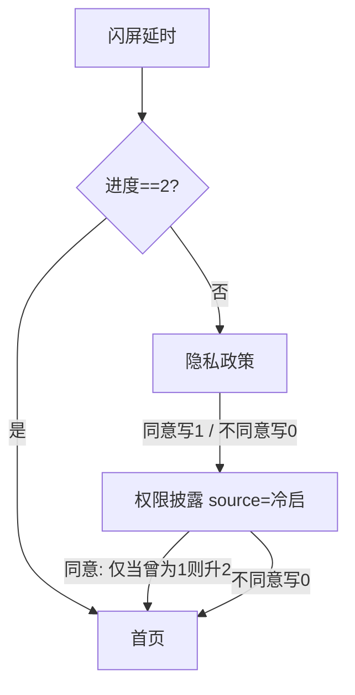
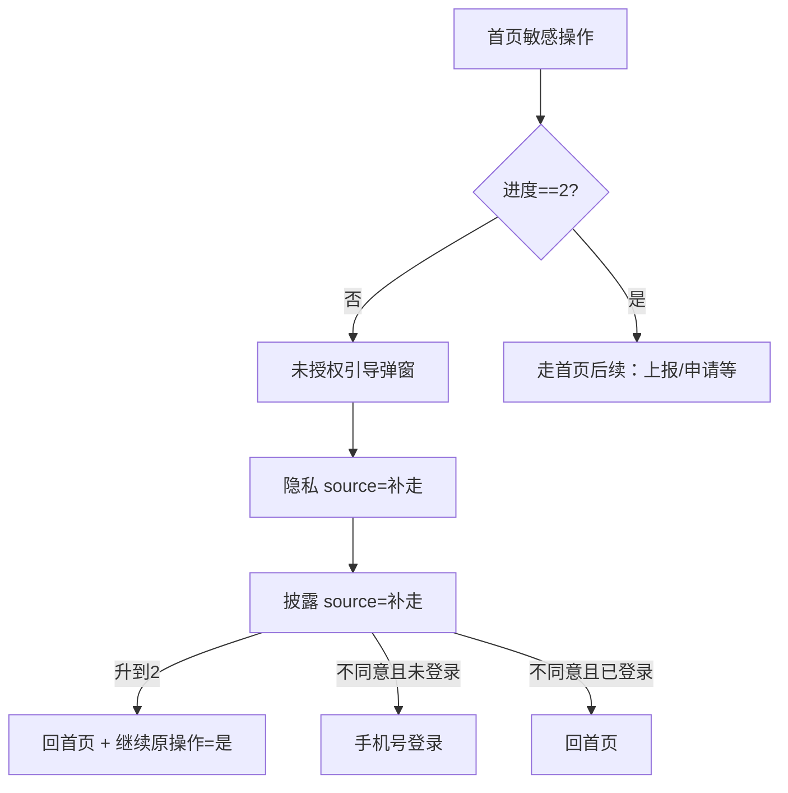

# 01 · 启动与权限（AR 完整版）

> 面向：Agent / 人工按本文**直接实现**（需求 + UE + 接口约定）。  
> **执行实现时以本文 + [`00-基础信息清单.md`](./00-基础信息清单.md) + [`AGENT实现约定.md`](./AGENT实现约定.md) 为准，不必再查阅外部工程源码。**  
> 后续登录见 [`02-登录注册.md`](./02-登录注册.md)；首页申请/上报与本文边界见 §8。  
> 全局约束：[`../../独立开发者账号-新App防关联工程清单.md`](../../独立开发者账号-新App防关联工程清单.md)。  
> UI：[`§12`](#12-ui-设计交付)。元素编号前缀 **`S-`**。符号按本工程风格自定，本文只用**职责名**。

---

## 写法约定

接口、字段、业务 vs 外观、实现用 UI：执行 [`AGENT实现约定.md`](./AGENT实现约定.md)。

本文字段只写 `o_xxx`；真实 wire 从 [`00`](./00-基础信息清单.md) §6 本包 API 映射（未指定前可注明 wire 待映射）。首页申请主流程见 [`03-首页.md`](./03-首页.md)，本文只定启动链与权限边界。

---

## 0. 范围

### 本模块包含

| 能力 | 说明 |
|------|------|
| 冷启动入口 | 启动页（闪屏）延时后按合规状态分流 |
| 隐私政策页 | H5/WebView 展示隐私；同意 / 不同意写入合规进度 |
| 权限披露页 | **文案说明**各权限用途（非系统弹窗）；同意 / 不同意 |
| 合规三态持久化 | `0` 未同意 / `1` 仅隐私同意 / `2` 隐私+披露均同意（完全同意） |
| 双入口 | 冷启动（source=冷启）vs 首页补走合规（source=补走） |
| 未完全同意可进首页 | 可浏览；敏感操作再拉合规（与首页协作） |
| 未授权引导弹窗约定 | 首页敏感入口且未完全同意时的拦截文案/按钮（可与首页共用组件） |

### 非本模块（边界写清，实现时勿塞进启动页）

| 能力 | 说明 |
|------|------|
| 登录注册页 | 见 [`02-登录注册.md`](./02-登录注册.md) |
| 首页场景 / 借款主按钮流程 | 见 [`03-首页.md`](./03-首页.md) |
| **系统运行时权限申请**（短信、粗定位等） | **不在**隐私/披露页申请；在首页「需上报」链路申请（§8） |
| 数据上报进度 / 上报接口业务 | 门禁在 03；采集见 [`风控上报共用.md`](./风控上报共用.md) |
| 相机等业务权限 | 活体 / 还款拍照等业务页申请 |
| 独立冷启动「检查版本」接口 | 本产品**不做**启动时单独 checkVersion；版本提示挂在首页信息（§8） |

---

## 1. 关键定论（实现必须遵守）

| # | 定论 |
|---|------|
| 1 | 冷启动顺序：**闪屏 →（未完全同意则）隐私页 → 权限披露页 → 首页**；已完全同意则闪屏后直达首页 |
| 2 | 闪屏**不**根据登录态分流登录页；合规结束后默认进**首页**（未登录也进首页） |
| 3 | **完全同意** = 合规进度 **`2`**（须先隐私同意到 `1`，再在披露页同意升到 `2`） |
| 4 | 隐私页点「不同意」→ 进度写 **`0`**，**仍进入**权限披露页 |
| 5 | 披露页点「不同意」→ 进度写 **`0`**；冷启入口下**仍进入首页** |
| 6 | 若隐私未同意（进度为 `0`）时在披露页点「同意」→ **不能**升到 `2`（下次冷启动仍走隐私） |
| 7 | 隐私页 / 披露页：**拦截系统返回**，无「返回上一页」退出该合规链 |
| 8 | **危险运行时权限不在本模块申请**；仅展示披露文案 |
| 9 | 闪屏展示时长：**约 1.5 秒**后再分流（可配置，默认 1500ms） |
| 10 | 应用初始化：`00` §8 **本包统一设备 id** 尚无则生成一次；风控上报只读 |

---

## 2. 功能概述

```
LAUNCHER → 应用初始化 → 根界面 → 闪屏（约 1.5s）
  ├─ 合规进度 == 2（完全同意）→ 首页（清闪屏）
  └─ 否则 → 隐私政策页（source=冷启）
              → 权限披露页（source=冷启）
              → 首页（同意或不同意均可进入，进度按 §3 写入）

首页（未完全同意）点敏感入口（如申请）
  → 未授权引导弹窗 → 确认后隐私页（source=补走）→ 披露页（source=补走）
  → 结束后回首页，并带上「是否继续原敏感操作」标记（§4）
```

---

## 3. 合规进度（本地持久化）

存储键名自定，但必须落在 [`00-基础信息清单.md`](./00-基础信息清单.md) §8「合规进度」槽，全工程共用，禁止另起一套。值为整数：

| 值 | 含义 | 是否完全同意 |
|----|------|--------------|
| `0` | 未同意，或任一步「不同意」导致重置 | 否 |
| `1` | 仅隐私页点了同意 | 否 |
| `2` | 隐私已为 `1` 且披露页再同意 → 升为 `2` | **是** |

| 用户操作 | 写入 |
|----------|------|
| 隐私页「同意 / 下一步」 | → `1` |
| 隐私页「不同意」 | → `0`（仍进披露页） |
| 披露页「同意」 | **仅当当前 == `1`** 时 → `2`；并允许开启「分析/采集类 SDK」。**本版无 Analytics/Firebase**；AppsFlyer 冷启即开，见 [`09-SDK与埋点.md`](./09-SDK与埋点.md)，不等待本条 |
| 披露页「不同意」 | → `0` |

首页 / 敏感入口判断「是否完全同意」**只认 `2`**。

---

## 4. 入口参数 `source`

| source（概念） | 来源 | 披露页结束后 |
|----------------|------|----------------|
| 冷启（如 `0`） | 闪屏后未完全同意 | 同意/不同意 → 均进**首页**（清掉隐私/披露栈） |
| 补走（如 `1`） | 首页敏感操作触发 | 同意且已到 `2`：回首页并写 **继续原操作=是**；不同意：已登录→回首页；未登录→进手机号登录页（见 02） |

**回传标记（概念名自定）：**

| 概念 | 含义 |
|------|------|
| 继续原敏感操作 | 补走合规返回首页后：`1`=继续申请链路；`0`=仅恢复首页；**读后清除** |

---

## 5. 页面与职责

| 职责 | 做什么 |
|------|--------|
| 应用入口 / 全局初始化 | 进程级初始化；生成设备 id；**本版**在此冷启 AppsFlyer init+start（09，入口跟壳）。Analytics/Firebase 后续版本再接到同意之后 |
| 根导航 | 启动目的地 = 闪屏 |
| 闪屏页 | 品牌展示；延时后按合规进度分流 |
| 隐私政策页 | WebView 加载隐私 H5；同意 / 不同意 |
| 权限披露页 | 多组「标题+说明」；同意 / 不同意 |
| 未授权引导弹窗 | 提示需先完成合规；确认→进隐私（补走） |

---

## 6. 分页面 UE

### 6.1 闪屏

| 项 | 说明 |
|----|------|
| 展示 | 品牌图/启动图（见 §12 UI；切图 3x） |
| 时长 | 默认 **1500ms**，到时再分流 |
| 分流 | 进度==`2` → 首页；否则 → 隐私页（source=冷启） |
| 登录 | **不**在此校验 token、**不**跳登录页 |
| 返回 | 一般无业务返回；按系统 |

### 6.2 隐私政策页

| 项 | 说明 |
|----|------|
| 内容 | WebView 加载 [`00-基础信息清单.md`](./00-基础信息清单.md) 中的隐私政策 URL（须先填好路径） |
| 主按钮 | 「下一步 / 同意」类文案（以 UI 稿为准）→ 写进度 `1` → 进披露页（同一 source） |
| 次按钮 | 「不同意」→ 写进度 `0` → **仍进**披露页 |
| 顶栏返回 | **无**；系统返回 **拦截**（不可退出本页） |
| 网络 | 仅加载 H5；无本模块业务 API |

### 6.3 权限披露页（文案页）

**不是**系统权限弹窗。按下列**展示顺序**列出说明（文案以 UI/产品西语为准）：

| 顺序 | 主题 | 说明要点（实现用文案资源，勿写死中文上架） |
|------|------|------------------------------------------|
| 1 | 短信 | 用于风控/核验等（产品定稿文案） |
| 2 | 紧急联系人 | 可手填或从通讯录选**单条**；**不**暗示读取全部通讯录 |
| 3 | 位置 | 粗定位相关说明 |
| 4 | 身份核验与反欺诈 | 自拍 / 证件等 |
| 5 | 相机 | 拍摄相关 |
| 6 | 已安装应用元数据 | 采集说明 |
| 7 | 设备信息 | 采集说明 |
| 8 | 普通网络状态 | 网络 / Wi‑Fi 状态等 |

| 操作 | 行为 |
|------|------|
| 同意 | 若当前进度==`1` → 写 `2` 并触发采集 SDK 可开启；再按 source 离开（§4） |
| 不同意 | 写 `0`；再按 source 离开（§4） |
| 系统返回 | **拦截** |

### 6.4 未授权引导弹窗

| 项 | 说明 |
|----|------|
| 时机 | 首页敏感入口且合规进度 ≠ `2` |
| 确认 | 打开隐私页（source=补走） |
| 关闭 | 不进入合规；不继续敏感操作 |

---

## 7. 业务流程

### 7.1 冷启动



### 7.2 首页补走合规



---

## 8. 与首页 / 运行时权限的协作边界

本模块**只做到**合规文案与进度 `2`。以下由**首页（或上报）模块**实现，本文约定接口与顺序，避免启动页误申请权限。

### 8.1 系统权限何时申请

**不在**闪屏 / 隐私 / 披露页申请。

首页主按钮典型顺序：

1. 已登录？（否则 → 02 登录）  
2. 合规进度 == `2`？（否则 → 未授权弹窗 → 本模块补走）  
3. 调「是否需要上报」`ori:/report/v1/whether/report`  
4. **不需要上报** → 直接后续业务（如 OCR 开关等），**不弹**系统权限  
5. **需要上报** → 「数据采集确认」弹层 → 用户确认后，**一次申请**：  
   - 短信读取  
   - 粗定位  
   - （Android 对应 `READ_SMS`、`ACCESS_COARSE_LOCATION`）  
   - **须全部授予**才算成功（只授一个 = 失败）  
6. 全开 → 上报进度 / `ori:/report/v1/record/report`  
7. 拒绝或永久拒绝（不区分第一次拒绝还是永久拒绝）→ 首页弹出 **权限拒绝说明弹层**（实现见 `03`）；关闭弹层则**中止**本次主按钮流程（无「跳过权限继续申请」）。弹层主按钮进本应用系统设置；从设置返回后再验两项是否全开。

本端权限清单至少声明（以实现为准）：网络；危险权限含短信读取、粗定位、相机（相机在业务页再申请）。Android 原生对应 Manifest。

### 8.2 版本更新（非冷启独立接口）

- 冷启动**不**单独调 checkVersion。  
- 已登录进首页拉首页信息时，用字段 `o_updateAppV1`：  
  - `1`：不弹  
  - `2`：强更（不可取消）  
  - `3`：弱更（可取消）  
- 更新按钮：打开商店或配置的更新页。

### 8.3 本模块相关 / 协作接口一览

| 用途 | ori | 调用方 | 关键字段 |
|------|-----|--------|----------|
| 隐私 H5 | （基础信息 URL，非 API） | 隐私页 | — |
| 是否需要上报 | `ori:/report/v1/whether/report` | 首页主按钮 | `o_isNeedReport`；`o_reportTimeOut`（秒） |
| 提交上报 | `ori:/report/v1/record/report` | 首页/上报 | 按本包（常为加密壳） |
| 首页基础信息 | `ori:/main/base/info` | 首页（已登录） | `o_updateAppV1` 等 |
| 用户资料 | `ori:/user/base/info` | 首页等 | 按本包 |
| OCR 开关 | `ori:/credit/ocr_switch` | 授信/主按钮路径 | `o_isNeedOcr` 等；**非冷启** |

---

## 9. 登录态与启动

| 情况 | 行为 |
|------|------|
| 本地有有效会话 | 合规结束后进首页；首页可拉已登录接口 |
| 无会话 | 合规结束后**仍进首页**（未登录态）；点「我的」或申请再进 02 |

Token 是否有效的判定规则与 02 / 会话模块一致（非空 token 等）。

---

## 10. 返回键汇总

| 页面 | 行为 |
|------|------|
| 隐私政策 | 拦截返回 |
| 权限披露 | 拦截返回 |
| 闪屏 | 无特殊业务返回 |
| 未授权弹窗 | 按弹层策略（不可误触关闭则禁止点窗外关闭） |

---

## 11. 测试矩阵

| # | 场景 | 预期 |
|---|------|------|
| 1 | 首次安装冷启动 | 闪屏 → 隐私 → 披露 → 首页 |
| 2 | 进度已为 2 冷启动 | 闪屏 → 直接首页 |
| 3 | 隐私不同意再披露同意 | 进度仍非 2；再次冷启动仍出隐私 |
| 4 | 隐私同意 + 披露同意 | 进度=2；下次冷启直达首页 |
| 5 | 披露不同意（冷启） | 进度=0；仍进首页 |
| 6 | 隐私/披露按返回键 | 无退出 |
| 7 | 未登录走完合规 | 进首页未登录态，不强制登录页 |
| 8 | 首页敏感入口未合规 | 未授权弹窗 → 补走隐私/披露 |
| 9 | 补走拒绝且未登录 | 进手机号登录 |
| 10 | 闪屏/披露页 | **不出现**系统短信/定位权限框 |

---

## 12. UI 设计交付

### 12.1 默认布局

| 规则 | 默认 |
|------|------|
| 顶栏 | 固定不滑（有顶栏时）；隐私/披露若稿面无返回则勿加返回 |
| 内容 | 可滑（披露列表等） |
| 底栏双按钮 | 吸底（有底栏时） |
| 切图 | Figma 可导出则 3x PNG |
| 共用/特殊 | 空则省略 |

### 12.2 Agent 执行前检查

1. 链接表为空时：按 [`UI链接扫描规则.md`](./UI链接扫描规则.md) 先要 **本包实现用** Figma 项目链接，扫描对照并确认后再填、再写 UI。梳理阶段对照过的稿不算实现稿。  
2. 确认画板后按 [`AGENT实现约定.md`](./AGENT实现约定.md) 补 §12.4 元素对照、§12.5 视觉变量，再写布局。  
3. [`00-基础信息清单.md`](./00-基础信息清单.md) 隐私/协议 H5 路径是否已填？未填则隐私 WebView 不可瞎写域名。

### 12.3 链接登记表

```text
### 闪屏
- UI：<Figma 链接>
- 例外：
- 共用：
- 特殊：
```

| 页面 | UI 链接 | 例外 | 共用 | 特殊 | 状态 |
|------|---------|------|------|------|------|
| 闪屏 | | | | | 未提供 |
| 隐私政策页 | | | | | 未提供 |
| 权限披露页 | | | | | 未提供 |
| 未授权引导弹窗 | | | | | 未提供 |
| （协作）数据采集确认弹层 | | | | | 未提供 / 可放首页文档 |
| （协作）权限拒绝说明弹层 | | | | | 未提供 / 见首页；文档阶段不填链接 |

### 12.4 元素对照表

实现确认画板后按 [`AGENT实现约定.md`](./AGENT实现约定.md) §6 / §9 回填。前缀 `S-`。文档阶段留空。

| 元素编号 | 文档位置 | 功能与定位 | 当前稿文案（快照） | node-id | 最终文案 |
|---|---|---|---|---|---|
| （确认稿后补：闪屏、隐私同意/不同意、披露同意/不同意、未授权弹窗主按钮等） | | | | | |

### 12.5 视觉变量表

颜色、字重、按钮主次样式从确认稿取样。文档阶段留空。

| 变量编号 | 文档位置 | 绑在什么业务上 | 在画板上取什么 | 最终样式 |
|---|---|---|---|---|
| （确认稿后补） | | | | |

---

## 13. 实现前检查清单

- [ ] [`00-基础信息清单.md`](./00-基础信息清单.md) 就绪（隐私 URL、品牌闪屏资源）  
- [ ] 合规三态与 §1 定论一致  
- [ ] 启动链**不申请**危险运行时权限  
- [ ] source 冷启 / 补走与回传标记打通首页  
- [ ] §12 UI 链接已补或明确无稿按默认壳  
- [ ] §12.4 / §12.5 已按确认稿回填（无稿则标无稿按默认）  
- [ ] 写代码前 `00` §6 本包 API 路径已填（涉及协作接口时）  

---

## 变更记录

| 日期 | 说明 |
|------|------|
| 2026-09-11 | 初稿：AR Agent 自洽「启动到权限」；系统权限与上报划归首页协作 |
| 2026-09-14 | 改挂全模块 [`AGENT实现约定.md`](./AGENT实现约定.md)；预留元素表与视觉变量表 |
| 2026-09-15 | 冷启生成 `00` 本包统一设备 id |
| 2026-09-15 | 协作拒绝引导改称权限拒绝说明弹层，实现归 03；不填 UI 链接 |
| 2026-09-16 | 冷启初始化对接 09 AppsFlyer；Analytics/Firebase 仍等同意后的后续版本 |
| 2026-09-17 | 进程入口/权限清单改为跟壳；AF 冷启见 09 |
| 2026-09-18 | 字段改为只写 `o_xxx`；去掉「待映射」字段包装写法 |
