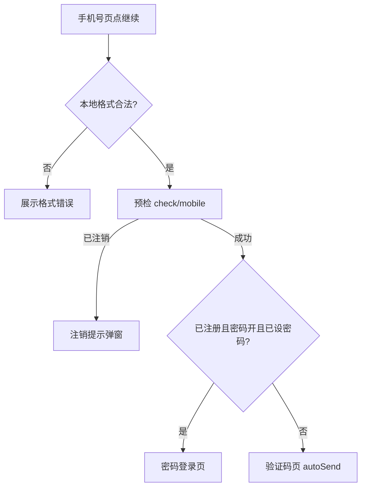

# 02 · 登录注册（AR 完整版）

> 面向：Agent / 人工按本文**直接实现**（需求 + UE + 接口约定）。  
> **执行实现时以本文 + [`00-基础信息清单.md`](./00-基础信息清单.md) + [`AGENT实现约定.md`](./AGENT实现约定.md) 为准，不必再查阅外部工程源码。**  
> 全局约束：[`../../独立开发者账号-新App防关联工程清单.md`](../../独立开发者账号-新App防关联工程清单.md)。  
> UI：[`§13`](#13-ui-设计交付)；默认布局见 [`§13.1`](#131-全局默认布局规则无需每页重复)。元素编号前缀 **`A-`**。  
> **特殊错误**（手机号格式、两次密码不一致等）定义与 UI 清单：[`特殊错误-UI定义.md`](./特殊错误-UI定义.md)。  
> 类名、路由名、包路径、存储 key 等符号：按本工程既有风格自定，本文只用**职责名**。

---

## 写法约定

接口、字段、业务 vs 外观、实现用 UI：执行 [`AGENT实现约定.md`](./AGENT实现约定.md)。

本文字段与响应壳**只写 `o_xxx` 语义名**（如 `o_code`、`o_msg`、`o_mobile`）；**禁止**写入对照工程混淆字段。实现时从 [`00`](./00-基础信息清单.md) §6 本包 API 映射真实 wire。业务码以 `o_` 语义分支为准，字面量见本包附录。

---

## 0. 范围

### 本模块包含

| 能力 | 说明 |
|------|------|
| 手机号入口 | 区号展示 + 本地号输入与校验 |
| 是否注册预检 | 决定登录 / 注册、是否走密码页、渠道开关 |
| OTP 登录 / 注册 | 自动发码、重发、倒计时、失败清码 |
| 验证码多渠道 | 短信 / WhatsApp / 语音（开关由预检下发） |
| 图形验证码 | 发码前检测；特定失败码再弹 |
| 密码登录 | 已注册 ∧ 密码功能开 ∧ 已设密码 → 密码页 |
| OTP 后设登录密码 | 密码功能开时，验 OTP 后再进设密页 |
| 忘记密码 / 重置登录密码 | 密码登录页入口；OTP + 设新密码 |
| 换设备验证 | 全局业务码 → 弹层发码验码 → 成功刷新 |
| 登录成功落库 | token / userId / mobile → 进首页并清认证栈 |
| 注销账号提示 | 预检「已注销」→ 弹层，不继续 |
| Token 失效回登录 | 全局拦截后清会话 → 手机号页 |

### 非本模块

| 能力 | 说明 |
|------|------|
| 账号注销申请 | [`08-我的.md`](./08-我的.md)；登录预检已注销弹层仍在本文 |
| 交易密码设置 / 重置 | 账户安全，非登录主路径 |

---

## 1. 关键 UE 定论（实现必须遵守）

市场常量见 [`00-基础信息清单.md`](./00-基础信息清单.md)。本模块交互定论：

| 项 | 定论 |
|----|------|
| OTP 校验失败，或登录/注册失败（OTP 链路） | **一律清空** OTP；若为「需图形码」业务码则同时弹图形码 |
| 设密页返回验证码页 | 离开设密须清敏感态 → **OTP 需重输** |
| 密码登录页返回 | **单层返回**手机号页；清密码等，**保留手机号** |
| 重置登录密码页 | **无** SMS/WA/语音渠道选择，只走默认渠道发码 |
| `o_loginPwd=true` | OTP 满后 **先验码 → 设密 → 再登录/注册**（含未注册） |
| 图形码成功且重发倒计时未结束 | **不补发** OTP，只关弹层 |
| 已注销提示后 | **不跳转**；留在手机号页，可改号再预检 |
| 换设备弹层关闭且未验证 | **清登录态 → 回手机号页** |

变更须改本文对应条款后才能改代码。

---

## 2. 功能概述与主流程

1. 本地校验手机号（[`00-基础信息清单.md`](./00-基础信息清单.md)）。  
2. 预检：写入是否已注册、登录密码开关、是否已设密码、WhatsApp/语音开关、默认渠道、渠道 Toast。  
3. 分支：已注册 ∧ 密码开 ∧ 已设密码 → **密码登录页**；否则 → **验证码页**。  
4. 验证码页首次自动发码；OTP 满后按是否开密码决定直接登录/注册或先验码再设密。  
5. 成功：落会话 → 首页，**清空整段认证栈**（含手机号页）。

```
手机号页
  └─ 预检 ori:/user/check/mobile
        ├─ 已注销码 → 提示弹窗（不跳转）
        ├─ 已注册 + 密码开 + 已设密码 → 密码登录页 → 登录成功 → 主页
        └─ 其它 → 验证码页
              ├─ 密码功能开 → 验 OTP → 设密码页 → 登录/注册 → 主页
              └─ 密码功能关 → 直接登录(type=登录) / 注册(type=注册) → 主页
```



---

## 3. 页面与职责

实现时类名自定；下表为**职责**。

| 职责 | 做什么 |
|------|--------|
| 认证导航子图 | 共享认证状态；入口为手机号页 |
| 手机号页 | 输入、校验、预检、分支导航 |
| 验证码页 | 自动发码、重发、渠道、OTP、清码 |
| 密码登录页 | 密码登录；忘记密码入口；返回 |
| 设登录密码页 | 两次密码一致后登录或注册 |
| 重置登录密码页 | type=重置；OTP + 新密码 |
| 图形验证码弹层 | 展示 / 刷新 / 校验 |
| 发码渠道弹层 | SMS / WhatsApp / 语音 |
| 已注销提示弹层 | 不可继续登录 |
| 换设备弹层 | type=换设备；验码后刷新当前业务 |

**状态共享**：认证子图内共用一份认证状态；回手机号或离开子图时清理敏感字段（可保留手机号）。

---

## 4. 认证状态（概念字段）

| 概念名 | 类型 | 来源 | 用途 |
|--------|------|------|------|
| phone | String | 输入 | 展示与加密上送 |
| phoneError | String | 校验 | 错误文案 |
| otpCode | String | 输入 | 登录/注册/验码 |
| captchaCode | String | 输入 | 图形码 |
| password / passwordConfirm | String | 输入 | 密码登录 / 设密 |
| smsBizType | Int/String | 预检 | 见 §5 |
| loginPwdFeatureOn | Boolean | 预检 `o_loginPwd` | 是否 OTP 后设密 |
| existLoginPwd | Boolean | 预检 `o_existLoginPwd` | 是否进密码登录页 |
| isRegistered | Boolean | 预检 `o_isRegistered` | 分支与 type |
| whatsappSwitch / voiceSwitch | Boolean | 预检 | 重发是否弹渠道 |
| channelType | Int | 预检默认 + 用户选 | 0 短信 / 1 WA / 2 语音 |
| whatsappToast / voiceToast | String | 预检 | 渠道发送成功提示 |
| autoSendOtpOnEnter | Boolean | 进 OTP 前 | 首次自动发码 |
| showCaptchaSheet | Boolean | 流程 | 图形码显隐 |
| countdownActive | Boolean | 本地 | 重发是否可点 |

手机号、密码上送前 **RSA 加密**；OTP、图形码按后端约定（通常明文）。

---

## 5. 业务类型 `type` / smsBizType

| 值 | 含义 | 本模块用途 |
|----|------|------------|
| 1 | 注册 | 未注册：发码、验码、注册 |
| 7 | 登录 | 已注册：发码、验码、登录 |
| 2 | 重置登录密码 | 忘记密码页 |
| 5 | 换设备 | 换设备弹层 |
| 其它 | — | 非本模块主路径 |

预检成功：`o_isRegistered == true` → 登录(7)；否则 → 注册(1)。

---

## 6. 后端接口（客户端实际字段）

> 下表 = **客户端实际会序列化上送 / 反序列化使用的字段**（含 data class 默认值会带上的字段）。  
> API 文档里多出来、但客户端模型未声明或调用未赋值的字段，**本模块不要猜着加**。  
> 新产品实现：字段集合与「是否上送/是否读取」对齐本表；正文只写 `o_xxx`，真实 wire 名从本包 API 映射。

### 6.0 全局响应壳

所有业务接口共用：

| 含义 | 字段 | 必有 | 客户端用法 |
|------|------|------|------------|
| 业务码 | `o_code` | 是 | 判成功 / 分支 |
| 提示文案 | `o_msg` | 是 | Toast 等 |
| 业务数据 | `data` | 视接口 | 见各节 |

| 含义 | o_ 语义 | 客户端行为 |
|------|---------|------------|
| 成功 | `o_0000` | `isSuccess` |
| 需图形码 | `o_T1019` | 弹图形码；配合清 OTP 见 §7.2；该码不 Toast |
| 换设备 | `o_T1021` | 换设备弹层；不 Toast |
| 账号已注销 | （附录成功/失败码表中的「已注销」语义；无统一 `o_` 时按本包附录码处理） | 注销提示，不跳转 |
| Token 失效 | `o_Z1003` | 清会话回手机号页 |

本包错误码**字面量**以附录为准，正文不写对照工程混淆码；**必须保留上述语义分支**。

---

### 6.1 检查手机号注册状态

- **ori:** `/user/check/mobile`  
- **方法:** POST  
- **时机:** 手机号页点继续且本地格式合法  

**请求（实际构造）**

| 字段 | 类型 | 必送 | 赋值 |
|------|------|------|------|
| `o_mobile` | string | 是 | RSA 加密后的本地手机号 |
| `type` | number | **否** | 预检调用**不传** `type`（模型允许 null，不序列化或为 null） |

**响应 `data`（模型声明；登录分流实际读取打 ✓）**

| 字段 | 类型 | 读取 | 用途 |
|------|------|------|------|
| `o_isRegistered` | boolean | ✓ | true→登录 type=7；false→注册 type=1 |
| `o_loginPwd` | boolean | ✓ | 是否走「OTP 后设密」 |
| `o_existLoginPwd` | boolean | ✓ | 与上两项决定进密码页 |
| `o_ycloudSwitch` | boolean | ✓ | WhatsApp 开关 → 重发是否弹渠道 |
| `o_dtype` | number | ✓ | 默认发码渠道 0/1/2 |
| `o_messageToast` | string | ✓ | WhatsApp 发码成功 Toast |
| `o_voiceSwitch` | boolean | ✓ | 语音开关 |
| `o_voiceMessageToast` | string | ✓ | 语音发码成功 Toast |
| `o_traderPwd` | boolean | 解析有，**本模块分流未用** | 交易密码开关；登录注册主路径可忽略 |

**UE**

| 结果 | 行为 |
|------|------|
| `o_code`=账号已注销（字面量见本包附录） | 弹注销提示；**不导航**；可改号再预检 |
| 成功且 已注册∧loginPwd∧existLoginPwd | → 密码登录页；进密码页后不得误触发自动发码 |
| 成功且其它 | → 验证码页，且 **autoSendOtpOnEnter = true** |
| 其它失败 | Toast `o_msg`；留在手机号页 |

---

### 6.2 是否需要图形验证码

- **ori:** `/user/is/need/check/image`  
- **方法:** POST  
- **时机:** 每次准备发 OTP 前  

**请求（实际构造）**

| 字段 | 类型 | 必送 | 赋值 |
|------|------|------|------|
| `o_mobile` | string | 是 | RSA 手机号 |
| `type` | number | 是 | 当前 `smsBizType`（1/7/2/5…） |

**响应**

| 字段 | 类型 | 用法 |
|------|------|------|
| 壳：`o_code` / `o_msg` | | 同 §6.0 |
| `data` | **boolean** | `true`→弹图形码；`false`→直接发 OTP |

---

### 6.3 发送 OTP

- **ori:** `/sms/code/send`  
- **方法:** POST  

**请求（实际构造 + 模型默认会带上的字段）**

| 字段 | 类型 | 必送 | 赋值 |
|------|------|------|------|
| `o_mobile` | string | 是 | RSA 手机号 |
| `type` | number | 是 | `smsBizType` |
| `o_dtype` | number | 是 | 当前渠道 0/1/2 |
| `o_msgType` | string | 是（默认） | 固定 **`"0"`**（模型默认，调用未改） |

**响应**

| 字段 | 用法 |
|------|------|
| 壳码/文案 | 成功→倒计时 60s + 渠道 Toast（见 UE）；失败 Toast；**不清 OTP** |
| `data` | 客户端按 `Any`/空，**不读业务字段** |

---

### 6.4 生成图形验证码图片

- **ori:** `/user/generate/verify/picture/{mobileSn}`  
- **方法:** GET  
- **path 参数：** 设备号字符串（客户端默认 `appDeviceId()`），对应 `o_mobileSn`  

**请求 Body：** 无  

**响应：** **图片二进制流**（非 JSON）；解码为 Bitmap 展示。失败则展示加载失败态并可重试刷新。

---

### 6.5 图形验证码校验

- **ori:** `/sms/image/code/verify`  
- **方法:** POST  

**请求（实际构造）**

| 字段 | 类型 | 必送 | 赋值 |
|------|------|------|------|
| `o_mobile` | string | 是 | RSA 手机号 |
| `type` | number | 是 | `smsBizType` |
| `o_mobileSn` | string | 是 | 设备号（模型默认 deviceId） |
| `o_imageCode` | string | 是 | 用户输入的图形码 |

**响应**

| 字段 | 用法 |
|------|------|
| 壳码/文案 | 成功→关弹层，若倒计时未跑则再调发码；失败→清图形码输入、刷图，**不清 OTP** |
| `data` | 不读 |

---

### 6.6 校验短信（及可选图形码）

- **ori:** `/sms/code/verify`  
- **方法:** POST  
- **时机:** `o_loginPwd==true` 且 OTP 输满；换设备弹层验码  

**请求（实际构造）**

| 字段 | 类型 | 必送 | 赋值 |
|------|------|------|------|
| `o_mobile` | string | 是 | RSA 手机号 |
| `type` | number | 是 | `smsBizType` |
| `o_verCode` | string | 是 | 短信 OTP |
| `o_verImageCode` | string | 否 | 有图形码会话则带；否则 null/不传有效值 |
| `o_mobileSn` | string | 是 | 设备号（默认） |
| `o_userId` | string | 否 | 已登录则带 userGid；空则 null |

**响应**

| 字段 | 用法 |
|------|------|
| 壳码/文案 | 成功→进设密或换设备成功回调；失败→**清 OTP** + 可能弹图形码 |
| `data` | 不读 |

---

### 6.7 登录

- **ori:** `/user/login`  
- **方法:** POST  

**请求（实际构造 + 默认会带上的字段）**

| 字段 | 类型 | 场景 | 赋值 |
|------|------|------|------|
| `o_mobile` | string | 必送 | RSA 手机号 |
| `password` | string | 密码页必填有效值；OTP 登录也会传入（可能为空串，经 RSA） | RSA 后的密码 |
| `o_verCode` | string | OTP/设密链路带；纯密码页可为空 | OTP |
| `o_verImageCode` | string | 有则带 | 图形码 |
| `o_mobileSn` | string | 默认带 | 设备号 |
| `o_appVersion` | string | 默认带 | App `VERSION_NAME` |
| `o_token` | string | **调用未传**（保持 null） | — |
| `o_userId` | string | **调用未传** | — |
| `oc` | number | **调用未传** | — |

**响应 `data`（`AuthLoginResp`）**

| 字段 | 类型 | 落库/使用 |
|------|------|-----------|
| `o_token` | string | ✓ 写入会话 |
| `o_userId` | string | ✓ 写入会话 |
| `o_mobile` | string | ✓ 写入会话手机号 |
| `name` | string | 模型有，**当前落库未用** |
| `o_registerTime` | string | 模型有，**当前落库未用** |

**UE：** 失败清 OTP（OTP 链路）；需图形码则弹层；成功 → §10。

---

### 6.8 注册

- **ori:** `/user/register`  
- **方法:** POST  
- **响应 `data`：** 与登录相同结构（`AuthLoginResp`），落库字段同 §6.7。  

**请求（实际构造 + 默认会带上的字段）**

| 字段 | 类型 | 必送 | 赋值 |
|------|------|------|------|
| `o_mobile` | string | 是 | RSA 手机号 |
| `password` | string | 视开关；设密后带 RSA 密码；密码关时可能为空 | RSA |
| `o_verCode` | string | 是 | OTP |
| `o_verImageCode` | string | 否 | 图形码 |
| `o_mobileSn` | string | 默认带 | 设备号 |
| `o_reqChannel` | string | 默认带 | 固定 **`"2"`**（Android） |
| `o_appsflyerId` | string | 默认带 | AppsFlyer Id（工具方法） |
| `o_reqSubChannelAf` | string | 默认 null | 调用未赋值 |
| `o_lastAaid` | string | 默认 null | 调用未赋值 |

---

### 6.9 重置登录密码

- **ori:** `/user/login/password/reset`  
- **方法:** POST  

**请求（实际构造）**

| 字段 | 类型 | 必送 | 赋值 |
|------|------|------|------|
| `o_mobile` | string | 是 | RSA 手机号 |
| `password` | string | 是 | RSA 新密码 |
| `o_verCode` | string | 是 | OTP |
| `o_verImageCode` | string | 否 | 图形码（有则带） |
| `o_mobileSn` | string | 默认带 | 设备号 |

**响应**

| 字段 | 用法 |
|------|------|
| 壳码/文案 | 成功→成功提示→回密码登录页（不自动登录） |
| `data` | 不读 |

---

## 7. 分页面 UE

### 7.1 手机号页

| 项 | 说明 |
|----|------|
| 输入 | 本地号；展示 `+{区号}`；maxLength 见基础信息。**展示分组 2-4-4**（见 [`00`](./00-基础信息清单.md) §2.1）；逻辑值连续 10 位 |
| 继续 | 至少非空可点；严格格式在点击时校验 |
| 格式失败 | 页内错误文案（特殊错误，见 [`特殊错误-UI定义.md`](./特殊错误-UI定义.md) §4.1），**不请求**预检 |
| 预检 | §6.1 |
| 返回 | 若为登录根页：按产品（退出 / 回启动） |

### 7.2 验证码页

#### 进入

- `autoSendOtpOnEnter == true`：立刻置 false，走「需图形码？→ 发码」。  
- 手机号展示按稿面（脱敏或完整）。

#### 重发

```
点击重发
  ├─ whatsappSwitch ∨ voiceSwitch → 弹出渠道选择
  │     └─ 用户选择 channelType → 需图形码？→ 发码
  └─ 两开关都关 → channelType=0（短信）→ 需图形码？→ 发码
```

- 倒计时中：重发不可点。  
- **重发 / 切换渠道：不清空 OTP**。

#### 输满 OTP

| `o_loginPwd` | 行为 |
|--------------|------|
| true | `ori:/sms/code/verify`；成功 → 设密页；失败 → **清 OTP**（+ 可能弹图） |
| false 且 type=登录 | `ori:/user/login`（带 OTP） |
| false 且 type=注册 | `ori:/user/register`（带 OTP） |

#### 清空 OTP

| 场景 | 清 OTP |
|------|--------|
| 校验短信失败（含需图形码） | **是** |
| 登录/注册失败（OTP 链路） | **是** |
| 发码前需图形码而弹层 | **是** |
| 关闭图形码弹层（未失败） | **否** |
| 图形码校验失败 | **否**（只清图形码输入） |
| 重发 / 切换渠道 | **否** |
| 本页返回手机号 | **是**（清敏感态，保留手机号） |

#### 返回

顶栏 / 系统返回：清 OTP/密码/图形码/autoSend 等，**保留手机号**，回手机号页。

### 7.3 密码登录页

| 项 | 说明 |
|----|------|
| 进入 | 已注册 ∧ `o_loginPwd` ∧ `o_existLoginPwd` |
| 登录 | 密码位数满足 → `ori:/user/login` |
| 忘记密码 | → 重置页（带入手机号；type=2） |
| 返回 | 单层回手机号；清密码等，保留手机号 |
| 需图形码 | 弹层后按约定重试 |

### 7.4 设登录密码页

| 项 | 说明 |
|----|------|
| 进入 | 密码功能开且 OTP 校验成功 |
| 提交 | 两格位数够且一致 → 按 type 登录或注册 |
| 不一致 | 特殊错误提示（见 [`特殊错误-UI定义.md`](./特殊错误-UI定义.md) §4.2），不提交 |
| 返回 | 回验证码页；**清空 OTP，需重输** |

### 7.5 重置登录密码页

| 项 | 说明 |
|----|------|
| 进入 | 自动「需图形码？→ 发码」（type=2） |
| 多渠道 | **无**渠道弹层；默认渠道发码 |
| 提交 | OTP + 两次新密码一致 → `ori:/user/login/password/reset` |
| 成功 | 提示 → 回密码登录页 |
| 返回 | 回密码登录页 |

### 7.6 换设备弹层

| 项 | 说明 |
|----|------|
| 触发 | 全局「换设备」业务码 |
| 行为 | type=5；自动发码；OTP 满 → `ori:/sms/code/verify`；成功关层并刷新原业务 |
| 关闭未验证 | 清登录态 → 手机号页 |

---

## 8. 图形验证码（汇总）

**触发**

1. 发码前 `ori:/user/is/need/check/image` 为 true。  
2. 业务失败码为「需图形码」。

弹层：展示、刷新、校验；失败清图形码输入并刷图。与 OTP 关系见 §7.2。

---

## 9. 多渠道发码矩阵

| whatsappSwitch | voiceSwitch | 重发行为 |
|----------------|-------------|----------|
| 关 | 关 | 不弹框，短信（0）直接发 |
| 开 | 任意 | 弹渠道框（SMS + 已开渠道） |
| 任意 | 开 | 同上 |

默认渠道：预检 `o_dtype`；用户选择后覆盖。

---

## 10. 成功与会话

1. 持久化 `o_token`、`o_userId`、mobile 到 [`00`](./00-基础信息清单.md) §8 会话三槽（已有则复用，禁止平行 key）。  
2. 进首页。  
3. **弹出整段认证栈**（含手机号）。  
4. Token 失效：清会话 → 手机号页。

---

## 11. 推荐职责拆分（本工程自定符号）

```
市场常量 → 会话仓库 → 认证 API
  → 认证状态
  → 预检（返回下一步：密码页 / OTP 页 / 已注销）
  → OTP（需图? → 发码 → 倒计时）
  → 完成 OTP（验码 / 登录 / 注册）
  → 密码登录 / 设密 / 重置
  → 换设备 / 图形码 / 渠道 独立 UI
```

---

## 12. 测试矩阵

| # | 场景 | 预期 |
|---|------|------|
| 1 | 非法手机号 | 错误文案，不预检 |
| 2 | 未注册 | OTP 页，type=注册，自动发码 |
| 3 | 已注册未设密码 | OTP 页，type=登录 |
| 4 | 已注册+密码开+已设 | 密码页 |
| 5 | 密码开 + OTP 满 | 先验码 → 设密 → 登录/注册 |
| 6 | 密码关 + OTP 满 | 直接登录/注册 |
| 7 | OTP 校验失败 | **清空 OTP** |
| 8 | 登录失败（OTP 链路） | **清空 OTP**；可能弹图形码 |
| 9 | 重发双渠道关 | 不弹框，短信 |
| 10 | 重发有 WA/语音 | 弹渠道框 |
| 11 | 发码前需图 | 先图后码 |
| 12 | 密码页返回 | 回手机号，保留手机号 |
| 13 | 设密页返回 | 回 OTP 且 **清空 OTP** |
| 14 | 已注销码 | 弹窗不跳转，可改号 |
| 15 | 登录成功 | 有 token；进首页；不可返回 OTP 栈 |
| 16 | 忘记密码成功 | 回密码登录，可用新密码 |
| 17 | 换设备 | 成功关层刷新；关闭未验证回登录 |

---

## 13. UI 设计交付

### 13.1 全局默认布局（无需每页重复）

| 规则 | 默认 |
|------|------|
| 顶栏 / 标题栏 | **固定不滑** |
| 主内容 | **可滑** |
| 底栏主按钮 | **吸底**（有底栏时） |
| 切图 | Figma 可导出则 **自动下 3x PNG** |
| 共用 / 特殊 | **空则省略** |

仅当某页违反默认时写 **例外 / 共用 / 特殊**。

### 13.2 Agent 执行前检查

空表或未提供时：按 [`UI链接扫描规则.md`](./UI链接扫描规则.md) **先要本包实现用 Figma 项目链接 → 扫描对照 → 使用者确认后再填表**。梳理对照稿不算实现稿。禁止猜布局。确认后按 [`AGENT实现约定.md`](./AGENT实现约定.md) 填 §13.4 / §13.5 再写 UI。

### 13.3 链接登记表

文档阶段默认留空。实现阶段填入经确认的画板链接。

| 页面 | 匹配关键词（含） | 排除（名中含则跳过） | UI 链接 | 例外 | 共用 | 特殊 | 状态 |
|------|------------------|----------------------|---------|------|------|------|------|
| 手机号输入 | 手机号；且非「验证码」主名 | 不用、废弃、交易密码 | | | | | 未提供 |
| 验证码 | 验证码；且非「图形」单独弹层 | 交易密码、删除账号、注销- 安全 | | | | | 未提供 |
| 密码登录 | 登录密码 | 交易密码、设置密码、重置 | | | | | 未提供 |
| 设登录密码 | 设置密码、注册 设置密码 | 交易密码、重置登录 | | | | | 未提供 |
| 重置登录密码 | 重置登录密码 | 交易密码 | | | | | 未提供 |
| 图形验证码弹层 | 图形验证码 | 组件盘 | | | | | 未提供 |
| 发码渠道弹层 | 收取验证码方式、选择.*验证码方式 | | | | | | 未提供 |
| 已注销提示弹层 | 注销的账号、被删除提醒 | | | | | | 未提供 |
| 手机号页退出挽留 | 退出输入手机号、挽留 | 授信-挽留 | | | | | 未提供 |
| 换设备弹层 | 更换设备验证 | 不用 | | | | | 未提供 |

### 13.4 元素对照表

实现确认画板后按 [`AGENT实现约定.md`](./AGENT实现约定.md) §6 / §9 回填。前缀 `A-`。文档阶段留空。

| 元素编号 | 文档位置 | 功能与定位 | 当前稿文案（快照） | node-id | 最终文案 |
|---|---|---|---|---|---|
| （确认稿后补：手机号下一步、发码、渠道项、图形码确认、密码登录、设密提交等） | | | | | |

### 13.5 视觉变量表

颜色、字重、错误态、按钮主次从确认稿取样。文档阶段留空。

| 变量编号 | 文档位置 | 绑在什么业务上 | 在画板上取什么 | 最终样式 |
|---|---|---|---|---|
| （确认稿后补） | | | | |

---

## 14. 实现前检查清单

- [ ] [`00-基础信息清单.md`](./00-基础信息清单.md) 已就绪（含 §6 本包 API 路径，写代码前）  
- [ ] §1 / §7 UE 定论按本文实现  
- [ ] §13 UI 链接已按扫描规则确认填入，或明确「无稿按默认壳」  
- [ ] §13.4 / §13.5 已按确认稿回填（无稿则标无稿按默认）  
- [ ] 多渠道 + 图形码 + 设密 + 重置 + 换设备均在范围中  

---

## 变更记录

| 日期 | 说明 |
|------|------|
| 2026-09-11 | 初稿 |
| 2026-09-11 | §6 改为客户端**实际**请求/响应字段表（含默认上送与落库字段） |
| 2026-09-12 | §13.3 改回空表；实现时走 UI 链接扫描规则（项目链接→确认后填入） |
| 2026-09-14 | 改挂全模块 [`AGENT实现约定.md`](./AGENT实现约定.md)；预留元素表与视觉变量表 |
| 2026-09-18 | §6 字段改为只写 `o_xxx`；去掉对照工程混淆字段与混淆业务码字面量 |
| 2026-09-24 | §7.1：手机号展示分组引用 `00` **2-4-4** |
